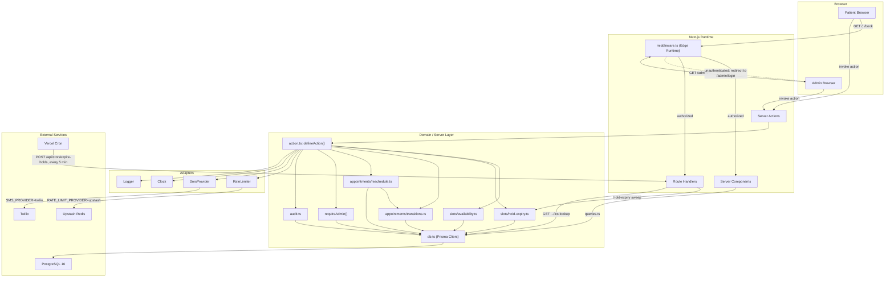
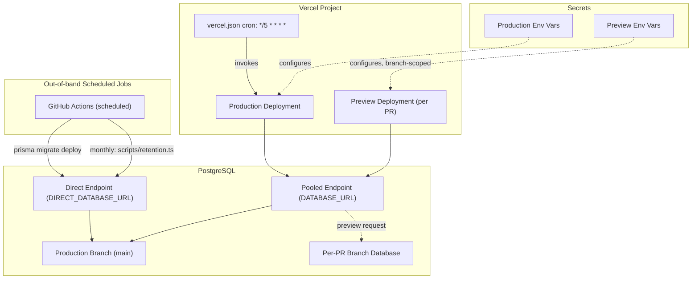

## 2. Architecture Overview

### 2.1 System Component Diagram

Solid arrows are synchronous calls (in-process or network); the dashed arrow is an HTTP redirect.



`ActionWrapper` is the chokepoint every Server Action passes through (Zod parse, rate limit, auth, handler, error mapping — C12). Route Handlers skip it (C13 scopes it to Server Actions) and carry their own guard instead: `Bearer CRON_SECRET` for the cron route, rate limiting only for `.ics`/`health`.

### 2.2 Layers and Dependency Rule

Four layers, one-directional: `app -> features -> server -> lib`. `components/ui` and `components/` sit beside `lib` as a second leaf, importable from `app`/`features`, importing nothing above themselves.

- `app/` — route segments only (`page.tsx`, `layout.tsx`, `loading.tsx`, `error.tsx`, `route.ts`); renders feature components, no business logic.
- `features/<feature>/` — `components/`, `actions.ts`, `schemas.ts`, `queries.ts`, `types.ts`, `hooks/` per feature (`landing`, `booking`, `otp`, `admin-auth`, `dashboard`, `appointments`, `patients`, `services`, `settings`, C17).
- `server/` — `db.ts`, `action.ts`, auth guards, `slots/` (`availability.ts`, `hold-expiry.ts`), `appointments/` (`transitions.ts`, `reschedule.ts`), `sms/`, `ratelimit/`, `audit.ts`; domain logic and the Prisma client, feature-agnostic.
- `lib/` — `env.ts`, `money.ts`, `dates.ts`, `phone.ts`, `ics.ts`, `enums.ts`, `errors.ts`, `utils.ts`, `clock.ts`; pure, feature-agnostic primitives.

A file imports only from its own layer or one strictly below. Keeps `server/` reusable across features, `lib/` trivially unit-testable. Enforced via ESLint path-boundary rule `import/no-restricted-paths` (directory-scoped, unlike core `no-restricted-imports`), one zone per forbidden upward edge:

```ts
// .eslintrc.cjs (excerpt)
rules: {
  "import/no-restricted-paths": ["error", {
    zones: [
      { target: "./src/lib/**",        from: ["./src/app", "./src/features", "./src/server"] },
      { target: "./src/components/**", from: ["./src/app", "./src/features", "./src/server"] },
      { target: "./src/server/**",     from: ["./src/app", "./src/features"] },
      { target: "./src/features/**",   from: ["./src/app"] },
    ],
  }],
}
```

Zod placement (C17): every feature's schemas live in `features/<feature>/schemas.ts`, never in `server/`, never duplicated. `features/booking/components/*` passes the schema to `@hookform/resolvers/zod` for inline client validation; `features/booking/actions.ts` passes the SAME schema object into `defineAction({ input: schema, handler })` (`src/server/action.ts`). `server/action.ts` itself imports zero feature schemas — it takes one generically per call site — so `features -> server` is never reversed. Types are `z.infer<typeof Schema>`, never hand-written: one schema edit updates client validation, server validation, and the TS type together.

### 2.3 Rendering Strategy per Route

| Route | Strategy | Caching / revalidate | Auth | Why |
|---|---|---|---|---|
| `/` | SSG at build | `revalidate: false`; on-demand `revalidatePath('/')` on services/settings mutations | None | Static, fast landing page; see "The SSG tension" below. |
| `/privacy` | SSG | `revalidate: false` | None | Static legal content, no DB read. |
| `/terms` | SSG | `revalidate: false` | None | Static legal content, no DB read. |
| `/book` | Static shell, `dynamic = 'force-static'`, client wizard island | Shell cached indefinitely; data via Server Actions (uncached per call) | None | Shell stays fast; live availability can't be route-cached, so it's pushed to action calls. |
| `/book/success/[reference]` | **Token-resolving page** (dynamic SSR) | `Cache-Control: no-store`; `noindex, nofollow` | None; `reference.lookup` rate limit (C14) applied in the page's own data loader, keyed by IP | URL itself grants access (C8); unknown/expired reference renders the identical not-found view — no timing or wording tell (A5). |
| `/admin/login` | Dynamic SSR | `force-dynamic` | None (pre-auth) | Reads CSRF/session cookie state per request (C11). |
| `/admin` | Dynamic SSR | `force-dynamic`; `searchParams`-driven date range | `requireAdmin()` + middleware | KPIs are live and query-parameterized, not cacheable. |
| `/admin/calendar` | Dynamic SSR shell + FullCalendar client island | `force-dynamic` | `requireAdmin()` + middleware | Appointment state changes constantly. |
| `/admin/appointments` | Dynamic SSR | `force-dynamic`; `searchParams`-driven (`page`, `q`, `status`, `service`, `range`) | `requireAdmin()` + middleware | Filtered/paginated per request; no cacheable shape. |
| `/admin/patients` | Dynamic SSR | `force-dynamic`; `searchParams`-driven | `requireAdmin()` + middleware | Same reasoning as appointments. |
| `/admin/settings` | Dynamic SSR + client forms | `force-dynamic` | `requireAdmin()` + middleware | Must show latest DB state before an edit. |
| `GET/POST /api/auth/[...nextauth]` | Route Handler (Auth.js internal) | No caching | Auth.js flow itself | Required wiring for the Credentials provider (C11, C13). |
| `GET /api/appointments/[reference]/ics` | Route Handler | `no-store`; `Content-Disposition: attachment` | None; `reference.lookup` rate limit (C14) | Needs a response header a Server Action can't set (C13); shares the success page's rate limit and identical not-found behavior (A5). |
| `POST /api/cron/expire-holds` | Route Handler | No caching | `Bearer CRON_SECRET` | Vercel Cron target; sweeps expired holds (C9 step 5). |
| `GET /api/health` | Route Handler | `no-store` | None | Uptime probe; leaks no DB-schema detail (C13). |

All `/admin/*` segments additionally set `export const dynamic = 'force-dynamic'` and `noindex` (C15).

#### Token-Resolving Surfaces

`/book/success/[reference]` and `GET /api/appointments/[reference]/ics` are neither Server Actions nor ordinary Route Handlers in C13's sense — both resolve a bearer capability (the booking reference, C8) instead of an authenticated identity, so C13/C15 classify them as **token-resolving surfaces** (A5). Both carry the same three properties: `Cache-Control: no-store` and `noindex, nofollow` so the URL is never cached or indexed by a crawler; the `reference.lookup` rate limit (C14: 30/1h per IP); and a uniform not-found response for an unknown, malformed, or expired reference, with no timing or wording difference between those cases. For the `.ics` route the limit is just another `RateLimiter` call inside the handler; the page has no `defineAction` chokepoint to pass through (C12 wraps Server Actions only), so its data loader calls `RateLimiter` directly, keyed by IP, before touching `Db`.

#### The SSG Tension

The brief requires `/` to be "statically generated with no runtime data fetching," and separately requires Services to be CRUD-editable in `/admin/settings`. These conflict the moment an admin edits a price after the landing page is already built: a static page cannot reflect that edit without some re-render.

Resolution (C15): the Service list is read from Postgres at **build time** (`pnpm build` runs a Prisma query against active `Service` rows, alongside `src/content/site.ts`'s static copy), then served as plain static HTML with `revalidate: false` — no request ever re-runs that query. Freshness is handled out-of-band instead: every `services`/`settings` mutation that changes landing-visible data (`SERVICE_CREATED`, `SERVICE_UPDATED`, `SERVICE_DEACTIVATED`, `SETTINGS_UPDATED` — C4) calls `revalidatePath('/')` as its last step. On-demand revalidation is independent of a segment's `revalidate` setting, so `revalidate: false` does not block it; the page regenerates once, on that mutation, never on a patient request.

Named alternative for instant propagation without relying on mutations to call `revalidatePath`: ISR with a short `revalidate` window (e.g. 60s) instead of `false`. Trade-off: a visitor can see a price up to one window stale — a real relaxation of "no runtime data fetching" that should be a deliberate, stated choice if adopted.

### 2.4 Booking Request Lifecycle

Walkthrough of one `createBooking` call, module by module:

1. `BookingWizard` (`features/booking/components`, client island on `/book`) collects `serviceId`, date, slot, `holdFullName`, `holdPhoneE164`; inline-validates via `features/booking/schemas.ts`'s `CreateBookingInputSchema` (UX only), invokes the Server Action.
2. Next's Server Action transport handles the POST, verifying the same-origin header (CSRF, C13) before the function body runs.
3. `features/booking/actions.ts` exports `createBooking` as `defineAction({ input: CreateBookingInputSchema, rateLimit: [...], auth: "public", handler })` (`server/action.ts`, C12).
4. `defineAction` re-parses server-side; failure short-circuits to `VALIDATION_ERROR` with `fieldErrors` before any DB touch — the real gate, not step 1.
5. `defineAction` calls `RateLimiter` (`server/ratelimit/`) with HMAC-hashed phone/IP keys against both `booking.create` rules (C14: 5/1h per phone, 20/1h per IP); either breach short-circuits to `RATE_LIMITED`.
6. `auth: "public"` skips `requireAdmin()`; the handler runs.
7. Handler calls `server/slots/hold-expiry.ts`'s lazy sweep first (C9 step 5 — expired `PENDING_VERIFICATION` rows cancelled, their `AppointmentSlot` rows deleted), then `server/slots/availability.ts` recomputes candidate slot(s) against `ClinicSettings`/`WorkingHour`/`ClosedDate` (React `cache()`, C23). The client's chosen slot is never trusted as-is.
8. One `server/db.ts` `$transaction`: insert `Appointment` (`status: "PENDING_VERIFICATION"`, `holdExpiresAt: Clock.now() + holdTtlMin`, `patientId: null`, four `...AtBooking` snapshots from `Service`) plus one `AppointmentSlot` row per occupied interval (C5, C9 step 2); `lib/clock.ts`'s `Clock` is the only time source (C22).
9. A `P2002` on `AppointmentSlot.slotStartUtc` aborts the transaction; the Prisma-error mapper (C12) converts it to `SLOT_TAKEN` — the unique index is the real guard (C5), this only translates the failure.
10. On commit: generate the `MB-XXXXXX` reference (C8, retry up to 5x), create `OtpChallenge` (`codeHash` = HMAC-SHA256 with `OTP_PEPPER`, 5-min `expiresAt`), call `SmsProvider.sendOtp`. Send failure does not roll back the hold; it surfaces as `OTP_SEND_FAILED` for resend (C9 step 3) — envelope shape is Section 5's concern.
11. `defineAction` logs `{ action, durationMs, outcome }` via `Logger` (no PII, C19/C23), returns `ActionResult<T>`; uncaught exceptions map to `INTERNAL`.
12. `BookingWizard`: `ok: true` advances to OTP; `ok: false` renders `fieldErrors` or branches on `error.code` (e.g. `SLOT_TAKEN` refetches availability).

### 2.5 Trust Boundaries and Runtime Constraints

- **Edge**: `middleware.ts` and `src/auth.config.ts` only. Edge Middleware runs in a V8 isolate ahead of the Node function on every matched request — no Node APIs, no native addons, no raw TCP sockets.
- **Node**: everything else — Server Components, Server Actions, Route Handlers, all of `server/**` — each transitively reaches Prisma (`server/db.ts`), `@node-rs/argon2` (`src/auth.ts`'s `authorize()`), or another Node-only SDK (Twilio, the hand-rolled `ics.ts` writer).

Why: Prisma's query engine and argon2's addon are platform-native binaries — genuinely unbuildable for a V8 isolate, not merely slow — so Edge Middleware's bundle must stay clear of them to keep its no-cold-start value.

The specific build-breaking mistake (C11):

```ts
// middleware.ts — WRONG, breaks the Edge build
import { auth } from "./auth"; // auth.ts: Credentials provider + @node-rs/argon2 + Prisma

// middleware.ts — CORRECT
import { auth } from "./auth.config"; // auth.config.ts: providers: [], callbacks only
```

Importing `src/auth.ts` into `middleware.ts` pulls `@node-rs/argon2` and Prisma into the Edge bundle transitively: the bundler either fails the build outright, or on some toolchains ships a bundle that only throws at request time in production, since `next dev` runs in Node mode and never exercises the Edge path locally. C11's two-file split keeps `middleware.ts`'s check Edge-safe (a shallow "structurally valid session JWE" check) while real argon2 verification stays Node-only — and is why `requireAdmin()` independently re-checks `AdminUser.isActive`/`lockedUntil` inside every admin Server Action: middleware is defense-in-depth, never the only check.

### 2.6 Deployment Topology

- One Vercel project: a Production deployment tracking the default branch, one Preview deployment per open PR/branch.
- `vercel.json` declares the single in-app cron: `*/5 * * * *` -> `POST /api/cron/expire-holds` (Bearer `CRON_SECRET`, C9/C13).
- Postgres is pooler-fronted (e.g. Neon): `DATABASE_URL` is the pooled endpoint (`?pgbouncer=true&connection_limit=1`, C23), used by every Node-runtime request. `DIRECT_DATABASE_URL` is unpooled, used only by `prisma migrate deploy` from CI — a transaction-mode pooler mishandles migration DDL locks.
- Preview deployments get their own branch database: each PR's Preview env vars point at a database branch created from `main` (Neon's branch-per-PR integration or equivalent), so preview migrations/seed data never touch production and are discarded with the branch.
- Secrets (`AUTH_SECRET`, `OTP_PEPPER`, `CRON_SECRET`, `TWILIO_*`, `UPSTASH_*`, both `*_DATABASE_URL`s) are Vercel Project Environment Variables scoped per environment; `.env.example` documents names only, never values (C16).
- Assumption: C20's monthly retention cron (`scripts/retention.ts`) runs from a GitHub Actions scheduled workflow against `DIRECT_DATABASE_URL`, not a Vercel Cron Job — a Vercel Cron must target an HTTP route, which would need a fifth Route Handler and contradict C13's closed list of four (see Contract Challenges).



#### Contract Challenges

- **C13 vs C20**: C13 closes Route Handlers at exactly four, with no retention endpoint; C20 says retention runs "by a monthly cron" without naming a mechanism. A Vercel Cron Job can only target an HTTP route, so a monthly Vercel Cron for retention would need a fifth Route Handler, contradicting C13. Section 2 resolves this by assuming retention runs via a GitHub Actions scheduled workflow calling `scripts/retention.ts` directly against `DIRECT_DATABASE_URL`, never through a Route Handler — but the contract should say this explicitly rather than leave it to be re-derived: either C13 gets a named fifth exception, or C20 states outright that its cron is not Vercel/Route-Handler-based.
