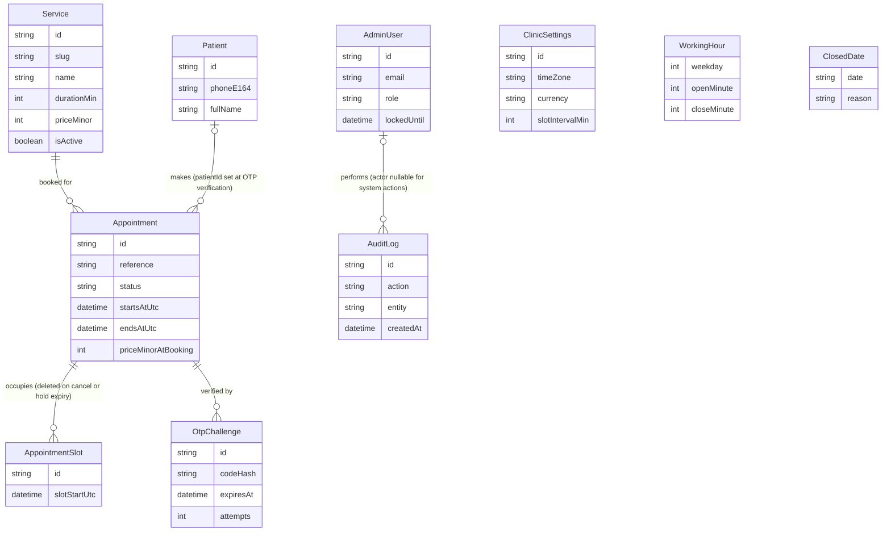

## 4. Data Model

All model and field names are canonical per C5; this section is the only place they are defined
and every later section (5, 6, 7, 9, 11, 12) refers back here rather than restating them. Money is
integer minor units (C7); every `DateTime` is a UTC instant (C6); there are no Prisma enums and no
`Json` columns, by the portability rule in C3.

### 4.1 Prisma schema draft

Compilable against PostgreSQL (the canonical provider, C3). `prisma/schema.sqlite.prisma` is a
generated sibling of this file (4.6), never hand-edited. `onDelete` is given explicitly by C5 only
for `AppointmentSlot -> Appointment` (`Cascade`); the other four relations' `onDelete` values below
are this section's own reasoned choice (explained inline), since C5 leaves them unspecified.

```prisma
// prisma/schema.prisma
datasource db {
  provider  = "postgresql"
  url       = env("DATABASE_URL")
  directUrl = env("DIRECT_DATABASE_URL")
}

generator client {
  provider = "prisma-client-js"
}

// --- Catalog ---------------------------------------------------------------

model Service {
  id          String   @id @default(cuid())
  slug        String   @unique
  name        String
  description String
  durationMin Int
  priceMinor  Int
  isActive    Boolean  @default(true)
  sortOrder   Int
  colorHex    String
  createdAt   DateTime @default(now())
  updatedAt   DateTime @updatedAt

  appointments Appointment[]
}

// --- Patients ----------------------------------------------------------------
// Created only on successful OTP verification (C9.6) — never for an unverified
// hold. See 4.3.

model Patient {
  id        String   @id @default(cuid())
  phoneE164 String   @unique
  fullName  String
  createdAt DateTime @default(now())
  updatedAt DateTime @updatedAt

  appointments Appointment[]
}

// --- Booking core --------------------------------------------------------------

model Appointment {
  id        String @id @default(cuid())
  reference String @unique

  serviceId String
  service   Service @relation(fields: [serviceId], references: [id], onDelete: Restrict)
  // Restrict: services are deactivated (isActive=false), never deleted, in v1 —
  // Restrict is a defensive backstop that should never actually fire.

  patientId String?
  patient   Patient? @relation(fields: [patientId], references: [id], onDelete: Restrict)
  // Restrict: a Patient with appointment history is never hard-deleted directly;
  // retention (4.7) only hard-deletes a Patient once zero Appointment rows
  // reference it, at which point Restrict never fires either.

  holdFullName  String
  holdPhoneE164 String

  startsAtUtc DateTime
  endsAtUtc   DateTime // stored, not recomputed: startsAtUtc + durationMinAtBooking at write time

  // Snapshots taken at booking time so later Service edits never rewrite
  // history — see 4.3 "AtBooking fields".
  durationMinAtBooking Int
  priceMinorAtBooking  Int
  currencyAtBooking    String
  serviceNameAtBooking String

  status String // AppointmentStatus union (C4), validated against src/lib/enums.ts
  source String // BookingSource union (C4)

  holdExpiresAt DateTime?
  verifiedAt    DateTime?
  confirmedAt   DateTime?
  completedAt   DateTime?
  cancelledAt   DateTime?

  cancellationReason String?
  rescheduledFromUtc DateTime?
  adminNote          String?

  createdAt DateTime @default(now())
  updatedAt DateTime @updatedAt

  slots         AppointmentSlot[]
  otpChallenges OtpChallenge[]

  @@index([startsAtUtc])
  @@index([status, startsAtUtc])
  @@index([serviceId, startsAtUtc])
  @@index([status, holdExpiresAt])
  @@index([patientId])
  @@index([startsAtUtc, status, serviceId])
}

// --- Concurrency guard — see 4.4 ------------------------------------------------

model AppointmentSlot {
  id            String   @id @default(cuid())
  appointmentId String
  slotStartUtc  DateTime @unique

  appointment Appointment @relation(fields: [appointmentId], references: [id], onDelete: Cascade)

  @@index([appointmentId])
}

// --- OTP -----------------------------------------------------------------------

model OtpChallenge {
  id            String    @id @default(cuid())
  appointmentId String
  phoneE164     String
  codeHash      String
  expiresAt     DateTime
  attempts      Int       @default(0)
  maxAttempts   Int       @default(5)
  resendCount   Int       @default(0)
  lastSentAt    DateTime
  consumedAt    DateTime?
  createdAt     DateTime  @default(now())

  appointment Appointment @relation(fields: [appointmentId], references: [id], onDelete: Cascade)

  @@index([appointmentId, createdAt])
  @@index([phoneE164, createdAt])
}

// --- Admin -----------------------------------------------------------------------

model AdminUser {
  id               String    @id @default(cuid())
  email            String    @unique
  passwordHash     String
  fullName         String
  role             String // AdminRole union (C4)
  isActive         Boolean   @default(true)
  lastLoginAt      DateTime?
  failedLoginCount Int       @default(0)
  lockedUntil      DateTime?
  createdAt        DateTime  @default(now())
  updatedAt        DateTime  @updatedAt

  auditLogs AuditLog[]
}

// --- Clinic configuration (singleton + child tables) ------------------------------

model ClinicSettings {
  id              String   @id @default("singleton")
  clinicName      String
  timeZone        String
  currency        String
  slotIntervalMin Int      @default(15)
  bufferMin       Int      @default(0)
  minLeadTimeMin  Int      @default(120)
  maxAdvanceDays  Int      @default(60)
  holdTtlMin      Int      @default(10)
  phoneE164       String
  email           String
  addressLine1    String
  addressLine2    String
  mapUrl          String
  updatedAt       DateTime @updatedAt
}

model WorkingHour {
  id          String @id @default(cuid())
  weekday     Int
  openMinute  Int
  closeMinute Int

  @@unique([weekday, openMinute])
}

model ClosedDate {
  id     String  @id @default(cuid())
  date   String  @unique
  reason String?
}

// --- Audit -----------------------------------------------------------------------

model AuditLog {
  id               String    @id @default(cuid())
  actorAdminUserId String?
  actor            AdminUser? @relation(fields: [actorAdminUserId], references: [id], onDelete: SetNull)
  action           String // AuditAction union (C4)
  entity           String
  entityId         String
  metaJson         String?
  createdAt        DateTime  @default(now())

  @@index([createdAt])
  @@index([entity, entityId])
  @@index([actorAdminUserId]) // additive, beyond C5's literal index list — see 4.5
}
```

### 4.2 ER diagram

Key attributes only — full field lists are in 4.3. `ClinicSettings`, `WorkingHour` and `ClosedDate`
have no foreign key to any other model (they describe "the clinic," the implicit singleton
resource, C1), so they are drawn as standalone attribute blocks rather than relationship lines.



### 4.3 Field-by-field notes

#### 4.3.1 Service

| Field | Type | Notes |
|---|---|---|
| id | String (cuid) | PK. Never exposed to patients — the capability token on the booking side is `Appointment.reference` (C8), not any Service id. |
| slug | String, unique | Stable identifier for the SSG landing page (`/`, C15) and seed fixtures; independent of `name` so a rename doesn't break a cached link. |
| name | String | Display name; also the source value snapshotted into `serviceNameAtBooking`. |
| description | String | Required, no `?` in C5: empty string is "no description," never `null`. |
| durationMin | Int | Minutes; source value snapshotted into `durationMinAtBooking`. CHECK `durationMin > 0` (4.5). |
| priceMinor | Int | Integer minor units (C7); source value for `priceMinorAtBooking`. CHECK `priceMinor >= 0` (4.5). |
| isActive | Boolean, default `true` | Soft-delete flag. An inactive service drops out of the wizard and the landing page but stays joinable from historical `Appointment` rows — which don't need the join anyway, since they already snapshot name/duration/price. |
| sortOrder | Int | Manual display order (landing page Services section; wizard Step 1). |
| colorHex | String | Series color for the "Appointments by service" chart (Section 9) — a distinct concern from the admin calendar's status color-coding. |
| createdAt / updatedAt | DateTime | Standard audit timestamps. |

#### 4.3.2 Patient

| Field | Type | Notes |
|---|---|---|
| id | String (cuid) | PK. |
| phoneE164 | String, unique | The natural key for "who is this patient" (C9). Because this column is unique, "Total patients" (Section 9) is a plain `count(Patient)` — no `DISTINCT` over `Appointment.holdPhoneE164` is ever needed. |
| fullName | String | Overwritten with the latest value on every successful verification (C9.4). This row tracks "most recently given name," not a name history. |
| createdAt | DateTime | Set exactly once, at the *first* successful OTP verification for this phone number. |
| updatedAt | DateTime | Bumped whenever `fullName` is refreshed by a later booking. |

**Why Patient is created only after verification (C9.6).** An unverified `PENDING_VERIFICATION`
hold carries only `Appointment.holdFullName` / `holdPhoneE164` — no `Patient` row exists for it.
Two consequences: (1) privacy minimization — an abandoned wizard, a hold that times out, or an OTP
that is never completed leaves no durable per-person record at all, only an anonymous-looking
`Appointment` row that retention (4.7) will anonymize further; (2) correctness-by-construction for
the "Total patients" KPI, which would otherwise have to decide whether an unverified phone number
"counts," and could double-count a phone that tried, abandoned, and retried.

#### 4.3.3 Appointment

**Assumption on the "five `...AtBooking` fields."** This section's task brief refers to "the five
`...AtBooking` snapshot fields"; C5 defines exactly **four** fields carrying the literal
`AtBooking` suffix: `durationMinAtBooking`, `priceMinorAtBooking`, `currencyAtBooking`,
`serviceNameAtBooking`. The table below documents those four, plus `holdFullName` /
`holdPhoneE164` immediately after — the two fields that answer the same "why snapshot instead of
reference" question on the *patient*-identity side of a booking, rather than the *service*-pricing
side. Treat "five" as loose language for "the snapshot fields, patient and service alike" (six, by
that reading), not a sixth undocumented column.

| Field | Type | Notes |
|---|---|---|
| id | String (cuid) | PK. |
| reference | String, unique | Patient-facing capability token, format `MB-XXXXXX` (C8). Looked up case-insensitively; never the PK. |
| serviceId | String (FK) | See 4.1 for `onDelete: Restrict`. |
| patientId | String? (FK) | `null` while `PENDING_VERIFICATION`; set once, at verification, and never cleared. |
| holdFullName | String | The name as typed in wizard Step 4, captured *before* a `Patient` row can exist. Kept even after verification so an `Appointment` never needs a join to show "who this booking is for" — `Patient.fullName` can drift (a later booking updates it) while this field is a true point-in-time record of what was typed for *this* booking. |
| holdPhoneE164 | String | Same reasoning as `holdFullName`, for phone. Also what `OtpChallenge.phoneE164` is denormalized from (4.3.5). |
| startsAtUtc | DateTime | UTC instant; THE value the concurrency guard (4.4) is built from. |
| endsAtUtc | DateTime | Stored, not a computed column (C3 bans native/computed-column attributes for portability): written once as `startsAtUtc + durationMinAtBooking` at booking/reschedule time. Cheap to read for calendar rendering without recomputing from duration each time. |
| durationMinAtBooking | Int | Snapshot of `Service.durationMin` at booking time. |
| priceMinorAtBooking | Int | Snapshot of `Service.priceMinor` at booking time. Every revenue KPI (Section 9) sums this column, never `Service.priceMinor`. |
| currencyAtBooking | String | Snapshot of `ClinicSettings.currency` at booking time. |
| serviceNameAtBooking | String | Snapshot of `Service.name` at booking time. |
| **Why the four `AtBooking` fields exist** | | A clinic edits `Service.priceMinor` or `durationMin` constantly (price changes, revised appointment lengths). Without a snapshot, every historical `Appointment` would silently re-price itself the moment an admin edited the service it points to — "Total revenue" for March would change in April because someone edited a price in May. Snapshotting at booking time makes an `Appointment` a receipt: immutable once written, independent of later catalog edits, and directly summable for revenue KPIs with no join and no "as-of" logic. |
| status | String | `AppointmentStatus` union (C4). |
| source | String | `BookingSource` union (C4). No `@default` — always set explicitly by the creating code path. |
| holdExpiresAt | DateTime? | `null` once `CONFIRMED` or later; set only while `PENDING_VERIFICATION`. Paired index `[status, holdExpiresAt]` (4.5) drives the hold-expiry sweep (C9.5). |
| verifiedAt | DateTime? | Set once, at OTP success. |
| confirmedAt | DateTime? | Set once, at OTP success (same instant as `verifiedAt` in v1 — kept as two columns because "OTP verified" and "booking confirmed" are different *concepts* that happen to coincide today; a future flow where they diverge needs no migration). |
| completedAt | DateTime? | Set on the `CONFIRMED -> COMPLETED` admin action. |
| cancelledAt | DateTime? | Set on any `-> CANCELLED` transition, patient- or system-initiated. |
| cancellationReason | String? | Free text / short code, e.g. `"HOLD_EXPIRED"` (C9.5) or an admin-entered reason. Not a Zod enum in v1 — just explanatory text, never parsed. |
| rescheduledFromUtc | DateTime? | Set on `CONFIRMED -> CONFIRMED` reschedule (C4) to the *previous* `startsAtUtc`, so "this booking moved" is visible without a separate history table. Only ever holds the immediately-prior value — not a full move history. |
| adminNote | String? | Free-text staff note, e.g. "patient called to confirm by phone." Never patient-visible. |
| createdAt / updatedAt | DateTime | Standard audit timestamps. |
| slots | AppointmentSlot[] | Back-relation; not a persisted column (4.3.4). |
| otpChallenges | OtpChallenge[] | Back-relation; not a persisted column (4.3.5). |

#### 4.3.4 AppointmentSlot

| Field | Type | Notes |
|---|---|---|
| id | String (cuid) | PK. Exists only so the row has an identity distinct from the `(appointmentId, slotStartUtc)` pair; never referenced elsewhere. |
| appointmentId | String (FK) | See 4.1 for `onDelete: Cascade` (C5-mandated). |
| slotStartUtc | DateTime, unique | THE concurrency guard — see 4.4. |

Deliberately no `createdAt`/`updatedAt` (C5 lists none): a slot row is never updated in place, only
inserted or deleted inside the same transaction as its owning `Appointment`'s own timestamped
write, so `Appointment.createdAt`/`updatedAt` already dates the event.

#### 4.3.5 OtpChallenge

| Field | Type | Notes |
|---|---|---|
| id | String (cuid) | PK. |
| appointmentId | String (FK) | `onDelete: Cascade`. An appointment can have more than one challenge over its lifetime: a challenge that exhausts `maxAttempts` is dead (C10) and the next `otp.send` creates a fresh row rather than reviving it. |
| phoneE164 | String | Denormalized from `Appointment.holdPhoneE164` so the per-phone rate-limit index (`[phoneE164, createdAt]`, 4.5) never needs a join through `Appointment` on the `otp.send` hot path (C14). |
| codeHash | String | `HMAC-SHA256(code, OTP_PEPPER)` hex (C10) — never the raw code. |
| expiresAt | DateTime | `now + 5min` at creation; reset on every resend (C10). |
| attempts | Int, default 0 | Incremented on each failed `verifyOtp` call; dead at `maxAttempts`. |
| maxAttempts | Int, default 5 | Stored per-row (not a global constant lookup) so a future per-challenge override needs no migration. |
| resendCount | Int, default 0 | Caps at 3 (C10); a 4th resend request is rejected before touching this row. |
| lastSentAt | DateTime | Drives the 60s resend cooldown (C10) — no separate rate-limiter call needed for that specific rule, since it's a single-row read. |
| consumedAt | DateTime? | Set once, on successful verification; a consumed challenge can never be re-verified (C9.4). |
| createdAt | DateTime | Standard timestamp. |

#### 4.3.6 AdminUser

| Field | Type | Notes |
|---|---|---|
| id | String (cuid) | PK. |
| email | String, unique | Stored lowercased (C5) so lookup is a plain equality on a portable `String` column — no `citext` (C3). |
| passwordHash | String | argon2id (C11); never read back by any query path other than the login check itself. |
| fullName | String | Display name in the admin UI. |
| role | String | `AdminRole` union (C4); v1 treats both values as full access. |
| isActive | Boolean, default true | Deactivation takes effect immediately because `requireAdmin()` (C11) re-checks live `AdminUser` state on every request — not just at login. |
| lastLoginAt | DateTime? | Updated on every successful login; `null` for an admin who has never logged in. |
| failedLoginCount | Int, default 0 | Reset to 0 on a successful login; incremented on each failed attempt. |
| lockedUntil | DateTime? | See callout below. |
| createdAt / updatedAt | DateTime | Standard timestamps. |

**Why `AdminUser` carries `lockedUntil` (C14).** `admin.login` is rate-limited to 5 attempts per
15 minutes per `(email+IP)` by the `RateLimiter` abstraction — but `MemoryRateLimiter` is
per-instance and therefore *advisory* on a serverless deployment where consecutive requests can
land on different instances (C14). `lockedUntil`, set to `now + 15min` after 5 *consecutive*
failures on the `AdminUser` row itself, is the authoritative, instance-independent backstop: it
lives in the one place every instance shares (the database), exactly the same argument 4.4 makes
for the slot guard. A login attempt checks `lockedUntil` before checking the password at all.

#### 4.3.7 ClinicSettings

| Field | Type | Notes |
|---|---|---|
| id | String, `@default("singleton")` | Always the literal string `"singleton"`; CHECK-constrained to that value (4.5). |
| clinicName | String | Display name across the landing page, `.ics` output, and SMS templates. |
| timeZone | String | IANA zone (e.g. `"Europe/Berlin"`); the single display/compute zone (C6). |
| currency | String | ISO-4217 code; snapshotted per-booking into `currencyAtBooking`. |
| slotIntervalMin | Int, default 15 | The atomic grid unit the concurrency guard (4.4) is built on. |
| bufferMin | Int, default 0 | Mandatory gap after a service before the next booking may start; folded into the slot-row count by Section 6's generalized formula (see 4.4). |
| minLeadTimeMin | Int, default 120 | Minimum notice before a bookable instant (Section 6). |
| maxAdvanceDays | Int, default 60 | How far into the future the booking window extends (Section 6). |
| holdTtlMin | Int, default 10 | PENDING_VERIFICATION lifetime before the hold-expiry sweep reclaims the slot (C9.5). |
| phoneE164 / email / addressLine1 / addressLine2 / mapUrl | String | Clinic contact details for the landing page footer and SMS "contact us" lines. All required (no `?` in C5) — **assumption**: `addressLine2` (e.g. suite/unit) is inherently optional in reality; modeled here as required `String` exactly as C5 specifies, so an admin with no line 2 stores `""`, not `null`. |
| updatedAt | DateTime | Bumped on every settings write; the only timestamp on this row (no `createdAt` — the row is seeded once and never re-created). |

**Why `ClinicSettings` is a singleton row, not env config.** Three reasons, all load-bearing: (1)
the brief's Settings screen (brief Section 3) requires admin CRUD on working hours, closed dates
and the slot interval *at runtime, without a redeploy* — env vars are read once at process start
and can't be edited from a browser; (2) every settings change must be attributable in `AuditLog`
(`action: "SETTINGS_UPDATED"`, C4) with an old/new diff — env vars have no row to diff against;
(3) `CLINIC_TIMEZONE` / `CLINIC_CURRENCY` (C16) still exist, but only as the *seed-time* default
written into this row once by `prisma/seed.ts` (4.6) — after seeding, the `ClinicSettings` table is
the sole runtime source of truth and the two env vars are never read again. This is the resolution
to an apparent redundancy between C16 and C5, not a contradiction between them.

#### 4.3.8 WorkingHour

| Field | Type | Notes |
|---|---|---|
| id | String (cuid) | PK; exists purely because Prisma models need one — the real identity is the `(weekday, openMinute)` pair. |
| weekday | Int | `0`=Sunday .. `6`=Saturday, clinic-local. CHECK `weekday BETWEEN 0 AND 6` (4.5). |
| openMinute / closeMinute | Int | Minutes-from-midnight, clinic-local wall time (C6) — never a `DateTime`, since a shift boundary has no date. CHECK `closeMinute > openMinute` (4.5). |

A weekday with zero rows is closed. Multiple rows for the same `weekday` express a split shift
(4.6 seeds one). These CHECK constraints are a DB-level backstop; the authoritative validation is
the shared Zod schema in the `settings` feature's `schemas.ts` (C17), used by both the admin form
and the slot engine (Section 6).

#### 4.3.9 ClosedDate

| Field | Type | Notes |
|---|---|---|
| id | String (cuid) | PK. |
| date | String, unique | `"YYYY-MM-DD"`, clinic-local. See callout below. |
| reason | String? | Optional label, e.g. `"Public holiday"`; display-only, never parsed. |

**Why `date` is a `String`, not a `DateTime` (C5).** A calendar date — "December 25th" — has no
instant; it is only ever compared to another clinic-local calendar date (react-day-picker's
`disabled` matcher, Section 6; the admin Settings closed-dates list). Storing it as a `DateTime`
would force a choice of instant (midnight UTC? midnight clinic-local?) that invites an off-by-one
day error the moment the clinic's time zone has a non-zero UTC offset — a `ClosedDate` meant to
mean "Dec 25 clinic-local" could render as Dec 24 or Dec 26 somewhere in the pipeline. A plain
`"YYYY-MM-DD"` string sidesteps the question entirely: it is compared lexically to another
`"YYYY-MM-DD"` string with no time-zone math involved at all.

#### 4.3.10 AuditLog

| Field | Type | Notes |
|---|---|---|
| id | String (cuid) | PK. |
| actorAdminUserId | String? (FK) | `null` for system-triggered entries (the hold-expiry sweep, C9.5) that have no human actor. `onDelete: SetNull` (4.1). |
| action | String | `AuditAction` union (C4). |
| entity / entityId | String | A generic polymorphic pointer (e.g. `entity: "Appointment"`, `entityId: <Appointment.id>`), not a typed Prisma relation — deliberately, so an `AuditLog` row outlives the thing it describes. A `Patient` hard-deleted by retention (4.7) still leaves its historical audit trail intact; a typed FK with any `onDelete` behavior would either orphan-cascade the log away (losing history) or block the deletion (defeating retention). |
| metaJson | String? | See callout below. |
| createdAt | DateTime | Standard timestamp; the sort key for every audit listing (4.5). |

**Why `metaJson` is a `String`, not a `Json` column (C3).** Prisma's `Json` type has no SQLite
equivalent, and the schema must compile unchanged against the SQLite fallback. `metaJson` is
instead a JSON-serialized `String`, written with `JSON.stringify` and read with `JSON.parse` at the
one call site that needs structure (e.g. a reschedule's `{ fromUtc, toUtc }`, Section 6.5); every
other code path treats it as opaque text. Per C19, it must never contain PII — phone numbers and
full names are logged nowhere, including here.

### 4.4 AppointmentSlot: the concurrency guard

#### Why a unique index on `Appointment.startsAtUtc` is insufficient

A unique constraint on `startsAtUtc` alone only rejects two bookings that start at the *exact same
instant*. It says nothing about overlap once services have different durations, which is the
normal case.

**Counterexample.** Both services are 60 minutes.

- Appointment A: `startsAtUtc = 09:00`, `endsAtUtc = 10:00`.
- Appointment B: `startsAtUtc = 09:30` (30 minutes into A), `endsAtUtc = 10:30`.

`09:00 != 09:30`, so a bare `@@unique([startsAtUtc])` on `Appointment` lets **both** inserts
succeed. Yet `[09:00, 10:00)` and `[09:30, 10:30)` overlap for the 30 minutes from 09:30 to 10:00 —
the clinic now has two confirmed appointments double-booked over half their length, and the
database enforced nothing.

#### Why one row per occupied slot-interval closes the gap

`AppointmentSlot` makes the *unit of uniqueness* a fixed-size grid tick (`slotIntervalMin`), not an
appointment's arbitrary start. For a given `slotIntervalMin`, every appointment's occupied
interval is tiled into consecutive grid points starting at its (grid-aligned) `startsAtUtc`:

```
occupiedKeys(appointment) = { startsAtUtc + k * slotIntervalMin : k = 0 .. durationSlots - 1 }
```

and **one `AppointmentSlot` row is inserted per key, in the same transaction as the `Appointment`
row.** Because every candidate start the slot engine ever offers is itself grid-aligned (Section
6), two overlapping intervals necessarily share at least one grid point inside their overlap
region — tiling the same fixed-size grid two different (grid-aligned) ways cannot avoid
intersecting if the intervals themselves intersect. The unique index on `slotStartUtc` then turns
"these two rows exist" into "only one of these two inserts can ever commit," which is exactly what
a per-instant unique index on `Appointment.startsAtUtc` could not do.

This guarantee depends on alignment: it protects exactly the inputs the system itself produces (all
candidates come from the same grid, Section 6.1 invariant 3), not arbitrary unaligned intervals —
it is a backstop on the application's own write path, not a general-purpose interval-overlap
detector.

#### Row count formula

```
durationSlots = ceil(durationMinAtBooking / slotIntervalMin)
```

e.g. `slotIntervalMin = 15`: a 15-minute service occupies 1 row, 45 minutes occupies 3, 60 minutes
occupies 4, 90 minutes occupies 6. A duration that is not an exact multiple of `slotIntervalMin`
still rounds **up**, locking the trailing partial slot in full (e.g. 50 minutes on a 15-minute grid
locks 4 rows = 60 minutes of grid).

This is C5's literal formula, which does not mention `ClinicSettings.bufferMin`. Section 6
generalizes it to `ceil((durationMinAtBooking + bufferMin) / slotIntervalMin)` so the configurable
buffer becomes real, DB-enforced rows instead of unenforced configuration — identical to the
formula above at the shipped default `bufferMin = 0` (4.6's seed uses this default, so the worked
example below matches both formulas). See Section 6's own Contract Challenge for the full
rationale; this section does not restate it as a second challenge.

#### Which statuses retain rows, which release them

| Status | AppointmentSlot rows | Why |
|---|---|---|
| PENDING_VERIFICATION | Retained | The hold itself *is* the slot being occupied during the OTP window. |
| CONFIRMED | Retained | The booking is live. |
| COMPLETED | Retained | That time genuinely was used; the historical record must keep blocking re-booking of an already-past slot from ever appearing available. |
| NO_SHOW | Retained | Same reasoning as COMPLETED — the clinic held the slot regardless of whether the patient arrived. |
| CANCELLED | **Deleted** | The whole point of cancelling (patient-initiated, admin-initiated, or hold-expiry sweep) is to free the slot for someone else. |

A reschedule (`CONFIRMED -> CONFIRMED`, C4) deletes the *old* `AppointmentSlot` rows and inserts the
*new* ones inside one transaction (Section 6.5) — it is a release-then-retain pair, not a third
category.

#### Exactly which error surfaces, and what it maps to

A collision on insert raises Postgres unique-violation `23505`, which Prisma Client surfaces as
`PrismaClientKnownRequestError` with `code: "P2002"` and `meta.target` naming the violated
constraint's column(s) — here, `["slotStartUtc"]`. The `defineAction` error-mapping layer (C12)
matches specifically on `P2002` **with** `slotStartUtc` in `meta.target` and maps it to
`ActionError.code = "SLOT_TAKEN"` (HTTP-409 semantics, C9.2). This matters because `Appointment`
also has a unique column (`reference`): a `P2002` whose `meta.target` is `["reference"]` is caught
earlier, by the reference-generation retry loop (C8, up to 5 regenerate-and-retry attempts), and
never reaches the generic mapper as `SLOT_TAKEN` at all. The whole `createBooking` transaction
rolls back atomically on either violation — a losing booking writes zero rows, including on its own
`Appointment` row, not just its `AppointmentSlot` rows.

#### Worked example: two colliding 45-minute bookings on a 15-minute grid

`slotIntervalMin = 15`. Appointment A (45 min) starts at 09:00; Appointment B (45 min) starts at
09:15 — 15 minutes into A. Assume A's transaction commits first.

| `slotStartUtc` | A's rows (09:00–09:45) | B's attempted rows (09:15–10:00) | Outcome |
|---|---|---|---|
| 09:00 | Inserted (row 1/3) | — | A's transaction commits all 3 rows. |
| 09:15 | Inserted (row 2/3) | Attempted (row 1/3) | **Collision** — `09:15` already exists; Postgres raises `23505`, Prisma raises `P2002` on `slotStartUtc`. |
| 09:30 | Inserted (row 3/3) | Attempted (row 2/3) — never reached | B's transaction aborts atomically on the *first* violation. |
| 09:45 | (A ends here) | Attempted (row 3/3) — never reached | — |

B's booking returns `SLOT_TAKEN`; the database holds exactly 3 `AppointmentSlot` rows (all A's) and
zero trace of B. The outcome does not depend on insertion order: A and B's occupied-key sets are
`{09:00, 09:15, 09:30}` and `{09:15, 09:30, 09:45}`, whose intersection `{09:15, 09:30}` is
non-empty, so *some* row collides regardless of which key is attempted first.

### 4.5 Indexes and constraints

| Table | Constraint/Index | Kind | Purpose | Which query uses it |
|---|---|---|---|---|
| Appointment | `@@index([startsAtUtc])` | btree | Range-scan all appointments in a time window, any status | Admin calendar day/week/month fetch (`/admin/calendar`, C15) |
| Appointment | `@@index([status, startsAtUtc])` | btree, composite | Filter by status, then range on time | "Today's appointments" / "Upcoming this week" KPIs; appointments table status+date filter (Section 9 / Section 5) |
| Appointment | `@@index([serviceId, startsAtUtc])` | btree, composite | Filter by service, then range on time | "Appointments by service" chart; per-service upcoming lists (Section 9) |
| Appointment | `@@index([status, holdExpiresAt])` | btree, composite | Find expired holds | Lazy sweep + `POST /api/cron/expire-holds`: `status='PENDING_VERIFICATION' AND holdExpiresAt < now()` (C9.5, Section 6.3/6.4) |
| Appointment | `@@index([patientId])` | btree | Join a patient to their appointments | Patients list: visit count / total spent / last visit (Section 9) |
| Appointment | `@@index([startsAtUtc, status, serviceId])` | btree, composite | Covering index: range-scan on the leading `startsAtUtc`, with `status` and `serviceId` carried in the index for an index-only scan (no heap lookups) | Dashboard "appointments by service" aggregate (Section 9.8) only. That query filters `status IN (3 of 5 values)` — too unselective to lead — and uses `serviceId` as a `GROUP BY` key, so neither `[status, startsAtUtc]` nor `[serviceId, startsAtUtc]` serves it. The single-status revenue queries (9.3, 9.7) deliberately keep `[status, startsAtUtc]`, which seeks on `status='COMPLETED'` and then ranges — strictly better than range-then-filter, and this index does not carry `priceMinorAtBooking` so it saves no heap fetch there. |
| Appointment | `reference` unique | unique btree | O(1) lookup by capability token | Success page; `GET /api/appointments/[reference]/ics`; `reference.lookup` action (C8, C13) |
| AppointmentSlot | `slotStartUtc` unique | unique btree | **The concurrency guard** | Every `booking.create` / reschedule transaction (4.4) |
| AppointmentSlot | `@@index([appointmentId])` | btree | Load/delete all slot rows for one appointment | Cancel, hold-expiry sweep, reschedule (4.4, Section 6.4–6.5) |
| OtpChallenge | `@@index([appointmentId, createdAt])` | btree, composite | Latest challenge for an appointment | `verifyOtp` / resend actions (Section 5) |
| OtpChallenge | `@@index([phoneE164, createdAt])` | btree, composite | Per-phone rate accounting | `otp.send` rate limit (C14) |
| Patient | `phoneE164` unique | unique btree | Natural key, upsert target | `verifyOtp`'s upsert-by-phone (C9.4); "Total patients" KPI |
| WorkingHour | `@@unique([weekday, openMinute])` | unique btree, composite | Prevent duplicate shift rows at the same start minute | Settings CRUD write path; per-weekday read (Section 6) |
| ClosedDate | `date` unique | unique btree | O(1) "is this date closed" | Calendar day-disabling (Section 6); Settings CRUD idempotency |
| AuditLog | `@@index([createdAt])` | btree | Recency ordering | Audit/compliance listing |
| AuditLog | `@@index([entity, entityId])` | btree, composite | "History for this specific record" | Per-appointment / per-service audit trail |
| AuditLog | `@@index([actorAdminUserId])` | btree | FK lookup; "actions by this admin" | Additive, beyond C5's literal list — justified below |
| Appointment | `serviceId -> Service.id`, `onDelete: Restrict` | foreign key | Referential integrity | Covered as a leading column by the `[serviceId, startsAtUtc]` index above |
| Appointment | `patientId -> Patient.id`, `onDelete: Restrict` | foreign key (nullable) | Referential integrity | Covered by the `[patientId]` index above |
| AppointmentSlot | `appointmentId -> Appointment.id`, `onDelete: Cascade` | foreign key | Referential integrity (C5-mandated) | Covered by the `[appointmentId]` index above |
| OtpChallenge | `appointmentId -> Appointment.id`, `onDelete: Cascade` | foreign key | Referential integrity | Covered as a leading column by the `[appointmentId, createdAt]` index above |
| AuditLog | `actorAdminUserId -> AdminUser.id`, `onDelete: SetNull` | foreign key (nullable) | Referential integrity | **Not** covered by `[createdAt]` or `[entity, entityId]` — hence the explicit additive index immediately above, rather than relying on Prisma's connector-dependent implicit FK indexing in a document meant to be precise about what exists |

#### CHECK constraints (hand-written migration; Postgres only)

Prisma's schema DSL has no CHECK-constraint primitive (Prisma 6.x), so these six are added by
hand-editing the SQL of a `prisma migrate dev --create-only` migration (4.6), not expressed in
`schema.prisma`:

```sql
ALTER TABLE "Appointment" ADD CONSTRAINT "appointment_status_legal"
  CHECK (status IN ('PENDING_VERIFICATION','CONFIRMED','COMPLETED','CANCELLED','NO_SHOW'));

ALTER TABLE "ClinicSettings" ADD CONSTRAINT "clinic_settings_singleton"
  CHECK (id = 'singleton');

ALTER TABLE "WorkingHour" ADD CONSTRAINT "working_hour_weekday_range"
  CHECK (weekday BETWEEN 0 AND 6);

ALTER TABLE "WorkingHour" ADD CONSTRAINT "working_hour_close_after_open"
  CHECK ("closeMinute" > "openMinute");

ALTER TABLE "Service" ADD CONSTRAINT "service_price_non_negative"
  CHECK ("priceMinor" >= 0);

ALTER TABLE "Service" ADD CONSTRAINT "service_duration_positive"
  CHECK ("durationMin" > 0);
```

**SQLite skips all six.** The SQLite fallback path (`prisma db push`, no migration history, C3)
never runs a hand-written migration file, so none of these constraints exist there. On SQLite the
Zod schemas in each feature's `schemas.ts` (C17) are the *only* enforcement — an accepted gap for a
dev-only, zero-dependency fallback, not for the canonical Postgres path.

### 4.6 Migrations and seed

#### Migration workflow

**PostgreSQL (canonical, both dev and prod, C3):**

1. `docker compose up -d db` — local Postgres 16.
2. `pnpm prisma migrate dev --name <change>` — generate + apply against `DATABASE_URL`.
3. For the CHECK constraints specifically: `pnpm prisma migrate dev --name add_check_constraints --create-only`, hand-edit the generated `migration.sql` to append the six statements in 4.5, then `pnpm prisma migrate dev` to apply. The edited file is checked in like any other migration.
4. CI/prod: `pnpm prisma migrate deploy`, using `DIRECT_DATABASE_URL` (unpooled, C23) — `migrate dev` never runs outside a developer machine.
5. `pnpm prisma db seed` (wired via `"prisma": { "seed": "tsx prisma/seed.ts" }` in `package.json`) runs the seed script below.

**SQLite (optional fallback, C3):**

1. `pnpm db:sqlite` runs `scripts/gen-sqlite-schema.ts`: reads `prisma/schema.prisma`, rewrites the `datasource` block to `provider = "sqlite"` / `url = "file:./dev.sqlite"`, drops `directUrl` (unsupported), writes `prisma/schema.sqlite.prisma`.
2. `pnpm prisma db push --schema=prisma/schema.sqlite.prisma` — schema sync, no migration history, no CHECK constraints (4.5).
3. `pnpm prisma db seed -- --schema=prisma/schema.sqlite.prisma` runs the same `seed.ts` — the seed logic is plain Prisma Client calls, provider-agnostic; only the schema file differs.

#### `prisma/seed.ts` contents

All randomized choices use a fixed-seed PRNG (seed string `"medibook-seed-v1"`) and a hardcoded
`FixedClock` anchor, `SEED_NOW = 2026-01-15T09:00:00Z` — a constant, not `Date.now()` — so that
re-running the seed produces byte-identical rows every time, and Section 9 / Section 11 can assert
exact KPI numbers against this specific instant rather than "whatever today happens to be."

1. **One admin.** Upserted by `email = SEED_ADMIN_EMAIL` (lowercased), `passwordHash` from
   `SEED_ADMIN_PASSWORD` via argon2id (C11), `role = "OWNER"`, `isActive = true`.
2. **`ClinicSettings` singleton.** Upserted by `id = "singleton"`: `clinicName`, `timeZone` from
   `CLINIC_TIMEZONE` (default `"Europe/Berlin"`), `currency` from `CLINIC_CURRENCY` (default
   `"EUR"`), `slotIntervalMin = 15`, all other numeric fields at their C5 defaults, plus placeholder
   contact fields.
3. **`WorkingHour`**, upserted by `(weekday, openMinute)`, one realistic week:

   | Weekday | Shifts (clinic-local) |
   |---|---|
   | Sunday (0) | closed — zero rows |
   | Monday–Friday (1–5) | 09:00–18:00 (one row each) |
   | Saturday (6) | **split shift**: 09:00–13:00 and 16:00–20:00 (two rows) |

   This Saturday split shift is deliberately richer than Section 1's OQ3 default (a plain
   09:00–13:00 Saturday) specifically to seed data that exercises the split-shift path in Section
   6 end to end. Both are stated defaults pending stakeholder confirmation (OQ3); this section's
   seed should be read as the one that actually ships a split shift, superseding OQ3 on that detail.
4. **`ClosedDate`**, upserted by `date`, three fixed calendar dates (deterministic, not relative to
   `SEED_NOW`): `"2026-01-01"` ("New Year's Day"), `"2026-04-10"` ("Spring holiday"),
   `"2026-12-25"` ("Christmas Day").
5. **Services**, upserted by `slug`, seven rows spanning a useful range of `durationSlots` at
   `slotIntervalMin = 15` (4.4):

   | slug | name | durationMin | priceMinor (EUR) | durationSlots |
   |---|---|---|---|---|
   | `general-consultation` | General Consultation | 30 | 5000 | 2 |
   | `follow-up-visit` | Follow-up Visit | 15 | 3000 | 1 |
   | `vaccination` | Vaccination | 15 | 2500 | 1 |
   | `dental-cleaning` | Dental Cleaning | 45 | 8000 | 3 |
   | `physical-therapy` | Physical Therapy Session | 60 | 9000 | 4 |
   | `diagnostic-ultrasound` | Diagnostic Ultrasound | 45 | 12000 | 3 |
   | `minor-outpatient-procedure` | Minor Outpatient Procedure | 90 | 20000 | 6 |

6. **~60 `Appointment` rows** (plus their `AppointmentSlot` rows per 4.4's formula), spread across
   the 90 days before `SEED_NOW` and a short window after it, so the admin dashboard has
   non-trivial, reproducible data:

   | Status | Count | Notes |
   |---|---|---|
   | COMPLETED | 28 | Past, spread across the 90-day window; `completedAt` set. |
   | CANCELLED | 10 | 6 explicit (`cancellationReason` = an admin/patient-entered string); 4 via `"HOLD_EXPIRED"` to exercise the sweep path. |
   | NO_SHOW | 6 | Past; `confirmedAt` set, `completedAt`/`cancelledAt` both `null`. |
   | CONFIRMED | 12 | Upcoming relative to `SEED_NOW`; `patientId` set. |
   | PENDING_VERIFICATION | 4 | 1 fresh hold, 1 about to expire, 2 already past `holdExpiresAt` but intentionally left un-swept — so a Section 11 test can assert the lazy sweep (Section 6.3 step 2) reclaims them on the next read. |
   | **Total** | **60** | |

   Patients are created by the same upsert-by-`phoneE164` logic `verifyOtp` uses in production, so
   the seed never bypasses the "`Patient` only after verification" rule (4.3.2) — the four
   `PENDING_VERIFICATION` rows above correctly have `patientId = null`.

**Idempotency and determinism.** Re-running `pnpm prisma db seed` must be safe and must produce the
same data: `AdminUser`, `ClinicSettings`, `WorkingHour`, `ClosedDate`, and `Service` all have a
natural unique key and are written with `upsert`. `Appointment` / `AppointmentSlot` /
`OtpChallenge` have no such natural key (a `reference` is randomly generated by design, C8), so the
seed instead wraps a `deleteMany` on all three — scoped to seed-owned demo data only, safe in dev —
followed by deterministic recreation from the fixed PRNG and `SEED_NOW`, inside one transaction.
The combination of (a) a fixed PRNG seed, (b) a hardcoded `SEED_NOW` instead of `Date.now()`, and
(c) delete-then-recreate for the three volatile tables is what lets Section 9 and Section 11 assert
exact KPI numbers rather than "approximately N."

### 4.7 Data retention

Restating C20 as a table; "where implemented" is the same script for every row.

| Entity | Trigger | Action | Where implemented |
|---|---|---|---|
| Appointment | `startsAtUtc` older than 24 months (assumption: the clinically-relevant date, not `createdAt` — C20 does not state which timestamp) | Anonymize in place: `holdFullName -> "Redacted"`, `holdPhoneE164 -> "+000000000000"`; `patientId`, `status`, and every `*AtBooking` field retained so revenue history survives | `scripts/retention.ts`, monthly cron |
| Patient | No `Appointment` row with `startsAtUtc` in the last 24 months | Hard delete the row | `scripts/retention.ts`, monthly cron |
| OtpChallenge | 24h after `consumedAt`, or 24h after `expiresAt` for a challenge never consumed | Hard delete the row | `scripts/retention.ts` — cadence mismatch flagged below |
| AuditLog | `createdAt` older than 24 months (assumption: C20 states "retained 24 months" without naming the post-window action; hard-delete is assumed, mirroring the other three rows) | Hard delete the row | `scripts/retention.ts`, monthly cron |

Documented in `/privacy` per C20; the 24-month figure itself is a provisional default pending legal
confirmation (Section 1, OQ10) controlled by one constant in `retention.ts`.

#### Contract Challenges

- **C20 — `OtpChallenge`'s 24-hour target cannot be met by a monthly cron.** C20 pins
  `OtpChallenge` hard-deletion at 24 hours after consumption/expiry, but also states the *entire*
  policy — all four rows above — runs on a single monthly cron. A monthly job cannot deliver a
  24-hour SLA: a consumed `OtpChallenge` row (which holds `codeHash` and `phoneE164`, exactly the
  PII-adjacent data C19 is strictest about) can sit live for up to ~30x longer than specified. This
  section documents `OtpChallenge` cleanup on the monthly cron per C20's literal text, but the
  recommendation is to run it on the existing 5-minute `expire-holds` cadence (C9.5) or a dedicated
  frequent job instead; Section 12 should schedule accordingly rather than inherit the mismatch.

- **C5's required-index list has no index supporting `Patient` name search/sort.** The only index
  on `Patient` is the `phoneE164` uniqueness constraint (4.5). The brief's Patients list (brief
  Section 3, item 3: "name, phone, visit count...") implies search/sort by name as well as phone;
  with no index on `fullName`, that query is a sequential scan. Acceptable at the clinic's expected
  scale (Section 1, A16: under ~200 appointments/week, so a correspondingly small patient table),
  but worth naming as a known, accepted gap rather than a silently-discovered one if patient volume
  ever grows past a single clinic's typical size.

- **C5 marks `ClinicSettings.addressLine2` as required, not optional.** A second address line
  (apartment/suite) is inherently optional in every real postal address. C5 gives it no `?`, so it
  is modeled here as a required `String` (4.3.7), meaning the seed and the settings form must
  always write `""` rather than omit the field. Minor, but it is schema behavior worth naming
  rather than silently "fixing" by making the column nullable against C5's explicit text.
