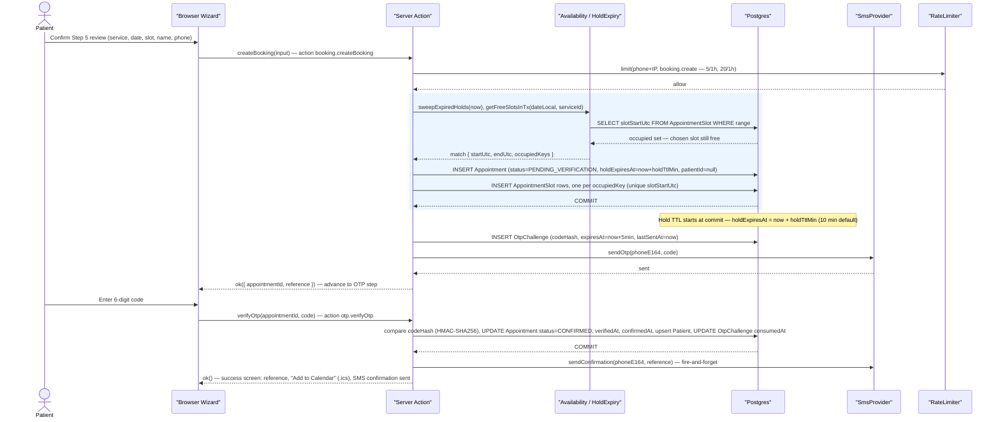
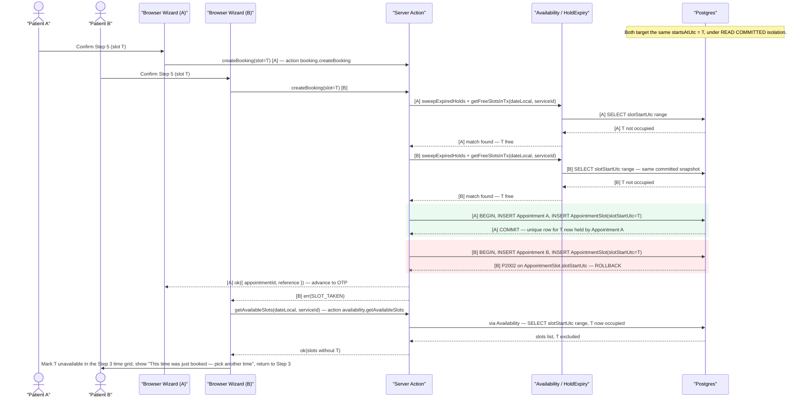
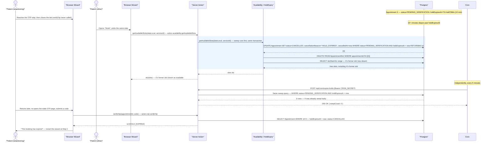
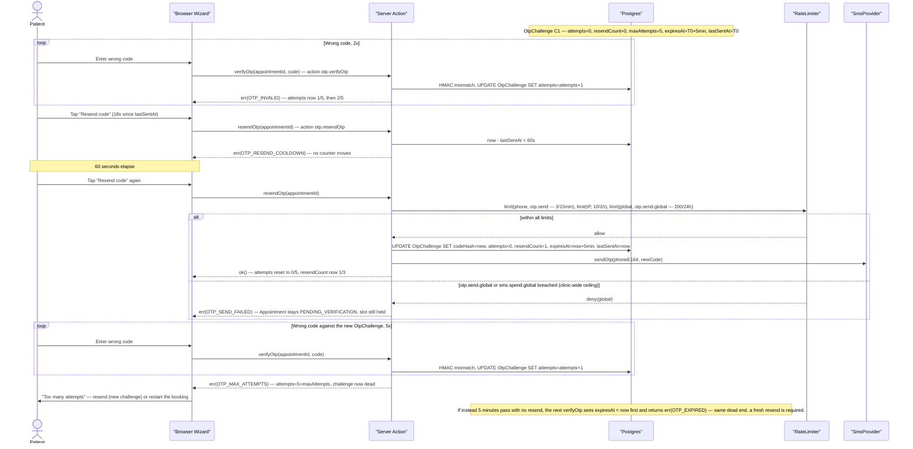
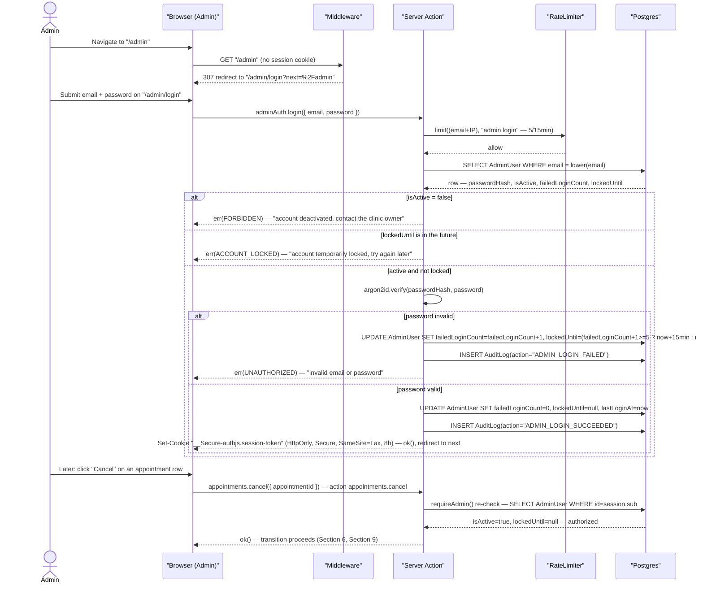

## 7. Booking and OTP Sequence Diagrams

Five scenarios, each a `sequenceDiagram` plus a numbered walkthrough naming the real action
identifiers (C13), error codes (C12), and DB writes (model/field names per Section 4). Participant
aliases stay constant wherever the same actor recurs: `Patient` / `Browser Wizard` (the
`features/booking` and `features/otp` client islands, Section 3), `Server Action`
(`server/action.ts`'s `defineAction`, C12), `Availability / HoldExpiry` (`server/slots/availability.ts`
and `server/slots/hold-expiry.ts`, Section 6 — the grid/query module and the lazy+cron sweep
module, per C17), `Postgres`, `SmsProvider`, `RateLimiter`, and `Cron`
(`POST /api/cron/expire-holds`, C13). 7.5 covers the admin side, which has no slots, SMS, or cron
concern, so it introduces `Admin`,
`Browser (Admin)`, and `Middleware` (`src/middleware.ts`, C11) while reusing `Server Action`,
`RateLimiter`, and `Postgres`. A `rect` block marks a transaction boundary where one matters;
`alt`/`loop` blocks keep repeated branches compact.

### 7.1 Happy Path — Wizard Through Confirmation

#### Walkthrough

1. The wizard's five steps are client-side only; nothing is written until the Step 5 confirm
   checkbox fires `createBooking` (C9.1).
2. `RateLimiter` is checked before any DB touch, against both `booking.create` rules keyed on
   HMAC-hashed phone and IP (C14) — a breach short-circuits to `RATE_LIMITED`.
3. The `rect` block is one `$transaction`: a fresh `getFreeSlotsInTx` re-check (never trusting the
   client's chosen slot), then one `Appointment` insert plus `durationSlots` `AppointmentSlot`
   inserts (Section 6.4). `holdExpiresAt` is written inside this commit, so the TTL clock starts
   when the row becomes visible to other transactions, not when the handler began.
4. `OtpChallenge` creation and `SmsProvider.sendOtp` happen *after* commit (C9.3): an SMS failure
   returns `OTP_SEND_FAILED` to the wizard, which offers resend, but never rolls back the hold.
5. `verifyOtp` is its own transaction: constant-time `codeHash` compare, then `Appointment` moves
   `PENDING_VERIFICATION -> CONFIRMED` (C4), `Patient` is upserted by `phoneE164` for the first time
   on this booking (C9.4, C9.6), and `holdExpiresAt` is cleared. The confirmation SMS that follows
   is fire-and-forget; the success screen reads `reference` (C8) and links
   `GET /api/appointments/[reference]/ics` (C13) for the calendar download.

### 7.2 Double-Booking Race

#### Walkthrough

1. Both requests pass the pre-check: `getFreeSlotsInTx` reads the same committed snapshot before
   either has written anything, so each legitimately sees T as free (Section 6.4, "why the recheck
   alone is not sufficient").
2. The two inserts are interleaved by commit order, not request order — the diagram fixes A ahead
   of B to make that order concrete, but either patient could win; the mechanism is identical.
3. A's transaction commits first and owns the only row `AppointmentSlot.slotStartUtc = T` can ever
   have (C5's unique index). B's insert of the same value raises Prisma `P2002`, mapped to
   `SLOT_TAKEN` (C9.2); B's transaction rolls back, taking its would-be `Appointment` row with it.
4. B never reaches OTP. The wizard's `SLOT_TAKEN` handler (Section 2.4 step 12) refetches
   `getAvailableSlots` — a fresh indexed read, not a cached list — which now shows T occupied, and
   routes B back to Step 3 (not Step 5, since name/phone/review state is still valid) with an
   inline "just booked" message.
5. A's booking proceeds exactly as in 7.1 from its `ok()` onward, unaffected by B's rollback.

### 7.3 Hold Expiry

#### Walkthrough

1. Appointment X is created exactly as in 7.1, but Patient A never submits an OTP code; nothing
   server-side distinguishes "about to resume" from "gone for good" until `holdExpiresAt` passes.
2. The *lazy* sweep is what makes correctness independent of the cron actually running (C9.5): any
   other patient's `getAvailableSlots` call, inside its own transaction, runs the sweep UPDATE
   against the `[status, holdExpiresAt]` index, then its own `AppointmentSlot` range SELECT — so
   the freed slot is visible within the same request that triggered the sweep, no polling delay.
3. The sweep is one `UPDATE ... RETURNING id` followed by a `DELETE` on the returned ids —
   `AppointmentSlot` rows for X are removed in the same transaction, which makes the slot bookable
   again immediately, not just X's status change.
4. `POST /api/cron/expire-holds` runs the identical predicate every 5 minutes as defense-in-depth;
   here it finds zero rows because the lazy path already swept X. The two paths share one query
   and neither depends on the other firing.
5. When Patient A returns, `verifyOtp` checks `Appointment.holdExpiresAt` directly (Section 6.6,
   "hold expires mid-wizard") rather than only the `OtpChallenge`'s own `expiresAt` — this produces
   `HOLD_EXPIRED` specifically, distinct from an `OTP_EXPIRED` challenge-level failure (7.4), and
   tells the wizard to restart at Step 1 rather than offer a resend.

### 7.4 OTP Failure Modes

#### Walkthrough

1. Every wrong-code `verifyOtp` call increments `OtpChallenge.attempts` on the *same* row and
   returns `OTP_INVALID`; the challenge stays usable until `attempts` reaches `maxAttempts` (5,
   C10). Nothing else moves on this branch.
2. A resend inside the 60s cooldown is rejected by one read of `lastSentAt` — `OTP_RESEND_COOLDOWN`
   — and touches no counter; it is a pure read-then-reject, not an attempt or a resend.
3. A resend after the cooldown first passes the `otp.send` rate limit (3/15min/phone, 10/1h/IP,
   plus the clinic-wide `otp.send.global` ceiling, C14), independent of the per-challenge
   `resendCount` cap of 3, then *replaces* `codeHash` on the same row, resets `attempts` to 0,
   bumps `resendCount`, and extends `expiresAt` — one row, one lineage, never a second
   `OtpChallenge` for a plain resend (C10). Wrong attempts against the replaced code resume from 0,
   independent of the count before the resend.
4. At `attempts = maxAttempts` the challenge is dead: `OTP_MAX_ATTEMPTS` is returned and no further
   `verifyOtp` against this `OtpChallenge` id can succeed, resend or not — the only way forward is a
   fresh challenge via `resendOtp` (still capped at 3 resends total).
5. Natural expiry (`expiresAt < now`) is checked before the attempt-count check on every `verifyOtp`
   call — an assumption this section states explicitly, since C10/C12 list both outcomes without
   ordering them. An expired-but-not-exhausted challenge returns `OTP_EXPIRED`, not `OTP_INVALID`
   or `OTP_MAX_ATTEMPTS`, and per C10 neither code reveals whether the submitted digits were right.
6. The `otp.send.global` branch is the clinic-wide ceiling (C14): 200 sends per rolling 24h across
   all phone numbers, plus a daily `sms.spend.global` cap in `SMS_DAILY_CAP_MINOR`. A breach returns
   `OTP_SEND_FAILED` — the same code and the same no-rollback behavior as an `SmsProvider` failure
   in 7.1 step 4 — so the `Appointment` stays `PENDING_VERIFICATION` and its slot stays held; the
   clinic can still confirm it by hand. The breach also emits a CRITICAL log event and a persistent
   admin-dashboard banner, and `SMS_KILL_SWITCH=true` short-circuits sending outright for the
   duration of an attack.

### 7.5 Admin Login

#### Walkthrough

1. `middleware.ts` only inspects whether a structurally valid session cookie is present (C11); an
   unauthenticated hit on any `/admin/:path*` other than `/admin/login` gets a same-origin,
   relative-path 307 to `/admin/login?next=<pathname>` — never an absolute external URL, closing
   the open-redirect vector.
2. `adminAuth.login` (`features/admin-auth/actions.ts`) still runs through `defineAction`: the
   `admin.login` rate limit (5/15min per `email+IP`, C14) is checked before the `AdminUser` row is
   even read.
3. `isActive` and `lockedUntil` are both read-and-checked independently of the `RateLimiter`
   verdict, in that order. `isActive = false` is permanent — a deactivated account, or a role
   revoked — and returns `FORBIDDEN`; a live `lockedUntil` window is temporary and self-clearing, a
   second DB-resident lockout keyed on the account (not IP) and set once `failedLoginCount` would
   reach 5 consecutive failures (C14), and returns `ACCOUNT_LOCKED` instead (C12) — never
   `FORBIDDEN` — so the UI copy can differ ("contact the clinic owner" versus "try again later").
   This section assumes the `RateLimiter` check runs first (cheap, no DB round-trip); see Contract
   Challenges.
4. Password verification is `argon2id` (`@node-rs/argon2`, C11) against the stored hash — never a
   plaintext comparison, never logged.
5. Every outcome writes an `AuditLog` row (`ADMIN_LOGIN_FAILED` or `ADMIN_LOGIN_SUCCEEDED`, C4) with
   no PII in `metaJson` (C19); only success also sets `lastLoginAt` and clears both counters.
6. The session is the Auth.js JWE cookie (C11), not a DB session row — "session-based" means an
   opaque, HttpOnly, Secure cookie the browser cannot read, not a server-side session table.
7. The later `appointments.cancel` call shows `requireAdmin()` firing *inside* the action, re-reading
   `AdminUser.isActive`/`lockedUntil` from the DB on every admin action — a session minted before an
   account was deactivated or locked stops working on its next action, not merely its next page
   load (C11 — "middleware is defense-in-depth, never the only check").

#### Contract Challenges

C14 defines two independent `admin.login` lockouts — the `RateLimiter`'s 5/15min window keyed on
`(email+IP)`, and `AdminUser.lockedUntil` set for 15 minutes after 5 *consecutive* failures keyed
on the account alone — without stating their check order or how they interact when they disagree.
A shared office IP can trip the IP-scoped limiter while an individual account's `lockedUntil` stays
clear, or a mobile admin on rotating IPs can lock their own account while never tripping the
IP-keyed limiter; the two also expire on different clocks (sliding window vs. fixed-until
timestamp), so a locked-out admin can see the error shape change from `RATE_LIMITED` to
`ACCOUNT_LOCKED` mid-wait with no action on their part (C12's split of `ACCOUNT_LOCKED` from
`FORBIDDEN` sharpens the symptom but does not resolve the ordering question below). This section
resolves it only by assuming the `RateLimiter` call runs first — C14 should state that ordering,
or fold the two into one authoritative check.
