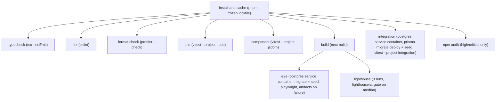

## 11. Testing Strategy

### 11.1 Shape and targets

Four layers, each proving what the layer below it cannot: unit (pure logic, no I/O) -> component
(rendered React, no server) -> integration (Server Actions against a real Postgres) -> E2E (the
built app in a real browser). Section 6.3 already splits `computeFreeStarts` (pure) from
`getFreeSlotsInTx` (DB-touching) for exactly this reason — the split is what makes a true unit layer
possible for the slot engine at all, instead of mocking Prisma into meaninglessness.

| Layer | Owns | Coverage target | Why this number |
|---|---|---|---|
| `src/server/slots/**`, `src/server/appointments/transitions.ts` | Every Section 6.6 edge case; every C4 transition pair | 100% branch | A missed branch here is a double-booking or an illegal status flip — the two defects this whole plan exists to prevent (Section 4.4). |
| `src/lib/**` (`money.ts`, `phone.ts`, `dates.ts`, `ics.ts`, `reference.ts`, `enums.ts`, `errors.ts`) | Pure, deterministic, zero I/O | >=95% line | Cheapest code in the repo to fully cover; no excuse for a gap. |
| `src/server/action.ts`, `auth-guards.ts`, `audit.ts`, `sms/`, `ratelimit/` | Orchestration, provider selection | >=85% line | Exact-boundary behavior (rate-limit windows, lockout) is proven by 11.5's integration tests, not by chasing the last unit branches here. |
| `src/features/*/actions.ts`, `queries.ts` | Per-feature business logic | >=80% line (unit) | Remaining confidence comes from 11.5, not a higher unit number. |
| `src/features/*/components/*`, `src/components/*` | Rendering, interaction | >=70% statement (RTL) | Deliberately the lowest bar — layout/visual correctness is Lighthouse's and manual review's job (11.7), not a coverage percentage. |
| E2E (Playwright) | Cross-cutting user journeys | No percentage target | Judged by the scenario catalogue in 11.6 being complete, not by instrumented coverage. |

CI additionally enforces a repo-wide **85% statement-coverage floor** (Vitest's `v8` provider) as a
blunt backstop beneath the per-layer bars above — the per-layer numbers are the real targets.

**Regression-test rule.** Every PR that fixes a bug includes a test reproducing that bug at the
lowest layer able to express it: unit if the defect is in `lib/`/`server/slots`/`transitions.ts`
logic, integration if it required a real unique-index violation or a real session, E2E only if it
is purely a rendering/interaction defect no lower layer can see. Enforced by a
`.github/pull_request_template.md` checklist item (Section 3), not a tool — a PR without one, for a
PR whose diff is tagged `fix:`, is a review-blocking comment, not an automated gate.

### 11.2 Determinism

- **Clock.** Every test that touches time constructs `new FixedClock(instant)` (C22) and passes it
  explicitly to the function under test — `computeFreeStarts`, `createBooking`, `verifyOtp`,
  `sweepExpiredHolds`, every `getDashboardKpis`/`getRevenueSeries` call. No test sleeps; a hold's
  10-minute expiry is proven by constructing a `FixedClock` already past `holdExpiresAt`, not by
  waiting 10 real minutes.
- **Fixed random seed.** `prisma/seed.ts`'s PRNG seed `"medibook-seed-v1"` (Section 4.6) is reused
  verbatim by any test that needs the standard dataset, so re-running the suite never produces a
  different distinct-patient count or a different fixture reference. Where a unit test needs to
  force a specific random outcome — a reference-generation collision (C8), a scripted wrong-then-
  right OTP sequence — it replaces `crypto.randomInt`/`randomBytes` with a `vi.spyOn` stub returning
  a scripted sequence, never relying on the real CSPRNG to happen to collide.
- **The seed itself is idempotent (Section 4.6).** `pnpm prisma db seed` is safe to re-run inside
  CI without a prior drop — upserts for the five static tables, delete-then-recreate for the three
  volatile ones (`Appointment`, `AppointmentSlot`, `OtpChallenge`) under the fixed PRNG and the
  pinned `SEED_NOW = 2026-01-15T09:00:00Z`. This is what lets 11.6/E4 assert exact KPI numbers
  rather than "approximately."
- **Pinned test time zone — two independent axes.** The Node test process itself runs with
  `TZ=UTC` (so an accidental `new Date(y,m,d)` in test code, if the ESLint ban in C22/C6 is ever
  missed, fails loudly instead of only failing on a CI runner in a different locale) while
  `ClinicSettings.timeZone` stays the seeded `"Europe/Berlin"` — the clinic's zone is business data
  under test, never conflated with the test runner's own.
- **DST transition dates (Europe/Berlin, 2026).** Spring-forward: **2026-03-29**, 02:00 CET jumps to
  03:00 CEST — the local wall-clock interval `[02:00, 03:00)` has zero UTC instants. Fall-back:
  **2026-10-25**, 03:00 CEST becomes 02:00 CET — `[02:00, 03:00)` occurs twice, at two distinct UTC
  instants one hour apart. A `FixedClock` anchored the day before each date drives
  `getAvailableSlots` for the transition date itself. The spring-forward run proves a candidate
  inside the missing hour is silently dropped (never surfaced as bookable, never a 500); the
  fall-back run proves the engine resolves the ambiguous wall time to exactly one, deterministically
  earlier, UTC instant (C6) and that this doesn't produce two `AppointmentSlot` rows for what the UI
  showed as one slot.
- **Rate-limit and lockout reset (C24 A6(b)).** C14's windows (`admin.login` 5/15min per email+IP,
  `otp.send` 3/15min per phone, `otp.verify` 10/15min per appointment) live inside the
  `RateLimiter`, not in a DB row a per-spec `afterEach` can clean up — so a same-day rerun of the
  E2E suite inherits a live window from the previous run regardless of fixture cleanup, and E3
  (which deliberately exhausts 5 login attempts) and E6 (which deliberately exhausts 5 OTP
  attempts) fail on that second run, not because anything regressed but because the suite is not
  independent of its own history. The fix is a reset seam, never a weaker limit: the `RateLimiter`
  interface (C14) exposes `resetAll(): Promise<void>`; `POST /api/test/reset` calls it and also
  clears `AdminUser.failedLoginCount` and `lockedUntil` for the fixture admin; the route is
  registered ONLY when `NODE_ENV !== "production"` AND `E2E_TEST_HOOKS === "true"` (C24 A6(b)/A7).
  Playwright's `globalSetup` (11.8) calls it once before the suite runs at all, and E3/E6 — the
  specs that actually exhaust a limit — call it again in their own `beforeAll`, so each is also
  independent of the other and of its own prior run within the same suite invocation, not only of
  "earlier today." **The rule this exists to protect, stated once:** a test is never made to pass
  by weakening a production rate limit or lockout window; `resetAll()` clears accumulated state, it
  never changes a rule's numbers, and 11.3.2/11.5 test that the reset route itself cannot reach a
  production build.

### 11.3 Unit tests (Vitest, `tests/unit/**`, node environment)

#### 11.3.1 Slot engine — every Section 6.6 case named

All against `computeFreeStarts` directly (pure function, a hand-built `occupiedSet` and `shifts`
array — no DB), in `tests/unit/server/slots/availability.test.ts`:

| Test name | 6.6 case | Proves |
|---|---|---|
| `drops_candidate_in_spring_forward_gap` | DST spring-forward | Zero instants from `resolveWallTime`; candidate absent, not an error |
| `fall_back_prefers_earlier_instant` | DST fall-back | Two instants resolve to the numerically smaller UTC value; one slot, not two |
| `excludes_when_duration_plus_buffer_exceeds_shift` | Service+buffer > remaining shift | 09:15 start, 60min total, 09-10 shift -> excluded |
| `split_shift_each_grid_independent` | Split-shift day | Two `WorkingHour` rows; zero candidates in the inter-shift gap |
| `rounds_duration_up_to_whole_slots` | Duration not a multiple of interval | 50min on 15min grid locks 4 slots (`ceil`) |
| `interval_change_does_not_retroactively_free_old_rows` | `slotIntervalMin` changed, bookings exist | Booked on 30min grid, settings switched to 15min; old instant still excluded |
| `price_duration_edit_does_not_rewrite_history` | Service edited, bookings exist | `...AtBooking` snapshot asserted unchanged (feeds `createBooking` test, 11.3.2) |
| `closed_date_added_does_not_evict_existing_booking` | `ClosedDate` added over a booking | Insert succeeds; existing occupied key untouched |
| `today_with_lead_time_stays_enabled_if_later_slot_clears` | Lead time cuts into morning | now 08:00, lead 120min, shift 09-17 -> day enabled, slots before 10:00 excluded |
| `fully_booked_day_yields_empty_array` | Day fully booked | Every candidate occupied -> `[]`, not an error |
| `no_active_services_yields_no_candidates` | No active services | `service` resolves to none; function returns `[]` before building any candidate |
| `closed_all_week_every_day_disabled` | Clinic closed all week | 7x zero-shift weekdays -> `NO_WORKING_HOURS` for 90 days |
| `concurrent_insert_is_a_db_level_guarantee_not_a_read_one` | Two patients, same slot | Marked `// see 11.5` — this specific guarantee needs a real unique index; asserted here only that both reads return the same candidate (expected pre-condition for the race) |
| `hold_expiry_mid_wizard_handled_by_verify_not_read` | Hold expires mid-wizard | `FixedClock` past `holdExpiresAt`; a bare read-side check alone is asserted insufficient (full proof in 11.5/E5) |
| `clock_skew_never_double_books` | Clock skew between instances | Two `FixedClock`s offset by 90s produce the same occupied-key decision; guard is the index (4.4), not the clock |
| `timezone_change_preserves_stored_instants` | Time zone changed, bookings exist | `startsAtUtc` unchanged; only `displayLocal` differs under the new zone |

#### 11.3.2 Everything else

| Module | What is asserted | Key cases |
|---|---|---|
| `lib/money.ts` (`formatMoney`) | Exponent read from `Intl`, never a hardcoded `/100` | EUR 55000 -> "€550.00" (2-digit); JPY 5500 -> "¥5,500" (0-digit, minor==major); KWD 5500 -> 3-decimal form (3-digit) |
| `lib/phone.ts` | E.164 parse/validate round-trips; country selector feed | DE number in local/spaced/`+49` forms all normalize identically; too-short number rejected; country switch changes expected length |
| `features/booking/schemas.ts` (name field) | Regex matches brief's "letters, spaces, hyphens, apostrophes," 2-80 chars | Accepts `"José María"`, `"O'Brien"`, `"Anne-Marie"`, 2-char `"Al"`, 80-char boundary; rejects `"John123"`, `"<script>alert(1)</script>"`, 1-char, 81-char |
| `lib/reference.ts` | Format, alphabet, retry-on-collision | `/^MB-[23456789ABCDEFGHJKMNPQRSTVWXYZ]{6}$/` over 1000 samples; stubbed collision on attempt 1 retries once and succeeds on attempt 2; 5 consecutive stubbed collisions exhausts retries |
| `src/server/otp.ts` (assumption below) | Hash determinism; expiry-before-code-check; attempts; cooldown; resend cap | Same `(code, OTP_PEPPER)` hashes identically; **wrong** code against an **expired** challenge returns `OTP_EXPIRED`, not `OTP_INVALID` (C10's "without revealing whether the code was right"); 5th wrong attempt -> `OTP_MAX_ATTEMPTS`; resend before 60s -> `OTP_RESEND_COOLDOWN`; a resend resets `attempts` to 0 and extends `expiresAt`; 4th resend rejected |
| `server/appointments/transitions.ts` | Legal/illegal matrix is exhaustive | Parametrized over all 25 ordered `(from, to)` pairs across the 5 statuses; exactly the 6 C4-legal edges pass, the other 19 throw `INVALID_TRANSITION` — a future accidental legalization of e.g. `COMPLETED -> CONFIRMED` fails this test the same way a missing legal edge would |
| `lib/ics.ts` | RFC 5545 structure, folding, escaping | Required fields present (`VCALENDAR`/`VEVENT`/`UID`/`DTSTAMP`/`DTSTART`/`DTEND`/`SUMMARY`); CRLF line endings; a line >75 octets folds with `CRLF `+continuation; a `SUMMARY` containing `,`, `;`, `\`, and an embedded newline escapes all four per §3.3.11 and round-trips through a tolerant unfold/unescape pass written in the test itself |
| `features/dashboard/schemas.ts` + bucketing helpers (assumption below) | Range presets resolve correctly; bucket keys are stable across DST | `"30d"` resolves to the exact half-open window in 9's worked example; `"custom"` requires both `from`/`to`; a week/month bucket straddling 2026-03-29 or 2026-10-25 still yields exactly one key; `bucketAndFill` zero-fills empty buckets (left-join, never inner-join) |
| `server/ratelimit/*` (`resetAll`) + the `/api/test/reset` registration guard (C24 A6(b)) | `resetAll()` clears every limiter's in-memory window; the route is wired only when both flags hold | all 4 boolean combinations of `NODE_ENV === "production"` x `E2E_TEST_HOOKS === "true"`; production always wins — `NODE_ENV === "production"` with `E2E_TEST_HOOKS === "true"` still refuses to register |

**Assumption — OTP module location.** Section 3 names `tests/unit/server/otp.test.ts` but does not
name the module it tests. This section assumes the hashing/expiry/attempts/cooldown logic lives in
`src/server/otp.ts` (parallel in shape to `server/appointments/transitions.ts`), imported by both
`features/booking/actions.ts` (initial send, C9.3) and `features/otp/actions.ts` (verify/resend).

**Assumption — bucketing helpers are extracted, not inlined.** Section 3 places `getRevenueSeries`
directly in `features/dashboard/queries.ts` with no separate helper file. For `bucketKey`/
`bucketAndFill` (Section 9.9) to be unit-testable without a DB, this section assumes they are pure
exports of `src/lib/dates.ts` (which already owns the `date-fns-tz` boundary wrappers, C17) and are
imported, not reimplemented, by `queries.ts`.

### 11.4 Component tests (React Testing Library, `tests/component/**`, jsdom)

| Component | Behaviour | Assertion |
|---|---|---|
| `service-step.tsx` | Selecting a service enables "Next" | "Next" disabled with none selected; enabled and advances on card click/`Enter` |
| `date-step.tsx` | Calendar disables the right days | Given a stubbed `getAvailableDays` result, `PAST`/`CLOSED_DATE`/`BEYOND_WINDOW`/`FULLY_BOOKED` dates render `aria-disabled`; clicking one is a no-op; an enabled date advances the wizard |
| `time-step.tsx` | Slot grid rendering and empty state | Given slots, renders one button per `displayLocal`; given `[]`, renders `EmptyState` ("no times available"), not an empty grid |
| `details-step.tsx` / `phone-input.tsx` | Phone field with country selector | Default country from `CLINIC_DEFAULT_COUNTRY`; switching country changes dial-code prefix/placeholder; invalid number shows a `lib/phone.ts`-sourced error via `aria-describedby`; valid number calls `onChange` with an E.164 string |
| `review-step.tsx` | Confirm checkbox gates submit | Summary fields match the injected draft (service, date, time, price via `money-display.tsx`); "Submit" disabled until the checkbox is checked; checking then unchecking re-disables it |
| `otp-input.tsx` / `otp-resend-button.tsx` | Attempt and cooldown feedback | Wrong code decrements a visible "N attempts remaining"; 5th wrong code shows the dead-challenge state, not a 6th prompt; resend button shows an `mm:ss` countdown and is disabled for 60s, then enabled; a 4th resend is not offered |
| `appointments-filters.tsx` + `data-table-pagination.tsx` | URL-synced filters and pagination | `next/navigation`'s `useRouter`/`useSearchParams` mocked; changing the status `<Select>` pushes `?status=CONFIRMED&page=1` (page reset); clicking page 2 preserves existing `q`/`status`/`service`/`range` params |
| `kpi-card.tsx` | Renders formatted money, never raw minor units | Given `{ amountMinor: 55000, currency: "EUR" }` renders "€550.00"; given a 0-digit currency, renders the integer unscaled — proves the component never assumes `/100` |

**Accessibility.** Every component above is additionally rendered through `axe-core`
(`@axe-core/playwright`'s unit-test sibling, `jest-axe`/`vitest-axe`); the test asserts zero
violations of impact `serious` or `critical`. **Must be keyboard-navigable in test** (not just
visually operable): `service-step.tsx` (`Tab`+`Enter`/`Space` between cards), `date-step.tsx`
(`Arrow` keys across the day grid, `Enter` to pick), `time-step.tsx` (`Tab`+`Enter` across slot
buttons), `phone-input.tsx` (country popover opens on `Enter`, filters on typed text, closes on
`Enter`/`Escape`), `review-step.tsx` (`Space` toggles the checkbox), `otp-input.tsx` (digit entry
auto-advances focus; `Backspace` moves focus back), and `appointments-filters.tsx` /
`data-table-pagination.tsx` (full `Tab` traversal of filter controls and page links).

### 11.5 Integration tests (`tests/unit/server/**/*.integration.test.ts`, real Postgres)

**Assumption, additive, not a C17 conflict.** C17/Section 3 name two Vitest projects (`node` for
`tests/unit/**`, `jsdom` for `tests/component/**`); no top-level `tests/integration/` directory
exists in either the contract or Section 3. This section adds a third Vitest project, `integration`
— matched by the file-naming convention `*.integration.test.ts` inside the already-canonical
`tests/unit/server/` tree, excluded from the default `vitest run` and invoked only by its own CI job
(11.8). This changes zero folder names C17 lists; it only adds a glob.

**Why these five cannot be proven at the unit layer:**

| Case | What it needs that a mock cannot give |
|---|---|
| Unique-index collision | A real Postgres `23505` on `AppointmentSlot.slotStartUtc`, surfaced by Prisma as `P2002` (Section 4.4) |
| Lazy sweep | A real transaction where the `UPDATE ... RETURNING` + `DELETE` and the subsequent availability read genuinely share one connection/snapshot |
| Transactional reschedule | A real rollback: the old slots must NOT be gone if the new insert fails |
| `requireAdmin()` rejection | A real signed session cookie (JWE) plus a real `AdminUser` row whose `isActive`/`lockedUntil` changed *after* the session was issued |
| `/api/test/reset` absent from a production build (C24 A6(b), the "security suite" assertion) | A real `next build` with `NODE_ENV=production` — a unit test can mock the two env vars the registration guard reads (11.3.2), but only an actual production artifact proves the bypass route was never wired into the compiled route table at all |

**Isolation.** Each test worker provisions its own Postgres schema (`CREATE SCHEMA IF NOT EXISTS
test_w<workerId>`, keyed off Vitest's worker id) against the `docker compose up -d db` instance, then
runs `prisma db push` once per worker. Between tests within a worker: a true `BEGIN`/`ROLLBACK`
wrapping both the test and the Server Action under test is not reliable here, because the
application's own `db.$transaction()` calls (createBooking, rescheduleAppointment) open their own
transaction on whatever connection Prisma's pool hands them — nesting that under an outer test-owned
transaction would require either `connection_limit=1` with Prisma detecting an already-open
transaction (it does not) or an invasive rewrite of `server/db.ts` to accept an injected `tx`. The
pinned, honest mechanism is instead a fast `TRUNCATE "Appointment","AppointmentSlot","OtpChallenge",
"AuditLog" RESTART IDENTITY CASCADE` in `afterEach`, scoped to the worker's own schema, plus a
re-upsert of the four config tables (`ClinicSettings`, `WorkingHour`, `ClosedDate`, `AdminUser`) to
their fixture state. "Transaction rollback between tests" in casual framing; truncate-and-reseed in
the actual implementation, and stated as such rather than mislabeled.

**Coverage:**
1. `createBooking(sameInput, FixedClock)` invoked twice via `Promise.all` against two independent
   Prisma Client instances pointed at the same worker schema -> exactly one `{ ok: true }`, one
   `{ ok: false, error.code: "SLOT_TAKEN" }`; DB has exactly one `Appointment` row and exactly one
   `AppointmentSlot` row at that `slotStartUtc`.
2. Insert a `PENDING_VERIFICATION` `Appointment` directly with `holdExpiresAt` in the past (bypassing
   the action, which always computes it from `now`) -> call `getAvailableSlots` for that day ->
   previously-occupied slot now appears free; re-read the `Appointment` -> `status: "CANCELLED"`,
   `cancellationReason: "HOLD_EXPIRED"`; its `AppointmentSlot` rows are gone.
3. Reschedule a `CONFIRMED` appointment to a free slot -> old slot rows gone, new ones present,
   exactly one `AuditLog` row (`APPOINTMENT_RESCHEDULED`). Second case: target the reschedule at a
   slot another appointment already holds -> whole transaction rolls back; the *original* slot rows
   are still present (proves the delete inside step 5 of Section 6.5 is rolled back too, not just
   the failed insert).
4. Call an admin Server Action with (a) no session cookie -> `UNAUTHORIZED`; (b) a valid session for
   an `AdminUser` whose `isActive` was flipped to `false` after the session was issued ->
   `FORBIDDEN` (a permanent condition, C24 A4); (c) a valid session with `lockedUntil` in the future
   -> `ACCOUNT_LOCKED`, never `FORBIDDEN` (C24 A4: the temporary, self-clearing lockout window gets
   its own code precisely so the two cases, which demand different UI copy — "contact the clinic
   owner" versus "try again in 12 minutes" — are also distinguishable in a test without parsing
   `error.message`). Each case asserts on `error.code`, never on message text, and additionally
   asserts the target row was NOT mutated.
5. Build the app once with `NODE_ENV=production` and `E2E_TEST_HOOKS` unset (a one-time extra step
   in the `integration` CI job, 11.8 — not per-test), start the built server, and `POST
   /api/test/reset` -> no route / 404, never the reset handler. This is the security-suite
   assertion C24 A6(b) requires: the bypass is structurally absent from what ships, not merely
   gated by a runtime check a misconfigured production environment could satisfy by accident.

### 11.6 End-to-end (Playwright, `tests/e2e/**`)

Each scenario runs against the full built app (`playwright.config.ts`'s `webServer`) and a seeded
Postgres database; each spec file's `afterEach` deletes the `Appointment`/`Patient`/`AuditLog` rows
it created (by `reference` or its synthetic phone number) rather than relying on 11.5's per-worker
truncation, which does not apply to the slower, server-shared E2E job (11.8).

**E1 — full booking flow.**
*Precondition:* seeded DB; `SMS_PROVIDER=console`; fresh browser context.
1. Go to `/`; click the Hero "Book Appointment" CTA.
2. Step 1: select "General Consultation".
3. Step 2: click the first enabled calendar date.
4. Step 3: click the first available slot.
5. Step 4: enter name `"Maria Alves"`, country `DE`, a valid German mobile number.
6. Step 5: verify the summary matches steps 2-5; check the confirmation checkbox; click Submit.
7. Read the 6-digit code from the console `SmsProvider`'s captured output; enter it; click Verify.

*Assertions:* URL matches `/book/success/MB-[2-9A-HJ-NP-TV-Z]{6}/`; the on-page reference matches the
captured console confirmation SMS; "Add to calendar" downloads a file the test parses with a minimal
RFC 5545 reader and confirms contains matching `SUMMARY`/`DTSTART`/`DTEND`/`UID`; a confirmation SMS
to the entered number was captured by the console provider.
*Cleanup:* delete the created `Appointment` (cascades `AppointmentSlot`/`OtpChallenge`) and `Patient`.

**E2 — double-booking race.**
*Precondition:* seeded DB; a date/slot both contexts will target identically.
1. Open two isolated `BrowserContext`s, A and B (not tabs — session isolation matters).
2. Drive both through Steps 1-3 independently, each picking the identical service/date/time.
3. Both reach Step 5, both check the confirmation checkbox.
4. `await Promise.all([pageA submit click, pageB submit click])`.

*Honest mechanism note:* two `page.click()` calls dispatched via `Promise.all` land their HTTP
requests close together but not atomically — this scenario demonstrates the UI's graceful handling
of a real-world near-simultaneous race, not the proof of the DB guarantee itself. The guarantee
(exactly one commit under *genuine* concurrency, no network/browser jitter) is what 11.5's
function-level `Promise.all` on `createBooking` directly proves.

*Assertions:* exactly one context advances past Step 5 to the OTP step; that context completes OTP
and reaches `CONFIRMED`. The other context shows a `SLOT_TAKEN` banner on Step 5 and is returned to
Step 3 with the slot's grid re-fetched — the previously-picked time is now absent from it. DB:
exactly one `Appointment` with `status: "CONFIRMED"` for that `startsAtUtc`/`serviceId`; exactly one
`AppointmentSlot` row at that instant; the losing attempt left zero `Appointment` rows of its own.
*Cleanup:* delete the winning `Appointment`/`Patient`.

**E3 — admin login.**
*Precondition:* seeded `AdminUser` (`SEED_ADMIN_EMAIL`/`SEED_ADMIN_PASSWORD`), `isActive: true`,
`failedLoginCount: 0`, `lockedUntil: null`; this spec's `beforeAll` calls `POST /api/test/reset`
(C24 A6(b)) so the `admin.login` limiter window starts clean regardless of run order or a same-day
rerun of the suite.
1. Go to `/admin/login`; submit correct email+password -> redirected to `/admin`; KPI cards render.
2. Clear cookies; submit correct email + wrong password -> generic inline error; DB
   `failedLoginCount` incremented by 1.
3. Repeat wrong password 4 more times (5 consecutive total) -> on the 5th, `lockedUntil` is set to
   `now + 15min` (C14); a 6th attempt with the *correct* password while `lockedUntil` is still future
   is still rejected with `error.code: "ACCOUNT_LOCKED"` (C24 A4) — proving the DB-level lock, not
   just the per-request rate limiter, blocks it — and the code is asserted distinct from the
   `FORBIDDEN` a deactivated account gets at the integration layer (11.5, case 4b).
4. Fresh unauthenticated context: navigate directly to `/admin` -> redirected to
   `/admin/login?next=%2Fadmin`.
5. Navigate to `/admin/login?next=https%3A%2F%2Fevil.example.com`; log in with valid, unlocked
   credentials -> lands on `/admin` (same-origin), never on the attacker-controlled absolute URL.

*Cleanup:* reset the test `AdminUser`'s `failedLoginCount`/`lockedUntil` via direct DB write; clear
cookies.

**E4 — KPI accuracy.**
*Precondition:* DB in the exact seeded state (`SEED_NOW = 2026-01-15T09:00:00Z`); logged in as admin.
1. Go to `/admin`; apply range preset `"30d"` (default, resolving to Section 9's worked window).
2. Read every KPI card and both charts' underlying datasets.

*Assertions, exact numbers from Section 9.11:* Total patients = **45**; Total revenue = **55,000**
minor (€550.00); Expected revenue = **87,500** minor (€875.00); Today's appointments = **3**;
Upcoming this week = **4**; Revenue-over-time daily series = **10** non-empty buckets summing to
55,000; weekly = **5** buckets summing to 55,000; monthly = **2** buckets summing to 55,000;
Appointments by service sums to **14** across 7 rows (General Consultation 5, Follow-up Visit 4,
Vaccination 2, Dental Cleaning 1, Physical Therapy Session 1, Diagnostic Ultrasound 1, Minor
Outpatient Procedure 0). Cross-check: summing the revenue chart's own values (any granularity)
equals the Total revenue card exactly (Section 9.1's internal-consistency commitment).
*Cleanup:* none — read-only.

**E5 — hold expiry.**
*Precondition:* `ClinicSettings.holdTtlMin` overridden to `1` via a direct settings fixture
(`FixedClock` is not reachable from a browser-driven process, 11.2; a shortened TTL is the only
mechanism available here).
1. Patient A reaches the OTP step (createBooking succeeded; `holdExpiresAt = now + 1min`).
2. A abandons; the test waits past the 1-minute TTL, then calls `POST /api/cron/expire-holds` with
   `Bearer CRON_SECRET` once to make the wait deterministic (the test under this scenario is the
   lazy-sweep path triggered next, not the cron route itself).
3. A attempts to submit the original OTP code anyway.
4. Patient B independently books the identical slot and completes to `CONFIRMED`.

*Assertions:* step 3's verify returns `error.code: "HOLD_EXPIRED"`; B's booking succeeds, proving
the slot was genuinely released (not merely that A's own retry failed); A's `Appointment` is
`CANCELLED` / `"HOLD_EXPIRED"` with its slot rows gone before B's `createBooking` ran.
*Cleanup:* delete both `Appointment`/`Patient` rows.

**E6 — OTP exhaustion and resend.**
*Precondition:* fresh booking at the OTP step; `maxAttempts: 5`; this spec's `beforeAll` calls
`POST /api/test/reset` (C24 A6(b)) so the `otp.send`/`otp.verify` limiter windows from a previous run
in the same period don't interfere with the attempt-exhaustion and resend assertions below.
1-5. Submit a wrong code 5 times; after each, assert the UI's "N attempts remaining" decrements;
after the 5th, the challenge is dead and the UI prompts resend rather than a 6th input.
6. Click resend; assert no cooldown error on this first resend, a second distinct code appears in
   the console provider's log, and server-side `attempts` resets to 0.
7. Enter the new code; submit; assert success -> `CONFIRMED` -> success page.
*Cleanup:* delete the created `Appointment`/`Patient`.

**E7 — admin lifecycle actions.**
*Precondition:* five fixture appointments: G1 `PENDING_VERIFICATION`/`source: "ADMIN"`; G2-G5 all
`CONFIRMED`.
1. Log in; go to `/admin/appointments`.
2. G1: admin cancels the outstanding hold via `appointments.updateStatus`
   (`PENDING_VERIFICATION -> CANCELLED`, `cancellationReason: "ADMIN_CANCELLED"` — the only legal
   target from `PENDING_VERIFICATION` per C4/05-api-spec.md; `CONFIRMED` is reachable from this
   state only through patient OTP verification, never a staff action); slot rows **deleted**; one
   `AuditLog` row; `/admin`'s Today's/Upcoming counts reflect its removal if G1 was in range.
3. G2: "Mark completed" -> status `COMPLETED`, `completedAt` set; one `AuditLog` row; Total revenue
   on `/admin` increases by G2's `priceMinorAtBooking` if G2 is in the default range.
4. G3: "Mark no-show" -> status `NO_SHOW`; slot rows **retained** (Section 4.4); one `AuditLog` row.
5. G4: "Cancel" via the `ConfirmDialog` -> status `CANCELLED`, `cancelledAt` set; slot rows **deleted**
   (confirmed free on a subsequent patient-side availability read); one `AuditLog` row.
6. G5: "Reschedule" to a known-free slot -> `startsAtUtc` updated, `rescheduledFromUtc` set to the
   old value, old slot rows gone / new ones present, one `AuditLog` row (`APPOINTMENT_RESCHEDULED`);
   `/admin/calendar` shows the event at the new time only.
*Cleanup:* delete G1-G5 and their `AuditLog` rows.

**E8 — settings changes take effect.**
*Precondition:* admin context plus an independent unauthenticated patient context.
1. Admin: close Wednesday (delete its `WorkingHour` rows); save.
2. Patient: on Step 2, the next Wednesday is now disabled.
3. Admin: add a `ClosedDate` for an upcoming Thursday, reason `"Staff training day"`; save.
4. Patient: that Thursday is now disabled.
5. Admin: change `slotIntervalMin` from 15 to 30; save.
6. Patient: Step 3's grid for a working day now shows half as many slots, 30 minutes apart; a
   previously valid `:15`-offset time is gone.
7. Admin: deactivate "Minor Outpatient Procedure"; save.
8. Patient: Step 1 no longer lists that service.
*Cleanup:* re-run `prisma/seed.ts` for this spec file's schema rather than manually reverting four
independent settings changes.

**E9 — accessibility and responsive sweep.**
*Precondition:* seeded DB; mobile (375x667) and desktop (1440x900) viewport presets.
1. At each viewport, run `@axe-core/playwright` against `/`, every `/book` step incl. OTP and
   success, `/admin/login`, `/admin`, `/admin/calendar`, `/admin/appointments`, `/admin/patients`,
   `/admin/settings` -> zero violations of impact `serious`/`critical`.
2. Complete the entire booking flow (E1's path) using only `Tab`/`Arrow`/`Space`/`Enter`/typed text
   — no mouse events at any step, including the phone-country popover and the OTP cell auto-advance.
3. At every focused element in step 2, assert `document.activeElement` has a non-empty visible focus
   indicator (C18: "focus ring is NEVER removed").
*Cleanup:* delete the `Appointment`/`Patient` created by the keyboard-only run.

### 11.7 Performance and Lighthouse gates

`lighthouserc.json` (Section 3) runs **3 times** against the production build's `/` route
(`numberOfRuns: 3`) and asserts the **median** of those three runs is `>= 0.95` in all four
Lighthouse categories (Performance, Accessibility, Best Practices, SEO) — a hard assertion, not a
warning; any category's median below 95 fails the `lighthouse` CI job (11.8).

**Why the median of three, not a single run (C24 A10).** Lighthouse's own documentation treats
several-point run-to-run variance as expected even against an unchanged build — load-timing
jitter, CPU scheduling noise, GC pauses on the CI runner. A single-run gate therefore fails PRs
that touched nothing relevant to the score, for no reason the PR's author caused and no reason a
re-run fixes except luck; the only two ways a team routinely responds to that are re-running CI
until a favorable sample happens to land ("green" meaning "we got lucky this time," which erodes
what a passing gate is supposed to mean) or disabling the check outright. Three runs and a median
absorb the documented jitter without widening the real threshold: a build that genuinely regressed
still fails, because the regression moves the whole distribution, not one sample of it.

The landing-page performance budgets underneath that score (C23: zero third-party scripts, <=90KB
gzipped JS, LCP image preloaded, CLS 0) are configured as Lighthouse CI's own `assertions` block, so
a regression surfaces as a named failing assertion, not just a lower score to investigate blind.

**C23's booking-path p95 budgets, measured two different ways:**

| Where | What's measured | Threshold | Purpose |
|---|---|---|---|
| CI (`integration` job) | `durationMs` logged by `defineAction` (C12/C23), over ~50 sequential `createBooking`/`getAvailableSlots`/`verifyOtp` calls against the job's Docker Postgres | A **looser smoke ceiling** (e.g. 2x the production figure) | Catch a gross regression (an added N+1, a missing index) before merge |
| Production | The same `{ action, durationMs, outcome }` log line (C19/C23), aggregated by the log platform over real traffic | The pinned figures themselves: `availability.getSlots` <120ms, `booking.create` <250ms, `otp.verify` <150ms, dashboard aggregate <400ms | The actual SLA |

A CI container's CPU/IO characteristics are not the production serverless platform's; asserting the
production number itself in CI would make the build flaky on noisy-neighbor CI runners for a
regression that may not exist in production, and passing CI would say nothing reliable about the
production number either. The smoke ceiling exists to catch regressions large enough to matter
regardless of environment noise; the pinned C23 figures are watched continuously in production, not
re-asserted as a hard merge gate. **What fails the build:** any Lighthouse category's median under
95, any Lighthouse `assertions` budget violation, or the integration job's smoke ceiling.

### 11.8 CI pipeline



GitHub Actions service containers are job-scoped, not shareable across jobs, so "Prisma migrate
against a service container" is not its own job in the graph above — it is the first step of both
`integration` and `e2e`, each spinning its own throwaway Postgres 16 container and running
`prisma migrate deploy` + `prisma db seed` before its tests. `e2e` additionally depends on `build`
because `playwright.config.ts`'s `webServer` boots the production build, not `next dev`.

`playwright.config.ts`'s `globalSetup` also calls `POST /api/test/reset` once before any spec runs
(C24 A6(b)), and E3/E6 call it again in their own `beforeAll` (11.6) — see 11.2's determinism entry
for why a rate-limit/lockout reset is needed at all. The route this depends on is registered only
when `NODE_ENV !== "production"` AND `E2E_TEST_HOOKS === "true"` (A6(b)/A7); its absence from a
production build is itself asserted by 11.5's fifth integration case, and the registration guard's
own logic by the unit test in 11.3.2.

| Setting | Value |
|---|---|
| Concurrency | `group: ci-${{ github.ref }}`, `cancel-in-progress: true` — a force-push cancels the superseded run |
| Timeout (`typecheck`/`lint`/`format`/`unit`/`component`/`audit`) | 10 min |
| Timeout (`build`) | 15 min |
| Timeout (`integration`) | 15 min |
| Timeout (`e2e`) | 20 min, Playwright `retries: 1` in CI only |
| Timeout (`lighthouse`) | 10 min |
| Lighthouse sampling (C24 A10) | `numberOfRuns: 3`; gate asserts the **median** of the three per category, never a single run |
| Artifacts on `e2e` failure | Playwright HTML report + trace + screenshots, `actions/upload-artifact`, 7-day retention |

**Required to merge** (branch protection status checks): `typecheck`, `lint`, `format`, `unit`,
`component`, `build`, `integration`, `e2e`, `lighthouse`. `audit` is required but configured to fail
only on `high`/`critical` advisories — a low-severity transitive advisory with no fix available is
otherwise a permanently red, un-mergeable required check, which defeats the point of requiring it.

### 11.9 Test data and fixtures

`tests/fixtures/{services.ts, appointments.ts, admin-user.ts, clinic-settings.ts}` (Section 3) are
factory functions, not static JSON — each returns a fully valid object with sensible defaults,
overridable per field, so a test states only what it deviates from:

```ts
// tests/fixtures/appointments.ts
export function buildAppointment(overrides?: Partial<AppointmentFixture>): AppointmentFixture { /* defaults + overrides */ }
export function buildPendingHold(overrides?: Partial<AppointmentFixture>): AppointmentFixture {
  return buildAppointment({ status: "PENDING_VERIFICATION", holdExpiresAt: /* +holdTtlMin */ , ...overrides });
}
```

A composing helper, `seedScenario(db, { services?, workingHours?, closedDates?, appointments?,
adminUser?, clinicSettings? })`, writes exactly the rows a given integration/E2E spec declares and
nothing else — a double-booking test calls `seedScenario(db, { appointments: [buildAppointment({
startsAtUtc: T })] })` rather than inheriting the full ~60-row `prisma/seed.ts` dataset, so the
scenario's precondition is legible from the test file alone. E2E specs that need the full
dashboard-accuracy dataset (E4) instead run the real `prisma/seed.ts` directly, since that is the one
scenario where the standard seed's exact numbers (Section 9.11) *are* the fixture.

#### Contract Challenges

- **C23 pins production SLAs but is silent on a CI gate.** C23's four latency figures are stated as
  production p95 budgets with no mention of whether, or how, CI should enforce anything before
  merge. 11.7 introduces a separate, looser CI "smoke ceiling" to fill that gap; C23 should name this
  split explicitly so a future reader doesn't mistake the CI number for the SLA itself, or mistake
  the SLA's absence from CI for "untested."
