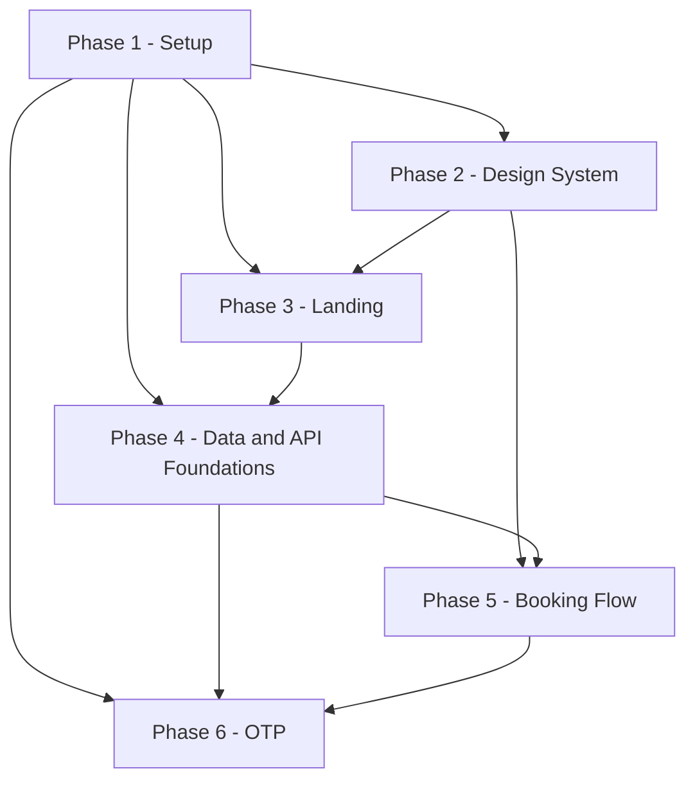

## 12. Implementation Phases

This section sequences the build as ordered phases — Setup, Design System, Landing, Data and
API Foundations, Booking Flow, OTP, then (in the companion fragment) Admin Auth, Dashboard,
Calendar/Tables, Settings, Testing, Deploy. Phases run in order; within a phase, tasks run in
dependency order, not necessarily numeric order. This fragment covers Phases 1-6 — everything
needed to take an empty repository to a patient completing an OTP-verified booking on a styled,
statically-generated marketing site. Phases 7-12 (the admin surface, test suites beyond unit
coverage, and deploy) are a separate fragment.

### 12.0 How to read this section

**Task IDs.** `T<phase>.<index>`, e.g. `T1.1` is the first task of Phase 1, `T4.7` the seventh
task of Phase 4. IDs are stable identifiers, not a execution order within the phase — consult a
task's own `Dependencies` field for that.

**Complexity scale.** Every task is rated S, M, or L:
- **S** — up to about half a focused implementation session.
- **M** — about one full focused session.
- **L** — a long session. An L task should be split into smaller tasks wherever a natural seam
  exists (pure logic vs. DB-touching code, server vs. client, schema vs. migration-polish); it is
  kept whole only when no such seam exists. No task in Phases 1-6 is rated L — every candidate
  that would have been L is split below (see Phase 4's slot-engine split and Phase 5's
  action/component split, in particular).

**The repo-green rule.** Every task — not every phase, every task — ends with: `pnpm lint` clean,
`pnpm typecheck` clean (**assumption**: Section 3's `package.json` script list omits a
`typecheck` script despite `.github/workflows/ci.yml`'s own comment pinning a
`lint -> typecheck -> unit -> ...` pipeline; this plan adds `"typecheck": "tsc --noEmit"`, see
Contract Challenges), and `pnpm test` clean (`vitest run`, which already covers both the `node`
and `jsdom` Vitest projects — unit and component tests — in one command, per Section 3's
`vitest.config.ts` comment). `pnpm build` is additionally required at every **phase** exit and on
any task whose acceptance criteria say so (SSG pages, the Lighthouse gate); it is not re-run after
every single task because most tasks in Phases 1-2 touch no route the build would exercise
differently. A task is not done while any of these are red.

**Dependencies.** Listed as task IDs (`T2.4, T4.1`) or `none`. A dependency means "the file(s)
this task extends or imports from must already exist with the shape this task assumes" — it is
not a claim that the dependency's whole phase must be closed first, though in practice phases run
in order anyway. Dependencies are intra-fragment only; nothing in Phases 1-6 depends on Phases
7-12.

**Task block shape.** Every task below gives, in order: a one-line title, Description (1-3
sentences), Files touched (real paths from Section 3's canonical tree, or an explicitly flagged
addition), Dependencies, Acceptance criteria (2-5 objectively checkable bullets — a command that
passes, a specific rendered output, a test assertion — never "works correctly"), and Complexity.

Two placement decisions apply across every phase below and are stated once here rather than
repeated on each affected task:

- **`src/lib/money.ts`, `src/lib/dates.ts`, `src/lib/enums.ts` are built in Phase 2 (T2.5), not
  Phase 4.** All three are pure, Prisma-free TypeScript/Zod modules (Section 2.2 already groups
  them under `lib/` alongside `env.ts`/`clock.ts`, which Phase 1 builds). Phase 2's shared
  composites (`StatusBadge`, `MoneyDisplay`, and 08b's `DateTimeInClinicTz`) need the vocabulary
  these modules export before they can be more than markup, and nothing about them requires the
  Prisma schema to exist first. **Assumption**, stated here once rather than re-argued per task.
- **Phase 3 (Landing) needs a working database before Phase 4 ("Data and API Foundations")
  formally starts**, because the brief's phase order puts Landing's build-time Service read (C15)
  before the full-schema phase. Resolution: T3.2 pulls forward only the catalog/config slice of
  C5's schema (`Service`, `ClinicSettings`, `WorkingHour`, `ClosedDate`) into its own migration,
  enough for the landing build; T4.1-T4.3 add the remaining models (`Patient`, `Appointment`,
  `AppointmentSlot`, `OtpChallenge`, `AdminUser`, `AuditLog`) in later migrations. All nine models
  and every field/index/constraint still conform to C5 exactly — this only changes which
  migration a given `CREATE TABLE` lands in. **Assumption**, stated here once; see also Contract
  Challenges.

### 12.1 Phase 1 — Setup

**Goal.** An empty repository becomes a booting Next.js app with every tool the rest of the plan
depends on — strict TypeScript, linting with the three contract-mandated custom rules, a local
Postgres, Prisma pointed at it, the env/logger/clock seams, and a green CI pipeline — before any
feature code exists. Per the brief: the repository must boot and CI must be green before anything
else.

#### T1.1 Scaffold the Next.js application

**Description.** Create the Next.js 15 App Router project under `src/` with React 19 and
TypeScript 5.x `strict: true` + `noUncheckedIndexedAccess: true` (C2), pnpm as the package
manager, the `@/*` -> `src/*` path alias, and the baseline root config files Section 3 lists
outside any later task's remit.

**Files touched:** `package.json`, `tsconfig.json`, `next.config.mjs`, `.gitignore`,
`src/app/layout.tsx` (minimal shell), `src/app/page.tsx` (placeholder), `src/app/globals.css`
(Tailwind directives only — T2.1 fills in tokens), `README.md` (stub — T1.8 completes it).

**Dependencies:** none.

**Acceptance criteria:**
- `pnpm install && pnpm dev` boots on `localhost:3000` and renders the placeholder page with no
  console errors.
- `tsconfig.json`'s `compilerOptions` includes `"strict": true` and
  `"noUncheckedIndexedAccess": true`; `pnpm typecheck`-equivalent `tsc --noEmit` (wired properly
  in T1.6) passes against the placeholder files once that script exists.
- `.gitignore` excludes `node_modules`, `.next`, `.env*`, and `prisma/schema.sqlite.prisma`
  (the last one pre-emptively, per Section 3.1's generated-file note, even though that file
  doesn't exist until T4.3).
- `next.config.mjs` sets no `images.remotePatterns` (no external images are used, per Section 3)
  and leaves Server Actions on their default config.
- **Complexity:** M

#### T1.2 ESLint flat config + Prettier, with the three contract-mandated custom rules

**Description.** Add `eslint.config.mjs` (flat config) and Prettier with the Tailwind
class-sorting plugin, wiring the layering rule from Section 2.2 and the three custom
`no-restricted-*` rules the brief calls out: the Date/clock-seam ban (C22), the raw-`process.env`
ban (C16), and the local-time-construction ban (C6) — plus the argon2/Prisma-in-middleware import
ban (C11) and `@typescript-eslint/no-explicit-any: "error"`, enforcing the brief's own
Non-Functional Requirement that code quality means "no `any`" (Section 14.2's Definition of Done
restates this same rule; this task is where it is actually pinned).

**Files touched:** `eslint.config.mjs`, `.prettierrc.json`, `.prettierignore`, `package.json`
(`lint` script).

**Dependencies:** T1.1.

**Acceptance criteria:**
- `import/no-restricted-paths` zones match Section 2.2's block exactly (four zones: `lib/**` and
  `components/**` unreachable from `app/features/server`; `server/**` unreachable from
  `app/features`; `features/**` unreachable from `app`) — `pnpm lint` fails on a scratch file
  that imports `@/server/db` from `@/app/page.tsx`, and passes once that import is removed.
- A `no-restricted-syntax` rule flags `new Date()` / `Date.now()` anywhere under
  `src/server/**` or `src/features/**/actions.ts` outside `src/lib/clock.ts` itself (C22's exact
  scope — not a repo-wide ban); a scratch violation in `src/server/db.ts` fails `pnpm lint`.
- A separate `no-restricted-syntax` rule flags multi-argument `new Date(y, m, d, ...)`
  construction in server code (C6); a scratch violation fails `pnpm lint`.
- A `no-restricted-syntax` rule flags any `process.env` member access outside `src/lib/env.ts`
  (C16); a scratch violation fails `pnpm lint`.
- A `no-restricted-imports` rule flags `@node-rs/argon2` or `@prisma/client` imported from
  `src/middleware.ts` or `src/auth.config.ts` (C11); `pnpm lint` fails on the exact WRONG example
  from Section 2.5 (`import { auth } from "./auth"` inside `middleware.ts`).
- `@typescript-eslint/no-explicit-any` is set to `"error"` repo-wide; a scratch file under `src/`
  containing a bare `: any` type annotation fails `pnpm lint`, and passes once that annotation is
  replaced with a real type or `unknown` (brief NFR "no `any`", closing the gap Section 14.2 flags
  as an unpinned assumption).
- `pnpm lint` and `pnpm format:check` (or equivalent Prettier script) both pass clean on the
  current tree.
- **Complexity:** M

#### T1.3 Tailwind CSS + shadcn/ui initialization

**Description.** Install and initialize Tailwind CSS 3.4.x (`tailwind.config.ts`, NOT v4
CSS-first, per C2) and run the shadcn CLI's `init`, which generates `components.json` and
`src/lib/utils.ts` (the `cn()` class-merge helper). Design tokens themselves are T2.1/T2.2's job
— this task only gets the toolchain running.

**Files touched:** `tailwind.config.ts` (bare, pre-token), `postcss.config.mjs`,
`components.json`, `src/lib/utils.ts`.

**Dependencies:** T1.1.

**Acceptance criteria:**
- `components.json` sets aliases `@/components`, `@/lib`, `@/ui` and `css: "src/app/globals.css"`
  (Section 3).
- `src/lib/utils.ts` exports `cn(...)` built on `clsx` + `tailwind-merge`; a unit test asserts
  `cn("p-2", false && "p-4", "text-sm")` returns `"p-2 text-sm"`.
- `pnpm dlx shadcn@latest add button` (run once as a smoke test, then reverted or left as the
  first of T2.4's 22 files) succeeds with no CLI errors against this `components.json`.
- `pnpm build` succeeds with Tailwind processing `globals.css`'s directives.
- **Complexity:** S

#### T1.4 Vitest and Playwright configuration

**Description.** Add `vitest.config.ts` with two projects (`node` for `tests/unit/**`, `jsdom`
for `tests/component/**`) and `playwright.config.ts` (baseURL, `webServer` boot, chromium +
webkit projects, `tests/e2e/**`), both resolving the `@/*` alias. No specs exist yet in either
suite — Phase 11 (out of scope here) is the first to populate `tests/e2e/**` in depth, though
Phases 2-6 populate `tests/unit/**` and `tests/component/**` as they go.

**Files touched:** `vitest.config.ts`, `playwright.config.ts`, `package.json` (`test`, `test:e2e`
scripts).

**Dependencies:** T1.1.

**Acceptance criteria:**
- `pnpm test` runs successfully against zero spec files (exits 0, "no tests found" is not treated
  as a failure for either project).
- `pnpm test:e2e --list` resolves `playwright.config.ts` without error (no `webServer` boot
  needed for `--list`).
- Both configs resolve `@/lib/utils` to `src/lib/utils.ts` (one trivial import-smoke spec in each
  project, deleted once Phase 2 adds real specs, or left as a `*.smoke.test.ts` placeholder).
- **Complexity:** S

#### T1.5 Docker Compose Postgres + Prisma init

**Description.** Add `docker-compose.yml` with one `db` service (Postgres 16, per C3), and run
`prisma init` to create `prisma/schema.prisma` with the `postgresql` datasource (`DATABASE_URL`,
`directUrl = env("DIRECT_DATABASE_URL")`) and no models yet — the first model-bearing migration is
T3.2's job.

**Files touched:** `docker-compose.yml`, `prisma/schema.prisma` (datasource + generator block
only), `package.json` (`db:migrate`, `db:seed` script stubs).

**Dependencies:** T1.1.

**Acceptance criteria:**
- `docker compose up -d db` starts a Postgres 16 container reachable on the port
  `DATABASE_URL` (once T1.6 defines it) points at.
- `prisma/schema.prisma`'s `datasource db` block uses `provider = "postgresql"`,
  `url = env("DATABASE_URL")`, `directUrl = env("DIRECT_DATABASE_URL")` — no `@db.` native type
  attributes anywhere (C3).
- `pnpm prisma validate` passes against the empty (model-free) schema.
- `docker-compose.yml` declares no `redis`/cache service (C3's note: dev uses
  `MemoryRateLimiter`, no external dependency yet).
- **Complexity:** S

#### T1.6 Zod env module and `.env.example`

**Description.** Build `src/lib/env.ts`: Zod-parses `process.env` exactly once at module load
against the full C16 variable list, exporting a typed, frozen object; throws a readable startup
error (not a silent `undefined`) if any required var is missing or malformed. Add `.env.example`
documenting every C16 name with no values.

**Files touched:** `src/lib/env.ts`, `.env.example`, `tests/unit/lib/env.test.ts`.

**Dependencies:** T1.2 (the ESLint rule this file is the sanctioned exception to must already
exist so this task can prove compliance against it).

**Acceptance criteria:**
- `.env.example` lists exactly the C16 names (as amended by A7) — `DATABASE_URL`,
  `DIRECT_DATABASE_URL`, `AUTH_SECRET`, `AUTH_URL`, `NEXT_PUBLIC_SITE_URL`, `OTP_PEPPER`,
  `CRON_SECRET`, `SMS_PROVIDER`, `TWILIO_ACCOUNT_SID`, `TWILIO_AUTH_TOKEN`,
  `TWILIO_MESSAGING_SERVICE_SID`, `TWILIO_FROM_NUMBER`, `SMS_DAILY_CAP_MINOR`,
  `SMS_KILL_SWITCH`, `RATE_LIMIT_PROVIDER`, `UPSTASH_REDIS_REST_URL`,
  `UPSTASH_REDIS_REST_TOKEN`, `CLINIC_TIMEZONE`, `CLINIC_CURRENCY`, `CLINIC_DEFAULT_COUNTRY`,
  `SEED_ADMIN_EMAIL`, `SEED_ADMIN_PASSWORD`, `LOG_LEVEL`, `E2E_TEST_HOOKS` — no more, no fewer,
  no values (a test diffs the file's keys against a hardcoded literal array of these 24 names).
- `env.ts`'s schema rejects `SMS_PROVIDER` values other than `"console" | "twilio"` and
  `RATE_LIMIT_PROVIDER` values other than `"memory" | "upstash"` (unit test, both enums, both
  branches).
- Deleting a required var from a test `.env` and importing `env.ts` throws synchronously with a
  message naming the missing key, not a generic Zod dump (unit test).
- `pnpm lint` passes with zero `no-restricted-syntax` violations for the `process.env` rule,
  proving `env.ts` is correctly exempted while nothing else is.
- **Complexity:** S

#### T1.7 Logger and Clock seams

**Description.** Build `src/lib/logger.ts` (pino, redaction serializer per C19 — never logs
phone numbers, full names, OTP codes, passwords, session tokens, or booking references) and
`src/lib/clock.ts` (`interface Clock { now(): Date }`, `systemClock` for production, a
`FixedClock` test double, per C22).

**Files touched:** `src/lib/logger.ts`, `src/lib/clock.ts`, `tests/unit/lib/clock.test.ts` (added
here even though Section 3 doesn't name it individually; `tests/unit/lib/` already exists per
Section 3's tree for the five files T2.5/T5.1/T5.9 add — this task's clock test lands beside
them).

**Dependencies:** T1.6 (`LOG_LEVEL` from env.ts).

**Acceptance criteria:**
- `logger.ts`'s pino instance is configured with `level: env.LOG_LEVEL` and a `redact` serializer
  array covering `phoneE164`, `holdPhoneE164`, `fullName`, `holdFullName`, `code`, `passwordHash`,
  `sessionToken`, `reference` paths; a unit test logs an object containing a `phoneE164` field and
  asserts the captured output string never contains the raw value.
- `FixedClock` constructed with a fixed `Date` returns that exact instant from every `now()` call
  regardless of real wall-clock time elapsed between calls (unit test with two calls separated by
  a real `setTimeout`).
- `systemClock.now()` returns a `Date` within 50ms of `Date.now()` at call time (unit test, loose
  tolerance since this one file is the sanctioned exception to C22's ban).
- `pnpm test` passes including both new spec files.
- **Complexity:** S

#### T1.8 CI skeleton, PR template, and README quickstart

**Description.** Add `.github/workflows/ci.yml` running the pipeline stages that exist so far
(`lint`, `typecheck`, `unit`, `build`) in order, failing fast; add
`.github/pull_request_template.md` with the C19 PII-review checklist item; complete `README.md`'s
quickstart (`docker compose up -d db`, `pnpm install`, `pnpm db:migrate`, `pnpm db:seed`,
`pnpm dev`, per Section 3's own README comment — the migrate/seed steps become real once T3.2
exists, but the README documents the eventual full sequence now).

**Files touched:** `.github/workflows/ci.yml`, `.github/pull_request_template.md`, `README.md`.

**Dependencies:** T1.2, T1.4, T1.6.

**Acceptance criteria:**
- `ci.yml` runs `pnpm lint`, `pnpm typecheck`, `pnpm test`, `pnpm build` as separate steps, in
  that order, each gating the next (`continue-on-error` is never set).
- A pushed branch with one deliberately failing lint rule shows a red `lint` check and the
  pipeline does not proceed to `typecheck` (observed once on a scratch PR, then reverted).
- `pull_request_template.md` contains a checklist line matching "any new log line touching
  patient data reviewed for PII" (C19).
- `README.md`'s quickstart section lists the five commands above in that exact order and nothing
  else, runnable top-to-bottom on a clean checkout once T3.2's migration exists.
- **Complexity:** M

#### T1.9 Initiate Twilio account and A2P messaging registration (long-lead, non-blocking)

**Description.** Open the Twilio account and start carrier A2P registration now, since review
takes days to weeks that no engineering effort can compress (A11): 10DLC registration in the US
and Canada, or toll-free verification, or — only where the destination carrier permits it, which
excludes the US and Canada — an alphanumeric sender ID. Record which path was filed and the
carrier's expected approval date in a tracked location (e.g. an issue or a dated note in the repo
alongside this plan). This task has no code dependencies and blocks nothing else in development:
`SMS_PROVIDER=console` (T6.1) covers every dev and test send until the registration clears, and
only Phase 12's provider switch-over to `TwilioProvider` in production depends on this task's
completion.

**Files touched:** none (a tracking issue/note, not application code).

**Dependencies:** none.

**Acceptance criteria:**
- The Twilio account exists and one of the three A2P paths (10DLC, toll-free verification, or —
  outside the US/Canada only — an alphanumeric sender ID) has been filed for review.
- The expected carrier approval date is recorded somewhere durable and linkable (issue tracker,
  dated repo note).
- A code comment or doc note states explicitly that this task blocks no other task in Phases 1-11
  and is calendar-time, not engineer-time, work.
- **Complexity:** S

#### Phase 1 exit criteria
- `pnpm install && docker compose up -d db && pnpm dev` boots the app from a clean checkout.
- `pnpm lint`, `pnpm typecheck`, `pnpm test`, `pnpm build` all pass locally and in CI.
- `eslint.config.mjs` enforces all four custom rules (layering, clock-seam, env-seam,
  local-time-construction) plus the middleware-import ban and `@typescript-eslint/no-explicit-any`;
  each has a reverted scratch-violation commit as proof during review, not just an assertion in
  this plan.
- `src/lib/env.ts`, `src/lib/clock.ts`, `src/lib/logger.ts` exist, are unit-tested, and are the
  only files exempted from their respective lint bans.

### 12.2 Phase 2 — Design System

**Goal.** Every visual primitive the rest of the app will compose — color tokens, type, the
vendored shadcn kit, and the shared composites from Section 8.2 that don't require booking/admin
domain logic — exists, is type-checked, and is proven accessible (contrast audit) before any
feature screen is built.

#### T2.1 `globals.css` design tokens (light + dark)

**Description.** Define the canonical token vocabulary (C18, A8) as an HSL-channel CSS variable
under `:root` and under `.dark`, computed precisely from Section 8.3.2's pinned values — both the
light hexes (C18: "token values are EXACTLY the brief's hexes") and the dark-mode values, which
Section 8.3.2 pins explicitly rather than leaving to this plan's own derivation. The canonical set
is exactly 30 names, no more and no fewer (A8); three brief colors expand into named pairs no
single brief hex covers alone — `--card`/`--popover` (both the brief's one "Surface" hex),
`--primary`/`--primary-button` (brand teal versus the distinct, slightly darker button-fill shade
C18 already requires), and five `--chart-*` series tokens (two reuse `--primary`/`--secondary`,
three are net-new or reused status hues) — plus a `*-foreground` pairing for every surface/brand/
status token ever used as a text or icon color on top of it.

| Token | Light HSL | Dark HSL |
|---|---|---|
| `--background` | `210 40% 98%` (#F8FAFC) | `222 47% 11%` (#0F172A) |
| `--foreground` | `222 47% 11%` (#0F172A) | `210 40% 96%` (#F1F5F9) |
| `--card` | `0 0% 100%` (#FFFFFF) | `217 33% 17%` (#1E293B) |
| `--card-foreground` | `222 47% 11%` (#0F172A) | `210 40% 96%` (#F1F5F9) |
| `--popover` | `0 0% 100%` (#FFFFFF) | `217 33% 17%` (#1E293B) |
| `--popover-foreground` | `222 47% 11%` (#0F172A) | `210 40% 96%` (#F1F5F9) |
| `--primary` | `175 84% 32%` (#0D9488) | `172 66% 50%` (#2DD4BF) |
| `--primary-foreground` | `0 0% 100%` (#FFFFFF) | `222 47% 11%` (#0F172A) |
| `--primary-button` | `175 77% 26%` (#0F766E) | `172 66% 50%` (#2DD4BF) |
| `--primary-button-hover` | `176 69% 22%` (#115E59) | `173 60% 44%` (#26B8A5) |
| `--secondary` | `243 75% 59%` (#4F46E5) | `234 89% 74%` (#818CF8) |
| `--secondary-foreground` | `0 0% 100%` (#FFFFFF) | `222 47% 11%` (#0F172A) |
| `--accent` | `4 92% 69%` (#F97066) | `4 92% 69%` (unchanged) |
| `--accent-foreground` | `222 47% 11%` (#0F172A) | `222 47% 11%` (unchanged) |
| `--muted` | `214 32% 91%` (#E2E8F0) | `215 25% 27%` (#334155) |
| `--muted-foreground` | `215 19% 35%` (#475569) | `215 20% 65%` (#94A3B8) |
| `--border` | `214 32% 91%` (#E2E8F0) | `215 25% 27%` (#334155) |
| `--input` | `214 32% 91%` (#E2E8F0) | `215 25% 27%` (#334155) |
| `--ring` | `175 84% 32%` (= `--primary`) | `172 66% 50%` (= `--primary`) |
| `--destructive` | `0 72% 51%` (#DC2626) | `0 91% 71%` (#F87171) |
| `--destructive-foreground` | `0 0% 100%` (#FFFFFF) | `222 47% 11%` (#0F172A) |
| `--success` | `142 76% 36%` (#16A34A) | `142 69% 58%` (#4ADE80) |
| `--warning` | `38 92% 50%` (#F59E0B) | `43 96% 56%` (#FBBF24) |
| `--info` | `199 89% 48%` (#0EA5E9) | `198 93% 60%` (#38BDF8) |
| `--chart-1` | `175 84% 32%` (= `--primary`) | `172 66% 50%` (= `--primary`) |
| `--chart-2` | `243 75% 59%` (= `--secondary`) | `234 89% 74%` (= `--secondary`) |
| `--chart-3` | `26 90% 37%` (#B45309) | `43 96% 56%` (= `--warning`) |
| `--chart-4` | `201 96% 32%` (#0369A1) | `198 93% 60%` (= `--info`) |
| `--chart-5` | `295 72% 40%` (#A21CAF) | `292 91% 73%` (#E879F9) |

None of the banned aliases `--primary-hover`, `--primary-hover-dark`, `--surface`, `--danger`
(C18, A8) may appear anywhere in `globals.css`.

Also sets `--radius: 1rem` (C18) once, under `:root` only — not redeclared under `.dark`, since
`.dark` is a class applied to the same `<html>` element `:root` matches, and a custom property one
matching rule doesn't set is simply not overridden by that rule; the value set under `:root` keeps
resolving in dark mode too, exactly as Section 8.3.2's own `globals.css` does it.

**Files touched:** `src/app/globals.css`.

**Dependencies:** T1.3.

**Acceptance criteria:**
- Every one of the 30 canonical tokens above exists as a CSS variable under `:root`, and every
  one of the 29 color tokens (all but `--radius`) is redeclared under `.dark` with its dark-mode
  value from the table — a test (or a documented manual check, since this is pure CSS) greps
  `globals.css` for all 30 `--`-prefixed names and confirms zero occurrences of
  `--primary-hover`, `--primary-hover-dark`, `--surface`, or `--danger` anywhere in the file (A8).
- A browser devtools check (`getComputedStyle(document.documentElement).getPropertyValue(...)`)
  for every one of the 30 tokens resolves to a non-empty value both with and without a
  `class="dark"` attribute on `<html>` (manual check, documented in a code comment) — this is the
  exact precondition Phase 8's `hsl(var(--chart-1))` chart tasks depend on (A8's rationale).
- `pnpm build` succeeds with Tailwind processing the full token block.
- Toggling a `class="dark"` attribute on `<html>` in a browser devtools inspector (manual check,
  documented in a code comment) visibly swaps background/foreground without a page reload.
- **Complexity:** S

#### T2.2 `tailwind.config.ts` token mapping

**Description.** Map every T2.1 token into `theme.extend.colors` following Section 8.3.3's exact
structure — nested `{ DEFAULT, foreground }` objects for `card`, `popover`, `secondary`, `accent`,
`muted`, `destructive`; a nested `primary` object additionally carrying `button`/`button-hover`
keys; a nested `chart` object with keys `1`-`5`; and flat entries for `background`, `foreground`,
`border`, `input`, `ring`, `success`, `warning`, `info` — every leaf using
`"hsl(var(--token) / <alpha-value>)"` (shadcn convention). Set `darkMode: "class"` (C18), and set
`borderRadius` to derive from `--radius` (`rounded-2xl` for cards, `rounded-xl` for
inputs/buttons, per C18 — expressed as the default radius scale, not new tokens).

**Files touched:** `tailwind.config.ts`.

**Dependencies:** T2.1.

**Acceptance criteria:**
- `tailwind.config.ts` sets `darkMode: "class"`.
- `theme.extend.colors` resolves every one of T2.1's 30 canonical tokens — the six nested
  `{ DEFAULT, foreground }` groups (`card`, `popover`, `secondary`, `accent`, `muted`,
  `destructive`), `primary`'s nested `DEFAULT`/`button`/`button-hover`/`foreground` keys, the
  nested `chart.{1,2,3,4,5}` group, and the eight flat entries — each leaf using the
  `hsl(var(--x) / <alpha-value>)` pattern (Section 8.3.3) — grep confirms exactly 30
  `var(--...)` references, one per canonical token, and zero occurrences of any banned alias
  (A8).
- A scratch component using `bg-primary text-foreground border-border` builds and resolves to the
  expected computed colors in a browser devtools inspection (manual check).
- A code comment documents the C18 "8px spacing grid, restricted to multiples of 2" convention
  (Tailwind's default spacing scale is 4px-based, so "multiples of 2" means only even-numbered
  utilities — `p-2`, `p-4`, `p-6`... — are used in app code; this is a documented review
  convention, not an automatically-lint-enforced one, since no Tailwind-classname linter is
  otherwise introduced in this plan).
- `pnpm build` succeeds.
- **Complexity:** S

#### T2.3 `next/font` self-hosted type

**Description.** Wire `next/font/google` in `src/app/layout.tsx`: Inter as `--font-sans`, Plus
Jakarta Sans as `--font-display`, both `display: "swap"` (C18), applied as CSS variables on
`<html>` or `<body>`.

**Files touched:** `src/app/layout.tsx`.

**Dependencies:** T2.2.

**Acceptance criteria:**
- `layout.tsx` imports both fonts from `next/font/google` with `display: "swap"` and exposes
  `--font-sans` / `--font-display` CSS variables on the root element.
- `pnpm build` output contains zero requests to `fonts.googleapis.com` at runtime (self-hosted —
  `grep -r "fonts.googleapis" .next/static` after a build returns nothing).
- `tailwind.config.ts`'s `fontFamily.sans`/`fontFamily.display` reference the two CSS variables.
- **Complexity:** S

#### T2.4 shadcn primitive vendoring (closed list of 22)

**Description.** Vendor exactly the 22 shadcn primitives Section 3 names via the shadcn CLI:
`button`, `input`, `label`, `select`, `calendar`, `dialog`, `sheet`, `dropdown-menu`, `table`,
`tabs`, `badge`, `card`, `form`, `sonner`, `skeleton`, `separator`, `popover`, `alert`,
`checkbox`, `pagination`, `tooltip`, `command`. No `toast.tsx` (superseded by `sonner`), no
`accordion.tsx` (FAQ uses native `
`/`
`), no `radio-group.tsx` (Section 3: "no
genuine use").

**Files touched:** `src/components/ui/button.tsx`, `input.tsx`, `label.tsx`, `select.tsx`,
`calendar.tsx`, `dialog.tsx`, `sheet.tsx`, `dropdown-menu.tsx`, `table.tsx`, `tabs.tsx`,
`badge.tsx`, `card.tsx`, `form.tsx`, `sonner.tsx`, `skeleton.tsx`, `separator.tsx`, `popover.tsx`,
`alert.tsx`, `checkbox.tsx`, `pagination.tsx`, `tooltip.tsx`, `command.tsx`.

**Dependencies:** T1.3, T2.2.

**Acceptance criteria:**
- All 22 files exist at `src/components/ui/` and no others do — `ls src/components/ui | wc -l`
  returns `22`.
- `pnpm typecheck` passes.
- `button.tsx`, `badge.tsx`, and `alert.tsx` each define a `cva(...)` variants object (component
  convention, Section 8.2.13) — grep returns exactly 3 hits across the directory for `cva(`.
- A scratch page importing all 22 named exports builds with no missing-export errors, then is
  deleted.
- **Complexity:** S

#### T2.5 `lib/money.ts`, `lib/dates.ts`, `lib/enums.ts`

**Description.** Build the three pure vocabulary/formatting modules Section 2.2 groups under
`lib/`, pulled forward from their "natural" Phase 4 home per this section's stated assumption
(12.0): `money.ts` (`formatMoney(minor, currency, locale)`, exponent from
`Intl.NumberFormat().resolvedOptions().maximumFractionDigits`, never a hardcoded `/100`, C7);
`dates.ts` (boundary wrappers around `fromZonedTime`/`toZonedTime`/`formatInTimeZone` from
`date-fns-tz`, C6); `enums.ts` (`AppointmentStatus`/`BookingSource`/`AdminRole`/`AuditAction` as
const objects plus matching Zod unions, C4).

**Files touched:** `src/lib/money.ts`, `src/lib/dates.ts`, `src/lib/enums.ts`,
`tests/unit/lib/money.test.ts`, `tests/unit/lib/dates.test.ts`, `tests/unit/lib/enums.test.ts`.

**Dependencies:** none (pure, Prisma-free).

**Acceptance criteria:**
- `formatMoney(5000, "EUR", "en-GB")` returns `"€50.00"`; `formatMoney(500, "JPY", "ja-JP")`
  returns a 0-decimal yen string (two unit test cases, asserting the exponent is read from
  `Intl`, not hardcoded, by also testing a 3-decimal currency like `JOD`).
- `enums.ts` exports all four C4 const objects and their Zod unions; `z.infer` of each union
  equals the literal string-union type (a `tests/unit/lib/enums.test.ts` case using
  `expectTypeOf` or a runtime array-equality check against C4's literal lists).
- `dates.ts` exports `fromZonedTime`, `toZonedTime`, `formatInTimeZone` as its only re-exports —
  grep confirms no other file in the repo imports `date-fns-tz` directly (the rule this module
  exists to enforce, verified once more files exist in later phases).
- `pnpm test` passes including all three new spec files.
- **Complexity:** S

#### T2.6 Shared composites, part 1 — PageHeader, EmptyState, StatusBadge, MoneyDisplay

**Description.** Build four of Section 8.2.2's shared composites: `PageHeader` (title + optional
actions slot), `EmptyState` (icon + message + optional action), `StatusBadge`
(`AppointmentStatus` -> color + icon + text, never color alone — C4, WCAG 1.4.1), `MoneyDisplay`
(thin wrapper around `formatMoney`). All four are Server Components by default (Section 8.2.13).

**Files touched:** `src/components/page-header.tsx`, `src/components/empty-state.tsx`,
`src/components/status-badge.tsx`, `src/components/money-display.tsx`.

**Dependencies:** T2.4 (`ui/badge`, `ui/card`), T2.5 (`enums.ts` for `StatusBadge`, `money.ts` for
`MoneyDisplay`).

**Acceptance criteria:**
- `StatusBadge` renders a distinct icon + text label for each of the 5 `AppointmentStatus`
  values; a component test asserts the rendered text content differs for all 5 (never relying on
  color alone, per C4/WCAG 1.4.1).
- `MoneyDisplay` given `{ minor: 5000, currency: "EUR" }` renders text containing `"€50.00"`
  (component test).
- None of the four files contain a `"use client"` directive (grep confirms).
- `pnpm typecheck` and `pnpm test` pass.
- **Complexity:** S

#### T2.7a Shared composites, part 2a — ConfirmDialog, DataTablePagination, DateRangePicker

**Description.** Build the three straightforward primitive-wrapper composites from Section 3's
11-file budget: `ConfirmDialog` (generic "are you sure?" over `ui/dialog`, one focus-trap +
pending-state + destructive-styling pattern reused by every "are you sure" dialog, 8.2.12),
`DataTablePagination` (wraps `ui/pagination`), `DateRangePicker` (`ui/popover` + `ui/calendar`
range picker, presentation-only — the caller owns the URL-sync wrapper, 8.2.12). Each is a
controlled component with no component-owned test-harness complexity beyond a standard
render/interact/assert cycle, unlike T2.7b's three.

**Files touched:** `src/components/confirm-dialog.tsx`, `src/components/data-table-pagination.tsx`,
`src/components/date-range-picker.tsx`.

**Dependencies:** T2.4 (`ui/dialog`, `ui/pagination`, `ui/popover`, `ui/calendar`).

**Acceptance criteria:**
- `ConfirmDialog` returns focus to its trigger element after closing, whether confirmed or
  cancelled (component test asserting `document.activeElement` post-close).
- `DataTablePagination` renders page/next/prev controls driven entirely by props (`page`,
  `pageCount`, `onPageChange`) with no internal state of its own (component test; grep confirms no
  `useState` call in the file).
- `DateRangePicker` calls `onChange({ from, to })` once a full range is selected and never mutates
  its `value` prop in place (component test).
- `pnpm typecheck` and `pnpm test` pass.
- **Complexity:** S

#### T2.7b Shared composites, part 2b — DateTimeInClinicTz, CopyButton, CountdownTimer (08b-sourced additions)

**Description.** Build the three components named only in Section 8.2's own stated additions
(**assumption, inherited from that fragment**: `DateTimeInClinicTz`, `CopyButton`,
`CountdownTimer` — extending the 11-file shared-composite budget to 14, per 8.2.12's own note).
Split out from T2.7a because each needs a meaningfully distinct, non-trivial test harness —
`CountdownTimer` needs `vi.useFakeTimers()`, `CopyButton` needs a mocked-absent
`navigator.clipboard` plus an `aria-live` assertion, `DateTimeInClinicTz` needs a `dates.ts`
boundary-call assertion — making this closer to its own session than a tail end of T2.7a's.

**Files touched:** `src/components/date-time.tsx`, `src/components/copy-button.tsx`,
`src/components/countdown-timer.tsx`.

**Dependencies:** T2.5 (`dates.ts` for `DateTimeInClinicTz`).

**Acceptance criteria:**
- `CopyButton` degrades without throwing when `navigator.clipboard` is undefined, and announces
  its state change via `aria-live` (component test mocking the API's absence).
- `CountdownTimer` renders `mm:ss` and decrements on a fake-timer tick (component test using
  `vi.useFakeTimers()`).
- `DateTimeInClinicTz` calls `formatInTimeZone` (from T2.5's `dates.ts`) exactly once per render —
  no inline `date-fns-tz` import of its own (grep).
- `pnpm typecheck` and `pnpm test` pass.
- **Complexity:** M

#### T2.8 SiteHeader, SiteFooter, ThemeToggle, AppLogo

**Description.** Build the four remaining Section 3 shared composites that are specifically
chrome, not data display: `SiteHeader` (public nav: `/`, `/privacy`, `/terms`, `/book`),
`SiteFooter` (contact info + hours summary — the brief's Footer landing section, built shared
because `/privacy` and `/terms` reuse it too), `ThemeToggle` (dark-mode switch, C18
nice-to-have), `AppLogo`.

**Files touched:** `src/components/site-header.tsx`, `src/components/site-footer.tsx`,
`src/components/theme-toggle.tsx`, `src/components/app-logo.tsx`.

**Dependencies:** T2.4, T2.2 (dark-mode class strategy).

**Acceptance criteria:**
- `SiteHeader` renders exactly 4 nav anchors with `href` values `/`, `/privacy`, `/terms`, `/book`
  (component test).
- `ThemeToggle` toggles `class="dark"` on `document.documentElement` on click and persists the
  choice to `localStorage` wrapped in `try`/`catch` (component test for the toggle; a second test
  forces `localStorage.setItem` to throw and asserts no uncaught error).
- `ThemeToggle`'s icon-swap transition is wrapped in a `@media (prefers-reduced-motion: reduce)`
  guard and never removes the element's focus ring (grep `globals.css`/the component's class
  list for the media query; manual keyboard-tab check that a visible outline remains).
- `pnpm typecheck` and `pnpm test` pass.
- **Complexity:** S

#### T2.9 Contrast audit artifact + `/dev/tokens` style guide page

**Description.** Record a committed contrast audit covering every pair C18 calls out, and build
a `/dev/tokens` page rendering every token swatch (both themes) and all 22 shadcn primitives'
default states, excluded from production builds. **Assumption**: neither the audit file's path
nor the style-guide route exists in Section 3's tree; this plan adds
`docs/accessibility/contrast-audit.md` and `src/app/dev/tokens/page.tsx` as new, explicitly
flagged files — noted as an assumption, not a Contract Challenge, since nothing in Section 3
forbids additive files, it simply doesn't name these two.

**Files touched:** `docs/accessibility/contrast-audit.md`, `src/app/dev/tokens/page.tsx`,
`src/lib/env.ts` (extend: export a `isProduction` boolean computed from `process.env.NODE_ENV` —
`NODE_ENV` is a framework builtin, not a C16-pinned var needing `.env.example` documentation, but
reading it still goes through the one file C16 allows to touch `process.env`, so it is added here
rather than read raw in the page).

**Dependencies:** T2.1 through T2.8 (audits/renders everything they produced).

**Acceptance criteria:**
- `docs/accessibility/contrast-audit.md` records a measured ratio for every pair C18 names
  (white-on-`#0D9488`, white-on-`#0F766E`, `#0F172A`-on-coral, muted-text-on-background, each
  status color's icon+text pairing) with every normal-text pair >= 4.5:1 and every
  large-text/non-text pair >= 3:1 — including the explicit note that white-on-`#0D9488` measures
  ~3.4:1 and FAILS, which is why `#0F766E` is the button fill, not `#0D9488` (C18).
- `/dev/tokens` renders all 14 color swatches in both themes and all 22 `ui/` primitives'
  default states on one page.
- `pnpm build && pnpm start`, then `curl -s -o /dev/null -w "%{http_code}" localhost:3000/dev/tokens`
  with `NODE_ENV=production` returns `404`.
- `/dev/tokens` is absent from `sitemap.ts`'s output and listed under `Disallow` in `robots.ts`
  once those exist (T3.7 — forward reference, re-verified there).
- **Complexity:** M

#### Phase 2 exit criteria
- `pnpm build` succeeds with the full token set, both fonts self-hosted, and all 22 shadcn
  primitives plus all 14 shared composites type-checking and smoke-tested.
- `/dev/tokens` renders every token and primitive in dev and 404s in a production build.
- `docs/accessibility/contrast-audit.md` is committed with every C18-named pair passing its WCAG
  threshold.
- `pnpm lint`, `pnpm typecheck`, `pnpm test`, `pnpm build` all green.

### 12.3 Phase 3 — Landing

**Goal.** The public marketing site at `/` (plus `/privacy`, `/terms`) is fully built as a
statically-generated page with build-time data, every section server-rendered in brief order,
and passes a hard Lighthouse gate of a >=95 median (3 runs, A10) in all four categories before
this phase can close.

#### T3.1 `src/content/site.ts`

**Description.** Build the single static-content config: hero copy, "How It Works" steps,
testimonials, doctor bios, FAQ entries, footer contact strings. Services and prices are
explicitly NOT here — they come from the database (T3.2's seed), per Section 3's own comment on
this file.

**Files touched:** `src/content/site.ts`.

**Dependencies:** T1.1.

**Acceptance criteria:**
- Exports one typed `siteContent` object covering: hero headline/subhead/CTA label, exactly 3
  "How It Works" steps, >= 3 testimonials, >= 3 doctor bios, >= 5 FAQ entries, footer contact
  strings — a unit test (`tests/unit/lib` is the closest existing home; this plan adds
  `tests/unit/content/site.test.ts`) asserts each array's minimum length.
- `pnpm typecheck` passes with zero `any` in the file.
- A code comment states explicitly that Services/prices are read from the database, not this
  file.
- **Complexity:** S

#### T3.2 Catalog/config schema slice, first migration, `server/db.ts`, partial seed

**Description.** Add the four catalog/config models from C5 — `Service`, `ClinicSettings`,
`WorkingHour`, `ClosedDate` — to `prisma/schema.prisma` with their exact C5 fields and indexes,
generate and apply the first migration, add the Prisma Client singleton, and seed only these four
tables (per the 12.0 assumption: this is a deliberate early slice, not the full schema — T4.1-T4.3
add the rest in later migrations).

**Files touched:** `prisma/schema.prisma` (four models), `prisma/migrations/<ts>_catalog_init/migration.sql`,
`src/server/db.ts`, `prisma/seed.ts` (partial: `ClinicSettings` singleton + `WorkingHour` rows +
`ClosedDate` rows + `Service` rows only — no `AdminUser`/`Appointment`/etc. yet).

**Dependencies:** T1.5.

**Acceptance criteria:**
- `Service` has exactly C5's fields (`id`, `slug` unique, `name`, `description`, `durationMin`,
  `priceMinor`, `isActive` default `true`, `sortOrder`, `colorHex`, `createdAt`, `updatedAt`,
  `appointments` relation); `ClinicSettings` has `id` defaulting to `"singleton"` plus all 13
  remaining C5 fields with their exact defaults (`slotIntervalMin` 15, `bufferMin` 0,
  `minLeadTimeMin` 120, `maxAdvanceDays` 60, `holdTtlMin` 10); `WorkingHour` has
  `@@unique([weekday, openMinute])`; `ClosedDate` has `date` as `String @unique`, not `DateTime`
  (C5's deliberate off-by-one-day-avoidance choice) — `pnpm prisma validate` plus a schema-diff
  review against C5 confirms all four.
- `pnpm prisma migrate dev --name catalog_init` applies cleanly against a freshly started
  `docker compose up -d db`.
- `pnpm prisma db seed` inserts: 1 `ClinicSettings` row (`id = "singleton"`), the Mon-Fri +
  Saturday-split-shift + Sunday-closed `WorkingHour` rows, 3 `ClosedDate` rows, and the 7 seeded
  `Service` rows (Section 4.6) — zero rows in any as-yet-undefined table.
- Re-running `pnpm prisma db seed` is idempotent (identical row counts on a second run).
- `src/server/db.ts` exports a `PrismaClient` singleton cached on `globalThis` across HMR reloads
  (Section 3) — a dev-mode double-import does not open a second connection (manual check: log
  Prisma's connection count across two hot reloads).
- **Complexity:** M

#### T3.3 Hero + Services sections, landing queries

**Description.** Build `HeroSection` and `ServicesSection` as ordered Server Components, plus
`features/landing/queries.ts`'s `getActiveServicesForLanding()` — the one build-time Prisma read
(C15) — and `types.ts`. Wire both sections into `src/app/page.tsx` in brief order (Hero first).

**Files touched:** `src/features/landing/queries.ts`, `src/features/landing/types.ts`,
`src/features/landing/components/hero-section.tsx`,
`src/features/landing/components/services-section.tsx`, `src/app/page.tsx`.

**Dependencies:** T3.1, T3.2, T2.6 (`MoneyDisplay`).

**Acceptance criteria:**
- `getActiveServicesForLanding()` queries `Service` `WHERE isActive = true ORDER BY sortOrder`,
  called from exactly one call site (`services-section.tsx`) — grep confirms no second caller.
- `ServicesSection` renders all 7 seeded services, each with its price via `MoneyDisplay`.
- `HeroSection` renders a `<a href="/book">` CTA.
- Neither component carries a `"use client"` directive (grep).
- `pnpm build` embeds the services list as static HTML with no client-side fetch for this section
  (view-source on the built output).
- **Complexity:** S

#### T3.4 About, How It Works, Testimonials sections

**Description.** Build `AboutSection` (doctors from `site.ts`), `HowItWorksSection` (3 numbered
steps), `TestimonialsSection` (all testimonials from `site.ts`) as ordered Server Components,
wired into `page.tsx` immediately after Services.

**Files touched:** `src/features/landing/components/about-section.tsx`,
`src/features/landing/components/how-it-works-section.tsx`,
`src/features/landing/components/testimonials-section.tsx`, `src/app/page.tsx`.

**Dependencies:** T3.1.

**Acceptance criteria:**
- `AboutSection` renders every doctor bio from `siteContent`; `HowItWorksSection` renders exactly
  3 steps; `TestimonialsSection` renders every testimonial — three component tests, one per
  section, each asserting the exact count.
- Every ``/`next/image` usage across the three sections sets explicit `width`/`height`
  (CLS 0, C23) — grep confirms no image tag lacks both attributes.
- None of the three carry `"use client"`.
- **Complexity:** S

#### T3.5 Hours/Location + FAQ sections

**Description.** Build `HoursLocationSection` (reads `ClinicSettings` + `WorkingHour` via a new
landing query, renders per-weekday open/close in clinic-local wall time) and `FaqSection`
(renders every FAQ entry from `site.ts` as native `
`/`
`, zero client JS), wired
into `page.tsx` in brief order.

**Files touched:** `src/features/landing/queries.ts` (extend: `getClinicHoursForLanding()`),
`src/features/landing/components/hours-location-section.tsx`,
`src/features/landing/components/faq-section.tsx`, `src/app/page.tsx`.

**Dependencies:** T3.1, T3.2.

**Acceptance criteria:**
- `HoursLocationSection` renders all 7 weekdays' hours (or "Closed") derived from the seeded
  `WorkingHour` rows, formatted in `ClinicSettings.timeZone` wall time (component/integration
  test against the seeded test DB).
- `FaqSection` renders every FAQ entry as a native `
`/`
` pair — grep confirms
  zero `"use client"` directive and no `ui/accordion` import anywhere in the file.
- Each `
` is natively keyboard-focusable and togglable with the Enter/Space keys with no
  custom JS attached (manual accessibility check, documented in a code comment).
- **Complexity:** S

#### T3.6 Privacy and Terms pages

**Description.** Build the two static legal pages Section 3's tree names: `/privacy` (states the
C20 retention policy in prose) and `/terms` (service terms). **Assumption**: the brief gives no
specific Terms content; this plan uses generic boilerplate (service terms, no medical-advice
disclaimer, a cancellation-policy line referencing the booking hold) since nothing more specific
is pinned anywhere in scope.

**Files touched:** `src/app/privacy/page.tsx`, `src/app/terms/page.tsx`.

**Dependencies:** T2.8 (`SiteHeader`/`SiteFooter` reused on both).

**Acceptance criteria:**
- `/privacy`'s rendered text states, in plain language and matching C20's actual numbers:
  appointments older than 24 months are anonymized (not deleted) with revenue history retained;
  patients with no appointment in 24 months are hard-deleted; OTP codes are deleted within 24
  hours of use or expiry — a component test asserts the rendered page text contains the strings
  `"24 months"` and `"24 hours"`.
- Both pages are plain Server Components (no `"use client"`), reuse `SiteHeader`/`SiteFooter`.
- `pnpm build` renders both as static HTML (SSG, no `dynamic` export).
- **Complexity:** S

#### T3.7 Metadata, OG image, sitemap, robots

**Description.** Add page-level `metadata` exports (title/description) across `/`, `/privacy`,
`/terms`, `/book`; `src/app/opengraph-image.tsx` (generated OG image for `/`); `sitemap.ts`
(`/`, `/privacy`, `/terms`, `/book` only); `robots.ts` (disallow `/admin`, `/book/success`,
`/api`, `/dev`).

**Files touched:** `src/app/opengraph-image.tsx`, `src/app/sitemap.ts`, `src/app/robots.ts`,
`src/app/page.tsx`, `src/app/privacy/page.tsx`, `src/app/terms/page.tsx`, `src/app/book/page.tsx`
(metadata exports on each — `book/page.tsx` itself is a thin shell at this point, fully built in
Phase 5).

**Dependencies:** T3.3, T3.4, T3.5, T3.6.

**Acceptance criteria:**
- `sitemap.ts`'s output contains exactly `/`, `/privacy`, `/terms`, `/book` — a unit test calling
  the exported function asserts the 4-entry array.
- `robots.ts`'s output disallows `/admin`, `/book/success`, `/api`, and `/dev` — unit test.
- `/book/success/[reference]` and `/dev/tokens` set `robots: { index: false }` in their own
  metadata (forward-checked here against T2.9's and T5.9's pages once those exist).
- `opengraph-image.tsx` renders a 1200x630 image for `/`; `curl` against the built route returns
  `Content-Type: image/png` (or `svg`, depending on implementation).
- **Complexity:** S

#### T3.8 Image optimization pass

**Description.** Audit every image across the landing sections (hero, doctor headshots) for
`next/image` usage with explicit dimensions and the correct `priority`/`sizes` configuration —
the hero image (LCP element, C23) gets `priority`; doctor images do not.

**Files touched:** `src/features/landing/components/hero-section.tsx`,
`src/features/landing/components/about-section.tsx`, `public/images/hero.jpg`,
`public/images/doctors/*.jpg`.

**Dependencies:** T3.3, T3.4.

**Acceptance criteria:**
- The hero `next/image` sets `priority` and explicit `width`/`height`; doctor images set explicit
  `width`/`height` but not `priority` — grep confirms exactly one `priority` prop in the whole
  `landing/components` directory.
- A Lighthouse run (ad hoc, ahead of T3.9's formal gate) shows `0` layout-shift-causing image
  elements and the hero image as the LCP candidate.
- No image exceeds 200KB after Next's optimization pipeline (checked via `next build`'s output
  size report or a manual `curl -I` content-length check against the built `/_next/image` route).
- **Complexity:** S

#### T3.9 Lighthouse CI gate (>= 95, all four categories)

**Description.** Add `lighthouserc.json` asserting Performance, Accessibility, Best Practices,
and SEO each >= 95 against the built `/` route (C23), configured with `numberOfRuns: 3` and
asserting the MEDIAN score per category rather than a single run (A10, since a single-run gate
fails unrelated PRs on Lighthouse's documented run-to-run jitter and trains engineers to re-run CI
until green), and wire it as a `ci.yml` stage. This is a hard acceptance criterion in its own
right, not a nice-to-have: the phase does not close if any category's median is below 95.

**Files touched:** `lighthouserc.json`, `.github/workflows/ci.yml` (add `lighthouse` stage after
`build`).

**Dependencies:** T3.3, T3.4, T3.5, T3.6, T3.7, T3.8.

**Acceptance criteria:**
- `lighthouserc.json` sets `numberOfRuns: 3` and asserts against the median, not the first or
  best run — a grep/config review confirms `numberOfRuns: 3` is set (A10).
- `pnpm build && pnpm start &` then `lhci autorun` (or equivalent) runs 3 passes against `/` and
  reports a MEDIAN of Performance >= 95, Accessibility >= 95, Best Practices >= 95, SEO >= 95 —
  all four medians, not an average of the four categories.
- `ci.yml`'s `lighthouse` stage runs after `build` and fails the pipeline if any category's
  median drops below 95 (a deliberately regressed scratch commit — e.g. removing `priority` from
  the hero image — is observed to fail this stage, then reverted).
- Landing JS payload is <= 90KB gzipped and the page makes 0 third-party script requests (C23) —
  both asserted by the Lighthouse report's own resource-summary audit.
- **Complexity:** M

#### Phase 3 exit criteria
- `pnpm build` produces a fully static `/`, `/privacy`, `/terms` with zero runtime data fetching
  beyond the build-time Service/ClinicSettings/WorkingHour reads.
- The Lighthouse CI gate passes at >= 95 in all four categories and is wired into `ci.yml`.
- `sitemap.ts`/`robots.ts` correctly exclude every non-public route that exists so far.
- `pnpm lint`, `pnpm typecheck`, `pnpm test`, `pnpm build` all green.

### 12.4 Phase 4 — Data and API Foundations

**Goal.** The complete C5 data model exists in Postgres with every index and CHECK constraint,
seeded with realistic cross-status data; the cross-cutting server primitives
(`defineAction`/errors/rate limiting/audit) exist and are unit-tested; and the slot-availability
engine — the single most safety-critical module in the system — is built as a pure, fully
tested, DB-free core plus a thin DB-integrated layer, with every Section 6.6 edge case passing
before this phase closes.

#### T4.1 `Patient`, `Appointment`, `AppointmentSlot` models + migration

**Description.** Add the three core booking models from C5 to `prisma/schema.prisma` and
generate/apply the second migration, extending T3.2's catalog slice.

**Files touched:** `prisma/schema.prisma` (three models), `prisma/migrations/<ts>_booking_core_init/migration.sql`.

**Dependencies:** T3.2.

**Acceptance criteria:**
- `Patient` has `phoneE164 @unique`; `Appointment` has every C5 field including all four
  `...AtBooking` snapshot fields (`durationMinAtBooking`, `priceMinorAtBooking`,
  `currencyAtBooking`, `serviceNameAtBooking`) and `status`/`source` as plain `String` (no native
  Prisma enum, C3); `AppointmentSlot` has `slotStartUtc DateTime @unique` with
  `onDelete: Cascade` on its `appointmentId` relation — schema-diff review against C5 confirms
  all three.
- The exact 7 `Appointment` index/constraint entries from C5 as amended by A2 exist:
  `@@index([startsAtUtc])`, `@@index([status, startsAtUtc])`,
  `@@index([serviceId, startsAtUtc])`, `@@index([status, holdExpiresAt])`,
  `@@index([patientId])`, `@@index([startsAtUtc, status, serviceId])` (A2's covering index for
  the dashboard's "appointments by service" aggregate (9.8) — the single-status revenue
  queries keep `[status, startsAtUtc]`, see Section 4.5),
  `@@unique([reference])`; `AppointmentSlot` has `@@unique([slotStartUtc])` and
  `@@index([appointmentId])`; `Patient` has `@@unique([phoneE164])` — a generated-SQL review
  (`migration.sql`) confirms every one by name.
- `pnpm prisma migrate dev --name booking_core_init` applies cleanly on top of `catalog_init`.
- `pnpm typecheck` passes with the three new Prisma Client model types available.
- **Complexity:** M

#### T4.2 Hand-written CHECK-constraint migration

**Description.** Per Section 4.6's workflow: `pnpm prisma migrate dev --name
add_check_constraints --create-only`, then hand-edit the generated (empty) `migration.sql` to
append the six CHECK constraints from Section 4.5, as its own migration — distinct from
`booking_core_init`, per Section 4.6's own documented workflow (Section 3's folder tree depicts
only the schema's final shape, not the full migration history Section 12 actually produces).

**Files touched:** `prisma/migrations/<ts>_add_check_constraints/migration.sql`.

**Dependencies:** T4.1 (the `Appointment.status` CHECK needs that table to exist; `Service`/
`ClinicSettings`/`WorkingHour` already exist from T3.2).

**Acceptance criteria:**
- The migration file contains exactly these six statements, verbatim (Section 4.5):
  `appointment_status_legal` (status IN the 5 literals), `clinic_settings_singleton`
  (`id = 'singleton'`), `working_hour_weekday_range` (`weekday BETWEEN 0 AND 6`),
  `working_hour_close_after_open` (`"closeMinute" > "openMinute"`),
  `service_price_non_negative` (`"priceMinor" >= 0`), `service_duration_positive`
  (`"durationMin" > 0`).
- `pnpm prisma migrate dev` applies it; a raw-SQL `INSERT INTO "Service" (..., "priceMinor", ...)
  VALUES (..., -1, ...)` fails with a Postgres constraint violation (integration test).
- A raw-SQL `INSERT INTO "ClinicSettings" (id, ...) VALUES ('not-singleton', ...)` fails the
  CHECK (integration test).
- A code comment on `scripts/gen-sqlite-schema.ts` (added in T4.3) states that the SQLite
  fallback path never runs this file (`db push` has no migration history, C3) and that these six
  constraints therefore do not exist there — an accepted, documented gap.
- **Complexity:** S

#### T4.3 `OtpChallenge`, `AdminUser`, `AuditLog` models + migration; SQLite fallback tooling

**Description.** Add the three remaining C5 models and generate/apply the third migration,
completing the full nine-model schema; add `scripts/gen-sqlite-schema.ts` and its `pnpm db:sqlite`
wiring (C3's optional dev fallback) now that the schema is complete.

**Files touched:** `prisma/schema.prisma` (three models), `prisma/migrations/<ts>_admin_audit_init/migration.sql`,
`scripts/gen-sqlite-schema.ts`, `package.json` (`db:sqlite` script).

**Dependencies:** T4.1.

**Acceptance criteria:**
- `OtpChallenge` has every C5 field (`codeHash`, `expiresAt`, `attempts` default `0`,
  `maxAttempts` default `5`, `resendCount` default `0`, `lastSentAt`, `consumedAt?`) with
  `@@index([appointmentId, createdAt])` and `@@index([phoneE164, createdAt])`; `AdminUser` has
  `email @unique`, `role String`, `isActive` default `true`, `failedLoginCount` default `0`,
  `lockedUntil DateTime?`; `AuditLog` has `metaJson String?` (a JSON-serialized string, never a
  native `Json` column, C3) with `@@index([createdAt])` and `@@index([entity, entityId])` — plus
  the additive `@@index([actorAdminUserId])` Section 4.5 justifies beyond C5's literal list.
- `pnpm prisma migrate dev --name admin_audit_init` applies cleanly; `pnpm prisma validate`
  confirms the full 9-model schema matches C5 field-for-field.
- `pnpm db:sqlite` generates `prisma/schema.sqlite.prisma` with `provider = "sqlite"`, no
  `directUrl`, same models/fields; `pnpm prisma db push --schema=prisma/schema.sqlite.prisma`
  succeeds against a fresh `file:./dev.sqlite`.
- `git status` shows `prisma/schema.sqlite.prisma` ignored (not tracked) after generation.
- **Complexity:** M

#### T4.4 Full seed script completion

**Description.** Extend T3.2's partial `prisma/seed.ts` to the full Section 4.6 spec: 1
`AdminUser` (email from `SEED_ADMIN_EMAIL`, lowercased, argon2id-hashed `SEED_ADMIN_PASSWORD`)
and ~60 `Appointment`/`AppointmentSlot`/`OtpChallenge` rows across every status, generated with a
fixed PRNG seed (`"medibook-seed-v1"`) and a fixed `Clock` anchor (`SEED_NOW =
2026-01-15T09:00:00Z`) so re-seeding is deterministic. Section 4.6 pins the status-count totals
only; this task's placement of individual rows must additionally land the exact day-level fixtures
(`F1`-`F6`, `N1`, `N2`) Section 9.11 names, since 9.11 states those fixtures are "this section's own
elaboration" beyond what Section 4.6 pins, and 12b's `T8.1`/`T8.7` and Section 11's E4 scenario take
Section 9.11's worked numbers as given against this seed, not just the status breakdown.

**Files touched:** `prisma/seed.ts` (extend).

**Dependencies:** T4.3, T1.7 (`FixedClock`).

**Acceptance criteria:**
- `pnpm prisma db seed` against a freshly migrated DB inserts exactly 1 `AdminUser` and 60
  `Appointment` rows matching Section 4.6's status breakdown: 28 `COMPLETED`, 10 `CANCELLED`, 6
  `NO_SHOW`, 12 `CONFIRMED`, 4 `PENDING_VERIFICATION` (sums to 60; a seed-verification test
  queries `GROUP BY status` and asserts each count).
- Every seeded `Appointment` has exactly `ceil((durationMinAtBooking + bufferMin) /
  slotIntervalMin)` `AppointmentSlot` rows (the buffer-inclusive formula Section 6.1 generalizes
  C5's row-count note to — see that section's own Contract Challenge) — a test checks this for
  every one of the 60 rows.
- Two of the four `PENDING_VERIFICATION` rows have `holdExpiresAt` already in the past relative
  to `SEED_NOW` (exercising the lazy-sweep path T4.9/T6.4 build) — a test asserts this.
- Re-running `pnpm prisma db seed` twice (delete-all-then-recreate) produces the same 60-row
  status breakdown both times (idempotency test).
- The seed's day-level placement matches Section 9.11's fixture table exactly, verified by a
  seed-verification integration test run against `FixedClock(SEED_NOW)` that asserts each number
  individually rather than re-deriving status totals: `totalPatients === 45`; `todaysAppointments
  === 3` (fixtures `F1`/`F2` `CONFIRMED` and `F3` `COMPLETED` on 2026-01-15, with `F4` `CANCELLED`
  on the same day correctly excluded, 9.5); `upcomingThisWeek === 4` (`F1`, `F2`, `F5`, `F6`, ISO
  week Jan 12-18, 9.6); `totalRevenueMinor === 55_000` over the default 30-day range (the 10
  `COMPLETED` rows 9.3/9.9 pin inside `[2025-12-16T23:00Z, 2026-01-15T23:00Z)`); `expectedRevenueMinor
  === 87_500` over all 12 `CONFIRMED` rows (9.4); and `getAppointmentsByService` for that same
  default range sums to 14 across the 7 named services exactly as 9.8's table (General Consultation
  5, Follow-up Visit 4, Vaccination 2, Dental Cleaning 1, Physical Therapy Session 1, Diagnostic
  Ultrasound 1, Minor Outpatient Procedure 0) — the 10 `COMPLETED` rows plus `F1`/`F2` (`CONFIRMED`)
  plus `N1`/`N2` (two of the status breakdown's six `NO_SHOW` rows, placed in-range for this check).
- **Complexity:** M

#### T4.5 RateLimiter abstraction (interface + both implementations) + test-reset bypass

**Description.** Build `interface RateLimiter { limit(key, rule): Promise<Decision>;
resetAll(): Promise<void> }` (C14, A6b), `MemoryRateLimiter` (sliding-window `Map`,
dev/single-instance), `UpstashRateLimiter` (`@upstash/ratelimit`, prod/serverless), the pinned
rule table — including the two clinic-wide global ceilings `otp.send.global` and
`sms.spend.global` (A6a) — and the provider-selection module. Also build
`POST /api/test/reset` (A6b): registered ONLY when `NODE_ENV !== "production"` AND
`env.E2E_TEST_HOOKS === "true"`; calls `RateLimiter.resetAll()` and clears every
`AdminUser.failedLoginCount`/`lockedUntil`, so the required E2E scenarios (E3/E6) can pass on a
second same-day CI run without weakening any production limit.

**Files touched:** `src/server/ratelimit/limiter.ts`, `src/server/ratelimit/memory-limiter.ts`,
`src/server/ratelimit/upstash-limiter.ts`, `src/server/ratelimit/rules.ts`,
`src/server/ratelimit/index.ts`, `src/app/api/test/reset/route.ts`.

**Dependencies:** T1.6 (`RATE_LIMIT_PROVIDER`/`UPSTASH_*`/`E2E_TEST_HOOKS` from `env.ts`), T1.7
(`Clock`), T4.3 (`AdminUser`).

**Acceptance criteria:**
- `rules.ts` encodes exactly the C14 pinned table plus A6a's two global ceilings:
  `availability.read` 60/1min/IP; `booking.create` 5/1h/phone AND 20/1h/IP; `otp.send`
  3/15min/phone AND 10/1h/IP; `otp.verify` 10/15min/appointment; `reference.lookup` 30/1h/IP;
  `otp.send.global` 200/rolling-24h across all phones; `sms.spend.global` a rolling-24h cap at
  `env.SMS_DAILY_CAP_MINOR` minor units — a test asserts the exported object's shape matches
  these seven values exactly (six rules in scope here plus the one global-spend rule;
  `admin.login` is Phase 7's concern but may be stubbed in the table now since the file is
  otherwise complete).
- `MemoryRateLimiter.limit()` returns a decision whose `success` is `false` on the call
  immediately after a rule's threshold is reached, for every rule above including both global
  ceilings (one test per rule, using `FixedClock` to control the window).
- Both implementations HMAC-hash their keys before use — a test asserts the raw phone/IP string
  never appears as a `Map` key (`MemoryRateLimiter`) or as the key string passed to the mocked
  Upstash client.
- `src/server/ratelimit/index.ts` selects `MemoryRateLimiter` when
  `env.RATE_LIMIT_PROVIDER === "memory"` and `UpstashRateLimiter` when `"upstash"` (test, both
  branches) — this file is a provider-selection module, not a re-export barrel (Section 3.1).
- `RateLimiter.resetAll()` clears every in-memory sliding-window bucket (test: breach a rule,
  call `resetAll()`, confirm the next call succeeds again).
- `POST /api/test/reset` returns `200 { ok: true }` and calls `resetAll()` plus resets
  `AdminUser.failedLoginCount`/`lockedUntil` to `0`/`null` when both guard conditions hold
  (integration test); a test with `NODE_ENV === "production"` (with `E2E_TEST_HOOKS="true"`)
  asserts the route is entirely absent — no handler to 404 or 401 from — proving the guard is a
  registration-time check, not a runtime early-return (A6b, security suite).
- **Complexity:** M

#### T4.6 `lib/errors.ts` + `server/action.ts` (`defineAction`)

**Description.** Build `src/lib/errors.ts` (the `ErrorCode` union + `ActionError` shape, C12) and
`src/server/action.ts` (`defineAction({ input, handler, auth, rateLimit })`: Zod parse -> rate
limit -> auth -> handler -> error mapping, C12). Per Section 3.1's "where types live" convention,
`ActionResult<T>` and the cross-feature `Paginated<T>`/`DateRange` generics live in `action.ts`
beside `defineAction`, not in `errors.ts`.

**Files touched:** `src/lib/errors.ts`, `src/server/action.ts`.

**Dependencies:** T1.7 (`Logger`, `Clock`), T4.5 (`RateLimiter`).

**Acceptance criteria:**
- `errors.ts`'s `ErrorCode` union has exactly these 18 literal members (C12 as amended by A4,
  verbatim): — `VALIDATION_ERROR`, `RATE_LIMITED`, `SLOT_TAKEN`, `SLOT_UNAVAILABLE`,
  `HOLD_EXPIRED`, `OTP_INVALID`, `OTP_EXPIRED`, `OTP_MAX_ATTEMPTS`, `OTP_RESEND_COOLDOWN`,
  `OTP_SEND_FAILED`, `NOT_FOUND`, `UNAUTHORIZED`, `FORBIDDEN`, `ACCOUNT_LOCKED`,
  `INVALID_TRANSITION`, `CLOSED_DAY`, `OUTSIDE_BOOKING_WINDOW`, `INTERNAL` — `ACCOUNT_LOCKED` is
  distinct from `FORBIDDEN`: `FORBIDDEN` now means only a permanent condition (`isActive = false`,
  or insufficient role), while `ACCOUNT_LOCKED` means the temporary, self-clearing `lockedUntil`
  window (A4) — a test asserts a hardcoded array of these 18 strings matches the union's
  runtime-available member list exactly.
- `defineAction` runs Zod parse -> rate limit -> auth -> handler -> error mapping in that order —
  a unit test with a spy handler asserts the handler is never invoked when Zod parsing fails or
  when the rate limit is exceeded.
- A thrown Prisma `P2002` with `meta.target: ["slotStartUtc"]` maps to
  `{ ok: false, error: { code: "SLOT_TAKEN" } }` inside `defineAction`'s error-mapping step (unit
  test); a `P2002` on `["reference"]` is NOT mapped here (C8's own retry loop inside the handler
  is expected to have already retried before this layer ever sees it — unit test for both
  branches).
- `ActionResult<T>`, `Paginated<T>`, and `DateRange` are exported from `action.ts` (not
  `errors.ts`) — grep confirms, per Section 3.1.
- Every `defineAction`-wrapped call logs `{ action, durationMs, outcome }` via T1.7's logger with
  zero PII fields (unit test spies on the logger mock and asserts no `phoneE164`/`fullName` key
  is present in the logged object).
- **Complexity:** M

#### T4.7 `server/audit.ts`

**Description.** Build `writeAuditLog(action, entity, entityId, meta?)`, typed against the
`AuditAction` union (C4), inserting one `AuditLog` row per call with `metaJson` as a
`JSON.stringify`'d string (never a native `Json` column, C3) and never containing PII (C19).

**Files touched:** `src/server/audit.ts`.

**Dependencies:** T4.3 (`AuditLog` model), T1.7 (`Clock`).

**Acceptance criteria:**
- `writeAuditLog("APPOINTMENT_RESCHEDULED", "Appointment", id, { fromUtc, toUtc })` inserts one
  row with `metaJson = JSON.stringify({ fromUtc, toUtc })`; calling with no `meta` argument
  inserts `metaJson: null` (integration test, both branches).
- The `action` parameter's type is the `AuditAction` union only — a scratch call passing an
  arbitrary string literal not in C4's list fails `pnpm typecheck`.
- A unit test serializes a sample reschedule call's `metaJson` and asserts it contains no raw
  phone number or full name substring (C19).
- **Complexity:** S

#### T4.8 Slot engine, pure core — `computeFreeStarts`, `resolveWallTime`, day classification

**Description.** Build the DB-free half of Section 6's slot engine: `computeFreeStarts`
(candidate generation from shifts/service/occupied-set/settings/now), `resolveWallTime` (the one
place DST is resolved — 0/1/2 UTC instants per wall-clock minute), and the pure per-day
classification helper `getAvailableDays` uses (`"PAST" | "BEYOND_WINDOW" | "CLOSED_DATE" |
"NO_WORKING_HOURS" | "LEAD_TIME" | "FULLY_BOOKED" | null`). These functions live in
`src/server/slots/availability.ts`, per Section 3's canonical tree and A9's correction of C17 —
`src/server/slots/` is two modules, `availability.ts` and `hold-expiry.ts`, never a single
`engine.ts`.

**Files touched:** `src/server/slots/availability.ts` (pure exports only — T4.9 adds the
DB-touching exports to the same file), `tests/unit/server/slots/availability.test.ts`.

**Dependencies:** T1.7 (`Clock`, `FixedClock`).

**Acceptance criteria:**
- Every Section 6.6 edge case that is pure-logic-testable has a passing test: DST spring-forward
  (wall time doesn't exist -> candidate dropped), DST fall-back (wall time occurs twice -> earlier
  UTC instant wins), service+buffer exceeding the remaining shift (candidate excluded),
  split-shift gap (never iterated), duration not a multiple of `slotIntervalMin` (rounds up via
  the buffer-inclusive formula), today with lead time cutting into the morning (day stays enabled
  if a later slot clears the horizon) — at least 6 distinct cases, each citing its row from
  Section 6.6.
- `resolveWallTime` returns 0 instants for a wall-clock minute inside a spring-forward gap and
  exactly 2 for a fall-back-ambiguous minute, using a `FixedClock` anchored at a real
  `Europe/Berlin` DST transition (the seeded time zone, C6).
- `computeFreeStarts` never issues a DB call (grep: no Prisma import in this test's exercised code
  path) and never reads `Date.now()` directly (grep: zero `new Date()` outside the one place
  `now` is threaded in as a parameter).
- `pnpm vitest run tests/unit/server/slots/availability.test.ts` passes with the coverage report
  showing both branches of the candidate lead-time filter exercised.
- **Complexity:** M

#### T4.9 Slot engine, DB-integrated layer + hold-expiry sweep

**Description.** Add the DB-touching exports to `availability.ts` (`getFreeSlotsInTx`,
`getAvailableSlots`, the full `getAvailableDays` assembly around T4.8's pure classifier) and
build `src/server/slots/hold-expiry.ts` (`sweepExpiredHolds`: expired `PENDING_VERIFICATION` rows
-> `CANCELLED` with `cancellationReason = "HOLD_EXPIRED"`, their `AppointmentSlot` rows deleted,
C9 step 5), imported by `availability.ts`.

**Files touched:** `src/server/slots/availability.ts` (extend), `src/server/slots/hold-expiry.ts`,
`tests/unit/server/slots/hold-expiry.test.ts`.

**Dependencies:** T4.8, T3.2 (`ClinicSettings`/`WorkingHour`/`ClosedDate`), T4.1
(`Appointment`/`AppointmentSlot`).

**Acceptance criteria:**
- `getAvailableSlots` opens one `$transaction`, calls `sweepExpiredHolds` first, then
  `getFreeSlotsInTx` — against the seeded test DB, a `PENDING_VERIFICATION` row with
  `holdExpiresAt` in the past (two exist in T4.4's seed) is `CANCELLED` and its slot freed by the
  time the same call returns available slots for that day (integration test).
- `getAvailableDays` issues exactly one range `SELECT` over `AppointmentSlot` for the whole
  queried month (no per-day query — the N+1 avoidance Section 6.2 calls out) — a test asserts
  query count via a Prisma middleware/log spy.
- The remaining Section 6.6 edge cases needing the DB are covered: `ClosedDate` added over an
  existing `CONFIRMED` booking leaves it untouched; a fully booked day agrees between
  `getAvailableDays` (`FULLY_BOOKED`) and `getAvailableSlots` (`[]`); two concurrent
  `getFreeSlotsInTx` reads against the same day both see the same occupied set pre-insert
  (integration tests).
- `pnpm vitest run tests/unit/server/slots` passes (both files).
- **Complexity:** M

#### T4.10 Availability Server Actions

**Description.** Add `getAvailableDays`/`getAvailableSlots` read functions to
`src/features/booking/queries.ts` (delegating to `availability.ts` — Section 3's comment on this
file lists `getAvailableDays` alongside `getAvailableSlots`, Section 6's equally real sibling
read) and the two corresponding Server
Actions (`action availability.getAvailableDays`, `action availability.getAvailableSlots`) in
`src/features/booking/actions.ts`, both wired through `defineAction` under the `availability.read`
rate limit.

**Files touched:** `src/features/booking/queries.ts`, `src/features/booking/actions.ts`.

**Dependencies:** T4.9, T4.6, T4.5.

**Acceptance criteria:**
- Both actions are rate-limited under `availability.read` (60/1min/IP, C14) — a test asserts the
  61st call within one window from one simulated IP returns `{ ok: false, error: { code:
  "RATE_LIMITED" } }`.
- A bad `serviceId` (nonexistent or inactive) returns `{ ok: false, error: { code:
  "VALIDATION_ERROR", fieldErrors: {...} } }` rather than throwing (test).
- `getAvailableSlots` called for a date in `closedDateSet` or with no `WorkingHour` rows for that
  weekday returns `{ ok: true, data: [] }` — empty is success, not an error (test, mirroring
  Section 6.6's "day fully booked" semantics).
- `pnpm vitest run tests/unit/features/booking` passes.
- **Complexity:** S

#### Phase 4 exit criteria
- The full 9-model schema matches C5 field-for-field, index-for-index; `pnpm prisma migrate
  deploy` replays all three migrations cleanly on an empty database.
- `pnpm prisma db seed` produces exactly the Section 4.6 row counts and is idempotent.
- Every Section 6.6 edge case has a passing automated test.
- `RateLimiter`, `defineAction`, and `writeAuditLog` are each independently unit-tested.
- `pnpm lint`, `pnpm typecheck`, `pnpm test`, `pnpm build` all green.

### 12.5 Phase 5 — Booking Flow

**Goal.** A patient can walk the full 5-step wizard — service, date, time, details, review — and
commit a `PENDING_VERIFICATION` hold via a transactionally safe `createBooking` action, with
state surviving a reload and a clean recovery path when a slot is lost to a race. OTP
verification (the step between review and success) is Phase 6's addition; this phase's own exit
bar stops at the hold plus the success-page scaffolding, not full confirmation.

#### T5.1 Shared Zod schemas + `lib/phone.ts`

**Description.** Build `src/features/booking/schemas.ts` (per-step Zod schemas plus
`createBookingInputSchema`, shared by both the client step forms and `actions.ts`, C17) and
`src/lib/phone.ts` (libphonenumber-js wrapper: E.164 parse/validate, country list for the phone
selector).

**Files touched:** `src/features/booking/schemas.ts`, `src/lib/phone.ts`,
`tests/unit/lib/phone.test.ts`, `tests/unit/features/booking/schemas.test.ts`.

**Dependencies:** none.

**Acceptance criteria:**
- `fullNameSchema` rejects digits and underscores, accepts `"Mary O'Connor"` and `"Jean-Luc"`,
  enforces 2-80 characters (a table-driven unit test with >= 6 valid/invalid cases).
- `phoneE164Schema` (built on `lib/phone.ts`'s `isValidE164`) rejects a national-format string
  like `"0171234567"` with no country code (unit test).
- `createBookingInputSchema`'s inferred type has exactly the shape `{ serviceId, dateLocal,
  startUtc, fullName, phoneE164, confirm: true }` (a `satisfies`-based compile-time check).
- `pnpm vitest run tests/unit/lib/phone.test.ts tests/unit/features/booking/schemas.test.ts`
  passes.
- **Complexity:** S

#### T5.2 Wizard types, reducer/hook, `BookingWizard` shell

**Description.** Build `src/features/booking/types.ts` (`BookingWizardState`, `StepId` union,
`BookingDraft`), `src/features/booking/hooks/use-booking-wizard.ts` (a pure, unit-testable
reducer: actions `SELECT_SERVICE | SELECT_DATE | SELECT_SLOT | SET_DETAILS | CONFIRM_REVIEW |
BACK | RESTORE`), and `src/features/booking/components/booking-wizard.tsx` (the sole
`"use client"` boundary mounted by `app/book/page.tsx`, rendering exactly one step at a time).

**Files touched:** `src/features/booking/types.ts`,
`src/features/booking/hooks/use-booking-wizard.ts`,
`src/features/booking/components/booking-wizard.tsx`, `src/app/book/page.tsx`.

**Dependencies:** T5.1.

**Acceptance criteria:**
- Dispatching `SELECT_SERVICE` then `BACK` returns to step 1 with the previously selected service
  still present in the draft (unit test against the reducer directly, no rendering).
- `BookingWizard` renders exactly one step component matching `state.step` at a time (component
  test asserting only one step's test-id is present per render).
- `BookingWizard` is the only file under `src/features/booking/**` or `src/app/book/**` carrying
  `"use client"` at this point in the plan (grep) — `app/book/page.tsx` itself stays a Server
  Component shell that renders `<BookingWizard />`.
- `pnpm typecheck` and `pnpm test` pass.
- **Complexity:** M

#### T5.3 Step 1 (Service) + Step 2 (Date)

**Description.** Build `ServiceStep` (selectable service cards, price via `MoneyDisplay`) and
`DateStep` (`ui/calendar` wrapper whose `disabled` matcher is fed by `getAvailableDays`), plus
extend `queries.ts` with `getBookableServices()`.

**Files touched:** `src/features/booking/components/service-step.tsx`,
`src/features/booking/components/date-step.tsx`, `src/features/booking/queries.ts` (extend),
`tests/component/booking/service-step.test.tsx`, `tests/component/booking/date-step.test.tsx`.

**Dependencies:** T5.2, T4.10, T2.4 (`ui/calendar`).

**Acceptance criteria:**
- `ServiceStep` renders every active service as a selectable card and calls `onSelect(serviceId)`
  on click (component test).
- `DateStep`'s `disabled` matcher, given a mocked `getAvailableDays` response, disables every day
  tagged `PAST`/`CLOSED_DATE`/`NO_WORKING_HOURS`/`BEYOND_WINDOW`/`LEAD_TIME`/`FULLY_BOOKED` and
  leaves every other day enabled (component test).
- Selecting an enabled day calls `onSelect(dateLocal)` (component test).
- `pnpm vitest run tests/component/booking/service-step.test.tsx tests/component/booking/date-step.test.tsx`
  passes.
- **Complexity:** M

#### T5.4 Step 3 (Time) + `slot-picker.tsx`

**Description.** Build `TimeStep` and the shared `slot-picker.tsx` (reused by `DateStep`'s
day-fullness check and `TimeStep`'s slot grid), rendering `getAvailableSlots`'s results as
buttons showing clinic-local `displayLocal` times.

**Files touched:** `src/features/booking/components/time-step.tsx`,
`src/features/booking/components/slot-picker.tsx`,
`tests/component/booking/time-step.test.tsx`.

**Dependencies:** T5.3, T4.10.

**Acceptance criteria:**
- `TimeStep` renders one button per returned slot, labeled with `displayLocal`.
- An empty slot list renders T2.6's `EmptyState` instead of an empty grid (component test).
- Selecting a slot that the server then reports as `SLOT_TAKEN`/`SLOT_UNAVAILABLE` on a
  subsequent action call (mocked) triggers a re-fetch of the slot list and surfaces `ui/alert`
  with the error's `message` (component test simulating the error result).
- `pnpm vitest run tests/component/booking/time-step.test.tsx` passes.
- **Complexity:** M

#### T5.5 Step 4 (Details) + `PhoneInput`

**Description.** Build `DetailsStep` (React Hook Form, full name + phone, blocked submit until
both T5.1 schemas pass) and `PhoneInput` (`ui/command` + `ui/popover` country selector defaulting
to `CLINIC_DEFAULT_COUNTRY`, feeding `lib/phone.ts`).

**Files touched:** `src/features/booking/components/details-step.tsx`,
`src/features/booking/components/phone-input.tsx`,
`tests/component/booking/details-step.test.tsx`.

**Dependencies:** T5.1, T2.4 (`ui/command`, `ui/popover`, `ui/form`).

**Acceptance criteria:**
- `PhoneInput` emits a normalized E.164 string via `onChange` once a national number is entered
  under a selected country (component test).
- `DetailsStep`'s submit button stays disabled while `fullNameSchema`/`phoneE164Schema` have any
  violation, and the exact rejection reason renders via `FormMessage` (component test with an
  invalid name case).
- `pnpm vitest run tests/component/booking/details-step.test.tsx` passes.
- **Complexity:** M

#### T5.6 `createBooking` Server Action

**Description.** Build `src/features/booking/actions.ts`'s `createBooking` (extends T4.10's
file) implementing Section 6.4's transaction exactly: sweep -> re-check the chosen slot via
`getFreeSlotsInTx` -> generate the `MB-XXXXXX` reference (C8, retry up to 5x on collision) ->
insert `Appointment(status = "PENDING_VERIFICATION")` -> insert its `AppointmentSlot` rows, all
in one `$transaction`. Also builds `src/lib/reference.ts` (the generator C8 pins: Crockford
base32 minus vowels/look-alikes, `crypto.randomBytes` + rejection sampling). OTP-challenge
creation and SMS sending are Phase 6's extension to this same function (C9 step 3 runs "after
commit," per Section 2.4) — this task stops at a committed hold.

**Files touched:** `src/features/booking/actions.ts` (extend), `src/lib/reference.ts`,
`tests/unit/features/booking/actions.test.ts`.

**Dependencies:** T4.6, T4.9, T5.1.

**Acceptance criteria:**
- A submitted `dateLocal` outside `[today, today + maxAdvanceDays]` returns `{ ok: false, error:
  { code: "OUTSIDE_BOOKING_WINDOW" } }`; a submitted `dateLocal` present in `ClosedDate` returns
  `{ code: "CLOSED_DAY" }` — both checked before the transaction opens, distinct from the generic
  `SLOT_UNAVAILABLE` used when the specific slot (not the whole day) is already gone (two unit
  tests).
- A `P2002` on `AppointmentSlot.slotStartUtc` during insert maps to `{ code: "SLOT_TAKEN" }`;
  `getFreeSlotsInTx`'s re-check finding no matching candidate maps to `{ code:
  "SLOT_UNAVAILABLE" }` before any insert is attempted (two unit tests, mirroring Section 6.4
  exactly).
- A `P2002` on `Appointment.reference` is retried up to 5 times with a freshly generated
  reference before giving up (unit test forcing one collision, asserting a second, different
  reference is used).
- The action is rate-limited under `booking.create` (5/1h/phone AND 20/1h/IP, C14) — a test
  asserts the 6th call for one phone within the window returns `RATE_LIMITED`.
- A happy-path integration test against the seeded test DB returns `{ ok: true, data: {
  appointmentId, reference } }` with `reference` matching `/^MB-[2-9A-HJ-NP-TV-Z]{6}$/`.
- **Complexity:** M

#### T5.7 `ReviewStep` + `SLOT_TAKEN`/`SLOT_UNAVAILABLE` recovery UX

**Description.** Build `ReviewStep`: summary of the draft, the brief-required explicit
confirmation checkbox, and the recovery flow when `createBooking` reports the chosen slot is
gone.

**Files touched:** `src/features/booking/components/review-step.tsx`,
`tests/component/booking/review-step.test.tsx`.

**Dependencies:** T5.6, T5.2.

**Acceptance criteria:**
- The confirm checkbox is wired as a required `z.literal(true)` field; the submit button is
  disabled until it is checked (component test).
- Renders service/date/time/name/phone/price summary read from wizard state, price via
  `MoneyDisplay`.
- On a mocked `SLOT_TAKEN`/`SLOT_UNAVAILABLE` result, dispatches the wizard back to `TimeStep`
  with a `ui/alert` explaining the slot was just taken, and does not resubmit the same slot
  automatically (component test).
- `pnpm vitest run tests/component/booking/review-step.test.tsx` passes.
- **Complexity:** M

#### T5.8 `sessionStorage` draft persistence

**Description.** Extend T5.2's `use-booking-wizard.ts` to persist the draft (service, date, slot,
name, phone — never a server-issued `appointmentId`, `reference`, or OTP code) to
`sessionStorage` on every reducer transition, wrapped in `try`/`catch` for private-browsing
safety.

**Files touched:** `src/features/booking/hooks/use-booking-wizard.ts` (extend).

**Dependencies:** T5.2.

**Acceptance criteria:**
- Dispatching a sequence of actions then simulating a remount restores the exact prior step and
  all prior field values from `sessionStorage` (component test).
- The persisted draft's TS type has no `appointmentId`/`reference`/OTP-code field — grep/type
  review confirms (nothing server-trust-sensitive survives a reload).
- Forcing `sessionStorage.setItem` to throw (private mode / blocked) degrades to a fresh wizard
  with no uncaught error (component test).
- **Complexity:** S

#### T5.9 Success screen + `.ics` route + `lib/ics.ts`

**Description.** Build `/book/success/[reference]` (dynamic SSR, `no-store`, `noindex` — a
capability-token page, C8/C15) with its `not-found.tsx` for an unknown reference; the
`GET /api/appointments/[reference]/ics` Route Handler; and `src/lib/ics.ts` (the hand-rolled
RFC 5545 writer, no dependency, C2). Wires T2.7b's `CopyButton` to copy the reference.

**Files touched:** `src/app/book/success/[reference]/page.tsx`,
`src/app/book/success/[reference]/not-found.tsx`,
`src/app/api/appointments/[reference]/ics/route.ts`, `src/lib/ics.ts`,
`tests/unit/lib/ics.test.ts`.

**Dependencies:** T5.6, T2.7b (`CopyButton`).

**Acceptance criteria:**
- The success page looks up `Appointment` by case-insensitive `reference`; an unknown reference
  renders `not-found.tsx` rather than throwing (C12's `NOT_FOUND` semantics, surfaced as a 404
  page since this is SSR, not an action).
- The page sets `export const dynamic = "force-dynamic"`, a `no-store` response, and
  `robots: { index: false }` metadata (C15) — and its lookup is rate-limited under
  `reference.lookup` (30/1h/IP, C14) by calling `RateLimiter` directly, since this is a Server
  Component, not a Server Action or Route Handler, so `defineAction`'s pipeline does not apply
  here — the page is instead C13's third guarded-surface category, a "token-resolving page"
  (A5). An unknown reference and an expired or already-cancelled one render the identical
  `not-found.tsx` view with no timing or wording difference between the two (A5; integration test
  comparing both response bodies and latencies).
- `GET /api/appointments/[reference]/ics` returns `Content-Type: text/calendar` and a
  `Content-Disposition: attachment` header for a known reference, and `404` for an unknown one
  (integration test, both cases) — sharing the same `reference.lookup` rate limit as the success
  page (Section 3's own comment on this file).
- `lib/ics.ts`'s writer produces a `VEVENT` with `DTSTART`/`DTEND` ending in `Z` (UTC) regardless
  of `ClinicSettings.timeZone` (unit test fixture).
- `CopyButton` on the success page copies the reference string and announces "Copied" via
  `aria-live` (component test mocking `navigator.clipboard`).
- **Complexity:** M

#### Phase 5 exit criteria
- Steps 1-5 of the wizard are clickable end-to-end in dev, ending at a committed
  `PENDING_VERIFICATION` hold and a working success-page/`.ics` pair (full OTP-gated confirmation
  is Phase 6's addition, not yet wired at this point).
- `createBooking`'s concurrency test (two simultaneous calls for one slot, exactly one commits)
  passes.
- The wizard's in-progress draft survives a page reload at any step before submission.
- `pnpm lint`, `pnpm typecheck`, `pnpm test`, `pnpm build` all green.

### 12.6 Phase 6 — OTP

**Goal.** `createBooking`'s hold is extended with an OTP challenge the patient must clear before
the appointment becomes `CONFIRMED`; the hold still expires and is swept correctly if they never
do.

#### T6.1 `SmsProvider` interface + console + Twilio implementations

**Description.** Build `interface SmsProvider { sendOtp, sendConfirmation }`,
`ConsoleProvider` (dev/mock: logs to stdout at `debug` level only, never a real send),
`TwilioProvider`, and the provider-selection module. The clinic-wide kill switch and spend/volume
ceilings (A6a) are enforced one layer up, in T6.2's call site, before `SmsProvider.sendOtp` is
ever invoked — not inside either provider implementation here.

**Files touched:** `src/server/sms/provider.ts`, `src/server/sms/console-provider.ts`,
`src/server/sms/twilio-provider.ts`, `src/server/sms/index.ts`.

**Dependencies:** T1.6 (`SMS_PROVIDER`/`TWILIO_*` from `env.ts`).

**Acceptance criteria:**
- `ConsoleProvider.sendOtp` logs at `debug` level only (never `info`/`warn`/`error`, so it can
  never surface in a production log level) and never persists the code anywhere (unit test spies
  on the logger mock).
- `TwilioProvider` calls the Twilio client with `TWILIO_MESSAGING_SERVICE_SID`/
  `TWILIO_FROM_NUMBER`; a mocked network failure returns `{ success: false }` rather than
  throwing (unit test).
- Neither provider logs a raw phone number — only `phoneHash` (first 8 hex chars of
  `HMAC-SHA256(phone, OTP_PEPPER)`, C19's exact correlation field) ever reaches the logger (unit
  test asserts the logged object's shape).
- `index.ts` selects by `env.SMS_PROVIDER` (unit test, both branches); it is a provider-selection
  module, not a re-export barrel (Section 3.1).
- **Complexity:** M

#### T6.2 OTP challenge creation + resend, extending `createBooking`

**Description.** Add the OTP-challenge creation step to T5.6's `createBooking` (C9 step 3, "same
action, after commit"): first check `env.SMS_KILL_SWITCH` — if `"true"`, short-circuit
immediately with `OTP_SEND_FAILED`, generating no code and touching no `OtpChallenge` row (A6a);
otherwise check the two clinic-wide ceilings, `otp.send.global` and `sms.spend.global` (A6a) —
breaching either stops the send, returns `OTP_SEND_FAILED`, emits a `CRITICAL`-level log event
(C19, no PII — just the breached rule and current count), and raises a persistent banner on the
admin dashboard, while the Appointment stays `PENDING_VERIFICATION` and its `AppointmentSlot` rows
stay held, so clinic staff can confirm the booking by hand once sending resumes (a clinic-wide
ceiling never cancels a hold). Past that gate: generate a 6-digit code
(`crypto.randomInt(0, 1_000_000)`, zero-padded), hash it (`HMAC-SHA256(code, OTP_PEPPER)` hex,
C10), insert `OtpChallenge`, call `SmsProvider.sendOtp` — a provider-level send failure also
returns `OTP_SEND_FAILED` without rolling back the already-committed booking. Build
`otp.resendOtp` (60s cooldown, max 3 resends, each resend replaces the code and resets `attempts`
to 0; a resend is just another `otp.send` call and passes through the same kill-switch and
global-ceiling gate — it shares the budget, not a separate one, A6a). **Assumption**: the
code-generation/hashing helpers have no named home in Section 3's tree; this plan adds
`src/server/otp/codes.ts` (`generateOtpCode`/`hashOtpCode`) as a small cross-feature server
helper (consistent with Section 2.2's description of `server/` as feature-agnostic domain logic
shared by `booking` and `otp`).

**Files touched:** `src/features/booking/actions.ts` (extend `createBooking`),
`src/features/otp/actions.ts` (`resendOtp`), `src/features/otp/schemas.ts`,
`src/server/otp/codes.ts`.

**Dependencies:** T5.6, T6.1, T4.5 (`RateLimiter`, `otp.send.global`/`sms.spend.global` rules,
`env.SMS_KILL_SWITCH`/`SMS_DAILY_CAP_MINOR`).

**Acceptance criteria:**
- After a successful `createBooking` insert, exactly one `OtpChallenge` row is created with
  `expiresAt = now + 5min`, `lastSentAt = now` (C10) — the raw code is never persisted or logged
  anywhere (integration test).
- With `env.SMS_KILL_SWITCH = "true"`, `createBooking` returns `{ code: "OTP_SEND_FAILED" }`,
  creates no `OtpChallenge` row, and never calls `SmsProvider.sendOtp` (unit test), while the
  booking still commits as `PENDING_VERIFICATION`.
- Breaching `otp.send.global` (200/rolling-24h) or `sms.spend.global`
  (`env.SMS_DAILY_CAP_MINOR`/rolling-24h) returns `{ code: "OTP_SEND_FAILED" }`, emits one
  `CRITICAL` log event naming the breached rule and its current count with no PII, and leaves the
  Appointment/AppointmentSlot rows committed and held (two integration tests, one per ceiling,
  using `FixedClock` to control the rolling window).
- `SmsProvider.sendOtp` failure does NOT roll back the Appointment/AppointmentSlot rows; the
  action returns `{ code: "OTP_SEND_FAILED" }` while the hold remains `PENDING_VERIFICATION`
  (integration test mocking provider failure).
- `resendOtp` within 60s of `lastSentAt` returns `{ code: "OTP_RESEND_COOLDOWN" }` (unit test with
  `FixedClock`); the 4th resend request (after 3 successful resends) is rejected before touching
  the row (C10's resend cap, unit test); a resend also short-circuits under `SMS_KILL_SWITCH` or
  either global ceiling exactly like the initial send (unit test asserting the shared gate).
- A successful resend replaces `codeHash` on the SAME `OtpChallenge.id`, resets `attempts` to 0,
  and extends `expiresAt` (integration test).
- Both actions are rate-limited under `otp.send` (3/15min/phone AND 10/1h/IP, C14).
- **Complexity:** M

#### T6.3 `verifyOtp` + full transition matrix + confirmation SMS

**Description.** Build `otp.verifyOtp` (constant-time compare against `codeHash`; on success, in
one transaction: upsert `Patient` by `phoneE164` updating `fullName` to the latest, C9.4, set
`status = "CONFIRMED"`, `verifiedAt`, `confirmedAt`, `patientId`, `holdExpiresAt = null`,
`OtpChallenge.consumedAt`; fire-and-forget `SmsProvider.sendConfirmation`) and
`src/server/appointments/transitions.ts` (the full C4 legal-transition matrix and its
`assertTransition()` guard — built in full here even though only
`PENDING_VERIFICATION -> CONFIRMED` is exercised by product code until Phase 7+).

**Files touched:** `src/features/otp/actions.ts` (extend: `verifyOtp`),
`src/server/appointments/transitions.ts`,
`tests/unit/server/appointments/transitions.test.ts`.

**Dependencies:** T6.2, T4.1 (`Patient`).

**Acceptance criteria:**
- `assertTransition`'s matrix encodes every legal C4 edge
  (`PENDING_VERIFICATION -> CONFIRMED`, `PENDING_VERIFICATION -> CANCELLED`,
  `CONFIRMED -> COMPLETED | CANCELLED | NO_SHOW`, `CONFIRMED -> CONFIRMED` for reschedule) and
  rejects every other pair with `INVALID_TRANSITION` — `transitions.test.ts` enumerates every
  pair in the full matrix (legal and illegal) and asserts the correct outcome for each.
- A correct code within attempts/expiry transitions the Appointment to `CONFIRMED`, sets
  `verifiedAt`/`confirmedAt`/`holdExpiresAt = null`, and upserts `Patient` (create-on-first-phone,
  update-`fullName`-on-repeat-phone) inside one transaction (two integration tests, both
  branches).
- An incorrect code increments `attempts` and returns `OTP_INVALID` without the error shape
  differing between two different wrong codes (unit test asserting identical error shape); a
  verify attempt against an expired or already-consumed challenge returns `OTP_EXPIRED`; the 6th
  attempt after 5 failures returns `OTP_MAX_ATTEMPTS` even with the correct code (C10's dead-
  challenge rule) — three unit tests.
- The comparison uses a constant-time compare (`crypto.timingSafeEqual` or equivalent) on the
  HMAC digest, not `===` on the raw code — a test with a deliberately length-mismatched input
  still returns `OTP_INVALID` rather than throwing.
- `SmsProvider.sendConfirmation`'s failure (mocked rejection) does not change the action's
  returned `ok: true` result (fire-and-forget, unit test).
- Rate-limited under `otp.verify` (10/15min/appointment, C14).
- **Complexity:** M

#### T6.4 Hold-expiry cron Route Handler

**Description.** Build `POST /api/cron/expire-holds` (`Bearer CRON_SECRET`, every 5 minutes),
calling the exact same `sweepExpiredHolds` function T4.9 built — no duplicated sweep logic.

**Files touched:** `src/app/api/cron/expire-holds/route.ts`.

**Dependencies:** T4.9, T1.6 (`CRON_SECRET`).

**Acceptance criteria:**
- A request without a valid `Authorization: Bearer <CRON_SECRET>` header returns `401` and
  performs no sweep (integration test).
- A valid request sweeps every `PENDING_VERIFICATION` row past `holdExpiresAt` to `CANCELLED`
  (`cancellationReason = "HOLD_EXPIRED"`) and deletes its `AppointmentSlot` rows — reusing the two
  already-past-expiry seed rows from T4.4 as the integration test's fixture.
- Grep confirms this route imports `sweepExpiredHolds` from `src/server/slots/hold-expiry.ts`
  rather than reimplementing it.
- The response is `no-store` and its JSON body contains only a count, no row-level detail.
- **Complexity:** S

#### T6.5 OTP UI, wired into the wizard

**Description.** Build `OtpInput` (6 single-digit boxes, paste-to-fill) and `OtpResendButton`
(owns the 60s cooldown countdown via T2.7b's `CountdownTimer`), and extend `BookingWizard` to add
the OTP step between Review and Success.

**Files touched:** `src/features/otp/components/otp-input.tsx`,
`src/features/otp/components/otp-resend-button.tsx`,
`src/features/booking/components/booking-wizard.tsx` (extend),
`tests/component/booking/review-step.test.tsx` is unaffected; new:
`tests/component/otp/otp-input.test.tsx` (plan addition, mirrors the existing
`tests/component/booking/*` pattern for the `otp` feature).

**Dependencies:** T6.2, T6.3, T5.2.

**Acceptance criteria:**
- `OtpInput` supports paste-to-fill and calls `onComplete(code)` once all 6 digits are present
  (component test).
- `OtpResendButton` is disabled and shows a live "Resend in 0:NN" countdown until 60s elapse, then
  re-enables (component test with fake timers).
- A mocked `OTP_INVALID` result clears the input and shows a `ui/alert` without advancing; a
  mocked `OTP_MAX_ATTEMPTS` result routes the patient back to a fresh booking attempt rather than
  retrying `verifyOtp` again (C10's dead-challenge rule) — two component tests.
- On a mocked verify success, the wizard navigates to `/book/success/[reference]` (component test
  asserting the router call).
- **Complexity:** M

#### T6.6 Full OTP + rate-limit test matrix

**Description.** Add `tests/unit/server/otp.test.ts` (Section 3's named path) exercising
`verifyOtp`/`resendOtp` end to end — expiry, `maxAttempts`, resend cooldown/replacement — against
the real actions rather than isolated unit mocks, and extend `tests/unit/server/ratelimit.test.ts`
with the exact pinned thresholds for `otp.send`/`otp.verify`/`otp.send.global`/`sms.spend.global`
and a `SMS_KILL_SWITCH` case.

**Files touched:** `tests/unit/server/otp.test.ts`, `tests/unit/server/ratelimit.test.ts`
(extend).

**Dependencies:** T6.2, T6.3.

**Acceptance criteria:**
- `otp.test.ts` covers: a challenge past `expiresAt` returns `OTP_EXPIRED` on verify; the 6th
  attempt returns `OTP_MAX_ATTEMPTS`; a resend inside 60s is rejected and a resend after 60s
  replaces the code and resets `attempts` — against the seeded test DB and real actions, not
  mocks.
- `ratelimit.test.ts` asserts the exact pinned thresholds (3/15min/phone AND 10/1h/IP for
  `otp.send`; 10/15min/appointment for `otp.verify`; 200/rolling-24h for `otp.send.global`;
  `env.SMS_DAILY_CAP_MINOR`/rolling-24h for `sms.spend.global`) rather than an approximate "it
  eventually blocks" check, plus one case with `SMS_KILL_SWITCH="true"` asserting every send is
  short-circuited regardless of remaining budget (A6a).
- `pnpm vitest run tests/unit/server/otp.test.ts tests/unit/server/ratelimit.test.ts` passes.
- **Complexity:** S

#### Phase 6 exit criteria
- The full patient-facing flow — service through OTP-confirmed success — is clickable end to end
  in dev, using the console `SmsProvider` to read the code from server logs.
- A hold that is never verified expires via both the lazy sweep (next availability read) and the
  cron route, independently of each other (C9 step 5's "correctness independent of the cron
  actually running").
- Every C14 rate limit touched by Phases 4-6 (`availability.read`, `booking.create`, `otp.send`,
  `otp.verify`, `reference.lookup`) plus A6a's two clinic-wide ceilings
  (`otp.send.global`, `sms.spend.global`) and the `SMS_KILL_SWITCH` short-circuit has a passing
  test pinned to its exact threshold or behavior.
- `pnpm lint`, `pnpm typecheck`, `pnpm test`, `pnpm build` all green.

### 12.7 Dependency graph (Phases 1-6)

Phase-level dependencies only (task-level dependencies are listed per task above), scoped to this
fragment's six phases. The companion fragment's own dependency graph (12b's Section 12.13) already
draws every edge from these phases into Phases 7-12 (`P1 --> P7`, `P4 --> P7`, `P4 --> P8`,
`P4 --> P9`, `P6 --> P9`, `P5 --> P11`, `P6 --> P11`, `P6 --> P12`), so they are not repeated here.

**Parallelism this exposes.** Phases 1-6 are mostly a linear critical path — each phase's early
tasks block the next phase's start — unlike Phases 7-12's more branching admin surface (12b's
12.13). The one real exception: `T3.1` (site content) depends only on `T1.1` and `T3.2`
(catalog schema/seed/`db.ts`) depends only on `T1.5`, so both can be built alongside Phase 2's
design-system work once Phase 1 closes; only `T3.3` and `T3.6` (which need `T2.6`/`T2.8`) actually
hold Phase 3's close on Phase 2's. This is the same relationship 12.0 already names as an
assumption ("Phase 3 needs a working database before Phase 4 formally starts") — the dependency is
on specific tasks, not on a phase's full task list finishing in numeric order.

### 12.8 Effort summary (Phases 1-6)

| Phase | Tasks | S/M/L | Rough sessions |
|---|---|---|---|
| 1 - Setup | 9 | 6/3/0 | 6 |
| 2 - Design System | 10 | 8/2/0 | 6 |
| 3 - Landing | 9 | 7/2/0 | 5.5 |
| 4 - Data and API Foundations | 10 | 3/7/0 | 8.5 |
| 5 - Booking Flow | 9 | 2/7/0 | 8 |
| 6 - OTP | 6 | 2/4/0 | 5 |
| **Total** | **53** | **28/25/0** | **39** |

"Rough sessions" applies this fragment's own stated weights (S=0.5, M=1, L=2 sessions, 12.0) to the
S/M/L counts; it is a planning estimate, not a commitment. The `L` column is 0 in every row because
no task in Phases 1-6 is rated L (12.0's complexity-scale note: every L candidate was split into
smaller S/M tasks) — unlike Phases 7-12, where two phases carry `L`-rated tasks (12b's 12.14).
Phase 1's task count includes T1.9, A11's long-lead Twilio/A2P registration task — calendar-time,
not engineer-time, but still counted here since it is a real task on the board. Added to 12b's own
Phase 7-12 total (44 tasks, 46 rough sessions, its Section 12.14), the whole project is **97 tasks
across roughly 85 rough sessions** — the total neither fragment's effort table states on its own.

#### Contract Challenges

1. **Section 3's `package.json` script list has no `typecheck` script, but `ci.yml`'s own comment
   pins a pipeline that needs one.** The listed scripts are `dev, build, start, lint, test,
   test:e2e, db:migrate, db:sqlite, db:seed`; `.github/workflows/ci.yml`'s comment says the
   pipeline runs `lint -> typecheck -> unit -> component -> build -> e2e -> Lighthouse CI`.
   Nothing in the listed scripts can run the `typecheck` stage. T1.8 adds `"typecheck": "tsc
   --noEmit"` as an explicit, additive assumption, used throughout this section's "repo-green"
   rule (12.0). Section 3 should list it so the two comments agree.
