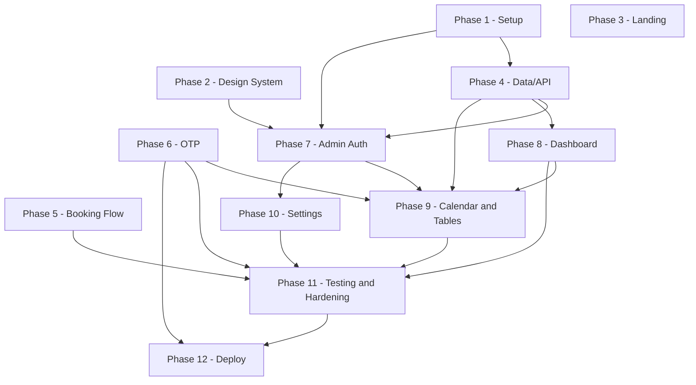

### 12.9 Phase 7 — Admin Auth

*Authoring note (applies to all of Phase 7-12 below).* Task IDs and the complexity scale continue
the scheme `12a-implementation-phases-1.md`'s "12.0 How to read this section" establishes for
Phases 1-6, restated here for a reader starting from this fragment:

- **Task ID scheme.** `T<phase>.<seq>`, e.g. `T7.3` = Phase 7's third task. Applied uniformly to
  Phases 7-12 here.
- **Complexity scale** (12a's 12.0, verbatim). `S` = fits a short focused session (~1-2h). `M` =
  one full focused session (~3-4h). `L` = reserved for work with no natural seam to split further
  (pure logic vs. DB-touching code, server vs. client, schema vs. migration-polish); wherever such
  a seam exists, the task is split instead of left `L`.

Tasks below depend on specific Phase 1-6 deliverables, cited directly by their real `12a` task IDs
(e.g. `T4.8` for `availability.ts`'s pure core, `T6.3` for `transitions.ts`) rather than by
placeholder.

#### Goal

Stand up the admin authentication boundary end to end: an Edge-safe split Auth.js v5 config, a
Credentials provider backed by argon2id, middleware route protection, a per-action `requireAdmin()`
guard, DB-backed login lockout, audit entries for every login attempt, and the authenticated admin
shell (sidebar/topbar/nav) every later admin page mounts into (C11).

#### T7.1 — Edge-safe Auth.js config split

| Attribute | Detail |
|---|---|
| Description | Create `src/auth.config.ts` (providers: `[]`, callbacks only — the `authorized()` callback consulted by middleware; no imports of `@node-rs/argon2` or `src/server/db`, so it transpiles for the Edge runtime, C11) and `src/auth.ts` (full NextAuth config: Credentials `authorize()` doing an `AdminUser` lookup by lowercased `email` + argon2id verify against `passwordHash`; `jwt`/`session` callbacks projecting `{ id, email, role }` onto the session; cookie `__Secure-authjs.session-token` in prod, `maxAge` 8h with rolling refresh). Export `auth()`, `signIn()`, `signOut()` from `auth.ts` only. |
| Files touched | `src/auth.config.ts`, `src/auth.ts` |
| Dependencies | `T1.1`, `T1.2`, `T1.3` |
| Acceptance criteria | `pnpm build` succeeds with `middleware.ts` importing only `auth.config.ts`; a static-import check (unit test walking the module graph, or an ESLint `no-restricted-imports` rule scoped to `middleware.ts`) fails if `auth.ts` becomes reachable from `middleware.ts`; a unit test calling `authorize()` directly with a seeded admin's correct credentials returns a session object containing `role`; the same call with a wrong password returns `null` without throwing. |
| Complexity | M |

#### T7.2 — Middleware route protection

| Attribute | Detail |
|---|---|
| Description | `src/middleware.ts`, matcher `/admin/:path*` excluding `/admin/login`, built on `auth.config.ts`'s `authorized()` callback. Unauthenticated requests redirect to `/admin/login?next=<pathname>`; `next` is validated same-origin-relative only (reject any value starting with `//`, containing `://`, or failing a leading-`/`-single-segment check) and falls back to `/admin` otherwise — open-redirect-safe (C11). |
| Files touched | `src/middleware.ts` |
| Dependencies | `T7.1` |
| Acceptance criteria | A request to `/admin` with no session cookie receives a redirect to `/admin/login?next=%2Fadmin`; a request to `/admin/login?next=https%3A%2F%2Fevil.example.com`, after a subsequent successful login, lands on `/admin`, never on the external URL; `/admin/login` itself is reachable with no session; a request to any `/admin/*` path with a valid session cookie passes through unredirected. |
| Complexity | S |

#### T7.3 — `requireAdmin()` guard, login rate limit, DB lockout

| Attribute | Detail |
|---|---|
| Description | `src/server/auth-guards.ts` exports `requireAdmin()`, called inside every admin Server Action independently of middleware (defense-in-depth, C11): re-checks the live session, re-reads the `AdminUser` row, and rejects with `FORBIDDEN` if `isActive: false`, or with `ACCOUNT_LOCKED` if `lockedUntil` is in the future — two distinct codes, not one overloaded `FORBIDDEN` (A4: `FORBIDDEN` is now reserved for the permanent, operator-cleared case; `ACCOUNT_LOCKED` is the temporary, self-clearing one). `auth.ts`'s `authorize()` increments `AdminUser.failedLoginCount` on a wrong password (locking at 5 consecutive failures: `lockedUntil = now + 15min`, C14) and resets it to 0 on success. The `admin.login` rate-limit rule (5/15min per email+IP, C14) is wired through `T4.5`'s `RateLimiter`. |
| Files touched | `src/server/auth-guards.ts`, `src/auth.ts`, `src/server/ratelimit/rules.ts` |
| Dependencies | `T7.1`, `T4.5` |
| Acceptance criteria | Integration test proves: (a) a Server Action call with no session cookie returns `UNAUTHORIZED`; (b) a valid session for an `AdminUser` flipped to `isActive: false` after the session was issued returns `FORBIDDEN`; (c) a valid session with `lockedUntil` in the future returns `ACCOUNT_LOCKED`, never `FORBIDDEN` (A4); each case additionally asserts the target row was not mutated (mirrors Section 11.5 case 4 exactly). A unit test proves 5 consecutive failed `authorize()` calls for the same email set `lockedUntil`, and a 6th call with the *correct* password while `lockedUntil` is still future still fails with `ACCOUNT_LOCKED`. |
| Complexity | M |

#### T7.4 — `adminAuth.login` action and login page

| Attribute | Detail |
|---|---|
| Description | `features/admin-auth/schemas.ts` (`loginSchema`: email, password); `features/admin-auth/actions.ts` (action `adminAuth.login`, a thin `defineAction`-wrapped call into `signIn("credentials", ...)`, per Section 5.4 — the real check is `authorize()` in `T7.1`, not here); `features/admin-auth/components/login-form.tsx` (React Hook Form + Zod, one `role="alert"` per failed attempt, `aria-describedby` on the form not per-field, distinct copy for `UNAUTHORIZED` (wrong credentials) / `ACCOUNT_LOCKED` (temporary, self-clearing) / `FORBIDDEN` (deactivated account) / `RATE_LIMITED` per Section 5.4's error table — `ACCOUNT_LOCKED` and `FORBIDDEN` are now distinct codes with distinct copy, never parsed out of one shared message, A4); `app/admin/login/page.tsx` + `loading.tsx`. |
| Files touched | `src/features/admin-auth/schemas.ts`, `src/features/admin-auth/actions.ts`, `src/features/admin-auth/types.ts`, `src/features/admin-auth/components/login-form.tsx`, `src/app/admin/login/page.tsx`, `src/app/admin/login/loading.tsx` |
| Dependencies | `T7.1`, `T7.3`, `T2.2` |
| Acceptance criteria | Submitting `SEED_ADMIN_EMAIL`/`SEED_ADMIN_PASSWORD` redirects to `/admin`; a wrong password shows the generic "Invalid email or password" message (no field-level distinction, per 5.4's stated non-enumeration trade-off); a locked account (`ACCOUNT_LOCKED`) shows the distinct lockout message *before* the password is checked, and a deactivated account (`FORBIDDEN`) shows a different, distinct message — a component test asserts the two render different copy and never collapse to the same string (A4); a component test asserts submit stays disabled until both fields are non-empty and exactly one `role="alert"` renders per failed attempt. |
| Complexity | M |

#### T7.5 — Audit entries for login success/failure

| Attribute | Detail |
|---|---|
| Description | Wire `writeAuditLog("ADMIN_LOGIN_SUCCEEDED" \| "ADMIN_LOGIN_FAILED", "AdminUser", adminUserId, meta)` into `auth.ts`'s `authorize()` callback. `meta` carries no PII (C19/LOG-2) — not even the attempted email — only non-identifying context (e.g. whether the failure was wrong-password vs. locked). |
| Files touched | `src/auth.ts`, `src/server/audit.ts` (reused, `T4.6`) |
| Dependencies | `T7.1`, `T4.6` |
| Acceptance criteria | A successful login writes exactly one `AuditLog` row (`action: "ADMIN_LOGIN_SUCCEEDED"`, `entity: "AdminUser"`, `entityId` = the user's id); a failed login writes exactly one `"ADMIN_LOGIN_FAILED"` row; a unit test scans every written `metaJson` string against the LOG-2 banned-substring list (phone/name/password/email) and asserts no match. |
| Complexity | S |

#### T7.6 — Logout

| Attribute | Detail |
|---|---|
| Description | Action `adminAuth.logout` (thin wrapper around `signOut()`) wired to a sign-out control in `admin-topbar.tsx` (`T7.7`). Clears the session cookie, writes `AuditLog("ADMIN_LOGGED_OUT", "AdminUser", adminUserId)` via `T4.6`'s `writeAuditLog` (A1 — C4's `AuditAction` union now carries a logout counter-operation alongside `ADMIN_LOGIN_SUCCEEDED`), and redirects to `/admin/login`. |
| Files touched | `src/features/admin-auth/actions.ts`, `src/app/admin/(dashboard)/_components/admin-topbar.tsx` |
| Dependencies | `T7.1`, `T7.7`, `T4.6` |
| Acceptance criteria | Clicking sign-out clears `__Secure-authjs.session-token` and a subsequent request to `/admin` redirects to `/admin/login`; the logout call writes exactly one `AuditLog("ADMIN_LOGGED_OUT")` row, asserted by an integration test. |
| Complexity | S |

#### T7.7 — Admin shell layout: sidebar, topbar, navigation

| Attribute | Detail |
|---|---|
| Description | `src/app/admin/layout.tsx` (outer shell: `force-dynamic` + `noindex` metadata for all `/admin/*`, C15 — kept separate so `/admin/login` renders without chrome); `src/app/admin/(dashboard)/layout.tsx` (sidebar + topbar, reads `auth()` for display name only — this layout is cosmetic, not a security boundary, C11); `_components/admin-sidebar.tsx`, `admin-topbar.tsx` (user menu, theme-toggle slot), `admin-nav-items.ts` (`{ href, label, icon }[]` for Dashboard/Calendar/Appointments/Patients/Settings, in that order); `src/hooks/use-media-query.ts` drives collapsing the sidebar into an off-canvas `Sheet` on `sm`/`md`. |
| Files touched | `src/app/admin/layout.tsx`, `src/app/admin/(dashboard)/layout.tsx`, `src/app/admin/(dashboard)/_components/admin-sidebar.tsx`, `src/app/admin/(dashboard)/_components/admin-topbar.tsx`, `src/app/admin/(dashboard)/_components/admin-nav-items.ts`, `src/hooks/use-media-query.ts` |
| Dependencies | `T7.1`, `T2.2`, `T2.4` |
| Acceptance criteria | Rendering the layout with a stubbed session shows exactly the 5 nav items in Dashboard/Calendar/Appointments/Patients/Settings order; the active route's item carries `aria-current="page"`; below the `md` breakpoint the sidebar is absent from the initial render and a visible menu control opens it as a `Sheet`; an axe pass on the rendered shell reports zero `serious`/`critical` violations. |
| Complexity | M |

#### Phase exit criteria

Every route under `/admin/:path*` except `/admin/login` is unreachable without a valid session;
correct credentials reach `/admin`; 5 consecutive failures lock the account at the DB level for 15
minutes, surviving across rate-limiter instances, and a locked session is rejected with
`ACCOUNT_LOCKED` while a deactivated one is rejected with `FORBIDDEN` (A4, two distinct codes);
every login attempt (success or failure) produces exactly one `AuditLog` row and every logout
produces exactly one `ADMIN_LOGGED_OUT` row (A1); the admin shell renders all 5 nav sections with
zero axe `serious`/`critical` violations.

---

### 12.10 Phase 8 — Dashboard

#### Goal

Build the read-only KPI dashboard: one `searchParams`-driven date-range control feeding five KPI
cards and two Recharts-based charts, loading/empty/error states per widget, and numeric accuracy
verified against Section 9's worked examples and Section 11's E4 scenario.

**Naming reconciliation.** Section 5.7's `dashboard.getKpis` already defines its output using the
canonical five-field `KpiSnapshot` shape — per Section 5.1's Naming Reconciliation table, citing
Section 9 rather than redefining it — and that shape matches Section 9's worked math (9.2-9.6) and
Section 11's E4 assertions exactly. There is no mismatch to reconcile here; Phase 8 implements
directly against that shape:

```ts
type KpiSnapshot = {
  totalPatients: number;
  totalRevenueMinor: number;      // COMPLETED only, 9.3
  expectedRevenueMinor: number;   // upcoming CONFIRMED, 9.4
  currency: string;
  todaysAppointments: number;     // 9.5
  upcomingThisWeek: number;       // 9.6
};
```

#### T8.1 — Dashboard queries (`getDashboardKpis`, `getRevenueSeries`, `getAppointmentsByService`)

| Attribute | Detail |
|---|---|
| Description | `features/dashboard/queries.ts` implementing the three Section 9 functions to the letter: date-anchor and status-filter semantics per metric (9.1-9.8), `bucketAndFill` reused from `lib/dates.ts` (never a DB-side `date_trunc`, per 9.9/C6); `features/dashboard/schemas.ts` (`dashboardRangeSchema` parsing `from`/`to`/`granularity` `searchParams`, default 30-day preset); `features/dashboard/types.ts` (`KpiSnapshot` above, `RevenuePoint`, `ServiceBreakdownPoint`). |
| Files touched | `src/features/dashboard/queries.ts`, `src/features/dashboard/schemas.ts`, `src/features/dashboard/types.ts` |
| Dependencies | `T4.2`, `T1.5` |
| Acceptance criteria | Against the standard seed with `FixedClock(SEED_NOW)` and the default 30-day range: `totalPatients === 45`, `totalRevenueMinor === 55000`, `expectedRevenueMinor === 87500`, `todaysAppointments === 3`, `upcomingThisWeek === 4` (Section 9.2-9.6); `getRevenueSeries(range, "day")` returns 10 non-empty buckets summing to 55000, `"week"` returns 5 summing to 55000, `"month"` returns 2 summing to 55000 (9.9/9.11); `getAppointmentsByService(range)` returns 7 rows summing to 14 matching Section 9.8's table exactly. |
| Complexity | L |

#### T8.2 — Date-range filter (shared, `searchParams`-driven)

| Attribute | Detail |
|---|---|
| Description | `features/dashboard/components/date-range-filter.tsx` (dashboard-specific wrapper around the new shared `src/components/date-range-picker.tsx`), pushing `from`/`to`/`granularity` into the URL; `app/admin/(dashboard)/page.tsx` parses `searchParams` server-side via `dashboardRangeSchema` and resolves one `DateRange` consumed by all three `T8.1` queries, so one navigation re-renders every widget (C15 — never per-widget filters). |
| Files touched | `src/features/dashboard/components/date-range-filter.tsx`, `src/components/date-range-picker.tsx`, `src/app/admin/(dashboard)/page.tsx` |
| Dependencies | `T8.1`, `T2.2` |
| Acceptance criteria | Changing the range control updates the URL without a full page reload; loading the URL directly with explicit `from`/`to`/`granularity` renders the identical resolved range server-side on first paint; exactly one live-region announcement fires per range change, not one per widget (Section 8.1.13). |
| Complexity | M |

#### T8.3 — Five KPI cards and `KpiGrid`

| Attribute | Detail |
|---|---|
| Description | `features/dashboard/components/kpi-card.tsx` (label + number + icon, money via `money-display.tsx`, never a raw minor-unit integer) and `kpi-grid.tsx` (1-col `sm`, 2-col `md`, 5-across `lg`/`xl`), wired to `T8.1`'s `KpiSnapshot`. |
| Files touched | `src/features/dashboard/components/kpi-card.tsx`, `src/features/dashboard/components/kpi-grid.tsx` |
| Dependencies | `T8.1`, `T2.2` |
| Acceptance criteria | A component test rendering `KpiGrid` with the `SEED_NOW` fixture snapshot shows "45", "€550.00", "€875.00", "3", "4" in that order, each with an accessible name including its label and unit; a zero-appointment range renders explicit "0" values, never a blank card. |
| Complexity | S |

#### T8.4 — Revenue-over-time chart (D/W/M toggle)

| Attribute | Detail |
|---|---|
| Description | `features/dashboard/components/revenue-chart.tsx`, a client island wrapping Recharts, series color from the `--chart-1` CSS variable (C18/8.3.7's token mapping, part of the full `--chart-1`..`--chart-5` set `T2.1` now creates per A8); D/W/M toggle via `ui/tabs` re-querying `T8.1`'s `getRevenueSeries` with the selected granularity; a visually-hidden `<table>` mirroring the chart's data plus a summarizing `aria-label`, per 8.1.13; loading skeleton; "No data in this range" empty state. |
| Files touched | `src/features/dashboard/components/revenue-chart.tsx` |
| Dependencies | `T8.1`, `T8.2`, `T2.4`, `T2.1` (A8 — the Phase 2 token task that must create `--chart-1` for this chart's `hsl(var(--chart-1))` acceptance criterion to resolve at all) |
| Acceptance criteria | Switching D/W/M tabs re-renders from the matching bucketed series without navigation; the series' resolved color is `hsl(var(--chart-1))`; a zero-appointment range renders the literal text "No data in this range" instead of an empty canvas; the chart's wrapper carries an `aria-label` summarizing total revenue plus the hidden equivalent `<table>`. |
| Complexity | M |

#### T8.5 — Appointments-by-service chart

| Attribute | Detail |
|---|---|
| Description | `features/dashboard/components/appointments-by-service-chart.tsx`, ranked horizontal bars, one per service, each bar filled with that `Service.colorHex` and paired with a visible numeric text label (never color alone, C18/WCAG 1.4.1); reads `getAppointmentsByService` from `T8.1`. |
| Files touched | `src/features/dashboard/components/appointments-by-service-chart.tsx` |
| Dependencies | `T8.1`, `T8.2` |
| Acceptance criteria | Given Section 9.8's fixture, bars render in descending count order (General Consultation 5 … Minor Outpatient Procedure 0) with each bar's visible label matching its count; a service with 0 in-range appointments still renders a labeled zero-length row rather than being omitted, so the visible rows always sum to the filtered total. |
| Complexity | S |

#### T8.6 — Loading skeletons and per-widget empty/error states

| Attribute | Detail |
|---|---|
| Description | `app/admin/(dashboard)/loading.tsx` (5 skeleton cards + 2 skeleton chart blocks matching the live grid, targeting <400ms p95 per C23); a new shared `src/components/widget-error-boundary.tsx` wrapping each of the 7 widgets' own data fetch so one widget's failure shows an inline `ui/alert` + retry without affecting the other six (8.1.13's stated rule — not achievable from the route-level `error.tsx` alone). |
| Files touched | `src/app/admin/(dashboard)/loading.tsx`, `src/components/widget-error-boundary.tsx` (new) |
| Dependencies | `T8.1`, `T8.3`, `T8.4`, `T8.5` |
| Acceptance criteria | A throttled-network run shows the 7-widget skeleton layout matching the live grid, with no visible reflow once data arrives; forcing one query to reject (test double) leaves the other six widgets rendering normally with only the failing one showing `Alert` + Retry. |
| Complexity | S |

#### T8.7 — KPI-accuracy verification (Section 9 / E4)

| Attribute | Detail |
|---|---|
| Description | No new production code: an integration test and the E4 Playwright scenario (already named in Section 3's tree as `tests/e2e/admin-dashboard-kpis.spec.ts`) exercising the full `/admin` page against the standard `prisma/seed.ts` dataset and `FixedClock(SEED_NOW)`, asserting every number in Section 9.11/11.6's E4 scenario in one place. |
| Files touched | `tests/unit/server/dashboard/kpi-accuracy.integration.test.ts` (new), `tests/e2e/admin-dashboard-kpis.spec.ts` |
| Dependencies | `T8.1`, `T8.3`, `T8.4`, `T8.5`, `T8.6` |
| Acceptance criteria | E4 passes verbatim: Total patients 45, Total revenue 55,000 minor, Expected revenue 87,500 minor, Today's appointments 3, Upcoming this week 4; daily/weekly/monthly series of 10/5/2 buckets each summing to 55,000; service breakdown summing to 14 across 7 rows. This task's own acceptance criterion is exactly "E4 is green in CI." |
| Complexity | M |

#### Phase exit criteria

`/admin` renders all five KPI cards and both charts from one shared date-range control; every
number matches Section 9's worked examples under the standard seed; a zero-data range renders
explicit zero/empty states, never a blank widget; E4 passes in CI.

---

### 12.11 Phase 9 — Calendar and Tables

#### Goal

Give admins full visibility and control over appointments: a color-coded calendar, a filterable and
paginated appointments table with status-transition row actions and reschedule, admin-created
appointments, and a read-only patients roster — all reusing the slot engine and transition guard
rather than re-implementing either.

#### T9.1 — Appointments list query and filters schema

| Attribute | Detail |
|---|---|
| Description | `features/appointments/queries.ts` `listAppointments(filters)` implementing `appointments.list` (Section 5.5): `page`/`pageSize`/`q` (plain scan over `holdFullName`/`Patient.fullName`/`reference`)/`status`/`serviceId`/`from`/`to`; `features/appointments/schemas.ts` (`appointmentsFiltersSchema`, `rescheduleSchema`); `features/appointments/types.ts` (`AppointmentRow`, `AppointmentsFilters`). |
| Files touched | `src/features/appointments/queries.ts`, `src/features/appointments/schemas.ts`, `src/features/appointments/types.ts` |
| Dependencies | `T1.2`, `T4.1` |
| Acceptance criteria | `listAppointments`'s `total` matches a direct `COUNT` query for at least 3 independent filter combinations (status-only, service-only, date-range-only); `q` matches both a name substring and an exact reference, case-insensitively; a `pageSize` over 100 is rejected by Zod before reaching the DB. |
| Complexity | M |

#### T9.2 — Status-transition actions and audit

| Attribute | Detail |
|---|---|
| Description | `features/appointments/actions.ts` action `appointments.updateStatus` (Section 5.5), funnelling confirm/complete/no-show/cancel through `T6.3`'s `transitions.ts` guard (C4). On `-> CANCELLED`, delete this appointment's `AppointmentSlot` rows (frees the slot); on `-> COMPLETED`/`-> NO_SHOW`, retain them (C5). One `AuditLog("APPOINTMENT_STATUS_CHANGED", { fromStatus, toStatus })` per call, no PII (C19). |
| Files touched | `src/features/appointments/actions.ts`, `src/server/appointments/transitions.ts` (reused) |
| Dependencies | `T9.1`, `T6.3`, `T4.6` |
| Acceptance criteria | A parametrized integration test over all 25 ordered `(from, to)` status pairs shows exactly the 6 C4-legal edges succeed and the other 19 return `INVALID_TRANSITION`; a `-> CANCELLED` call leaves zero `AppointmentSlot` rows for that appointment while a `-> NO_SHOW` call leaves them unchanged; each successful call writes exactly one `AuditLog` row. |
| Complexity | M |

#### T9.3 — Appointments DataTable and filters UI

| Attribute | Detail |
|---|---|
| Description | `features/appointments/components/appointments-table.tsx` (`ui/table` + the shared `data-table-pagination.tsx`); `appointments-filters.tsx` (debounced search via a new `use-debounced-value.ts`, status/service `Select`, date range reusing `T8.2`'s `date-range-picker.tsx`); `appointment-row-actions.tsx` (`ui/dropdown-menu` offering exactly the legal next transitions for the row's current status — none for `COMPLETED`/`CANCELLED`/`NO_SHOW`, C4); `app/admin/(dashboard)/appointments/page.tsx` + `loading.tsx` wiring `searchParams` (`page`, `q`, `status`, `service`, `range`) to `T9.1`. |
| Files touched | `src/features/appointments/components/appointments-table.tsx`, `src/features/appointments/components/appointments-filters.tsx`, `src/features/appointments/components/appointment-row-actions.tsx`, `src/app/admin/(dashboard)/appointments/page.tsx`, `src/app/admin/(dashboard)/appointments/loading.tsx`, `src/hooks/use-debounced-value.ts` |
| Dependencies | `T9.1`, `T9.2`, `T8.2`, `T2.2` |
| Acceptance criteria | Changing the status `Select` pushes `?status=CONFIRMED&page=1` (page resets on any filter change) while preserving `q`/`service`/`range`; clicking page 2 preserves all other params; a `COMPLETED` row's actions menu renders no enabled transition items; a row action that returns `INVALID_TRANSITION`/`SLOT_TAKEN` rolls its optimistic update back and shows a toast. |
| Complexity | L |

#### T9.4 — Reschedule dialog (reusing the slot engine)

| Attribute | Detail |
|---|---|
| Description | `features/appointments/components/reschedule-dialog.tsx` (`ui/dialog`) re-embedding the booking wizard's date/time pickers (`T5.*`), scoped to the appointment's existing service, to pick `dateLocal`/`startUtc`; action `appointments.reschedule` (Section 5.5) delegates verbatim to `rescheduleAppointment` (Section 6.5) via a new `src/server/appointments/reschedule.ts`: row-locks the appointment, requires `status === "CONFIRMED"`, sweeps expired holds, re-checks the new slot, deletes old `AppointmentSlot` rows and inserts new ones in one transaction, sets `rescheduledFromUtc`, writes `AuditLog("APPOINTMENT_RESCHEDULED", { fromUtc, toUtc })`. |
| Files touched | `src/features/appointments/components/reschedule-dialog.tsx`, `src/features/appointments/actions.ts`, `src/server/appointments/reschedule.ts` (new) |
| Dependencies | `T9.2`, `T9.3`, `T4.2`, `T4.9` |
| Acceptance criteria | Rescheduling a `CONFIRMED` appointment to a free slot leaves old `AppointmentSlot` rows gone, new ones present, `rescheduledFromUtc` set to the prior `startsAtUtc`, and exactly one `AuditLog` row; targeting a slot another appointment already holds rolls back the *whole* transaction, leaving the original appointment's slot rows still present (mirrors Section 11.5 case 3's two sub-cases exactly); rescheduling a non-`CONFIRMED` appointment returns `INVALID_TRANSITION` without opening the picker. |
| Complexity | L |

#### T9.5 — Admin-created appointments

| Attribute | Detail |
|---|---|
| Description | Action `appointments.createByAdmin` (Section 5.5): same slot-matching/insert path as `booking.create` but `status: "CONFIRMED"` directly, `patientId` resolved via the same upsert-by-`phoneE164` logic `otp.verify` uses (`T6.2`), `confirmedAt: now`, no `OtpChallenge` row, `AuditLog("APPOINTMENT_CREATED_BY_ADMIN")`. A "New appointment" entry point on `/admin/appointments` reuses `T9.4`'s date/time picker plus a minimal name/phone form — **assumption**: Section 8 has no dedicated wireframe for this screen, so this task also defines its minimal field set rather than a full new page. |
| Files touched | `src/features/appointments/actions.ts`, `src/features/appointments/components/appointments-table.tsx` |
| Dependencies | `T9.4`, `T6.2` |
| Acceptance criteria | Creating an admin appointment for a free slot produces an upserted `Patient` row and an `Appointment` with `status: "CONFIRMED"`, `source` in `{"ADMIN","PHONE"}`, and no `OtpChallenge` row; a slot collision returns `SLOT_TAKEN`/`SLOT_UNAVAILABLE` and reopens the picker, never a raw 500. |
| Complexity | M |

#### T9.6 — Admin calendar (day/week/month, color-coded, legend, detail sheet)

| Attribute | Detail |
|---|---|
| Description | `features/appointments/components/admin-calendar.tsx` (`"use client"` FullCalendar wrapper: daygrid+timegrid+interaction, C2); `calendar-view-toggle.tsx` (custom `role="tablist"`/`"tab"` control driving `calendarRef.current.changeView()`, kept custom per 8.1.14's styling rationale rather than FullCalendar's own toolbar); event blocks colored via the shared `status-badge.tsx` palette plus status/initials/service text (never hue alone); legend always visible beneath the grid; clicking an event opens a detail `ui/sheet` reusing `appointment-row-actions.tsx`'s menu; `app/admin/(dashboard)/calendar/page.tsx` + `loading.tsx`. |
| Files touched | `src/features/appointments/components/admin-calendar.tsx`, `src/features/appointments/components/calendar-view-toggle.tsx`, `src/app/admin/(dashboard)/calendar/page.tsx`, `src/app/admin/(dashboard)/calendar/loading.tsx` |
| Dependencies | `T9.1`, `T9.2`, `T9.3` |
| Acceptance criteria | Each of the 5 `AppointmentStatus` values renders in a visually distinct color plus a text label (axe flags no color-only encoding); a component test with two mocked viewport widths confirms Day view defaults below `md` and Week view at `lg`/`xl` (8.1.14); clicking an event opens the same row-action set as the table for that appointment's current status; a successful `T9.4` reschedule moves the event to its new time on the next render without a full page reload. |
| Complexity | L |

#### T9.7 — Patients list (visit count, total spent, last visit)

| Attribute | Detail |
|---|---|
| Description | `features/patients/queries.ts` `listPatients(filters)` (Section 5.6). **Assumption** (Section 8's wireframe names the three columns without pinning their status scope beyond one worked example, "4 visits / €220.00"): "visit count" and "total spent" both scope to `COMPLETED` appointments only — a visit is one that happened, not a future `CONFIRMED` booking or a `NO_SHOW` — and "last visit" is the max `startsAtUtc` among that same `COMPLETED` set, keeping all three columns' status filter identical to Section 9.3's revenue semantics rather than inventing a second definition. `features/patients/components/patients-table.tsx` masks the phone number (same staff-screen courtesy as the booking success page); `app/admin/(dashboard)/patients/page.tsx` + `loading.tsx`, `searchParams`-driven (`q`, `page`). |
| Files touched | `src/features/patients/queries.ts`, `src/features/patients/schemas.ts`, `src/features/patients/types.ts`, `src/features/patients/components/patients-table.tsx`, `src/app/admin/(dashboard)/patients/page.tsx`, `src/app/admin/(dashboard)/patients/loading.tsx` |
| Dependencies | `T1.2`, `T8.1` |
| Acceptance criteria | For a patient with `C` `COMPLETED` appointments, "visit count" equals `C`, "total spent" equals the sum of `priceMinorAtBooking` across exactly those `C` rows, and "last visit" equals the max `startsAtUtc` among them — each checked against a direct DB aggregate for every seeded patient; a search with no match renders the "no search match" `EmptyState`, zero patients at all renders the distinct "No patients yet" `EmptyState`; the phone renders masked with an accessible name repeating the same masked string, never the raw number. |
| Complexity | M |

#### Phase exit criteria

Every `CONFIRMED`/`COMPLETED`/`CANCELLED`/`NO_SHOW` transition is reachable from both the
appointments table and the calendar, guarded by the same `transitions.ts` matrix the unit tests
verify; a reschedule moves slots atomically with no orphaned `AppointmentSlot` rows on a collision;
admin-created appointments bypass OTP but never bypass the slot-concurrency guard; the patients
roster's three computed columns match a direct DB aggregate for every seeded patient.

---

### 12.12 Phase 10 — Settings

#### Goal

Let admins edit the clinic's live operating parameters — working hours (incl. split shifts), closed
dates, the slot/booking-window grid, the service catalogue, and clinic profile fields — with every
mutation audited and the public landing page kept in sync via `revalidatePath('/')`.

#### T10.1 — Settings aggregate query and page shell

| Attribute | Detail |
|---|---|
| Description | `features/settings/queries.ts` (`getClinicSettings()`, `listWorkingHours()`, `listClosedDates()`), composed by action `settings.get` (Section 5.9) into one `ClinicSettingsView`; `features/settings/types.ts`; `app/admin/(dashboard)/settings/page.tsx` + `loading.tsx` rendering the 4-tab shell (Hours / Closed Dates / Slot Interval & General / Services, per 8.1.17) with independent per-tab loading. |
| Files touched | `src/features/settings/queries.ts`, `src/features/settings/types.ts`, `src/app/admin/(dashboard)/settings/page.tsx`, `src/app/admin/(dashboard)/settings/loading.tsx` |
| Dependencies | `T1.2`, `T7.7` |
| Acceptance criteria | `settings.get`'s payload equals the composition of the three individual queries against the seed (the `ClinicSettings` singleton, 7 `WorkingHour` rows incl. Saturday's split shift, 3 `ClosedDate` rows, Section 4.6); the four tabs use `role="tablist"`/`"tab"`/`"tabpanel"` with roving tabindex. |
| Complexity | S |

#### T10.2 — Working hours form (per-weekday, split shifts)

| Attribute | Detail |
|---|---|
| Description | `features/settings/components/working-hours-form.tsx` (one row per weekday, "+ Add shift" appends a second open/close pair matching the seeded Saturday pattern, up to 4 shifts per Section 5.9's schema, zero shifts = closed); action `settings.updateWorkingHours` (Section 5.9): one transaction, `DELETE WorkingHour WHERE weekday = ...` then `INSERT` the submitted shifts (replace-all-for-that-weekday, matching `@@unique([weekday, openMinute])`, C5); `AuditLog("SETTINGS_UPDATED")` (reused — C4 has no dedicated working-hours action). |
| Files touched | `src/features/settings/components/working-hours-form.tsx`, `src/features/settings/actions.ts`, `src/features/settings/schemas.ts` |
| Dependencies | `T10.1` |
| Acceptance criteria | A shift with `closeMinute <= openMinute` returns `VALIDATION_ERROR` naming the offending shift before any DB write; submitting a valid 2-shift Saturday replaces only that weekday's rows (other weekdays untouched) and round-trips on reload; the save writes exactly one `AuditLog("SETTINGS_UPDATED")` row. |
| Complexity | M |

#### T10.3 — Closed dates management

| Attribute | Detail |
|---|---|
| Description | `features/settings/components/closed-dates-form.tsx` (date + reason, removable list); actions `settings.addClosedDate` (`P2002` on a duplicate date mapped to `fieldErrors.date`, `AuditLog("CLOSED_DATE_ADDED")`) and `settings.removeClosedDate` (**assumption**, per Section 5.9: removing an already-absent date is a silent success, not `NOT_FOUND`; `AuditLog("CLOSED_DATE_REMOVED")` written only when a row was actually deleted). |
| Files touched | `src/features/settings/components/closed-dates-form.tsx`, `src/features/settings/actions.ts`, `src/features/settings/schemas.ts` |
| Dependencies | `T10.1` |
| Acceptance criteria | Adding a date already present returns `VALIDATION_ERROR` on the date field with no new `AuditLog` row; removing an already-absent date succeeds with zero new `AuditLog` rows, removing a present one writes exactly one `CLOSED_DATE_REMOVED` row; a `CONFIRMED` appointment already booked on a newly-closed date is left untouched (Section 6.6). |
| Complexity | S |

#### T10.4 — Slot interval control with existing-bookings warning

| Attribute | Detail |
|---|---|
| Description | Within `general-settings-form.tsx` (`T10.5`'s file): changing `slotIntervalMin` surfaces a static inline warning — "Existing bookings keep their original times; new availability uses the new interval" — before save, since `interval_change_does_not_retroactively_free_old_rows` (Section 6.6/11.3.1) proves old bookings on the prior grid are neither moved nor freed. No confirmation modal blocks the save (effective-immediately config, Section 5.9); the warning is informational only. |
| Files touched | `src/features/settings/components/general-settings-form.tsx` (shared with `T10.5`) |
| Dependencies | `T10.5` |
| Acceptance criteria | The warning renders once the `slotIntervalMin` field's value differs from its server-rendered initial value, and not otherwise; an integration test confirms a booking made on the old grid still reads at its original `startsAtUtc` after the setting changes — no backfill of existing `Appointment` rows occurs. |
| Complexity | S |

#### T10.5 — Clinic profile and scheduling-window fields

| Attribute | Detail |
|---|---|
| Description | Remaining `general-settings-form.tsx` fields (`clinicName`, `timeZone` validated against `Intl.supportedValuesOf("timeZone")`, `currency`, `bufferMin`, `minLeadTimeMin`, `maxAdvanceDays`, `holdTtlMin`, `phoneE164`, `email`, `addressLine1`/`addressLine2`, `mapUrl`); action `settings.update` (Section 5.9): `UPDATE ClinicSettings` (singleton `id: "singleton"`, C5), `AuditLog("SETTINGS_UPDATED")`, `revalidatePath('/')` (`clinicName`/currency are landing-visible). |
| Files touched | `src/features/settings/components/general-settings-form.tsx`, `src/features/settings/actions.ts`, `src/features/settings/schemas.ts` |
| Dependencies | `T10.1` |
| Acceptance criteria | An unsupported IANA `timeZone` string returns `VALIDATION_ERROR` inline without reaching the DB; a successful save triggers exactly one `revalidatePath('/')` call and exactly one `AuditLog("SETTINGS_UPDATED")` row; client-side Zod (the shared schema import, C17) blocks an out-of-range submission before any network request fires, asserted in a component test. |
| Complexity | M |

#### T10.6 — Services CRUD (create/update/active flag/reorder)

| Attribute | Detail |
|---|---|
| Description | `features/services/components/services-table.tsx` + `service-form-dialog.tsx` (`ui/dialog`+`ui/form`); actions `services.create`/`.update`/`.setActive`/`.reorder` (Section 5.8): `create` inserts `isActive: true` + `AuditLog("SERVICE_CREATED")` + `revalidatePath('/')`; `update` never touches past `Appointment` `...AtBooking` snapshots (C5) + `AuditLog("SERVICE_UPDATED")` + `revalidatePath('/')`; `setActive` flips `isActive` (soft "deactivate," never a hard delete) + `revalidatePath('/')`, writing `AuditLog("SERVICE_DEACTIVATED")` when turning *off* and `AuditLog("SERVICE_REACTIVATED")` when turning back *on* (A1 — C4's `AuditAction` union now carries that counter-operation, so an `AuditLog` reader can reconstruct a service's full active/inactive history); `reorder` applies every `sortOrder` change in one transaction + `revalidatePath('/')`, no audit row — a separate, still-open gap, since A1 adds no `SERVICE_REORDERED` action. |
| Files touched | `src/features/services/components/services-table.tsx`, `src/features/services/components/service-form-dialog.tsx`, `src/features/services/actions.ts`, `src/features/services/schemas.ts`, `src/features/services/queries.ts`, `src/features/services/types.ts` |
| Dependencies | `T10.1` |
| Acceptance criteria | Creating a service with a `slug` colliding on the `@unique` constraint returns `VALIDATION_ERROR` with `fieldErrors.slug`, never `INTERNAL`; deactivating a service already referenced by a future `CONFIRMED` appointment leaves that appointment's `serviceId`/snapshot fields untouched; reordering 3 services in one call updates exactly those 3 `sortOrder` values atomically (no partial apply on a mid-batch failure); every create/update/deactivate call triggers exactly one `revalidatePath('/')` call. |
| Complexity | L |

#### T10.7 — Audit-coverage verification across every settings mutation

| Attribute | Detail |
|---|---|
| Description | No new production code: one consolidating integration test calling every `settings.*` and `services.*` mutating action once each — `setActive` called in both directions, so both `SERVICE_DEACTIVATED` and `SERVICE_REACTIVATED` are each asserted at least once (A1) — and asserting the resulting `AuditLog` rows exactly match the expected multiset, catching any future edit to these actions that forgets to call `writeAuditLog`. |
| Files touched | `tests/unit/server/settings/audit-coverage.integration.test.ts` (new) |
| Dependencies | `T10.2`, `T10.3`, `T10.5`, `T10.6` |
| Acceptance criteria | The test fails if any of the six settings/services mutating actions produces zero new `AuditLog` rows when called; it passes against the actions exactly as specified in `T10.2`-`T10.6`. |
| Complexity | S |

#### Phase exit criteria

Every one of the six audited settings/services mutations (`updateWorkingHours`, `addClosedDate`,
`removeClosedDate`, `update`, `services.create`/`update`/`setActive`) writes the trail C4 provides
for it; a working-hours or slot-interval change never mutates an existing `Appointment` row; a
service edit never rewrites `...AtBooking` history; every landing-visible mutation triggers exactly
one `revalidatePath('/')` call.

---

### 12.13 Phase 11 — Testing and Hardening

#### Goal

Fill out the unit/component/integration/E2E suites specified in Section 11 to their stated coverage
targets and scenario catalogue, then harden the shipped surface — accessibility, security headers
and CSP, data retention, SMS spend controls, PII-in-logs hygiene, and the Lighthouse gate — as
focused, independently landable tasks rather than one undifferentiated "write tests" task.

#### T11.1a — Unit suite: slot engine + hold-expiry (100%-branch tier)

| Attribute | Detail |
|---|---|
| Description | Fill out `tests/unit/server/slots/availability.test.ts` (all 16 named cases, Section 11.3.1) and `tests/unit/server/slots/hold-expiry.test.ts` — Section 11.1's 100%-branch tier for `src/server/slots/**`. |
| Files touched | `tests/unit/server/slots/availability.test.ts`, `tests/unit/server/slots/hold-expiry.test.ts` |
| Dependencies | `T4.8`, `T4.9` |
| Acceptance criteria | `vitest run --project node --coverage` reports 100% branch coverage for `src/server/slots/**`; all 16 named cases from Section 11.3.1's table exist as individually-named tests. |
| Complexity | M |

#### T11.1b — Unit suite: transitions + OTP (100%-branch tier)

| Attribute | Detail |
|---|---|
| Description | Fill out `tests/unit/server/appointments/transitions.test.ts` (all 25 ordered pairs) and `tests/unit/server/otp.test.ts` (hash determinism, expiry-before-code-check ordering, `maxAttempts`, resend cooldown/cap) — Section 11.1's 100%-branch tier for `transitions.ts`. |
| Files touched | `tests/unit/server/appointments/transitions.test.ts`, `tests/unit/server/otp.test.ts` |
| Dependencies | `T6.3`, `T4.3`, `T6.2` |
| Acceptance criteria | `vitest run --project node --coverage` reports 100% branch coverage for `transitions.ts`; the transitions test is parametrized over all 25 ordered pairs with exactly 6 legal and 19 asserting `INVALID_TRANSITION`. |
| Complexity | M |

#### T11.2 — Unit suite: `lib/**` and feature schemas (>=95% line tier)

| Attribute | Detail |
|---|---|
| Description | Fill out `tests/unit/lib/{money,dates,phone,enums,ics}.test.ts`, a new `tests/unit/lib/reference.test.ts` (**assumption**: Section 3's tree omits a test file for `lib/reference.ts` despite Section 11.3.2 requiring its 1000-sample/collision-retry coverage; added here under the existing `tests/unit/lib/` convention), `tests/unit/server/ratelimit.test.ts`, and `tests/unit/features/booking/schemas.test.ts`, per Section 11.3.2's table. |
| Files touched | `tests/unit/lib/money.test.ts`, `tests/unit/lib/dates.test.ts`, `tests/unit/lib/phone.test.ts`, `tests/unit/lib/enums.test.ts`, `tests/unit/lib/ics.test.ts`, `tests/unit/lib/reference.test.ts` (new), `tests/unit/server/ratelimit.test.ts`, `tests/unit/features/booking/schemas.test.ts` |
| Dependencies | `T1.5`, `T4.4` |
| Acceptance criteria | `vitest run --project node --coverage` reports >=95% line coverage for every file under `src/lib/**`; `ics.test.ts` round-trips a `SUMMARY` containing all four RFC 5545-escaped characters; `phone.test.ts` rejects a validly-formatted E.164 number from a non-allowlisted country (RATE-8). |
| Complexity | M |

#### T11.3 — Component suite: booking wizard, OTP, admin widgets (>=70% statement tier, with axe)

| Attribute | Detail |
|---|---|
| Description | Fill out `tests/component/booking/{service,date,time,details,review}-step.test.tsx` and `tests/component/admin/{kpi-cards,appointments-table}.test.tsx` per Section 11.4's table, plus two new files, `otp-input.test.tsx` and `otp-resend-button.test.tsx` (**assumption**: Section 3's tree lists only the 5 booking-step component tests and no `component/otp/` subtree; these are added under `tests/component/booking/` alongside the step tests, since 11.4 requires covering both components and no other location is named). Every file additionally asserts zero `vitest-axe` violations of impact `serious`/`critical`, and the 7 components 11.4 names explicitly get a keyboard-only interaction test. |
| Files touched | `tests/component/booking/service-step.test.tsx`, `tests/component/booking/date-step.test.tsx`, `tests/component/booking/time-step.test.tsx`, `tests/component/booking/details-step.test.tsx`, `tests/component/booking/review-step.test.tsx`, `tests/component/booking/otp-input.test.tsx` (new), `tests/component/booking/otp-resend-button.test.tsx` (new), `tests/component/admin/kpi-cards.test.tsx`, `tests/component/admin/appointments-table.test.tsx` |
| Dependencies | `T8.3`, `T9.3`, `T5.*` |
| Acceptance criteria | `vitest run --project jsdom --coverage` reports >=70% statement coverage for `src/features/*/components/*` and `src/components/*`; every listed file's test includes a `vitest-axe` assertion of zero `serious`/`critical` violations; each of the 7 named keyboard-testable components has at least one test driving only keyboard events. |
| Complexity | L |

#### T11.4 — Integration suite: concurrency, hold-expiry, reschedule rollback, `requireAdmin`

| Attribute | Detail |
|---|---|
| Description | Stand up the third Vitest project (`integration`, matching `tests/unit/server/**/*.integration.test.ts`, Section 11.5's additive change to C17) and its per-worker-schema + `TRUNCATE` isolation mechanism; implement the four named cases: (1) `Promise.all` double-`createBooking` -> one `SLOT_TAKEN`; (2) a direct past-`holdExpiresAt` insert -> `getAvailableSlots` sees it free, re-read shows `CANCELLED`/`"HOLD_EXPIRED"`; (3) reschedule success plus the rollback-on-collision sub-case; (4) `requireAdmin()`'s three rejection cases, each confirming the target row is unmutated. |
| Files touched | `vitest.config.ts` (adds the `integration` project), `tests/unit/server/booking/concurrency.integration.test.ts` (new), `tests/unit/server/slots/hold-expiry.integration.test.ts` (new), `tests/unit/server/appointments/reschedule.integration.test.ts` (new), `tests/unit/server/auth/require-admin.integration.test.ts` (new), `tests/support/integration-setup.ts` (new) |
| Dependencies | `T9.4`, `T7.3`, `T1.2` |
| Acceptance criteria | `vitest run --project integration` against a Docker Postgres passes all four cases exactly as specified in Section 11.5, including the rollback sub-case where the *original* appointment's slot rows survive a failed reschedule; two workers run in parallel without unique-constraint cross-talk. |
| Complexity | L |

#### T11.5 — E2E suite: booking, race, admin login, lifecycle, settings (E1-E3, E7, E8)

| Attribute | Detail |
|---|---|
| Description | Implement `tests/e2e/booking-flow.spec.ts` (E1), `double-booking.spec.ts` (E2), `admin-login.spec.ts` (E3), `admin-appointments-actions.spec.ts` (E7), and a new `admin-settings-effects.spec.ts` (E8) per Section 11.6's step-by-step scripts and cleanup. **Note**: Section 3's tree names only 5 of Section 11.6's 9 scenarios; `admin-settings-effects.spec.ts` is added here, consistent with the `integration` project's own precedent (11.5) of extending the tree additively rather than contradicting it. |
| Files touched | `tests/e2e/booking-flow.spec.ts`, `tests/e2e/double-booking.spec.ts`, `tests/e2e/admin-login.spec.ts`, `tests/e2e/admin-appointments-actions.spec.ts`, `tests/e2e/admin-settings-effects.spec.ts` (new) |
| Dependencies | `T9.2`, `T9.4`, `T10.2`, `T10.3`, `T10.6`, `T7.4` |
| Acceptance criteria | All five specs pass against a freshly migrated and seeded Postgres service container; E3's 6th login attempt with *correct* credentials is still rejected while `lockedUntil` is future; E8's four admin-then-patient round trips are each observed from an independent unauthenticated `BrowserContext`. |
| Complexity | L |

#### T11.6 — E2E suite: OTP exhaustion/resend, KPI accuracy, accessibility sweep (E6, E4, E9)

| Attribute | Detail |
|---|---|
| Description | Implement two new specs, `otp-exhaustion.spec.ts` (E6) and `accessibility-sweep.spec.ts` (E9: axe against all 12 named routes at 375x667 and 1440x900, plus the full keyboard-only booking traversal with visible-focus-indicator assertions), and finalize `admin-dashboard-kpis.spec.ts` (E4, started in `T8.7`) as the version that actually lands in the suite. |
| Files touched | `tests/e2e/otp-exhaustion.spec.ts` (new), `tests/e2e/admin-dashboard-kpis.spec.ts`, `tests/e2e/accessibility-sweep.spec.ts` (new) |
| Dependencies | `T8.7`, `T6.2` |
| Acceptance criteria | E6 passes including "the 5th wrong attempt kills the challenge, no 6th prompt" and the resend's reset-to-0-attempts behavior; E9 reports zero axe violations of impact `serious`/`critical` across all 12 routes at both viewports, and the keyboard-only run never loses a visible focus indicator. |
| Complexity | M |

#### T11.7 — Security hardening: headers, CSP, Lighthouse CI gate

| Attribute | Detail |
|---|---|
| Description | `next.config.mjs` `headers()` emitting the full HDR-1..HDR-6 bundle (Section 10.7's exact HSTS/CSP/`X-Frame-Options`/`Referrer-Policy`/`X-Content-Type-Options`/`Permissions-Policy` block); `middleware.ts` minting a per-request nonce threaded via an `x-nonce` header into `app/layout.tsx`; `lighthouserc.json` configured with `numberOfRuns: 3`, asserting the MEDIAN score across those runs — never a single run's score — is >=95 in all four categories (A10: a single-run gate fails unrelated PRs on Lighthouse's own documented run-to-run jitter) plus the C23 budget assertions; a new E2E header-assertion spec; and, per A6(b), a test proving `POST /api/test/reset` is registered only when `NODE_ENV !== "production"` AND `E2E_TEST_HOOKS === "true"` — built against a production-mode build (`NODE_ENV=production`, `E2E_TEST_HOOKS` unset) to confirm the route is absent, since the test bypass A6 introduces for E3/E6 must never ship live. |
| Files touched | `next.config.mjs`, `src/middleware.ts`, `src/app/layout.tsx`, `lighthouserc.json`, `tests/e2e/security-headers.spec.ts` (new), `tests/unit/server/test-reset-route-absent.test.ts` (new) |
| Dependencies | `T7.2` |
| Acceptance criteria | Every route in Section 3's tree carries all six HDR headers, `frame-ancestors 'none'`, and a nonce that differs between two separate requests; the `lighthouse` CI job runs 3 times per build and fails only if the MEDIAN of those 3 runs is below 95 in any category (A10), never on one run's score alone; a production-mode build (`NODE_ENV=production`, `E2E_TEST_HOOKS` unset) registers no `POST /api/test/reset` route at all — checked against the build's route manifest, not by issuing a live request (A6(b)). |
| Complexity | M |

#### T11.8 — Operational hardening: retention script, SMS spend ceiling, PII-in-logs audit

| Attribute | Detail |
|---|---|
| Description | `scripts/retention.ts` (C20's three rules: anonymize `Appointment`s >24mo, hard-delete stale `Patient`s, hard-delete `OtpChallenge` rows 24h past `consumedAt`/`expiresAt`, hard-delete `AuditLog` >24mo) plus an optional `--patient-id` flag for DSAR (PRIV-3); `src/server/sms/index.ts` wrapping the selected `SmsProvider` with the clinic-wide ceilings A6(a) adds on top of the existing per-phone/per-IP limits (RATE-9) — `otp.send.global` (200 sends / rolling 24h across all phone numbers) and `sms.spend.global` (a daily ceiling in minor units read from `SMS_DAILY_CAP_MINOR`, C16/A7) — either breach short-circuits to `OTP_SEND_FAILED` without reaching Twilio, emits a CRITICAL log event, and raises the alert hook that drives the admin dashboard's persistent banner; plus `SMS_KILL_SWITCH=true` (C16/A7) short-circuiting every send unconditionally for use during an attack (A6(a)); a PII-in-logs audit: `tests/unit/lib/logger.test.ts` asserting the redaction serializer strips every LOG-2 field even under an unexpected key. |
| Files touched | `scripts/retention.ts`, `src/server/sms/index.ts` (new), `src/lib/logger.ts`, `tests/unit/lib/logger.test.ts` (new), `tests/unit/server/sms/provider.test.ts` (new) |
| Dependencies | `T6.2`, `T1.5`, `T1.6` (`SMS_DAILY_CAP_MINOR`/`SMS_KILL_SWITCH` now parsed by `env.ts`, C16/A7) |
| Acceptance criteria | Running `retention.ts` against a 25-month-old `Appointment` anonymizes `holdFullName`/`holdPhoneE164` while `...AtBooking` fields stay untouched; a `Patient` with no appointment in 24 months is hard-deleted, one with a 23-month-old appointment is not; the (per-phone/IP cap+1)th simulated send returns `OTP_SEND_FAILED` with a spy proving Twilio's send function was never invoked, and separately the 201st simulated send spread across 201 distinct phone numbers within one rolling 24h window is also rejected with `OTP_SEND_FAILED`, proving `otp.send.global`'s ceiling holds even when no single phone/IP is over its own limit (A6(a)); crossing `SMS_DAILY_CAP_MINOR` in simulated spend likewise returns `OTP_SEND_FAILED` and emits exactly one CRITICAL log event; setting `SMS_KILL_SWITCH=true` short-circuits every send attempt with zero calls to the underlying provider, independently of either ceiling; `logger.test.ts` covers every LOG-2 field. |
| Complexity | M |

#### Phase exit criteria

CI's `typecheck`/`lint`/`format`/`unit`/`component`/`build`/`integration`/`e2e`/`lighthouse` jobs are
all green and configured as required branch-protection checks (Section 11.8); the repo-wide 85%
statement-coverage floor and every per-layer target in Section 11.1's table are met; all nine E2E
scenarios (E1-E9) exist and pass; the full HDR-1..6 header bundle and the Lighthouse gate — a
3-run median, never a single run (A10) — are enforced on every PR; the retention script, the
per-phone/IP SMS/OTP limits, the `otp.send.global`/`sms.spend.global` clinic-wide ceilings, and the
`SMS_KILL_SWITCH` (A6) are all implemented and unit-tested; `/api/test/reset` is confirmed absent
from a production build (A6(b)).

---

### 12.14 Phase 12 — Deploy

#### Goal

Ship to production: provision Vercel and managed Postgres, wire environment variables and the
migration/cron pipeline, switch SMS to Twilio, add uptime and error monitoring, and leave behind a
smoke-test checklist, an admin runbook, and a rollback procedure.

#### T12.1 — Vercel project and environment variables

| Attribute | Detail |
|---|---|
| Description | Create the Vercel project tracking the default branch for Production, one Preview deployment per open PR (Section 2.6); configure every C16 env var as a Vercel Project Environment Variable scoped per environment (Production/Preview/Development), cross-checked against `.env.example`'s name list (CFG-2/CFG-4); `AUTH_URL`/`NEXT_PUBLIC_SITE_URL` set per-environment to each deployment's own URL. |
| Files touched | `README.md` (deploy section, new) |
| Dependencies | `T1.3` |
| Acceptance criteria | All 21 C16 variable names are present in the Production environment and in at least one Preview environment, with zero names present that are not in C16's list; a fresh Preview deployment for a throwaway branch builds successfully using only Vercel-side env vars, no local `.env` in the build container. |
| Complexity | M |

#### T12.2 — Managed Postgres: pooled and direct URLs, branch-per-PR previews

| Attribute | Detail |
|---|---|
| Description | Provision a managed Postgres instance; `DATABASE_URL` set to the pooled endpoint (`?pgbouncer=true&connection_limit=1`, C23) used by every Node-runtime request; `DIRECT_DATABASE_URL` set to the unpooled endpoint, used only by `prisma migrate deploy`; configure branch-per-PR database branching so each Preview's env vars point at a database branch created from `main`, discarded with the PR (Section 2.6). |
| Files touched | `README.md` (deploy section) |
| Dependencies | `T12.1` |
| Acceptance criteria | A burst of concurrent serverless invocations against the pooled endpoint completes without a "too many connections" error; `prisma migrate deploy` against the pooled `DATABASE_URL` is confirmed to fail or warn while the same command against `DIRECT_DATABASE_URL` succeeds, demonstrating the split is load-bearing; opening a throwaway PR provisions a distinct database branch, confirmed by a row inserted in the preview being absent from `main` after the PR closes. |
| Complexity | M |

#### T12.3 — Migration step in the deploy pipeline

| Attribute | Detail |
|---|---|
| Description | A deploy-time step running `prisma migrate deploy` against `DIRECT_DATABASE_URL` before the Production deployment is promoted to serve traffic, so a failed migration blocks the release rather than shipping app code against a stale schema. |
| Files touched | `.github/workflows/deploy.yml` (new) |
| Dependencies | `T12.2` |
| Acceptance criteria | A deliberately-broken migration fails this step and the Production deployment is never promoted; a clean migration completes before the first request is served to the new deployment, verified immediately afterward by `T12.7`'s smoke check seeing the new schema. |
| Complexity | M |

#### T12.4 — Cron registrations: hold expiry (Vercel Cron) and retention (GitHub Actions)

| Attribute | Detail |
|---|---|
| Description | `vercel.json` declaring the single in-app cron `*/5 * * * *` -> `POST /api/cron/expire-holds` with Bearer `CRON_SECRET` (C9/C13/Section 2.6) — **note**: `vercel.json` is required by Section 2.6/C13 but is absent from Section 3's top-level file list, added here as the real repo file both already assume exists; a separate GitHub Actions scheduled workflow (monthly) invoking `scripts/retention.ts` directly against `DIRECT_DATABASE_URL` — explicitly not a Vercel Cron Job, consistent with Section 2's own resolution of the C13-vs-C20 tension (a Vercel Cron can only target an HTTP route, and C13 closes Route Handlers at exactly four). |
| Files touched | `vercel.json` (new), `.github/workflows/retention.yml` (new) |
| Dependencies | `T12.1`, `T11.8` |
| Acceptance criteria | `POST /api/cron/expire-holds` without the correct Bearer token returns 401 in production; with the correct `CRON_SECRET` it returns `200 { sweptCount }` and a manually-inserted expired hold is swept; a manual `workflow_dispatch` run of the retention workflow completes and its log shows no Route-Handler invocation, confirming the script runs directly. |
| Complexity | S |

#### T12.5 — Twilio switch-over from the console SMS provider

| Attribute | Detail |
|---|---|
| Description | Set `SMS_PROVIDER=twilio` and the four `TWILIO_*` env vars in Production only (Preview/Development keep `SMS_PROVIDER=console`); `T11.8`'s spend-ceiling wrapper applies identically regardless of provider — this task is the environment switch-over and a one-time manual send/receive drill, not new provider code (the `SmsProvider` Twilio implementation is assumed built in Phase 6, `T6.2`). Gated on Phase 1's long-lead A2P/10DLC-or-toll-free carrier registration task having come back *approved*, not merely submitted (A11): carrier review is calendar time measured in days-to-weeks that no engineering effort on this task compresses, so the switch-over is scheduled off that task's recorded approval date, never off this phase's own start date. |
| Files touched | `README.md` (deploy section) |
| Dependencies | `T12.1`, `T6.2`, `T11.8`, `T1.9` (A11 — Phase 1's long-lead "initiate Twilio account and A2P registration" task; its carrier-approval status must be verified `approved`, not just `submitted`, before this task is scheduled) |
| Acceptance criteria | `T1.9`'s recorded carrier-approval date has passed and its registration status is confirmed `approved` before this task is scheduled, checked against that recorded status rather than assumed from elapsed calendar time alone (A11); a real OTP sent from Production to a test phone number arrives within Twilio's normal delivery window and verifies successfully end-to-end; temporarily lowering the spend ceiling and sending once more confirms it still forces `OTP_SEND_FAILED` against the real Twilio provider, not just the console one. |
| Complexity | S |

#### T12.6 — Uptime and error monitoring

| Attribute | Detail |
|---|---|
| Description | An external uptime monitor polling `GET /api/health` on a short interval with alerting on failure/timeout; production log aggregation sufficient to alert on a sustained rise in `{ outcome: "error" }` entries from `defineAction`'s logging (C19/C23) or on RATE-10's unverified-ratio flag. |
| Files touched | `README.md` (deploy/runbook section) |
| Dependencies | `T12.1`, `T11.7` |
| Acceptance criteria | A forced temporary outage trips the uptime monitor's alert within its configured check interval; a synthetic burst of failed admin logins or `SLOT_TAKEN` responses is visible in the log aggregation view within a documented latency (e.g. under 5 minutes). |
| Complexity | S |

#### T12.7 — Production smoke-test checklist

| Attribute | Detail |
|---|---|
| Description | A documented, repeatable checklist run immediately after every Production deploy: health check 200, a real test booking through OTP-verified confirmation, admin login, one dashboard KPI spot-check against a known value, one appointment status transition, one settings read, security headers present, a successful `.ics` download — each a discrete, independently-checkable pass/fail line. |
| Files touched | `README.md` ("Production smoke test" section, new) |
| Dependencies | `T12.3`, `T12.4`, `T12.5` |
| Acceptance criteria | The checklist exists with exactly these checks enumerated as separate items, none bundling two assertions into one line; a dry run against the current Production deployment passes every item and the completed checklist is attached to the deploy record. |
| Complexity | S |

#### T12.8 — Admin runbook, rollback procedure, handover documentation

| Attribute | Detail |
|---|---|
| Description | Documentation covering: unlocking a locked `AdminUser` (direct DB update of `failedLoginCount`/`lockedUntil` — no UI exists for it, C4's STAFF-cannot-manage-admins note); re-running `prisma/seed.ts` safely; rotating `AUTH_SECRET`/`OTP_PEPPER` (CFG-5's stated procedures); rolling back a bad deploy (Vercel's "Promote to Production" on the prior deployment; a schema rollback needs a hand-written down migration, stated as a gap, not a tool); a handover summary pointing at every doc fragment (01-13) for a new maintainer's first read-through order. |
| Files touched | `README.md`, `docs/runbook.md` (new) |
| Dependencies | `T12.7` |
| Acceptance criteria | The runbook names, for each of the five procedures, the exact file/command/table involved — no "contact the team" placeholders; a dry run of the `AdminUser`-unlock procedure against a deliberately-locked seed account succeeds using only the documented steps; the rollback procedure, exercised once against a throwaway bad Preview deploy, restores the prior working deployment within a stated time budget. |
| Complexity | M |

#### Phase exit criteria

Production and Preview deployments both build and serve traffic with every C16 variable present and
correctly scoped; a schema migration runs automatically and blockingly before a new deployment
serves traffic; hold-expiry sweeps run every 5 minutes via Vercel Cron and retention runs monthly
via GitHub Actions, neither through a fifth Route Handler; Phase 1's A2P/carrier registration is
confirmed `approved` before the Twilio switch-over is scheduled, never assumed from elapsed time
alone (A11); Production sends real SMS via Twilio under the same spend ceiling as every other
environment; the smoke-test checklist passes clean on the live Production deployment; a runbook
exists covering unlock, seed, secret rotation, and rollback.

---

### 12.15 Dependency graph

Phase-level dependencies only (task-level dependencies are listed per task above). Phases at the
same depth with no edge between them can proceed in parallel.



**Parallelism this exposes.** Once Phase 4 (Data/API) and Phase 2 (Design System) are both done,
**Phase 7 (Admin Auth) and Phase 8 (Dashboard) have no edge between them and can run concurrently**
— Phase 8's queries only need the slot/data layer, not the auth layer. Once Phase 7 is done,
**Phase 9 (Calendar and Tables) and Phase 10 (Settings) can also run concurrently** — Phase 9
additionally needs Phase 8 (it reuses the dashboard's date-range picker, `T8.2`), but Phase 10 needs
only Phase 7's admin shell. Phase 11 is a convergence point (it needs 8, 9, and 10 all landed, plus
5 and 6 upstream) and Phase 12 is the final serialization point.

### 12.16 Effort summary

| Phase | Tasks | S/M/L | Rough sessions |
|---|---|---|---|
| 7 - Admin Auth | 7 | 3/4/0 | 5.5 |
| 8 - Dashboard | 7 | 3/3/1 | 6.5 |
| 9 - Calendar and Tables | 7 | 0/4/3 | 10 |
| 10 - Settings | 7 | 4/2/1 | 6 |
| 11 - Testing and Hardening | 9 | 0/6/3 | 12 |
| 12 - Deploy | 8 | 4/4/0 | 6 |
| **Total** | **45** | **14/23/8** | **46** |

"Rough sessions" applies this fragment's own stated weights (S=0.5, M=1, L=2 sessions) to the S/M/L
counts; it is a planning estimate, not a commitment — Phase 9 and Phase 11's L-heavy totals are the
two likeliest places actual effort runs past this number, precisely because an `L` task is already a
signal (per this fragment's complexity-scale note) that it may need splitting once implementation
starts.

#### Contract Challenges

None remaining. The four challenges this fragment previously raised are each resolved by AMENDMENTS
v2: C17's missing `appointments/` enumeration is fixed by A9 (and this fragment already names
`availability.ts`/`hold-expiry.ts`/`transitions.ts`/`reschedule.ts` throughout, per `T9.4`'s files
touched); `C12`'s conflated lockout code is fixed by A4 (`T7.3`/`T7.4` now implement and test
`ACCOUNT_LOCKED` as distinct from `FORBIDDEN`); `C4`'s asymmetric `AuditAction` union is fixed by A1
(`T10.6` now logs `SERVICE_REACTIVATED`, `T7.6` now logs `ADMIN_LOGGED_OUT`); and RATE-9's homeless
spend-ceiling env var is fixed by A7 (`T11.8` now reads the contract-listed `SMS_DAILY_CAP_MINOR`
and `SMS_KILL_SWITCH`, C16).
