# MediBook - Implementation Plan

**Version:** 1.1
**Date:** 2026-10-05
**Status:** Draft for stakeholder review
**Scope:** Single-clinic appointment booking (v1)

> The binding technical contract for this plan, including the v2 amendments A1-A13, lives in
> `docs/.plan-parts/_contract.md`. Where this document and that contract disagree, the contract
> governs.

MediBook replaces a single medical clinic's phone-only scheduling with a self-service booking
flow, while keeping staff in full control of the calendar. This document lays out the
architecture, data model, API surface, slot-locking algorithm, UI, admin metrics, security
posture, test strategy, and phased build-out for a v1 scoped to one clinic, one bookable
resource, and guest booking authenticated by SMS OTP. It is intended for stakeholder review
before implementation begins, and every section below is written to the same contract so that
engineering can execute against it without further clarification.

## Table of Contents

- [1. Summary and Assumptions](#1-summary-and-assumptions)
  - [1.1 What we are building](#11-what-we-are-building)
  - [1.2 Stack decisions and deviations](#12-stack-decisions-and-deviations)
  - [1.3 Assumptions](#13-assumptions)
  - [1.4 Open questions for the stakeholder](#14-open-questions-for-the-stakeholder)
  - [1.5 Success criteria](#15-success-criteria)
- [2. Architecture Overview](#2-architecture-overview)
  - [2.1 System Component Diagram](#21-system-component-diagram)
  - [2.2 Layers and Dependency Rule](#22-layers-and-dependency-rule)
  - [2.3 Rendering Strategy per Route](#23-rendering-strategy-per-route)
  - [2.4 Booking Request Lifecycle](#24-booking-request-lifecycle)
  - [2.5 Trust Boundaries and Runtime Constraints](#25-trust-boundaries-and-runtime-constraints)
  - [2.6 Deployment Topology](#26-deployment-topology)
- [3. Folder / File Structure](#3-folder-file-structure)
  - [3.1 Conventions](#31-conventions)
  - [3.2 File count budget](#32-file-count-budget)
- [4. Data Model](#4-data-model)
  - [4.1 Prisma schema draft](#41-prisma-schema-draft)
  - [4.2 ER diagram](#42-er-diagram)
  - [4.3 Field-by-field notes](#43-field-by-field-notes)
  - [4.4 AppointmentSlot: the concurrency guard](#44-appointmentslot-the-concurrency-guard)
  - [4.5 Indexes and constraints](#45-indexes-and-constraints)
  - [4.6 Migrations and seed](#46-migrations-and-seed)
  - [4.7 Data retention](#47-data-retention)
- [5. API / Server Actions Spec](#5-api-server-actions-spec)
  - [5.1 Conventions](#51-conventions)
  - [5.2 Public booking and availability](#52-public-booking-and-availability)
  - [5.3 OTP](#53-otp)
  - [5.4 Admin auth](#54-admin-auth)
  - [5.5 Appointments (admin)](#55-appointments-admin)
  - [5.6 Patients (admin, read-only — C1)](#56-patients-admin-read-only-c1)
  - [5.7 Dashboard (admin, read-only)](#57-dashboard-admin-read-only)
  - [5.8 Services (admin)](#58-services-admin)
  - [5.9 Settings (admin)](#59-settings-admin)
  - [5.10 Route Handlers (C13's closed list of four production routes, plus one non-production-only route added by A6b)](#510-route-handlers-c13s-closed-list-of-four-production-routes-plus-one-non-production-only-route-added-by-a6b)
  - [5.11 Error-handling matrix and CSRF](#511-error-handling-matrix-and-csrf)
- [6. Slot Availability Algorithm](#6-slot-availability-algorithm)
  - [6.1 Inputs, definitions and invariants](#61-inputs-definitions-and-invariants)
  - [6.2 `getAvailableDays(yearMonth, serviceId)`](#62-getavailabledaysyearmonth-serviceid)
  - [6.3 `getAvailableSlots(dateLocal, serviceId)`](#63-getavailableslotsdatelocal-serviceid)
  - [6.4 Committing a booking](#64-committing-a-booking)
  - [6.5 Rescheduling](#65-rescheduling)
  - [6.6 Edge cases](#66-edge-cases)
  - [6.7 Complexity and performance](#67-complexity-and-performance)
- [7. Booking and OTP Sequence Diagrams](#7-booking-and-otp-sequence-diagrams)
  - [7.1 Happy Path — Wizard Through Confirmation](#71-happy-path-wizard-through-confirmation)
  - [7.2 Double-Booking Race](#72-double-booking-race)
  - [7.3 Hold Expiry](#73-hold-expiry)
  - [7.4 OTP Failure Modes](#74-otp-failure-modes)
  - [7.5 Admin Login](#75-admin-login)
- [8. UI Plan](#8-ui-plan)
  - [8.1 Page-by-page wireframes](#81-page-by-page-wireframes)
  - [8.2 Component inventory](#82-component-inventory)
  - [8.3 Design tokens mapped to Tailwind config](#83-design-tokens-mapped-to-tailwind-config)
- [9. Admin Dashboard Metrics](#9-admin-dashboard-metrics)
  - [9.1 Shared semantics](#91-shared-semantics)
  - [9.2 Total patients](#92-total-patients)
  - [9.3 Total revenue](#93-total-revenue)
  - [9.4 Expected revenue](#94-expected-revenue)
  - [9.5 Today's appointments](#95-todays-appointments)
  - [9.6 Upcoming appointments this week](#96-upcoming-appointments-this-week)
  - [9.7 Revenue over time (daily / weekly / monthly)](#97-revenue-over-time-daily-weekly-monthly)
  - [9.8 Appointments by service](#98-appointments-by-service)
  - [9.9 Bucketing strategy](#99-bucketing-strategy)
  - [9.10 Query architecture and caching](#910-query-architecture-and-caching)
  - [9.11 Accuracy test hooks](#911-accuracy-test-hooks)
- [10. Security and Privacy Checklist](#10-security-and-privacy-checklist)
  - [10.1 Input validation and injection](#101-input-validation-and-injection)
  - [10.2 Authentication and session](#102-authentication-and-session)
  - [10.3 Authorization](#103-authorization)
  - [10.4 CSRF and request integrity](#104-csrf-and-request-integrity)
  - [10.5 Rate limiting and abuse](#105-rate-limiting-and-abuse)
  - [10.6 Secrets and configuration](#106-secrets-and-configuration)
  - [10.7 Transport and headers](#107-transport-and-headers)
  - [10.8 Logging and PII](#108-logging-and-pii)
  - [10.9 Privacy and data protection](#109-privacy-and-data-protection)
  - [10.10 Dependencies and supply chain](#1010-dependencies-and-supply-chain)
  - [10.11 Threat model summary](#1011-threat-model-summary)
- [11. Testing Strategy](#11-testing-strategy)
  - [11.1 Shape and targets](#111-shape-and-targets)
  - [11.2 Determinism](#112-determinism)
  - [11.3 Unit tests (Vitest, `tests/unit/**`, node environment)](#113-unit-tests-vitest-testsunit-node-environment)
  - [11.4 Component tests (React Testing Library, `tests/component/**`, jsdom)](#114-component-tests-react-testing-library-testscomponent-jsdom)
  - [11.5 Integration tests (`tests/unit/server/**/*.integration.test.ts`, real Postgres)](#115-integration-tests-testsunitserverintegrationtestts-real-postgres)
  - [11.6 End-to-end (Playwright, `tests/e2e/**`)](#116-end-to-end-playwright-testse2e)
  - [11.7 Performance and Lighthouse gates](#117-performance-and-lighthouse-gates)
  - [11.8 CI pipeline](#118-ci-pipeline)
  - [11.9 Test data and fixtures](#119-test-data-and-fixtures)
- [12. Implementation Phases](#12-implementation-phases)
  - [12.0 How to read this section](#120-how-to-read-this-section)
  - [12.1 Phase 1 — Setup](#121-phase-1-setup)
  - [12.2 Phase 2 — Design System](#122-phase-2-design-system)
  - [12.3 Phase 3 — Landing](#123-phase-3-landing)
  - [12.4 Phase 4 — Data and API Foundations](#124-phase-4-data-and-api-foundations)
  - [12.5 Phase 5 — Booking Flow](#125-phase-5-booking-flow)
  - [12.6 Phase 6 — OTP](#126-phase-6-otp)
  - [12.7 Dependency graph (Phases 1-6)](#127-dependency-graph-phases-1-6)
  - [12.8 Effort summary (Phases 1-6)](#128-effort-summary-phases-1-6)
  - [12.9 Phase 7 — Admin Auth](#129-phase-7-admin-auth)
  - [12.10 Phase 8 — Dashboard](#1210-phase-8-dashboard)
  - [12.11 Phase 9 — Calendar and Tables](#1211-phase-9-calendar-and-tables)
  - [12.12 Phase 10 — Settings](#1212-phase-10-settings)
  - [12.13 Phase 11 — Testing and Hardening](#1213-phase-11-testing-and-hardening)
  - [12.14 Phase 12 — Deploy](#1214-phase-12-deploy)
  - [12.15 Dependency graph](#1215-dependency-graph)
  - [12.16 Effort summary](#1216-effort-summary)
- [13. Risks and Mitigations](#13-risks-and-mitigations)
  - [13.1 Risk register](#131-risk-register)
  - [13.2 Top six, expanded](#132-top-six-expanded)
- [14. Definition of Done](#14-definition-of-done)
  - [14.1 Functional completeness](#141-functional-completeness)
  - [14.2 Quality gates](#142-quality-gates)
  - [14.3 Test evidence](#143-test-evidence)
  - [14.4 Performance](#144-performance)
  - [14.5 Accessibility](#145-accessibility)
  - [14.6 Security and privacy](#146-security-and-privacy)
  - [14.7 Data and operations](#147-data-and-operations)
  - [14.8 Documentation and handover](#148-documentation-and-handover)
  - [14.9 Sign-off](#149-sign-off)

---

## 1. Summary and Assumptions

### 1.1 What we are building

MediBook replaces phone-only scheduling for one medical clinic with self-service booking, keeping staff in control of the calendar: no multi-clinic ambition, no patient portal, no payments.

Three surfaces: a static SSG landing page listing services and prices; a public reservation wizard (service, date, time, details, review, SMS OTP) turning a visitor into a CONFIRMED appointment; a protected admin area (dashboard, calendar, appointments, patients, settings). One Postgres database, one Next.js deployment, no separate backend.

Done: a patient completes the wizard and gets a double-booking-proof confirmed appointment with an `.ics` file and confirmation SMS; an admin logs in, sees KPIs reconciling against seed data, and drives any appointment through its full status lifecycle without a code change (Section 14 is authoritative).

#### Scope at a glance

| In scope | Explicitly out of scope (C1) | Deferred seam (built, unused) |
|---|---|---|
| Single clinic, one bookable resource, many services | Multi-clinic / multi-tenant | `resourceId` hardcoded to the singleton clinic |
| Guest booking authenticated by phone OTP | Patient login/portal, per-doctor scheduling | `Appointment.practitionerId`, unused |
| Price display, revenue reporting | Payments, insurance billing | `priceMinorAtBooking` snapshot is payment-ready |
| English, one currency, one time zone | i18n, multi-currency | `content/site.ts` isolates copy from logic |
| OWNER/STAFF admin roles, equal access | Per-permission RBAC, admin self-signup | `AdminRole` enum value, no management UI |

### 1.2 Stack decisions and deviations

| Area | Brief recommends | Plan adopts | Deviation? | Justification |
|---|---|---|---|---|
| Framework | Next.js 14+, TS strict | Next.js 15.x, React 19, strict + `noUncheckedIndexedAccess` | Minor (pin) | Current majors at scaffold (C2); flag guards slot-grid math. |
| Styling | Tailwind + shadcn/ui + lucide-react | Tailwind 3.4.x + shadcn/ui + lucide-react + tailwindcss-animate | Yes — D3 | — |
| Database | Prisma, SQLite dev / Postgres prod | Prisma 6.x, Postgres 16 dev+prod, SQLite fallback | Yes — D1 | — |
| Auth | Auth.js, Credentials, bcrypt/argon2, session-based | Auth.js v5 Credentials, argon2, JWT cookie | Yes — D2 | — |
| Validation | Zod, shared client/server | Zod 3.x, same | No | Schemas in `features/<f>/schemas.ts` (C17), shared both sides. |
| Forms | React Hook Form | RHF 7.x + `@hookform/resolvers` | No | Standard Zod bridge. |
| Calendar | react-day-picker / FullCalendar | react-day-picker 9.x / FullCalendar 6.x | No | Version pin. |
| Charts | Recharts | Recharts 2.x | No | Version pin. |
| Dates | date-fns + date-fns-tz | date-fns 4.x + date-fns-tz 3.x | No | Version pin. |
| Testing | Vitest, RTL, Playwright | Vitest 2.x, RTL 16.x, Playwright 1.x | No | Version pin. |
| Tooling | ESLint/Prettier + CI | Same, plus ESLint bans on stray `new Date()` (C22) and `process.env` (C16) | No (additive) | Enforces "no any"-grade discipline beyond convention. |

#### Deviations requiring sign-off

1. **(D1) Postgres in dev, SQLite fallback retained.** Three Prisma blockers (C3): the provider can't be an `env()` value; Prisma enums are unsupported on SQLite; migration SQL is provider-specific, so a SQLite history can't replay on Postgres. Resolution: Postgres 16 is canonical for all migrations (`docker compose up -d db` locally); SQLite is a disconnected `db push` fallback, no migration history.
2. **(D2) JWT sessions, not database sessions.** Credentials is always JWT-encoded in Auth.js v5; database sessions need an Adapter-backed provider, which Credentials isn't. The cookie still satisfies "session-based auth": signed, encrypted, `HttpOnly`, `Secure`, `SameSite=Lax`, never `localStorage`; `requireAdmin()` (C11) re-checks live `AdminUser` state every request, so deactivating an admin takes effect immediately.
3. **(D3) Tailwind 3.4, not v4.** v4 drops `tailwind.config.ts` for CSS-first `@theme`; the brief asks for "tokens mapped to Tailwind config," and shadcn/ui plus `tailwindcss-animate` target v3's JS config most predictably. v4 is a named post-v1 option (C2).
4. **(D4) No Prisma enums, no Json columns.** Consequence of D1 — SQLite supports neither reliably. Cost: no DB-level `CHECK` unless hand-added (C3). Benefit: one enum source of truth — Zod union + `const` object in `src/lib/enums.ts` (C4) — an invalid status is a compile error, not a runtime surprise.
5. **(D5) Additions not in the brief, each load-bearing.**
   - `libphonenumber-js` — E.164 numbering rules are too irregular for a hand-rolled regex (brief §2.4).
   - `@node-rs/argon2` — OWASP-default argon2id; native binding avoids bcrypt's JS cost on cold starts.
   - `docker compose` — satisfies D1's dev Postgres without a native install.
   - Optional Upstash rate limiter — the in-memory limiter is per-instance, non-authoritative on serverless (C14).
   - `pino` — "no PII in logs" needs one logger, one redaction serializer, not scattered `console.log`.
   - Hand-rolled `.ics` writer — single-VEVENT RFC 5545, ~60 lines; not worth a dependency.
6. **(D6) Solid primary buttons use `#0F766E`, not `#0D9488`, for normal-size labels.** White on `#0D9488` measures ~3.4:1, below WCAG AA's 4.5:1 for normal text; white on `#0F766E` measures ~4.5:1. `#0D9488` stays for large/bold text, icons, borders, focus rings, and chart series (non-text 3:1 threshold, C18); table in Section 8.

### 1.3 Assumptions

1. **A1.** One bookable resource (the clinic); no two appointments ever overlap. Slot locking (`AppointmentSlot`, C5) is global, not per-service or per-doctor.
2. **A2.** Landing-page doctors are static bios, not individually bookable. No `DoctorId` exists in the booking path; `practitionerId` (C5) stays unused.
3. **A3.** No payments, no insurance. `priceMinorAtBooking` is a quoted amount only, never a paid/settled flag.
4. **A4.** Patients never log in. Every booking is a guest flow authenticated by the reference (C8) plus the OTP code.
5. **A5.** Only name and E.164 phone are collected; no patient email. `Patient` (C5) has no email field; SMS is the sole contact channel.
6. **A6.** English only, no i18n. `content/site.ts` (C17) is hardcoded English at a single locale.
7. **A7.** One currency (`ClinicSettings.currency`, `CLINIC_CURRENCY`). `money.ts` (C7) formats one locale+currency pair; no per-booking override.
8. **A8.** One IANA time zone (`ClinicSettings.timeZone`, `CLINIC_TIMEZONE`). Every patient-facing time renders clinic-local regardless of visitor locale.
9. **A9.** Patients cannot self-cancel/reschedule in v1; changes require phoning the clinic. Only an admin reaches `CONFIRMED -> CONFIRMED` (C4); no public "manage my booking" route exists.
10. **A10.** Admins can change any appointment's status at any time. Table actions are gated only by `requireAdmin()` (C11).
11. **A11.** No waitlist. A full day shows zero slots; no "notify when freed" path exists.
12. **A12.** No recurring appointments. `Appointment` has no series field; the wizard never offers "repeat weekly."
13. **A13.** No automated reminder SMS in v1. `SmsProvider` (C9) fires only at OTP send and confirmation.
14. **A14.** SMS cost is the clinic's; a Twilio account exists or will, with carrier registration (A2P 10DLC in the US/Canada, toll-free verification, or an alphanumeric sender ID where permitted) initiated in Phase 1, not deferred to launch. `TWILIO_*` (C16) is a provisioning prerequisite; `SMS_PROVIDER=console` is the pre-launch default and covers all development and testing, so nothing else waits on it — carrier review itself takes days to weeks that no engineering effort compresses.
15. **A15.** Testimonials/bios are clinic-authored copy, not user-generated. No submission form or moderation exists; `content/site.ts` is hand-edited.
16. **A16.** Under ~200 appointments/week. The single-row-per-slot unique constraint (C5) is sufficient; no queue or distributed lock is designed.
17. **A17.** Admins are seeded (`seed.ts`, `SEED_ADMIN_*`), not self-registered. No "create admin" UI exists; `AdminRole=STAFF` (C4) is schema-only.
18. **A18.** Last two versions of evergreen browsers; no legacy polyfills. Modern CSS and native `<input type="tel">` are used directly within the JS budget (C23).
19. **A19.** "No runtime fetching" is honored by rebuild/revalidate, not per-request query. A Service edit needs a rebuild or `revalidatePath('/')` (C15) to appear on `/`.
20. **A20.** One physical location. `ClinicSettings` (C5) and the landing page model exactly one address.
21. **A21.** Slot starts align to `slotIntervalMin` regardless of service duration. A 20-minute service on a 15-minute grid occupies `ceil(20/15)=2` rows (C5).
22. **A22.** Patient-count KPIs count unique verified `Patient` rows (C9 step 6). An unverified hold creates no `Patient` row, invisible to those KPIs by construction.

### 1.4 Open questions for the stakeholder

1. **OQ1.** Exact clinic time zone? *Default:* `Europe/Berlin` (C6).
2. **OQ2.** Exact currency (ISO-4217)? *Default:* `EUR`.
3. **OQ3.** Real weekly hours, including split shifts? *Default:* Mon–Fri 09:00–18:00, Sat 09:00–13:00, Sun closed (`WorkingHour`, C5).
4. **OQ4.** Holiday/closed-date list, next 12 months? *Default:* empty `ClosedDate`; admin adds via Settings.
5. **OQ5.** Real service catalogue (names, durations, prices)? *Default:* five placeholder services, illustrative EUR prices, editable before go-live.
6. **OQ6.** Does NO_SHOW count toward revenue? *Default:* no — only `COMPLETED` (actual) and `CONFIRMED` upcoming (expected) count (Section 9).
7. **OQ7.** Should patients self-cancel/reschedule in a later release? *Default:* no in v1 (A9); top post-v1 candidate.
8. **OQ8.** Is a 24h reminder SMS wanted in v1? *Default:* no (A13); adding it later touches one call site plus a cron entry.
9. **OQ9.** Who owns the Twilio account and sender identity? *Default:* `SMS_PROVIDER=console` until credentials exist.
10. **OQ10.** Does the 24-month retention window (C20) match local law? *Default:* provisional, pending legal confirmation; one constant in `retention.ts` controls it.
11. **OQ11.** Who is the data controller named in `/privacy`? *Default:* placeholder `[Clinic Legal Name]`; not an engineering blocker.
12. **OQ12.** Does dark mode ship as a toggle in v1? *Default:* defined-but-unexposed — tokens exist (C18), no toggle UI.
13. **OQ13.** What is the production domain? *Default:* a placeholder `*.vercel.app` domain until supplied.
14. **OQ14.** "Today's appointments" and "Upcoming appointments this week" are clock-anchored and deliberately exempt from the shared date-range picker (Section 9.1) — a literal deviation from the brief's "a date-range filter applied to all KPIs and charts." Ship the carve-out, or force both cards onto the picker? *Default:* ship the carve-out; the two cards stay clock-anchored and are visually marked as such (an "always current" badge, not a picker-bound control), so the deviation reads as deliberate rather than missed.
15. **OQ15.** Which country is the clinic's primary SMS jurisdiction (US/Canada require A2P 10DLC or toll-free verification; an alphanumeric sender ID may be usable elsewhere), and is its owner the same party named in OQ9? *Default:* unknown pending stakeholder confirmation; `SMS_PROVIDER=console` covers all development and testing in the meantime, so nothing else waits on it — but Phase 1 should initiate carrier registration the moment the country is known, since the review itself takes days to weeks that no engineering effort compresses.

### 1.5 Success criteria

- All 14 plan sections exist in `docs/PLAN.md`, conforming to C1–C23; Section 14 is the single completeness gate.
- The full wizard (service → date → time → details → review → OTP → success) completes end to end against the Section 4 schema (Section 11, "full booking flow").
- Two simultaneous bookings for one slot cannot both reach `CONFIRMED`; one gets `SLOT_TAKEN` (Section 11, "double-booking race"; C12).
- Every Section 9 KPI is reproducible from `prisma/seed.ts` data (Section 11, "KPI accuracy").
- Lighthouse CI reports ≥95 in all four categories for `/`, zero third-party scripts, ≤90KB gzipped JS (C23).
- Section 8's contrast table shows every text/background pair at ≥4.5:1 (normal) or ≥3:1 (large/non-text), per C18.
- Server-side p95 is under 300ms for `booking.create`, 120ms for `availability.getSlots`, 150ms for `otp.verify` (C23).
- Every `ErrorCode` in C12 has a triggering test in Section 11; no Server Action throws uncaught.

#### Contract Challenges

- **C3 (SQLite fallback):** no CI step keeps `schema.sqlite.prisma` in sync with the canonical schema, so it can silently rot. Recommend a CI job that regenerates and diffs it, or downgrading it to an explicitly unverified escape hatch.
- **C17 (`otp` as a sibling of `booking`):** C9 runs OTP creation/verification inside booking's own transactions, so an independent `otp` feature with its own `actions.ts` invites duplicated transaction logic. Recommend `features/otp` export pure helpers called from inside `features/booking/actions.ts`, not top-level Server Actions of its own.

---

## 2. Architecture Overview

### 2.1 System Component Diagram

Solid arrows are synchronous calls (in-process or network); the dashed arrow is an HTTP redirect.

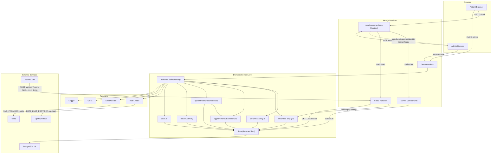

`ActionWrapper` is the chokepoint every Server Action passes through (Zod parse, rate limit, auth, handler, error mapping — C12). Route Handlers skip it (C13 scopes it to Server Actions) and carry their own guard instead: `Bearer CRON_SECRET` for the cron route, rate limiting only for `.ics`/`health`.

### 2.2 Layers and Dependency Rule

Four layers, one-directional: `app -> features -> server -> lib`. `components/ui` and `components/` sit beside `lib` as a second leaf, importable from `app`/`features`, importing nothing above themselves.

- `app/` — route segments only (`page.tsx`, `layout.tsx`, `loading.tsx`, `error.tsx`, `route.ts`); renders feature components, no business logic.
- `features/<feature>/` — `components/`, `actions.ts`, `schemas.ts`, `queries.ts`, `types.ts`, `hooks/` per feature (`landing`, `booking`, `otp`, `admin-auth`, `dashboard`, `appointments`, `patients`, `services`, `settings`, C17).
- `server/` — `db.ts`, `action.ts`, auth guards, `slots/` (`availability.ts`, `hold-expiry.ts`), `appointments/` (`transitions.ts`, `reschedule.ts`), `sms/`, `ratelimit/`, `audit.ts`; domain logic and the Prisma client, feature-agnostic.
- `lib/` — `env.ts`, `money.ts`, `dates.ts`, `phone.ts`, `ics.ts`, `enums.ts`, `errors.ts`, `utils.ts`, `clock.ts`; pure, feature-agnostic primitives.

A file imports only from its own layer or one strictly below. Keeps `server/` reusable across features, `lib/` trivially unit-testable. Enforced via ESLint path-boundary rule `import/no-restricted-paths` (directory-scoped, unlike core `no-restricted-imports`), one zone per forbidden upward edge:

```ts
// .eslintrc.cjs (excerpt)
rules: {
  "import/no-restricted-paths": ["error", {
    zones: [
      { target: "./src/lib/**",        from: ["./src/app", "./src/features", "./src/server"] },
      { target: "./src/components/**", from: ["./src/app", "./src/features", "./src/server"] },
      { target: "./src/server/**",     from: ["./src/app", "./src/features"] },
      { target: "./src/features/**",   from: ["./src/app"] },
    ],
  }],
}
```

Zod placement (C17): every feature's schemas live in `features/<feature>/schemas.ts`, never in `server/`, never duplicated. `features/booking/components/*` passes the schema to `@hookform/resolvers/zod` for inline client validation; `features/booking/actions.ts` passes the SAME schema object into `defineAction({ input: schema, handler })` (`src/server/action.ts`). `server/action.ts` itself imports zero feature schemas — it takes one generically per call site — so `features -> server` is never reversed. Types are `z.infer<typeof Schema>`, never hand-written: one schema edit updates client validation, server validation, and the TS type together.

### 2.3 Rendering Strategy per Route

| Route | Strategy | Caching / revalidate | Auth | Why |
|---|---|---|---|---|
| `/` | SSG at build | `revalidate: false`; on-demand `revalidatePath('/')` on services/settings mutations | None | Static, fast landing page; see "The SSG tension" below. |
| `/privacy` | SSG | `revalidate: false` | None | Static legal content, no DB read. |
| `/terms` | SSG | `revalidate: false` | None | Static legal content, no DB read. |
| `/book` | Static shell, `dynamic = 'force-static'`, client wizard island | Shell cached indefinitely; data via Server Actions (uncached per call) | None | Shell stays fast; live availability can't be route-cached, so it's pushed to action calls. |
| `/book/success/[reference]` | **Token-resolving page** (dynamic SSR) | `Cache-Control: no-store`; `noindex, nofollow` | None; `reference.lookup` rate limit (C14) applied in the page's own data loader, keyed by IP | URL itself grants access (C8); unknown/expired reference renders the identical not-found view — no timing or wording tell (A5). |
| `/admin/login` | Dynamic SSR | `force-dynamic` | None (pre-auth) | Reads CSRF/session cookie state per request (C11). |
| `/admin` | Dynamic SSR | `force-dynamic`; `searchParams`-driven date range | `requireAdmin()` + middleware | KPIs are live and query-parameterized, not cacheable. |
| `/admin/calendar` | Dynamic SSR shell + FullCalendar client island | `force-dynamic` | `requireAdmin()` + middleware | Appointment state changes constantly. |
| `/admin/appointments` | Dynamic SSR | `force-dynamic`; `searchParams`-driven (`page`, `q`, `status`, `service`, `range`) | `requireAdmin()` + middleware | Filtered/paginated per request; no cacheable shape. |
| `/admin/patients` | Dynamic SSR | `force-dynamic`; `searchParams`-driven | `requireAdmin()` + middleware | Same reasoning as appointments. |
| `/admin/settings` | Dynamic SSR + client forms | `force-dynamic` | `requireAdmin()` + middleware | Must show latest DB state before an edit. |
| `GET/POST /api/auth/[...nextauth]` | Route Handler (Auth.js internal) | No caching | Auth.js flow itself | Required wiring for the Credentials provider (C11, C13). |
| `GET /api/appointments/[reference]/ics` | Route Handler | `no-store`; `Content-Disposition: attachment` | None; `reference.lookup` rate limit (C14) | Needs a response header a Server Action can't set (C13); shares the success page's rate limit and identical not-found behavior (A5). |
| `POST /api/cron/expire-holds` | Route Handler | No caching | `Bearer CRON_SECRET` | Vercel Cron target; sweeps expired holds (C9 step 5). |
| `GET /api/health` | Route Handler | `no-store` | None | Uptime probe; leaks no DB-schema detail (C13). |

All `/admin/*` segments additionally set `export const dynamic = 'force-dynamic'` and `noindex` (C15).

#### Token-Resolving Surfaces

`/book/success/[reference]` and `GET /api/appointments/[reference]/ics` are neither Server Actions nor ordinary Route Handlers in C13's sense — both resolve a bearer capability (the booking reference, C8) instead of an authenticated identity, so C13/C15 classify them as **token-resolving surfaces** (A5). Both carry the same three properties: `Cache-Control: no-store` and `noindex, nofollow` so the URL is never cached or indexed by a crawler; the `reference.lookup` rate limit (C14: 30/1h per IP); and a uniform not-found response for an unknown, malformed, or expired reference, with no timing or wording difference between those cases. For the `.ics` route the limit is just another `RateLimiter` call inside the handler; the page has no `defineAction` chokepoint to pass through (C12 wraps Server Actions only), so its data loader calls `RateLimiter` directly, keyed by IP, before touching `Db`.

#### The SSG Tension

The brief requires `/` to be "statically generated with no runtime data fetching," and separately requires Services to be CRUD-editable in `/admin/settings`. These conflict the moment an admin edits a price after the landing page is already built: a static page cannot reflect that edit without some re-render.

Resolution (C15): the Service list is read from Postgres at **build time** (`pnpm build` runs a Prisma query against active `Service` rows, alongside `src/content/site.ts`'s static copy), then served as plain static HTML with `revalidate: false` — no request ever re-runs that query. Freshness is handled out-of-band instead: every `services`/`settings` mutation that changes landing-visible data (`SERVICE_CREATED`, `SERVICE_UPDATED`, `SERVICE_DEACTIVATED`, `SETTINGS_UPDATED` — C4) calls `revalidatePath('/')` as its last step. On-demand revalidation is independent of a segment's `revalidate` setting, so `revalidate: false` does not block it; the page regenerates once, on that mutation, never on a patient request.

Named alternative for instant propagation without relying on mutations to call `revalidatePath`: ISR with a short `revalidate` window (e.g. 60s) instead of `false`. Trade-off: a visitor can see a price up to one window stale — a real relaxation of "no runtime data fetching" that should be a deliberate, stated choice if adopted.

### 2.4 Booking Request Lifecycle

Walkthrough of one `createBooking` call, module by module:

1. `BookingWizard` (`features/booking/components`, client island on `/book`) collects `serviceId`, date, slot, `holdFullName`, `holdPhoneE164`; inline-validates via `features/booking/schemas.ts`'s `CreateBookingInputSchema` (UX only), invokes the Server Action.
2. Next's Server Action transport handles the POST, verifying the same-origin header (CSRF, C13) before the function body runs.
3. `features/booking/actions.ts` exports `createBooking` as `defineAction({ input: CreateBookingInputSchema, rateLimit: [...], auth: "public", handler })` (`server/action.ts`, C12).
4. `defineAction` re-parses server-side; failure short-circuits to `VALIDATION_ERROR` with `fieldErrors` before any DB touch — the real gate, not step 1.
5. `defineAction` calls `RateLimiter` (`server/ratelimit/`) with HMAC-hashed phone/IP keys against both `booking.create` rules (C14: 5/1h per phone, 20/1h per IP); either breach short-circuits to `RATE_LIMITED`.
6. `auth: "public"` skips `requireAdmin()`; the handler runs.
7. Handler calls `server/slots/hold-expiry.ts`'s lazy sweep first (C9 step 5 — expired `PENDING_VERIFICATION` rows cancelled, their `AppointmentSlot` rows deleted), then `server/slots/availability.ts` recomputes candidate slot(s) against `ClinicSettings`/`WorkingHour`/`ClosedDate` (React `cache()`, C23). The client's chosen slot is never trusted as-is.
8. One `server/db.ts` `$transaction`: insert `Appointment` (`status: "PENDING_VERIFICATION"`, `holdExpiresAt: Clock.now() + holdTtlMin`, `patientId: null`, four `...AtBooking` snapshots from `Service`) plus one `AppointmentSlot` row per occupied interval (C5, C9 step 2); `lib/clock.ts`'s `Clock` is the only time source (C22).
9. A `P2002` on `AppointmentSlot.slotStartUtc` aborts the transaction; the Prisma-error mapper (C12) converts it to `SLOT_TAKEN` — the unique index is the real guard (C5), this only translates the failure.
10. On commit: generate the `MB-XXXXXX` reference (C8, retry up to 5x), create `OtpChallenge` (`codeHash` = HMAC-SHA256 with `OTP_PEPPER`, 5-min `expiresAt`), call `SmsProvider.sendOtp`. Send failure does not roll back the hold; it surfaces as `OTP_SEND_FAILED` for resend (C9 step 3) — envelope shape is Section 5's concern.
11. `defineAction` logs `{ action, durationMs, outcome }` via `Logger` (no PII, C19/C23), returns `ActionResult<T>`; uncaught exceptions map to `INTERNAL`.
12. `BookingWizard`: `ok: true` advances to OTP; `ok: false` renders `fieldErrors` or branches on `error.code` (e.g. `SLOT_TAKEN` refetches availability).

### 2.5 Trust Boundaries and Runtime Constraints

- **Edge**: `middleware.ts` and `src/auth.config.ts` only. Edge Middleware runs in a V8 isolate ahead of the Node function on every matched request — no Node APIs, no native addons, no raw TCP sockets.
- **Node**: everything else — Server Components, Server Actions, Route Handlers, all of `server/**` — each transitively reaches Prisma (`server/db.ts`), `@node-rs/argon2` (`src/auth.ts`'s `authorize()`), or another Node-only SDK (Twilio, the hand-rolled `ics.ts` writer).

Why: Prisma's query engine and argon2's addon are platform-native binaries — genuinely unbuildable for a V8 isolate, not merely slow — so Edge Middleware's bundle must stay clear of them to keep its no-cold-start value.

The specific build-breaking mistake (C11):

```ts
// middleware.ts — WRONG, breaks the Edge build
import { auth } from "./auth"; // auth.ts: Credentials provider + @node-rs/argon2 + Prisma

// middleware.ts — CORRECT
import { auth } from "./auth.config"; // auth.config.ts: providers: [], callbacks only
```

Importing `src/auth.ts` into `middleware.ts` pulls `@node-rs/argon2` and Prisma into the Edge bundle transitively: the bundler either fails the build outright, or on some toolchains ships a bundle that only throws at request time in production, since `next dev` runs in Node mode and never exercises the Edge path locally. C11's two-file split keeps `middleware.ts`'s check Edge-safe (a shallow "structurally valid session JWE" check) while real argon2 verification stays Node-only — and is why `requireAdmin()` independently re-checks `AdminUser.isActive`/`lockedUntil` inside every admin Server Action: middleware is defense-in-depth, never the only check.

### 2.6 Deployment Topology

- One Vercel project: a Production deployment tracking the default branch, one Preview deployment per open PR/branch.
- `vercel.json` declares the single in-app cron: `*/5 * * * *` -> `POST /api/cron/expire-holds` (Bearer `CRON_SECRET`, C9/C13).
- Postgres is pooler-fronted (e.g. Neon): `DATABASE_URL` is the pooled endpoint (`?pgbouncer=true&connection_limit=1`, C23), used by every Node-runtime request. `DIRECT_DATABASE_URL` is unpooled, used only by `prisma migrate deploy` from CI — a transaction-mode pooler mishandles migration DDL locks.
- Preview deployments get their own branch database: each PR's Preview env vars point at a database branch created from `main` (Neon's branch-per-PR integration or equivalent), so preview migrations/seed data never touch production and are discarded with the branch.
- Secrets (`AUTH_SECRET`, `OTP_PEPPER`, `CRON_SECRET`, `TWILIO_*`, `UPSTASH_*`, both `*_DATABASE_URL`s) are Vercel Project Environment Variables scoped per environment; `.env.example` documents names only, never values (C16).
- Assumption: C20's monthly retention cron (`scripts/retention.ts`) runs from a GitHub Actions scheduled workflow against `DIRECT_DATABASE_URL`, not a Vercel Cron Job — a Vercel Cron must target an HTTP route, which would need a fifth Route Handler and contradict C13's closed list of four (see Contract Challenges).

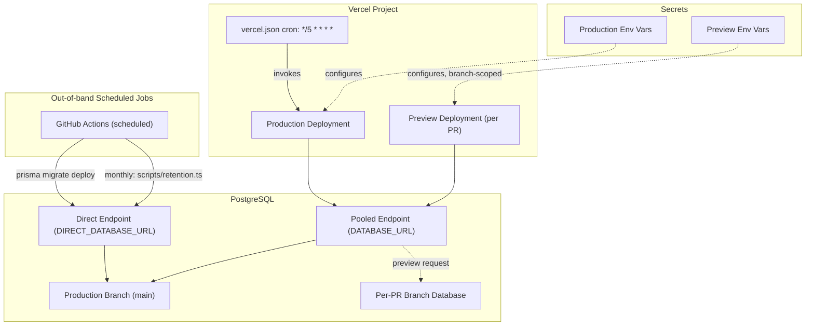

#### Contract Challenges

- **C13 vs C20**: C13 closes Route Handlers at exactly four, with no retention endpoint; C20 says retention runs "by a monthly cron" without naming a mechanism. A Vercel Cron Job can only target an HTTP route, so a monthly Vercel Cron for retention would need a fifth Route Handler, contradicting C13. Section 2 resolves this by assuming retention runs via a GitHub Actions scheduled workflow calling `scripts/retention.ts` directly against `DIRECT_DATABASE_URL`, never through a Route Handler — but the contract should say this explicitly rather than leave it to be re-derived: either C13 gets a named fifth exception, or C20 states outright that its cron is not Vercel/Route-Handler-based.

---

## 3. Folder / File Structure

Full repository tree. Generated/vendor directories (`node_modules/`, `.next/`, `.turbo/`, coverage output, Playwright report output) are omitted — standard, not project-specific. Every directory ends in `/`; every other line is a real file. A trailing `//` comment explains purpose where the filename alone doesn't. For each of the 9 features (C17) every conventional slot — `components/`, `actions.ts`, `schemas.ts`, `queries.ts`, `types.ts`, `hooks/` — is either a real file or an explicit `(… omitted — reason)` line, never silently dropped.

```text
med-reserv/
  README.md                          // setup: docker compose up -d db, pnpm install, pnpm db:migrate, pnpm db:seed, pnpm dev
  package.json                       // scripts: dev, build, start, lint, test, test:e2e, db:migrate, db:sqlite, db:seed
  tsconfig.json                      // strict + noUncheckedIndexedAccess (C2); path alias "@/*" -> "src/*"
  next.config.mjs                    // Server Actions config, security headers; no image remote patterns needed (no external images)
  tailwind.config.ts                 // v3.4.x, NOT v4 CSS-first (C2); HSL CSS-var token mapping (C18)
  postcss.config.mjs                 // tailwindcss + autoprefixer plugins
  eslint.config.mjs                  // flat config; no-restricted-syntax bans new Date() outside lib/clock.ts (C22) and
                                      // raw process.env outside lib/env.ts (C16); no-restricted-imports bans argon2/Prisma in middleware (C11)
  .prettierrc.json                   // formatting rules (tailwind class-sorting plugin enabled)
  .prettierignore
  vitest.config.ts                   // two environments via projects: node (unit, tests/unit/**) and jsdom (component, tests/component/**)
  playwright.config.ts               // baseURL, webServer boot, projects: chromium/webkit; tests/e2e/**
  lighthouserc.json                  // asserts >=95 all 4 categories against the built "/" route (C23)
  docker-compose.yml                 // Postgres 16 "db" service for local dev (C3); no redis — dev uses MemoryRateLimiter
  .env.example                       // exact var list in C16; no values, comments only
  components.json                    // shadcn CLI config: aliases "@/components", "@/lib", "@/ui"; css app/globals.css
  .gitignore                         // node_modules, .next, .env*, prisma/schema.sqlite.prisma (generated, see 3.1)

  src/
    middleware.ts                    // matcher protects /admin/:path* except /admin/login (C11). Lives under src/, not repo
                                      // root, because app/ is under src/ — Next.js requires middleware.ts at the same level
                                      // as app/ when a src/ directory is used (see 3.1 assumption)
    auth.config.ts                   // Edge-safe: providers: [], callbacks only. Imported by middleware.ts (C11)
    auth.ts                          // full Auth.js v5 config: Credentials provider + @node-rs/argon2. Node runtime only (C11)

    app/
      layout.tsx                     // root <html>; next/font Inter + Plus Jakarta Sans (C18); imports globals.css
      globals.css                    // Tailwind directives + :root / .dark HSL CSS variables for every C18 token
      page.tsx                       // "/" — SSG, revalidate: false (C15); build-time Prisma read of active Services
      loading.tsx                    // root suspense fallback (skeleton)
      error.tsx                      // root error boundary
      not-found.tsx                  // global 404
      opengraph-image.tsx            // generated OG image for "/", inherited by routes without their own override
      sitemap.ts                     // MetadataRoute.Sitemap: "/", "/privacy", "/terms", "/book" (admin + success excluded, noindex)
      robots.ts                      // MetadataRoute.Robots: disallow /admin, /book/success, /api
      privacy/
        page.tsx                     // SSG; states the C20 retention policy in prose
      terms/
        page.tsx                     // SSG
      book/
        page.tsx                     // "/book" — static shell, dynamic = 'force-static' (C15); mounts <BookingWizard/> client island
        loading.tsx
        error.tsx                    // catches unexpected render errors; action failures never throw (C12), handled in-wizard
        success/
          [reference]/
            page.tsx                 // "/book/success/[reference]" — dynamic SSR, no-store, noindex (C15); capability token (C8)
            not-found.tsx            // unknown/foreign reference -> NOT_FOUND (C12)
      admin/
        layout.tsx                   // outer shell: force-dynamic + noindex metadata for all /admin/* (C15); no visual chrome
                                      // (kept separate from the inner layout below so /admin/login renders without the sidebar)
        login/
          page.tsx                   // "/admin/login" — dynamic SSR (C15)
          loading.tsx
        (dashboard)/                 // route group: adds the authenticated shell, contributes no URL segment
          layout.tsx                 // sidebar + topbar chrome; reads session via auth() for display name only
                                      // (middleware + requireAdmin() in every action are the actual gate, C11 — this layout
                                      // is not a security boundary)
          error.tsx
          page.tsx                   // "/admin" — dynamic SSR, searchParams-driven date range (C15)
          loading.tsx
          _components/               // route-private: colocated chrome, not reused outside /admin (see 3.1)
            admin-sidebar.tsx
            admin-topbar.tsx         // user menu (sign out), ThemeToggle slot
            admin-nav-items.ts       // { href, label, icon }[] — Section 12 tasks that add an admin page touch this file
          calendar/
            page.tsx                 // "/admin/calendar" — dynamic SSR shell + FullCalendar client island (C15)
            loading.tsx
          appointments/
            page.tsx                 // "/admin/appointments" — searchParams: page, q, status, service, range (C15)
            loading.tsx
          patients/
            page.tsx                 // "/admin/patients" — searchParams-driven (C15)
            loading.tsx
          settings/
            page.tsx                 // "/admin/settings" — dynamic SSR + client forms (C15)
            loading.tsx
      api/
        auth/
          "[...nextauth]"/
            route.ts                 // GET/POST — Auth.js handler (C13)
        appointments/
          "[reference]"/
            ics/
              route.ts                // GET /api/appointments/[reference]/ics — Content-Disposition file download (C13);
                                      // shares the reference.lookup rate-limit rule (C14) with the success-page SSR query
        cron/
          expire-holds/
            route.ts                 // POST, Bearer CRON_SECRET, every 5 min (C13); same sweep as the lazy path in C9.5
        health/
          route.ts                   // GET — uptime probe, no schema detail leaked (C13)
        test/
          reset/
            route.ts                 // POST — RateLimiter.resetAll() + clears AdminUser.failedLoginCount/lockedUntil (C24 A6b);
                                      // registered ONLY when NODE_ENV !== "production" AND E2E_TEST_HOOKS === "true"; called by
                                      // Playwright global setup and between limit-exercising specs; a security-suite test
                                      // asserts this route is absent from a production build

    features/
      landing/
        components/
          hero-section.tsx
          services-section.tsx       // prices via lib/money.ts formatMoney
          about-section.tsx          // doctors, from content/site.ts
          how-it-works-section.tsx   // 3 steps
          testimonials-section.tsx
          hours-location-section.tsx
          faq-section.tsx
        queries.ts                   // getActiveServicesForLanding() — the one build-time Prisma read (C15)
        types.ts                     // LandingContent, ServiceCardView
        (actions.ts omitted — the public landing page has no mutations)
        (schemas.ts omitted — no form input to validate)
        (hooks/ omitted — pure SSG, no client state)

      booking/
        components/
          booking-wizard.tsx         // "use client" step-sequencing island mounted by app/book/page.tsx
          service-step.tsx
          date-step.tsx              // react-day-picker; disables past/closed/full days
          time-step.tsx              // slot grid for the selected date
          details-step.tsx           // full name + phone; renders <PhoneInput>
          phone-input.tsx            // ui/command + ui/popover country selector, feeds libphonenumber-js (lib/phone.ts)
          review-step.tsx            // summary + the required explicit confirm checkbox
          slot-picker.tsx            // shared by date-step (day fullness) and time-step (slot buttons)
        hooks/
          use-booking-wizard.ts      // client step state machine (current step, draft, back/next guards)
        actions.ts                   // action booking.createBooking (C9.2-3)
        schemas.ts                   // per-step Zod schemas + createBookingInputSchema; imported by both the step forms and actions.ts
        queries.ts                   // getBookableServices(), getAvailableSlots(date, serviceId), getAvailableDays(yearMonth,
                                      // serviceId) -> delegates to server/slots/availability.ts
        types.ts                     // BookingWizardState, StepId union, BookingDraft

      otp/
        components/
          otp-input.tsx              // 6-digit input
          otp-resend-button.tsx      // owns the 60s cooldown countdown display
        actions.ts                   // action otp.verifyOtp, action otp.resendOtp (otp.send is internal to booking.createBooking, C9.3)
        schemas.ts                   // otpCodeSchema (6 digits)
        types.ts                     // OtpChallengeView
        (queries.ts omitted — challenge state is only ever read back through an action result, never fetched standalone)
        (hooks/ omitted — cooldown timer lives inside otp-resend-button.tsx)

      admin-auth/
        components/
          login-form.tsx
        actions.ts                   // action adminAuth.login — thin wrapper around Auth.js signIn("credentials", ...);
                                      // the actual password check is authorize() inside src/auth.ts (C11), not here
        schemas.ts                   // loginSchema (email, password)
        types.ts                     // LoginFormValues
        (queries.ts omitted — no reads outside the Credentials authorize() callback)
        (hooks/ omitted)

      dashboard/
        components/
          kpi-grid.tsx
          kpi-card.tsx
          revenue-chart.tsx          // Recharts; daily/weekly/monthly toggle via ui/tabs
          appointments-by-service-chart.tsx
          date-range-filter.tsx      // dashboard-specific wrapper (searchParams wiring) around shared components/date-range-picker.tsx
        queries.ts                   // getDashboardKpis(range), getRevenueSeries(range, granularity), getAppointmentsByService(range) — Section 9
        schemas.ts                   // dashboardRangeSchema (parses the range/granularity searchParams)
        types.ts                     // KpiSnapshot, RevenuePoint, ServiceBreakdownPoint
        (actions.ts omitted — read-only feature, no mutations)
        (hooks/ omitted)

      appointments/
        components/
          appointments-table.tsx     // ui/table + shared data-table-pagination.tsx
          appointments-filters.tsx   // search, status, service, date range (composes shared date-range-picker.tsx)
          appointment-row-actions.tsx // ui/dropdown-menu: confirm/complete/no-show/cancel/reschedule
          reschedule-dialog.tsx      // ui/dialog; picks a new slot via booking/slot-picker.tsx
          admin-calendar.tsx         // "use client" FullCalendar wrapper; color-codes by status via shared status-badge.tsx palette
          calendar-view-toggle.tsx   // ui/tabs driving calendarRef.current.changeView() (day/week/month) — kept custom so the
                                      // control matches C18 styling instead of FullCalendar's default toolbar buttons
        actions.ts                   // action appointments.updateStatus (confirm/complete/markNoShow/cancel collapsed
                                      // per Section 5.1 Naming Reconciliation), appointments.reschedule — both route
                                      // through server/appointments/transitions.ts (C4)
        schemas.ts                   // appointmentsFiltersSchema, rescheduleSchema
        queries.ts                   // listAppointments(filters), getAppointmentById(id)
        types.ts                     // AppointmentRow, AppointmentsFilters
        (hooks/ omitted)

      patients/
        components/
          patients-table.tsx         // name, phone, visit count, total spent, last visit
        queries.ts                   // listPatients(filters) — aggregates Appointment by patientId
        schemas.ts                   // patientsFiltersSchema
        types.ts                     // PatientRow
        (actions.ts omitted — patients are read-only in v1; no patient-record mutation exists, C1)
        (hooks/ omitted)

      services/
        components/
          services-table.tsx
          service-form-dialog.tsx    // create/edit; ui/dialog + ui/form
        actions.ts                   // action services.create, .update, .deactivate (soft delete via isActive, never hard-delete)
        schemas.ts                   // serviceInputSchema (name, durationMin, priceMinor, colorHex, sortOrder)
        queries.ts                   // listServices(), getServiceById(id)
        types.ts                     // ServiceRow

      settings/
        components/
          working-hours-form.tsx     // per-weekday open/close minutes; supports split shifts (multiple rows per weekday)
          closed-dates-form.tsx      // add/remove ClosedDate rows
          general-settings-form.tsx  // clinicName, timeZone, currency, slotIntervalMin, bufferMin, minLeadTimeMin, maxAdvanceDays, holdTtlMin
        actions.ts                   // action settings.update, .addClosedDate, .removeClosedDate, .upsertWorkingHours
        schemas.ts                   // clinicSettingsSchema, workingHourSchema, closedDateSchema
        queries.ts                   // getClinicSettings(), listWorkingHours(), listClosedDates()
        types.ts                     // ClinicSettingsView

    components/
      ui/                            // shadcn primitives, vendored (C17); pruned to exactly what the UI plan uses (Section 8)
        button.tsx
        input.tsx
        label.tsx
        select.tsx                   // revenue granularity, status filter
        calendar.tsx                 // react-day-picker wrapper — booking date-step, closed-dates-form
        dialog.tsx                   // service-form-dialog, reschedule-dialog, generic confirm-dialog
        sheet.tsx                    // mobile admin nav drawer, mobile filters drawer
        dropdown-menu.tsx            // appointment-row-actions, admin user menu
        table.tsx                    // appointments / patients / services tables
        tabs.tsx                     // revenue granularity toggle, calendar view toggle
        badge.tsx                    // status-badge, service active/inactive
        card.tsx                     // KPI cards, landing service/testimonial cards
        form.tsx                     // React Hook Form field wrapper, used by every form across the app
        sonner.tsx                   // toast notifications (shadcn's current recommendation over the deprecated toast.tsx)
        skeleton.tsx                 // every loading.tsx
        separator.tsx                // settings sections, dropdown-menu dividers
        popover.tsx                  // phone-input country combobox, date-range-picker
        alert.tsx                   // inline error banners (SLOT_TAKEN, OTP_SEND_FAILED, settings save failure)
        checkbox.tsx                 // review-step "name and phone are correct" confirmation (brief requirement)
        pagination.tsx               // admin tables (brief requirement)
        tooltip.tsx                  // accessible names for icon-only buttons (WCAG 4.1.2)
        command.tsx                  // searchable country list inside phone-input's popover
                                      // (radio-group pruned: no genuine use — service choice renders as selectable cards, not a radio list)
      page-header.tsx                // title + optional actions slot, every /admin/* page
      empty-state.tsx                // "no appointments match these filters", etc.
      status-badge.tsx               // AppointmentStatus -> color + icon + text label, never color alone (C4, WCAG 1.4.1)
      confirm-dialog.tsx             // generic "are you sure?" wrapping ui/dialog — cancel/no-show, deactivate service
      widget-error-boundary.tsx      // generic data-fetch error wrapper for dashboard widgets (T8.6)
      data-table-pagination.tsx      // ui/pagination wrapper shared by all three admin tables
      date-range-picker.tsx          // ui/popover + ui/calendar range picker — dashboard filter and appointments filter both compose this
      money-display.tsx              // thin span around lib/money.ts formatMoney — landing, booking review, dashboard, appointments table
      site-header.tsx                // public nav: /, /privacy, /terms, /book
      site-footer.tsx                // contact info, clinic hours summary (brief: Footer section) — shared, not landing-local,
                                      // because /privacy and /terms reuse it too
      theme-toggle.tsx               // dark-mode switch (C18 nice-to-have); mounted in both site-header and admin-topbar
      app-logo.tsx                   // mounted in both site-header and admin-sidebar

    hooks/                           // cross-feature client hooks — C17 scopes hooks/ per-feature only; this is a stated
                                      // extension for the handful of hooks no single feature owns (see 3.1)
      use-debounced-value.ts         // appointments-filters and patients search inputs
      use-media-query.ts             // admin sidebar <-> sheet breakpoint switch

    server/
      db.ts                          // PrismaClient singleton, globalThis-cached across HMR reloads
      action.ts                      // defineAction({ input, handler, auth, rateLimit }) (C12): Zod parse -> rate limit ->
                                      // auth -> handler -> error mapping. Declares ActionResult<T> and the shared Paginated<T>,
                                      // DateRange generics here (see 3.1 — "where types live")
      auth-guards.ts                 // requireAdmin() — re-checks the session inside every admin action (C11); distinct from
                                      // the top-level auth.ts/auth.config.ts, which are the Auth.js configuration itself
      audit.ts                       // writeAuditLog(action, entity, entityId, meta) — AuditAction values from C4
      slots/
        availability.ts              // slot-grid builder: WorkingHour + ClosedDate + slotIntervalMin -> candidate UTC instants
                                      // minus taken AppointmentSlot rows (Section 6); DST de-dup rule from C6
        hold-expiry.ts                // lazy sweep: PENDING_VERIFICATION past holdExpiresAt -> CANCELLED, deletes its slots (C9.5)
      sms/
        provider.ts                   // interface SmsProvider { sendOtp, sendConfirmation }
        console-provider.ts           // dev/mock: logs to stdout, never a real send
        twilio-provider.ts             // Twilio implementation
        index.ts                       // selects an implementation by SMS_PROVIDER (C16) — provider selection, not a re-export barrel
      ratelimit/
        limiter.ts                     // interface RateLimiter { limit(key, rule): Promise<Decision> } (C14)
        memory-limiter.ts              // sliding-window Map; dev / single-instance; advisory only on serverless (C14)
        upstash-limiter.ts              // @upstash/ratelimit; prod
        rules.ts                        // the pinned rule table from C14 (availability.read, booking.create, otp.send, ...)
        index.ts                        // selects an implementation by RATE_LIMIT_PROVIDER (C16) — provider selection, not a barrel
      appointments/
        transitions.ts                  // legal AppointmentStatus transition matrix + assertTransition() guard (C4)
        reschedule.ts                   // delegates to rescheduleAppointment, Section 6.5 (T9.4)

    lib/
      env.ts                          // Zod-parses process.env once; the ONLY file allowed to read process.env (C16, ESLint-enforced)
      clock.ts                        // interface Clock { now(): Date }; systemClock + FixedClock test double (C22)
      money.ts                        // formatMoney(minor, currency, locale) — exponent from Intl, never hardcoded /100 (C7)
      dates.ts                        // date-fns-tz boundary wrappers: fromZonedTime, toZonedTime, formatInTimeZone (C6)
      phone.ts                        // libphonenumber-js: parse/validate E.164, country list for the phone-input selector
      ics.ts                          // hand-rolled RFC 5545 .ics writer, no dependency (C2)
      enums.ts                        // AppointmentStatus / BookingSource / AdminRole / AuditAction const objects + Zod unions (C4)
      errors.ts                       // ErrorCode union + ActionError shape (C12)
      logger.ts                       // pino + redaction serializer; never logs phone/name/OTP/password/token/reference (C19)
      utils.ts                        // cn() class-merge helper (clsx + tailwind-merge) and small array/pagination helpers
      reference.ts                    // "MB-XXXXXX" generator, Crockford-32-minus-vowels alphabet, rejection sampling (C8)

    content/
      site.ts                        // landing copy, FAQ, testimonials, doctors — single config source (C17); Services
                                      // themselves come from the DB (seed.ts), not from this file

  prisma/
    schema.prisma                    // Postgres — single source of truth for schema + migrations (C3)
    schema.sqlite.prisma             // generated by scripts/gen-sqlite-schema.ts; gitignored, never hand-edited (C3)
    migrations/
      migration_lock.toml
      "20250101000000_catalog_init"/
        migration.sql                // Service, ClinicSettings, WorkingHour, ClosedDate — first migration (T3.2, 4.6)
      "20250102000000_booking_core_init"/
        migration.sql                // Patient, Appointment, AppointmentSlot — second migration (T4.1)
      "20250103000000_add_check_constraints"/
        migration.sql                // hand-edited: the six CHECK-constraint statements from Section 4.5, as a migration
                                      // of its own, not folded into catalog_init (T4.2, 4.6 step 3)
      "20250104000000_admin_audit_init"/
        migration.sql                // OtpChallenge, AdminUser, AuditLog — fourth migration, completes the 9-model schema (T4.3)
    seed.ts                          // sample services, sample appointments across statuses, one admin user (brief "Delivery")

  scripts/
    gen-sqlite-schema.ts             // rewrites datasource provider + url into prisma/schema.sqlite.prisma (C3)
    retention.ts                     // monthly cron: anonymize appointments >24mo, hard-delete stale patients / expired OTP rows (C20)

  tests/
    unit/
      lib/
        money.test.ts
        dates.test.ts
        phone.test.ts
        enums.test.ts
        ics.test.ts
      server/
        slots/
          availability.test.ts       // Section 6 edge cases: DST spring-forward/fall-back, overlapping durations, closed days
          hold-expiry.test.ts
          hold-expiry.integration.test.ts // Section 11.5 integration tier: lazy sweep vs cron under real DB (T11.2)
        appointments/
          transitions.test.ts        // every legal/illegal transition pair from C4
          reschedule.integration.test.ts // Section 11.5 integration tier: reschedule success + rollback-on-collision (T11.2)
        auth/
          require-admin.integration.test.ts // Section 11.5 integration tier: requireAdmin() rejection cases, row left unmutated (T11.2)
        booking/
          concurrency.integration.test.ts // Section 11.5 integration tier: Promise.all double createBooking -> one SLOT_TAKEN (T11.2)
        dashboard/
          kpi-accuracy.integration.test.ts // dashboard KPI aggregate vs hand-computed totals under real DB (T8.7)
        settings/
          audit-coverage.integration.test.ts // every settings mutation path writes its AuditLog row (T10.7)
        otp.test.ts                  // expiry, maxAttempts, resend cooldown/replacement (C10)
        ratelimit.test.ts
      features/
        booking/
          schemas.test.ts
    component/
      booking/
        service-step.test.tsx
        date-step.test.tsx
        time-step.test.tsx
        details-step.test.tsx
        review-step.test.tsx
      admin/
        kpi-cards.test.tsx
        appointments-table.test.tsx
    e2e/
      booking-flow.spec.ts           // Section 11: full happy-path booking incl. OTP
      double-booking.spec.ts         // Section 11: concurrent-slot race
      admin-login.spec.ts
      admin-dashboard-kpis.spec.ts
      admin-appointments-actions.spec.ts
    fixtures/
      services.ts
      appointments.ts
      admin-user.ts
      clinic-settings.ts
    support/
      integration-setup.ts           // per-worker-schema + TRUNCATE isolation harness for the "integration" Vitest project (T11.4)

  public/
    favicon.ico
    images/
      hero.jpg                       // LCP image, next/image priority (C23)
      doctors/                       // "doctors/*.jpg" — About section headshots, several files not individually enumerated

  .github/
    workflows/
      ci.yml                        // lint -> typecheck -> unit -> component -> build -> e2e -> Lighthouse CI, on every PR
    pull_request_template.md         // includes the C19 checklist item: "any new log line touching patient data reviewed for PII"

  docs/
    PLAN.md                          // this document (Sections 1-14) — assembled output, not authored directly by this fragment
```

### 3.1 Conventions

- **File naming.** Kebab-case for every `.ts`/`.tsx` file (`review-step.tsx`, not `ReviewStep.tsx`). Route-segment folders use the exact lowercase URL segment; dynamic segments keep Next's bracket syntax (`"[reference]"`).
- **Component naming.** One component per file, PascalCase, name matches the filename (`booking-summary-card.tsx` exports `BookingSummaryCard`). No default exports for components — named exports only, so an import error names the symbol, not just "default."
- **Barrel-file policy: banned.** No `index.ts` re-export barrels under `features/`, `components/`, or `lib/` — every import is a direct path to one physical file, which is what lets Section 12's "files touched" column name a single real path per change. The two `index.ts` files that do exist (`server/sms/index.ts`, `server/ratelimit/index.ts`) are provider-*selection* modules (`export const smsProvider = env.SMS_PROVIDER === "twilio" ? twilioProvider : consoleProvider`), not re-exports of sibling files, so they don't reintroduce the barrel problem.
- **Where types live.** `@prisma/client`'s generated types are the base vocabulary. Per-feature view/input shapes live in that feature's `types.ts`, inferred from its `schemas.ts` Zod schemas wherever one exists (`z.infer<typeof x>`), never hand-duplicated. Cross-feature generics that aren't owned by any one feature (`Paginated<T>`, `DateRange`) live in `src/server/action.ts` beside `ActionResult<T>`, since every paginated or range-filtered read is itself a Server Action's input or output.
- **Import alias.** `"@/*"` → `"src/*"` (tsconfig `paths`, mirrored in `vitest.config.ts` and `playwright.config.ts` resolvers). Example: `import { db } from "@/server/db"`; `import { ReviewStep } from "@/features/booking/components/review-step"`.
- **Route-private colocation.** A `_folder` prefix (e.g. `app/admin/(dashboard)/_components/`) colocates files used by exactly one route segment and its children, opted out of Next's routing. Anything imported by two or more features or route segments graduates to `src/components/` (or `src/hooks/`) instead.
- **Assumption — `middleware.ts` location.** The task framing groups `middleware.ts` with repository-root config, but Next.js requires it at the same filesystem level as `app/`; since C17 nests `app/` under `src/`, `middleware.ts` is placed at `src/middleware.ts`, not the bare repo root. Functionally identical; this is a placement detail, not a deviation from C11's matcher behavior.
- **Assumption — generated SQLite schema.** `prisma/schema.sqlite.prisma` is listed in `.gitignore` and regenerated on demand by `pnpm db:sqlite`; it is build output of `scripts/gen-sqlite-schema.ts`, not a hand-maintained file (C3).
- **Assumption — `src/hooks/`.** C17 only names `hooks/` inside each `features/<feature>/`. Two hooks (debounce, media-query breakpoint) are genuinely cross-feature with no single owning feature; rather than duplicate them per-feature or force an artificial owner, they live in a sibling `src/hooks/`. This is additive to C17, not a substitute for the per-feature `hooks/` convention.
- **Assumption — static images.** Doctor photos and the landing hero image are plain files under `public/images/`, consumed via `next/image` with an explicit `src="/images/..."` path (not static `import`). Keeps the asset pipeline simple; no build-time image processing step is introduced.

### 3.2 File count budget

Approximate, source-file count (excludes config/lockfiles already itemized above and generated output):

| Area | Files (approx.) |
|---|---|
| `src/app` (routes incl. loading/error/not-found/route handlers) | 38 |
| `src/features` (9 features) | 66 |
| `src/components/ui` (shadcn primitives) | 22 |
| `src/components` (shared composites) | 12 |
| `src/hooks` (shared) | 2 |
| `src/server` | 17 |
| `src/lib` | 11 |
| `src/` top-level + `src/content` (`auth.ts`, `auth.config.ts`, `middleware.ts`, `site.ts`) | 4 |
| `public/` | ~6 |
| `prisma/` | 8 |
| `scripts/` | 2 |
| `tests/` (unit + component + e2e + fixtures + support) | 34 |
| Root config (`package.json` … `.gitignore`) | 15 |
| `.github/` | 2 |
| `docs/` + `README.md` | 2 |
| **Total** | **~241** |

`src/features` and `src/app` together are ~45% of the tree — expected for a feature-sliced, per-route-rendering-strategy app with no shared "pages" abstraction. The 9-feature split keeps no single feature above ~13 files (`booking`, the largest, carries the 5-step wizard plus the phone-input composite it uniquely owns).

---

## 4. Data Model

All model and field names are canonical per C5; this section is the only place they are defined
and every later section (5, 6, 7, 9, 11, 12) refers back here rather than restating them. Money is
integer minor units (C7); every `DateTime` is a UTC instant (C6); there are no Prisma enums and no
`Json` columns, by the portability rule in C3.

### 4.1 Prisma schema draft

Compilable against PostgreSQL (the canonical provider, C3). `prisma/schema.sqlite.prisma` is a
generated sibling of this file (4.6), never hand-edited. `onDelete` is given explicitly by C5 only
for `AppointmentSlot -> Appointment` (`Cascade`); the other four relations' `onDelete` values below
are this section's own reasoned choice (explained inline), since C5 leaves them unspecified.

```prisma
// prisma/schema.prisma
datasource db {
  provider  = "postgresql"
  url       = env("DATABASE_URL")
  directUrl = env("DIRECT_DATABASE_URL")
}

generator client {
  provider = "prisma-client-js"
}

// --- Catalog ---------------------------------------------------------------

model Service {
  id          String   @id @default(cuid())
  slug        String   @unique
  name        String
  description String
  durationMin Int
  priceMinor  Int
  isActive    Boolean  @default(true)
  sortOrder   Int
  colorHex    String
  createdAt   DateTime @default(now())
  updatedAt   DateTime @updatedAt

  appointments Appointment[]
}

// --- Patients ----------------------------------------------------------------
// Created only on successful OTP verification (C9.6) — never for an unverified
// hold. See 4.3.

model Patient {
  id        String   @id @default(cuid())
  phoneE164 String   @unique
  fullName  String
  createdAt DateTime @default(now())
  updatedAt DateTime @updatedAt

  appointments Appointment[]
}

// --- Booking core --------------------------------------------------------------

model Appointment {
  id        String @id @default(cuid())
  reference String @unique

  serviceId String
  service   Service @relation(fields: [serviceId], references: [id], onDelete: Restrict)
  // Restrict: services are deactivated (isActive=false), never deleted, in v1 —
  // Restrict is a defensive backstop that should never actually fire.

  patientId String?
  patient   Patient? @relation(fields: [patientId], references: [id], onDelete: Restrict)
  // Restrict: a Patient with appointment history is never hard-deleted directly;
  // retention (4.7) only hard-deletes a Patient once zero Appointment rows
  // reference it, at which point Restrict never fires either.

  holdFullName  String
  holdPhoneE164 String

  startsAtUtc DateTime
  endsAtUtc   DateTime // stored, not recomputed: startsAtUtc + durationMinAtBooking at write time

  // Snapshots taken at booking time so later Service edits never rewrite
  // history — see 4.3 "AtBooking fields".
  durationMinAtBooking Int
  priceMinorAtBooking  Int
  currencyAtBooking    String
  serviceNameAtBooking String

  status String // AppointmentStatus union (C4), validated against src/lib/enums.ts
  source String // BookingSource union (C4)

  holdExpiresAt DateTime?
  verifiedAt    DateTime?
  confirmedAt   DateTime?
  completedAt   DateTime?
  cancelledAt   DateTime?

  cancellationReason String?
  rescheduledFromUtc DateTime?
  adminNote          String?

  createdAt DateTime @default(now())
  updatedAt DateTime @updatedAt

  slots         AppointmentSlot[]
  otpChallenges OtpChallenge[]

  @@index([startsAtUtc])
  @@index([status, startsAtUtc])
  @@index([serviceId, startsAtUtc])
  @@index([status, holdExpiresAt])
  @@index([patientId])
  @@index([startsAtUtc, status, serviceId])
}

// --- Concurrency guard — see 4.4 ------------------------------------------------

model AppointmentSlot {
  id            String   @id @default(cuid())
  appointmentId String
  slotStartUtc  DateTime @unique

  appointment Appointment @relation(fields: [appointmentId], references: [id], onDelete: Cascade)

  @@index([appointmentId])
}

// --- OTP -----------------------------------------------------------------------

model OtpChallenge {
  id            String    @id @default(cuid())
  appointmentId String
  phoneE164     String
  codeHash      String
  expiresAt     DateTime
  attempts      Int       @default(0)
  maxAttempts   Int       @default(5)
  resendCount   Int       @default(0)
  lastSentAt    DateTime
  consumedAt    DateTime?
  createdAt     DateTime  @default(now())

  appointment Appointment @relation(fields: [appointmentId], references: [id], onDelete: Cascade)

  @@index([appointmentId, createdAt])
  @@index([phoneE164, createdAt])
}

// --- Admin -----------------------------------------------------------------------

model AdminUser {
  id               String    @id @default(cuid())
  email            String    @unique
  passwordHash     String
  fullName         String
  role             String // AdminRole union (C4)
  isActive         Boolean   @default(true)
  lastLoginAt      DateTime?
  failedLoginCount Int       @default(0)
  lockedUntil      DateTime?
  createdAt        DateTime  @default(now())
  updatedAt        DateTime  @updatedAt

  auditLogs AuditLog[]
}

// --- Clinic configuration (singleton + child tables) ------------------------------

model ClinicSettings {
  id              String   @id @default("singleton")
  clinicName      String
  timeZone        String
  currency        String
  slotIntervalMin Int      @default(15)
  bufferMin       Int      @default(0)
  minLeadTimeMin  Int      @default(120)
  maxAdvanceDays  Int      @default(60)
  holdTtlMin      Int      @default(10)
  phoneE164       String
  email           String
  addressLine1    String
  addressLine2    String
  mapUrl          String
  updatedAt       DateTime @updatedAt
}

model WorkingHour {
  id          String @id @default(cuid())
  weekday     Int
  openMinute  Int
  closeMinute Int

  @@unique([weekday, openMinute])
}

model ClosedDate {
  id     String  @id @default(cuid())
  date   String  @unique
  reason String?
}

// --- Audit -----------------------------------------------------------------------

model AuditLog {
  id               String    @id @default(cuid())
  actorAdminUserId String?
  actor            AdminUser? @relation(fields: [actorAdminUserId], references: [id], onDelete: SetNull)
  action           String // AuditAction union (C4)
  entity           String
  entityId         String
  metaJson         String?
  createdAt        DateTime  @default(now())

  @@index([createdAt])
  @@index([entity, entityId])
  @@index([actorAdminUserId]) // additive, beyond C5's literal index list — see 4.5
}
```

### 4.2 ER diagram

Key attributes only — full field lists are in 4.3. `ClinicSettings`, `WorkingHour` and `ClosedDate`
have no foreign key to any other model (they describe "the clinic," the implicit singleton
resource, C1), so they are drawn as standalone attribute blocks rather than relationship lines.

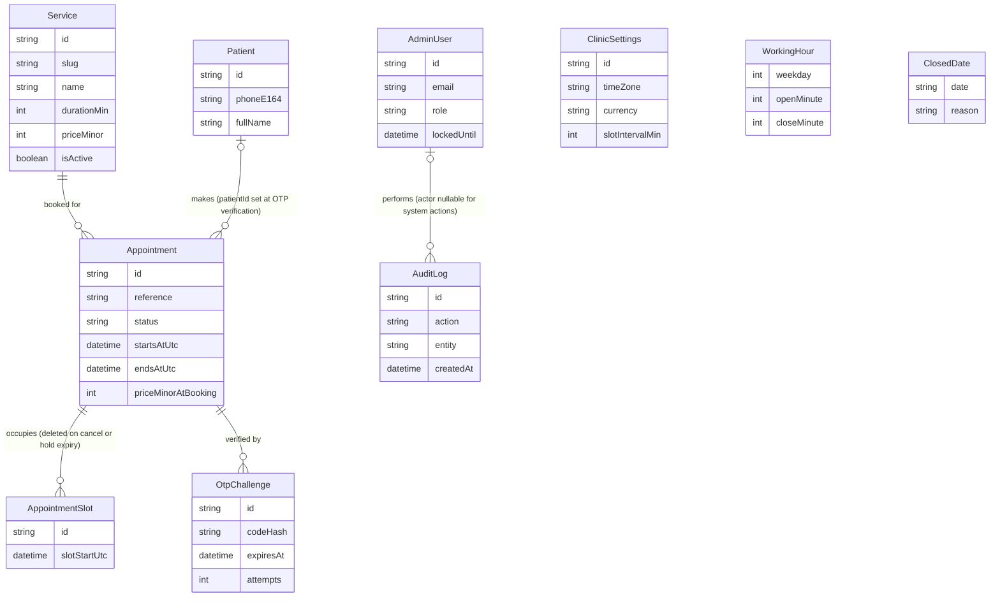

### 4.3 Field-by-field notes

#### 4.3.1 Service

| Field | Type | Notes |
|---|---|---|
| id | String (cuid) | PK. Never exposed to patients — the capability token on the booking side is `Appointment.reference` (C8), not any Service id. |
| slug | String, unique | Stable identifier for the SSG landing page (`/`, C15) and seed fixtures; independent of `name` so a rename doesn't break a cached link. |
| name | String | Display name; also the source value snapshotted into `serviceNameAtBooking`. |
| description | String | Required, no `?` in C5: empty string is "no description," never `null`. |
| durationMin | Int | Minutes; source value snapshotted into `durationMinAtBooking`. CHECK `durationMin > 0` (4.5). |
| priceMinor | Int | Integer minor units (C7); source value for `priceMinorAtBooking`. CHECK `priceMinor >= 0` (4.5). |
| isActive | Boolean, default `true` | Soft-delete flag. An inactive service drops out of the wizard and the landing page but stays joinable from historical `Appointment` rows — which don't need the join anyway, since they already snapshot name/duration/price. |
| sortOrder | Int | Manual display order (landing page Services section; wizard Step 1). |
| colorHex | String | Series color for the "Appointments by service" chart (Section 9) — a distinct concern from the admin calendar's status color-coding. |
| createdAt / updatedAt | DateTime | Standard audit timestamps. |

#### 4.3.2 Patient

| Field | Type | Notes |
|---|---|---|
| id | String (cuid) | PK. |
| phoneE164 | String, unique | The natural key for "who is this patient" (C9). Because this column is unique, "Total patients" (Section 9) is a plain `count(Patient)` — no `DISTINCT` over `Appointment.holdPhoneE164` is ever needed. |
| fullName | String | Overwritten with the latest value on every successful verification (C9.4). This row tracks "most recently given name," not a name history. |
| createdAt | DateTime | Set exactly once, at the *first* successful OTP verification for this phone number. |
| updatedAt | DateTime | Bumped whenever `fullName` is refreshed by a later booking. |

**Why Patient is created only after verification (C9.6).** An unverified `PENDING_VERIFICATION`
hold carries only `Appointment.holdFullName` / `holdPhoneE164` — no `Patient` row exists for it.
Two consequences: (1) privacy minimization — an abandoned wizard, a hold that times out, or an OTP
that is never completed leaves no durable per-person record at all, only an anonymous-looking
`Appointment` row that retention (4.7) will anonymize further; (2) correctness-by-construction for
the "Total patients" KPI, which would otherwise have to decide whether an unverified phone number
"counts," and could double-count a phone that tried, abandoned, and retried.

#### 4.3.3 Appointment

**Assumption on the "five `...AtBooking` fields."** This section's task brief refers to "the five
`...AtBooking` snapshot fields"; C5 defines exactly **four** fields carrying the literal
`AtBooking` suffix: `durationMinAtBooking`, `priceMinorAtBooking`, `currencyAtBooking`,
`serviceNameAtBooking`. The table below documents those four, plus `holdFullName` /
`holdPhoneE164` immediately after — the two fields that answer the same "why snapshot instead of
reference" question on the *patient*-identity side of a booking, rather than the *service*-pricing
side. Treat "five" as loose language for "the snapshot fields, patient and service alike" (six, by
that reading), not a sixth undocumented column.

| Field | Type | Notes |
|---|---|---|
| id | String (cuid) | PK. |
| reference | String, unique | Patient-facing capability token, format `MB-XXXXXX` (C8). Looked up case-insensitively; never the PK. |
| serviceId | String (FK) | See 4.1 for `onDelete: Restrict`. |
| patientId | String? (FK) | `null` while `PENDING_VERIFICATION`; set once, at verification, and never cleared. |
| holdFullName | String | The name as typed in wizard Step 4, captured *before* a `Patient` row can exist. Kept even after verification so an `Appointment` never needs a join to show "who this booking is for" — `Patient.fullName` can drift (a later booking updates it) while this field is a true point-in-time record of what was typed for *this* booking. |
| holdPhoneE164 | String | Same reasoning as `holdFullName`, for phone. Also what `OtpChallenge.phoneE164` is denormalized from (4.3.5). |
| startsAtUtc | DateTime | UTC instant; THE value the concurrency guard (4.4) is built from. |
| endsAtUtc | DateTime | Stored, not a computed column (C3 bans native/computed-column attributes for portability): written once as `startsAtUtc + durationMinAtBooking` at booking/reschedule time. Cheap to read for calendar rendering without recomputing from duration each time. |
| durationMinAtBooking | Int | Snapshot of `Service.durationMin` at booking time. |
| priceMinorAtBooking | Int | Snapshot of `Service.priceMinor` at booking time. Every revenue KPI (Section 9) sums this column, never `Service.priceMinor`. |
| currencyAtBooking | String | Snapshot of `ClinicSettings.currency` at booking time. |
| serviceNameAtBooking | String | Snapshot of `Service.name` at booking time. |
| **Why the four `AtBooking` fields exist** | | A clinic edits `Service.priceMinor` or `durationMin` constantly (price changes, revised appointment lengths). Without a snapshot, every historical `Appointment` would silently re-price itself the moment an admin edited the service it points to — "Total revenue" for March would change in April because someone edited a price in May. Snapshotting at booking time makes an `Appointment` a receipt: immutable once written, independent of later catalog edits, and directly summable for revenue KPIs with no join and no "as-of" logic. |
| status | String | `AppointmentStatus` union (C4). |
| source | String | `BookingSource` union (C4). No `@default` — always set explicitly by the creating code path. |
| holdExpiresAt | DateTime? | `null` once `CONFIRMED` or later; set only while `PENDING_VERIFICATION`. Paired index `[status, holdExpiresAt]` (4.5) drives the hold-expiry sweep (C9.5). |
| verifiedAt | DateTime? | Set once, at OTP success. |
| confirmedAt | DateTime? | Set once, at OTP success (same instant as `verifiedAt` in v1 — kept as two columns because "OTP verified" and "booking confirmed" are different *concepts* that happen to coincide today; a future flow where they diverge needs no migration). |
| completedAt | DateTime? | Set on the `CONFIRMED -> COMPLETED` admin action. |
| cancelledAt | DateTime? | Set on any `-> CANCELLED` transition, patient- or system-initiated. |
| cancellationReason | String? | Free text / short code, e.g. `"HOLD_EXPIRED"` (C9.5) or an admin-entered reason. Not a Zod enum in v1 — just explanatory text, never parsed. |
| rescheduledFromUtc | DateTime? | Set on `CONFIRMED -> CONFIRMED` reschedule (C4) to the *previous* `startsAtUtc`, so "this booking moved" is visible without a separate history table. Only ever holds the immediately-prior value — not a full move history. |
| adminNote | String? | Free-text staff note, e.g. "patient called to confirm by phone." Never patient-visible. |
| createdAt / updatedAt | DateTime | Standard audit timestamps. |
| slots | AppointmentSlot[] | Back-relation; not a persisted column (4.3.4). |
| otpChallenges | OtpChallenge[] | Back-relation; not a persisted column (4.3.5). |

#### 4.3.4 AppointmentSlot

| Field | Type | Notes |
|---|---|---|
| id | String (cuid) | PK. Exists only so the row has an identity distinct from the `(appointmentId, slotStartUtc)` pair; never referenced elsewhere. |
| appointmentId | String (FK) | See 4.1 for `onDelete: Cascade` (C5-mandated). |
| slotStartUtc | DateTime, unique | THE concurrency guard — see 4.4. |

Deliberately no `createdAt`/`updatedAt` (C5 lists none): a slot row is never updated in place, only
inserted or deleted inside the same transaction as its owning `Appointment`'s own timestamped
write, so `Appointment.createdAt`/`updatedAt` already dates the event.

#### 4.3.5 OtpChallenge

| Field | Type | Notes |
|---|---|---|
| id | String (cuid) | PK. |
| appointmentId | String (FK) | `onDelete: Cascade`. An appointment can have more than one challenge over its lifetime: a challenge that exhausts `maxAttempts` is dead (C10) and the next `otp.send` creates a fresh row rather than reviving it. |
| phoneE164 | String | Denormalized from `Appointment.holdPhoneE164` so the per-phone rate-limit index (`[phoneE164, createdAt]`, 4.5) never needs a join through `Appointment` on the `otp.send` hot path (C14). |
| codeHash | String | `HMAC-SHA256(code, OTP_PEPPER)` hex (C10) — never the raw code. |
| expiresAt | DateTime | `now + 5min` at creation; reset on every resend (C10). |
| attempts | Int, default 0 | Incremented on each failed `verifyOtp` call; dead at `maxAttempts`. |
| maxAttempts | Int, default 5 | Stored per-row (not a global constant lookup) so a future per-challenge override needs no migration. |
| resendCount | Int, default 0 | Caps at 3 (C10); a 4th resend request is rejected before touching this row. |
| lastSentAt | DateTime | Drives the 60s resend cooldown (C10) — no separate rate-limiter call needed for that specific rule, since it's a single-row read. |
| consumedAt | DateTime? | Set once, on successful verification; a consumed challenge can never be re-verified (C9.4). |
| createdAt | DateTime | Standard timestamp. |

#### 4.3.6 AdminUser

| Field | Type | Notes |
|---|---|---|
| id | String (cuid) | PK. |
| email | String, unique | Stored lowercased (C5) so lookup is a plain equality on a portable `String` column — no `citext` (C3). |
| passwordHash | String | argon2id (C11); never read back by any query path other than the login check itself. |
| fullName | String | Display name in the admin UI. |
| role | String | `AdminRole` union (C4); v1 treats both values as full access. |
| isActive | Boolean, default true | Deactivation takes effect immediately because `requireAdmin()` (C11) re-checks live `AdminUser` state on every request — not just at login. |
| lastLoginAt | DateTime? | Updated on every successful login; `null` for an admin who has never logged in. |
| failedLoginCount | Int, default 0 | Reset to 0 on a successful login; incremented on each failed attempt. |
| lockedUntil | DateTime? | See callout below. |
| createdAt / updatedAt | DateTime | Standard timestamps. |

**Why `AdminUser` carries `lockedUntil` (C14).** `admin.login` is rate-limited to 5 attempts per
15 minutes per `(email+IP)` by the `RateLimiter` abstraction — but `MemoryRateLimiter` is
per-instance and therefore *advisory* on a serverless deployment where consecutive requests can
land on different instances (C14). `lockedUntil`, set to `now + 15min` after 5 *consecutive*
failures on the `AdminUser` row itself, is the authoritative, instance-independent backstop: it
lives in the one place every instance shares (the database), exactly the same argument 4.4 makes
for the slot guard. A login attempt checks `lockedUntil` before checking the password at all.

#### 4.3.7 ClinicSettings

| Field | Type | Notes |
|---|---|---|
| id | String, `@default("singleton")` | Always the literal string `"singleton"`; CHECK-constrained to that value (4.5). |
| clinicName | String | Display name across the landing page, `.ics` output, and SMS templates. |
| timeZone | String | IANA zone (e.g. `"Europe/Berlin"`); the single display/compute zone (C6). |
| currency | String | ISO-4217 code; snapshotted per-booking into `currencyAtBooking`. |
| slotIntervalMin | Int, default 15 | The atomic grid unit the concurrency guard (4.4) is built on. |
| bufferMin | Int, default 0 | Mandatory gap after a service before the next booking may start; folded into the slot-row count by Section 6's generalized formula (see 4.4). |
| minLeadTimeMin | Int, default 120 | Minimum notice before a bookable instant (Section 6). |
| maxAdvanceDays | Int, default 60 | How far into the future the booking window extends (Section 6). |
| holdTtlMin | Int, default 10 | PENDING_VERIFICATION lifetime before the hold-expiry sweep reclaims the slot (C9.5). |
| phoneE164 / email / addressLine1 / addressLine2 / mapUrl | String | Clinic contact details for the landing page footer and SMS "contact us" lines. All required (no `?` in C5) — **assumption**: `addressLine2` (e.g. suite/unit) is inherently optional in reality; modeled here as required `String` exactly as C5 specifies, so an admin with no line 2 stores `""`, not `null`. |
| updatedAt | DateTime | Bumped on every settings write; the only timestamp on this row (no `createdAt` — the row is seeded once and never re-created). |

**Why `ClinicSettings` is a singleton row, not env config.** Three reasons, all load-bearing: (1)
the brief's Settings screen (brief Section 3) requires admin CRUD on working hours, closed dates
and the slot interval *at runtime, without a redeploy* — env vars are read once at process start
and can't be edited from a browser; (2) every settings change must be attributable in `AuditLog`
(`action: "SETTINGS_UPDATED"`, C4) with an old/new diff — env vars have no row to diff against;
(3) `CLINIC_TIMEZONE` / `CLINIC_CURRENCY` (C16) still exist, but only as the *seed-time* default
written into this row once by `prisma/seed.ts` (4.6) — after seeding, the `ClinicSettings` table is
the sole runtime source of truth and the two env vars are never read again. This is the resolution
to an apparent redundancy between C16 and C5, not a contradiction between them.

#### 4.3.8 WorkingHour

| Field | Type | Notes |
|---|---|---|
| id | String (cuid) | PK; exists purely because Prisma models need one — the real identity is the `(weekday, openMinute)` pair. |
| weekday | Int | `0`=Sunday .. `6`=Saturday, clinic-local. CHECK `weekday BETWEEN 0 AND 6` (4.5). |
| openMinute / closeMinute | Int | Minutes-from-midnight, clinic-local wall time (C6) — never a `DateTime`, since a shift boundary has no date. CHECK `closeMinute > openMinute` (4.5). |

A weekday with zero rows is closed. Multiple rows for the same `weekday` express a split shift
(4.6 seeds one). These CHECK constraints are a DB-level backstop; the authoritative validation is
the shared Zod schema in the `settings` feature's `schemas.ts` (C17), used by both the admin form
and the slot engine (Section 6).

#### 4.3.9 ClosedDate

| Field | Type | Notes |
|---|---|---|
| id | String (cuid) | PK. |
| date | String, unique | `"YYYY-MM-DD"`, clinic-local. See callout below. |
| reason | String? | Optional label, e.g. `"Public holiday"`; display-only, never parsed. |

**Why `date` is a `String`, not a `DateTime` (C5).** A calendar date — "December 25th" — has no
instant; it is only ever compared to another clinic-local calendar date (react-day-picker's
`disabled` matcher, Section 6; the admin Settings closed-dates list). Storing it as a `DateTime`
would force a choice of instant (midnight UTC? midnight clinic-local?) that invites an off-by-one
day error the moment the clinic's time zone has a non-zero UTC offset — a `ClosedDate` meant to
mean "Dec 25 clinic-local" could render as Dec 24 or Dec 26 somewhere in the pipeline. A plain
`"YYYY-MM-DD"` string sidesteps the question entirely: it is compared lexically to another
`"YYYY-MM-DD"` string with no time-zone math involved at all.

#### 4.3.10 AuditLog

| Field | Type | Notes |
|---|---|---|
| id | String (cuid) | PK. |
| actorAdminUserId | String? (FK) | `null` for system-triggered entries (the hold-expiry sweep, C9.5) that have no human actor. `onDelete: SetNull` (4.1). |
| action | String | `AuditAction` union (C4). |
| entity / entityId | String | A generic polymorphic pointer (e.g. `entity: "Appointment"`, `entityId: <Appointment.id>`), not a typed Prisma relation — deliberately, so an `AuditLog` row outlives the thing it describes. A `Patient` hard-deleted by retention (4.7) still leaves its historical audit trail intact; a typed FK with any `onDelete` behavior would either orphan-cascade the log away (losing history) or block the deletion (defeating retention). |
| metaJson | String? | See callout below. |
| createdAt | DateTime | Standard timestamp; the sort key for every audit listing (4.5). |

**Why `metaJson` is a `String`, not a `Json` column (C3).** Prisma's `Json` type has no SQLite
equivalent, and the schema must compile unchanged against the SQLite fallback. `metaJson` is
instead a JSON-serialized `String`, written with `JSON.stringify` and read with `JSON.parse` at the
one call site that needs structure (e.g. a reschedule's `{ fromUtc, toUtc }`, Section 6.5); every
other code path treats it as opaque text. Per C19, it must never contain PII — phone numbers and
full names are logged nowhere, including here.

### 4.4 AppointmentSlot: the concurrency guard

#### Why a unique index on `Appointment.startsAtUtc` is insufficient

A unique constraint on `startsAtUtc` alone only rejects two bookings that start at the *exact same
instant*. It says nothing about overlap once services have different durations, which is the
normal case.

**Counterexample.** Both services are 60 minutes.

- Appointment A: `startsAtUtc = 09:00`, `endsAtUtc = 10:00`.
- Appointment B: `startsAtUtc = 09:30` (30 minutes into A), `endsAtUtc = 10:30`.

`09:00 != 09:30`, so a bare `@@unique([startsAtUtc])` on `Appointment` lets **both** inserts
succeed. Yet `[09:00, 10:00)` and `[09:30, 10:30)` overlap for the 30 minutes from 09:30 to 10:00 —
the clinic now has two confirmed appointments double-booked over half their length, and the
database enforced nothing.

#### Why one row per occupied slot-interval closes the gap

`AppointmentSlot` makes the *unit of uniqueness* a fixed-size grid tick (`slotIntervalMin`), not an
appointment's arbitrary start. For a given `slotIntervalMin`, every appointment's occupied
interval is tiled into consecutive grid points starting at its (grid-aligned) `startsAtUtc`:

```
occupiedKeys(appointment) = { startsAtUtc + k * slotIntervalMin : k = 0 .. durationSlots - 1 }
```

and **one `AppointmentSlot` row is inserted per key, in the same transaction as the `Appointment`
row.** Because every candidate start the slot engine ever offers is itself grid-aligned (Section
6), two overlapping intervals necessarily share at least one grid point inside their overlap
region — tiling the same fixed-size grid two different (grid-aligned) ways cannot avoid
intersecting if the intervals themselves intersect. The unique index on `slotStartUtc` then turns
"these two rows exist" into "only one of these two inserts can ever commit," which is exactly what
a per-instant unique index on `Appointment.startsAtUtc` could not do.

This guarantee depends on alignment: it protects exactly the inputs the system itself produces (all
candidates come from the same grid, Section 6.1 invariant 3), not arbitrary unaligned intervals —
it is a backstop on the application's own write path, not a general-purpose interval-overlap
detector.

#### Row count formula

```
durationSlots = ceil(durationMinAtBooking / slotIntervalMin)
```

e.g. `slotIntervalMin = 15`: a 15-minute service occupies 1 row, 45 minutes occupies 3, 60 minutes
occupies 4, 90 minutes occupies 6. A duration that is not an exact multiple of `slotIntervalMin`
still rounds **up**, locking the trailing partial slot in full (e.g. 50 minutes on a 15-minute grid
locks 4 rows = 60 minutes of grid).

This is C5's literal formula, which does not mention `ClinicSettings.bufferMin`. Section 6
generalizes it to `ceil((durationMinAtBooking + bufferMin) / slotIntervalMin)` so the configurable
buffer becomes real, DB-enforced rows instead of unenforced configuration — identical to the
formula above at the shipped default `bufferMin = 0` (4.6's seed uses this default, so the worked
example below matches both formulas). See Section 6's own Contract Challenge for the full
rationale; this section does not restate it as a second challenge.

#### Which statuses retain rows, which release them

| Status | AppointmentSlot rows | Why |
|---|---|---|
| PENDING_VERIFICATION | Retained | The hold itself *is* the slot being occupied during the OTP window. |
| CONFIRMED | Retained | The booking is live. |
| COMPLETED | Retained | That time genuinely was used; the historical record must keep blocking re-booking of an already-past slot from ever appearing available. |
| NO_SHOW | Retained | Same reasoning as COMPLETED — the clinic held the slot regardless of whether the patient arrived. |
| CANCELLED | **Deleted** | The whole point of cancelling (patient-initiated, admin-initiated, or hold-expiry sweep) is to free the slot for someone else. |

A reschedule (`CONFIRMED -> CONFIRMED`, C4) deletes the *old* `AppointmentSlot` rows and inserts the
*new* ones inside one transaction (Section 6.5) — it is a release-then-retain pair, not a third
category.

#### Exactly which error surfaces, and what it maps to

A collision on insert raises Postgres unique-violation `23505`, which Prisma Client surfaces as
`PrismaClientKnownRequestError` with `code: "P2002"` and `meta.target` naming the violated
constraint's column(s) — here, `["slotStartUtc"]`. The `defineAction` error-mapping layer (C12)
matches specifically on `P2002` **with** `slotStartUtc` in `meta.target` and maps it to
`ActionError.code = "SLOT_TAKEN"` (HTTP-409 semantics, C9.2). This matters because `Appointment`
also has a unique column (`reference`): a `P2002` whose `meta.target` is `["reference"]` is caught
earlier, by the reference-generation retry loop (C8, up to 5 regenerate-and-retry attempts), and
never reaches the generic mapper as `SLOT_TAKEN` at all. The whole `createBooking` transaction
rolls back atomically on either violation — a losing booking writes zero rows, including on its own
`Appointment` row, not just its `AppointmentSlot` rows.

#### Worked example: two colliding 45-minute bookings on a 15-minute grid

`slotIntervalMin = 15`. Appointment A (45 min) starts at 09:00; Appointment B (45 min) starts at
09:15 — 15 minutes into A. Assume A's transaction commits first.

| `slotStartUtc` | A's rows (09:00–09:45) | B's attempted rows (09:15–10:00) | Outcome |
|---|---|---|---|
| 09:00 | Inserted (row 1/3) | — | A's transaction commits all 3 rows. |
| 09:15 | Inserted (row 2/3) | Attempted (row 1/3) | **Collision** — `09:15` already exists; Postgres raises `23505`, Prisma raises `P2002` on `slotStartUtc`. |
| 09:30 | Inserted (row 3/3) | Attempted (row 2/3) — never reached | B's transaction aborts atomically on the *first* violation. |
| 09:45 | (A ends here) | Attempted (row 3/3) — never reached | — |

B's booking returns `SLOT_TAKEN`; the database holds exactly 3 `AppointmentSlot` rows (all A's) and
zero trace of B. The outcome does not depend on insertion order: A and B's occupied-key sets are
`{09:00, 09:15, 09:30}` and `{09:15, 09:30, 09:45}`, whose intersection `{09:15, 09:30}` is
non-empty, so *some* row collides regardless of which key is attempted first.

### 4.5 Indexes and constraints

| Table | Constraint/Index | Kind | Purpose | Which query uses it |
|---|---|---|---|---|
| Appointment | `@@index([startsAtUtc])` | btree | Range-scan all appointments in a time window, any status | Admin calendar day/week/month fetch (`/admin/calendar`, C15) |
| Appointment | `@@index([status, startsAtUtc])` | btree, composite | Filter by status, then range on time | "Today's appointments" / "Upcoming this week" KPIs; appointments table status+date filter (Section 9 / Section 5) |
| Appointment | `@@index([serviceId, startsAtUtc])` | btree, composite | Filter by service, then range on time | "Appointments by service" chart; per-service upcoming lists (Section 9) |
| Appointment | `@@index([status, holdExpiresAt])` | btree, composite | Find expired holds | Lazy sweep + `POST /api/cron/expire-holds`: `status='PENDING_VERIFICATION' AND holdExpiresAt < now()` (C9.5, Section 6.3/6.4) |
| Appointment | `@@index([patientId])` | btree | Join a patient to their appointments | Patients list: visit count / total spent / last visit (Section 9) |
| Appointment | `@@index([startsAtUtc, status, serviceId])` | btree, composite | Covering index: range-scan on the leading `startsAtUtc`, with `status` and `serviceId` carried in the index for an index-only scan (no heap lookups) | Dashboard "appointments by service" aggregate (Section 9.8) only. That query filters `status IN (3 of 5 values)` — too unselective to lead — and uses `serviceId` as a `GROUP BY` key, so neither `[status, startsAtUtc]` nor `[serviceId, startsAtUtc]` serves it. The single-status revenue queries (9.3, 9.7) deliberately keep `[status, startsAtUtc]`, which seeks on `status='COMPLETED'` and then ranges — strictly better than range-then-filter, and this index does not carry `priceMinorAtBooking` so it saves no heap fetch there. |
| Appointment | `reference` unique | unique btree | O(1) lookup by capability token | Success page; `GET /api/appointments/[reference]/ics`; `reference.lookup` action (C8, C13) |
| AppointmentSlot | `slotStartUtc` unique | unique btree | **The concurrency guard** | Every `booking.create` / reschedule transaction (4.4) |
| AppointmentSlot | `@@index([appointmentId])` | btree | Load/delete all slot rows for one appointment | Cancel, hold-expiry sweep, reschedule (4.4, Section 6.4–6.5) |
| OtpChallenge | `@@index([appointmentId, createdAt])` | btree, composite | Latest challenge for an appointment | `verifyOtp` / resend actions (Section 5) |
| OtpChallenge | `@@index([phoneE164, createdAt])` | btree, composite | Per-phone rate accounting | `otp.send` rate limit (C14) |
| Patient | `phoneE164` unique | unique btree | Natural key, upsert target | `verifyOtp`'s upsert-by-phone (C9.4); "Total patients" KPI |
| WorkingHour | `@@unique([weekday, openMinute])` | unique btree, composite | Prevent duplicate shift rows at the same start minute | Settings CRUD write path; per-weekday read (Section 6) |
| ClosedDate | `date` unique | unique btree | O(1) "is this date closed" | Calendar day-disabling (Section 6); Settings CRUD idempotency |
| AuditLog | `@@index([createdAt])` | btree | Recency ordering | Audit/compliance listing |
| AuditLog | `@@index([entity, entityId])` | btree, composite | "History for this specific record" | Per-appointment / per-service audit trail |
| AuditLog | `@@index([actorAdminUserId])` | btree | FK lookup; "actions by this admin" | Additive, beyond C5's literal list — justified below |
| Appointment | `serviceId -> Service.id`, `onDelete: Restrict` | foreign key | Referential integrity | Covered as a leading column by the `[serviceId, startsAtUtc]` index above |
| Appointment | `patientId -> Patient.id`, `onDelete: Restrict` | foreign key (nullable) | Referential integrity | Covered by the `[patientId]` index above |
| AppointmentSlot | `appointmentId -> Appointment.id`, `onDelete: Cascade` | foreign key | Referential integrity (C5-mandated) | Covered by the `[appointmentId]` index above |
| OtpChallenge | `appointmentId -> Appointment.id`, `onDelete: Cascade` | foreign key | Referential integrity | Covered as a leading column by the `[appointmentId, createdAt]` index above |
| AuditLog | `actorAdminUserId -> AdminUser.id`, `onDelete: SetNull` | foreign key (nullable) | Referential integrity | **Not** covered by `[createdAt]` or `[entity, entityId]` — hence the explicit additive index immediately above, rather than relying on Prisma's connector-dependent implicit FK indexing in a document meant to be precise about what exists |

#### CHECK constraints (hand-written migration; Postgres only)

Prisma's schema DSL has no CHECK-constraint primitive (Prisma 6.x), so these six are added by
hand-editing the SQL of a `prisma migrate dev --create-only` migration (4.6), not expressed in
`schema.prisma`:

```sql
ALTER TABLE "Appointment" ADD CONSTRAINT "appointment_status_legal"
  CHECK (status IN ('PENDING_VERIFICATION','CONFIRMED','COMPLETED','CANCELLED','NO_SHOW'));

ALTER TABLE "ClinicSettings" ADD CONSTRAINT "clinic_settings_singleton"
  CHECK (id = 'singleton');

ALTER TABLE "WorkingHour" ADD CONSTRAINT "working_hour_weekday_range"
  CHECK (weekday BETWEEN 0 AND 6);

ALTER TABLE "WorkingHour" ADD CONSTRAINT "working_hour_close_after_open"
  CHECK ("closeMinute" > "openMinute");

ALTER TABLE "Service" ADD CONSTRAINT "service_price_non_negative"
  CHECK ("priceMinor" >= 0);

ALTER TABLE "Service" ADD CONSTRAINT "service_duration_positive"
  CHECK ("durationMin" > 0);
```

**SQLite skips all six.** The SQLite fallback path (`prisma db push`, no migration history, C3)
never runs a hand-written migration file, so none of these constraints exist there. On SQLite the
Zod schemas in each feature's `schemas.ts` (C17) are the *only* enforcement — an accepted gap for a
dev-only, zero-dependency fallback, not for the canonical Postgres path.

### 4.6 Migrations and seed

#### Migration workflow

**PostgreSQL (canonical, both dev and prod, C3):**

1. `docker compose up -d db` — local Postgres 16.
2. `pnpm prisma migrate dev --name <change>` — generate + apply against `DATABASE_URL`.
3. For the CHECK constraints specifically: `pnpm prisma migrate dev --name add_check_constraints --create-only`, hand-edit the generated `migration.sql` to append the six statements in 4.5, then `pnpm prisma migrate dev` to apply. The edited file is checked in like any other migration.
4. CI/prod: `pnpm prisma migrate deploy`, using `DIRECT_DATABASE_URL` (unpooled, C23) — `migrate dev` never runs outside a developer machine.
5. `pnpm prisma db seed` (wired via `"prisma": { "seed": "tsx prisma/seed.ts" }` in `package.json`) runs the seed script below.

**SQLite (optional fallback, C3):**

1. `pnpm db:sqlite` runs `scripts/gen-sqlite-schema.ts`: reads `prisma/schema.prisma`, rewrites the `datasource` block to `provider = "sqlite"` / `url = "file:./dev.sqlite"`, drops `directUrl` (unsupported), writes `prisma/schema.sqlite.prisma`.
2. `pnpm prisma db push --schema=prisma/schema.sqlite.prisma` — schema sync, no migration history, no CHECK constraints (4.5).
3. `pnpm prisma db seed -- --schema=prisma/schema.sqlite.prisma` runs the same `seed.ts` — the seed logic is plain Prisma Client calls, provider-agnostic; only the schema file differs.

#### `prisma/seed.ts` contents

All randomized choices use a fixed-seed PRNG (seed string `"medibook-seed-v1"`) and a hardcoded
`FixedClock` anchor, `SEED_NOW = 2026-01-15T09:00:00Z` — a constant, not `Date.now()` — so that
re-running the seed produces byte-identical rows every time, and Section 9 / Section 11 can assert
exact KPI numbers against this specific instant rather than "whatever today happens to be."

1. **One admin.** Upserted by `email = SEED_ADMIN_EMAIL` (lowercased), `passwordHash` from
   `SEED_ADMIN_PASSWORD` via argon2id (C11), `role = "OWNER"`, `isActive = true`.
2. **`ClinicSettings` singleton.** Upserted by `id = "singleton"`: `clinicName`, `timeZone` from
   `CLINIC_TIMEZONE` (default `"Europe/Berlin"`), `currency` from `CLINIC_CURRENCY` (default
   `"EUR"`), `slotIntervalMin = 15`, all other numeric fields at their C5 defaults, plus placeholder
   contact fields.
3. **`WorkingHour`**, upserted by `(weekday, openMinute)`, one realistic week:

   | Weekday | Shifts (clinic-local) |
   |---|---|
   | Sunday (0) | closed — zero rows |
   | Monday–Friday (1–5) | 09:00–18:00 (one row each) |
   | Saturday (6) | **split shift**: 09:00–13:00 and 16:00–20:00 (two rows) |

   This Saturday split shift is deliberately richer than Section 1's OQ3 default (a plain
   09:00–13:00 Saturday) specifically to seed data that exercises the split-shift path in Section
   6 end to end. Both are stated defaults pending stakeholder confirmation (OQ3); this section's
   seed should be read as the one that actually ships a split shift, superseding OQ3 on that detail.
4. **`ClosedDate`**, upserted by `date`, three fixed calendar dates (deterministic, not relative to
   `SEED_NOW`): `"2026-01-01"` ("New Year's Day"), `"2026-04-10"` ("Spring holiday"),
   `"2026-12-25"` ("Christmas Day").
5. **Services**, upserted by `slug`, seven rows spanning a useful range of `durationSlots` at
   `slotIntervalMin = 15` (4.4):

   | slug | name | durationMin | priceMinor (EUR) | durationSlots |
   |---|---|---|---|---|
   | `general-consultation` | General Consultation | 30 | 5000 | 2 |
   | `follow-up-visit` | Follow-up Visit | 15 | 3000 | 1 |
   | `vaccination` | Vaccination | 15 | 2500 | 1 |
   | `dental-cleaning` | Dental Cleaning | 45 | 8000 | 3 |
   | `physical-therapy` | Physical Therapy Session | 60 | 9000 | 4 |
   | `diagnostic-ultrasound` | Diagnostic Ultrasound | 45 | 12000 | 3 |
   | `minor-outpatient-procedure` | Minor Outpatient Procedure | 90 | 20000 | 6 |

6. **~60 `Appointment` rows** (plus their `AppointmentSlot` rows per 4.4's formula), spread across
   the 90 days before `SEED_NOW` and a short window after it, so the admin dashboard has
   non-trivial, reproducible data:

   | Status | Count | Notes |
   |---|---|---|
   | COMPLETED | 28 | Past, spread across the 90-day window; `completedAt` set. |
   | CANCELLED | 10 | 6 explicit (`cancellationReason` = an admin/patient-entered string); 4 via `"HOLD_EXPIRED"` to exercise the sweep path. |
   | NO_SHOW | 6 | Past; `confirmedAt` set, `completedAt`/`cancelledAt` both `null`. |
   | CONFIRMED | 12 | Upcoming relative to `SEED_NOW`; `patientId` set. |
   | PENDING_VERIFICATION | 4 | 1 fresh hold, 1 about to expire, 2 already past `holdExpiresAt` but intentionally left un-swept — so a Section 11 test can assert the lazy sweep (Section 6.3 step 2) reclaims them on the next read. |
   | **Total** | **60** | |

   Patients are created by the same upsert-by-`phoneE164` logic `verifyOtp` uses in production, so
   the seed never bypasses the "`Patient` only after verification" rule (4.3.2) — the four
   `PENDING_VERIFICATION` rows above correctly have `patientId = null`.

**Idempotency and determinism.** Re-running `pnpm prisma db seed` must be safe and must produce the
same data: `AdminUser`, `ClinicSettings`, `WorkingHour`, `ClosedDate`, and `Service` all have a
natural unique key and are written with `upsert`. `Appointment` / `AppointmentSlot` /
`OtpChallenge` have no such natural key (a `reference` is randomly generated by design, C8), so the
seed instead wraps a `deleteMany` on all three — scoped to seed-owned demo data only, safe in dev —
followed by deterministic recreation from the fixed PRNG and `SEED_NOW`, inside one transaction.
The combination of (a) a fixed PRNG seed, (b) a hardcoded `SEED_NOW` instead of `Date.now()`, and
(c) delete-then-recreate for the three volatile tables is what lets Section 9 and Section 11 assert
exact KPI numbers rather than "approximately N."

### 4.7 Data retention

Restating C20 as a table; "where implemented" is the same script for every row.

| Entity | Trigger | Action | Where implemented |
|---|---|---|---|
| Appointment | `startsAtUtc` older than 24 months (assumption: the clinically-relevant date, not `createdAt` — C20 does not state which timestamp) | Anonymize in place: `holdFullName -> "Redacted"`, `holdPhoneE164 -> "+000000000000"`; `patientId`, `status`, and every `*AtBooking` field retained so revenue history survives | `scripts/retention.ts`, monthly cron |
| Patient | No `Appointment` row with `startsAtUtc` in the last 24 months | Hard delete the row | `scripts/retention.ts`, monthly cron |
| OtpChallenge | 24h after `consumedAt`, or 24h after `expiresAt` for a challenge never consumed | Hard delete the row | `scripts/retention.ts` — cadence mismatch flagged below |
| AuditLog | `createdAt` older than 24 months (assumption: C20 states "retained 24 months" without naming the post-window action; hard-delete is assumed, mirroring the other three rows) | Hard delete the row | `scripts/retention.ts`, monthly cron |

Documented in `/privacy` per C20; the 24-month figure itself is a provisional default pending legal
confirmation (Section 1, OQ10) controlled by one constant in `retention.ts`.

#### Contract Challenges

- **C20 — `OtpChallenge`'s 24-hour target cannot be met by a monthly cron.** C20 pins
  `OtpChallenge` hard-deletion at 24 hours after consumption/expiry, but also states the *entire*
  policy — all four rows above — runs on a single monthly cron. A monthly job cannot deliver a
  24-hour SLA: a consumed `OtpChallenge` row (which holds `codeHash` and `phoneE164`, exactly the
  PII-adjacent data C19 is strictest about) can sit live for up to ~30x longer than specified. This
  section documents `OtpChallenge` cleanup on the monthly cron per C20's literal text, but the
  recommendation is to run it on the existing 5-minute `expire-holds` cadence (C9.5) or a dedicated
  frequent job instead; Section 12 should schedule accordingly rather than inherit the mismatch.

- **C5's required-index list has no index supporting `Patient` name search/sort.** The only index
  on `Patient` is the `phoneE164` uniqueness constraint (4.5). The brief's Patients list (brief
  Section 3, item 3: "name, phone, visit count...") implies search/sort by name as well as phone;
  with no index on `fullName`, that query is a sequential scan. Acceptable at the clinic's expected
  scale (Section 1, A16: under ~200 appointments/week, so a correspondingly small patient table),
  but worth naming as a known, accepted gap rather than a silently-discovered one if patient volume
  ever grows past a single clinic's typical size.

- **C5 marks `ClinicSettings.addressLine2` as required, not optional.** A second address line
  (apartment/suite) is inherently optional in every real postal address. C5 gives it no `?`, so it
  is modeled here as a required `String` (4.3.7), meaning the seed and the settings form must
  always write `""` rather than omit the field. Minor, but it is schema behavior worth naming
  rather than silently "fixing" by making the column nullable against C5's explicit text.

---

## 5. API / Server Actions Spec

### 5.1 Conventions

#### Envelope

```ts
type ActionResult<T> = { ok: true; data: T } | { ok: false; error: ActionError };

type ActionError = {
  code: ErrorCode;
  message: string;                        // safe, user-displayable, no PII (C19)
  fieldErrors?: Record<string, string[]>; // present only for VALIDATION_ERROR-shaped failures
};

type ErrorCode =
  | "VALIDATION_ERROR" | "RATE_LIMITED" | "SLOT_TAKEN" | "SLOT_UNAVAILABLE" | "HOLD_EXPIRED"
  | "OTP_INVALID" | "OTP_EXPIRED" | "OTP_MAX_ATTEMPTS" | "OTP_RESEND_COOLDOWN" | "OTP_SEND_FAILED"
  | "NOT_FOUND" | "UNAUTHORIZED" | "FORBIDDEN" | "ACCOUNT_LOCKED" | "INVALID_TRANSITION" | "CLOSED_DAY"
  | "OUTSIDE_BOOKING_WINDOW" | "INTERNAL";
```

No action ever throws across the client boundary (C12). Every failure path below — Zod rejection, rate limit, auth, a thrown engine error, a Prisma error — resolves to `{ ok: false, error }`, never a rejected promise the client has to `catch`.

#### `defineAction`

```ts
function defineAction<TIn extends z.ZodTypeAny, TOut>(config: {
  input: TIn;
  auth: "public" | "admin";
  rateLimit?: Array<{ rule: string; keys: Array<"ip" | "phone" | "email" | "appointmentId"> }>;
  handler: (
    input: z.infer<TIn>,
    ctx: { session: AdminSession | null; clock: Clock; requestId: string },
  ) => Promise<TOut>;
}): (raw: unknown) => Promise<ActionResult<TOut>>;

type AdminSession = { adminUserId: string; role: "OWNER" | "STAFF" };
```

Fixed pipeline, same order on every call (C12):

1. **Zod parse** — `config.input.safeParse(raw)`. Failure short-circuits to `err(VALIDATION_ERROR, { fieldErrors })`; the handler never runs.
2. **Rate limit** — one `RateLimiter.limit()` call per configured rule (C14, keys HMAC-hashed). Any breach short-circuits to `err(RATE_LIMITED)`.
3. **Auth** — `"public"` is a no-op. `"admin"` calls `requireAdmin()`, which re-reads the session server-side and re-checks `AdminUser.isActive`/`lockedUntil` (C11) even though middleware already gated the route: no session -> `UNAUTHORIZED`; valid session, `isActive: false` or an insufficient role (a seam per C4, unused by any action below) -> `FORBIDDEN`; valid session, `lockedUntil` in the future -> `ACCOUNT_LOCKED` (A4) — the temporary, self-clearing lock gets its own code so the UI can say "try again in N minutes" instead of a permanent-sounding "forbidden."
4. **Handler** — feature logic, already-typed input.
5. **Error mapping** — one catch site. A typed engine error (e.g. the slot engine's `SLOT_UNAVAILABLE`) passes through as its code. A Prisma `P2002` is mapped from `meta.target`: `slotStartUtc` -> `SLOT_TAKEN`; any other unique column (`Service.slug`, `ClosedDate.date`, `Patient.phoneE164`) -> `VALIDATION_ERROR` with a `fieldErrors` entry, since the union has no per-field "already taken" code and doesn't need one. Anything unrecognized -> `INTERNAL`, logged with its stack server-side only (C19), never echoed.

Every entry in 5.2-5.9 states only what varies — `input`, `auth`, `rateLimit`, and the handler's own effects/errors — the five steps above are implied, not repeated.

#### Field errors reaching React Hook Form

`fieldErrors` keys are the same dot-paths the shared schema in `features/<f>/schemas.ts` uses (C17): the form's `@hookform/resolvers/zod` resolver and the server's `defineAction({ input })` parse the identical object, so a server-side key always matches a client field name. On `ok: false`, the submit handler runs `Object.entries(error.fieldErrors ?? {}).forEach(([k, msgs]) => form.setError(k, { type: "server", message: msgs[0] }))`; a key with no matching field, or a missing `fieldErrors` altogether, falls back to a toast built from `error.message`.

#### Identifier convention

Every action is cited as action `<feature>.<name>`, matching its `features/<feature>/actions.ts` export (C17) and the literal string `defineAction` logs in `{ action, durationMs, outcome }` (C23). **Kind: Internal** marks a server-side helper with no `"use server"` export of its own — given a dotted identifier anyway because C14 pins a rate-limit rule under that name.

#### Naming reconciliation

This section's required identifiers occasionally rename a function Section 3 or Section 6 already specified. Resolved once here, used consistently below; no silent fork:

| This section's identifier | Named elsewhere as | Fragment |
|---|---|---|
| `availability.getMonth` | `getAvailableDays` | 6 (3's comment just says "delegates to server/slots") |
| `availability.getSlots` | `getAvailableSlots` | 6 |
| `booking.create` | `createBooking` | 3, 6 |
| `otp.send` | internal only, no export | 3 |
| `otp.resend` | `resendOtp` | 3 |
| `otp.verify` | `verifyOtp` | 3 |
| `appointments.list` | `listAppointments` | 3 |
| `appointments.get` | `getAppointmentById` | 3 |
| `appointments.updateStatus` | `.confirm`/`.complete`/`.markNoShow`/`.cancel` | 3 |
| `patients.get` | not present | 3 (new) |
| `dashboard.getKpis` | `getDashboardKpis` | 3, 9 |
| `dashboard.getRevenueSeries` | `getRevenueSeries` | 3, 9 |
| `dashboard.getServiceBreakdown` | `getAppointmentsByService` | 3, 9 |
| `services.setActive` | `.deactivate` | 3 (generalized to `isActive: boolean`) |
| `services.reorder` | not present | 3 (new) |
| `settings.updateWorkingHours` | `.upsertWorkingHours` | 3 |

Separately: Section 3 marks `dashboard/` and `patients/` as "`actions.ts` omitted — read-only, `queries.ts` only." This section documents `dashboard.*`, `patients.list` and `patients.get` as full Server Actions anyway, because the admin UI's range/granularity toggles and table search/pagination (C15: `/admin`, `/admin/patients` are `searchParams`-driven) need a client-side refetch path that doesn't re-navigate. Both call sites — the initial RSC render reading `searchParams` and these actions — invoke the same `queries.ts` function; no logic forks.

#### Other input conventions assumed here (not pinned by C1-C23)

- Pagination: `page` (integer >= 1, default 1), `pageSize` (integer, 1-100, default 20).
- Date-range filters use `"YYYY-MM-DD"` clinic-local calendar strings (C5/C6 convention, same as `ClosedDate`), converted at the query boundary via `fromZonedTime`; omitted range defaults to the trailing 30 days.
- Revenue aggregates (`dashboard.*`, `patients.list`'s "total spent") sum `priceMinorAtBooking` for `COMPLETED` appointments only; `NO_SHOW` and `CANCELLED` are excluded.

#### `ErrorCode` -> HTTP-equivalent status and user message

Server Actions never set a real HTTP status (they always return `200` with the envelope); "HTTP-equivalent" is the status a Route Handler expressing the same failure would use, and the status actually used by the four real routes in 5.10.

| Code | HTTP-equiv. | User-facing message |
|---|---|---|
| `VALIDATION_ERROR` | 400 | "Please check the highlighted fields." |
| `RATE_LIMITED` | 429 | "Too many attempts. Please wait a moment and try again." |
| `SLOT_TAKEN` | 409 | "That time was just taken. Please pick another slot." |
| `SLOT_UNAVAILABLE` | 409 | "That time is no longer available. Please pick another slot." |
| `HOLD_EXPIRED` | 410 | "Your booking hold expired. Please start again." |
| `OTP_INVALID` | 400 | "That code isn't right. Please try again." |
| `OTP_EXPIRED` | 410 | "That code has expired. Request a new one." |
| `OTP_MAX_ATTEMPTS` | 429 | "Too many incorrect attempts. Request a new code." |
| `OTP_RESEND_COOLDOWN` | 429 | "Please wait before requesting another code." |
| `OTP_SEND_FAILED` | 502 | "We couldn't send that code. Please try resending." |
| `NOT_FOUND` | 404 | "We couldn't find that." |
| `UNAUTHORIZED` | 401 | "Please sign in to continue." |
| `FORBIDDEN` | 403 | "You don't have permission to do that." |
| `ACCOUNT_LOCKED` | 423 | "Account locked after repeated failed attempts. Try again in {minutesRemaining} minute(s)." |
| `INVALID_TRANSITION` | 409 | "That action isn't allowed for this appointment right now." |
| `CLOSED_DAY` | 409 | "The clinic is closed that day." |
| `OUTSIDE_BOOKING_WINDOW` | 409 | "That date is outside the booking window." |
| `INTERNAL` | 500 | "Something went wrong. Please try again." |

`ACCOUNT_LOCKED` (A4) is a permanent condition's temporary sibling, not FORBIDDEN's twin: FORBIDDEN now means only `isActive: false` or an insufficient role, conditions a user cannot wait out, while `ACCOUNT_LOCKED` means `lockedUntil` is in the future and clears itself. Its message is also the one dynamic string in this table — the handler computes `minutesRemaining = Math.ceil((lockedUntil.getTime() - clock.now().getTime()) / 60_000)` from `AdminUser.lockedUntil` (C5/C11) and substitutes it; every other row above is a fixed string. 423 ("Locked") is used as the HTTP-equivalent precisely because it is not 403 — the two codes must stay distinguishable end to end.

### 5.2 Public booking and availability

The step-1 service picker on `/book` is served by `getBookableServices()` (`features/booking/queries.ts`, 3) read at the same build-time boundary as `/` (C15) — not a Server Action, out of scope here.

#### `availability.getMonth`

Server Action | Auth: public | Rate limit: `availability.read` — 60/1 min per IP (C14)

```ts
const GetMonthInput = z.object({
  yearMonth: z.string().regex(/^\d{4}-(0[1-9]|1[0-2])$/),
  serviceId: z.string().cuid(),
});
```
```ts
type GetMonthOutput = { disabledDates: string[] }; // "YYYY-MM-DD"[], feeds react-day-picker's Matcher
```

Side effects: none; delegates to `getAvailableDays` (6.2), cached settings/hours/closed-dates per request (C23 `cache()`).

| Code | Trigger | UI handling |
|---|---|---|
| `VALIDATION_ERROR` | malformed `yearMonth`, inactive/unknown `serviceId` | inline form error |
| `RATE_LIMITED` | > 60 req/min from one IP | retry after backoff, no toast spam |

Idempotency: naturally idempotent (pure read).

#### `availability.getSlots`

Server Action | Auth: public | Rate limit: `availability.read` — 60/1 min per IP (C14)

```ts
const GetSlotsInput = z.object({
  dateLocal: z.string().regex(/^\d{4}-\d{2}-\d{2}$/),
  serviceId: z.string().cuid(),
});
```
```ts
type GetSlotsOutput = {
  slots: Array<{ startUtc: string; endUtc: string; displayLocal: string }>; // ISO instants
};
```

Side effects: opens its own transaction; runs the hold-expiry sweep (C9 step 5) before reading, so a slot freed a moment ago is already offered (6.3).

| Code | Trigger | UI handling |
|---|---|---|
| `VALIDATION_ERROR` | malformed date, inactive/unknown service | inline error, step blocked |
| `RATE_LIMITED` | burst polling | silent backoff |

Idempotency: idempotent; result reflects only committed state at call time (invariant 6.1-1 — never a reservation).

#### `booking.create`

Server Action | Auth: public | Rate limit: `booking.create` — 5/1h per phone AND 20/1h per IP (C14)

```ts
// Accepts: letters incl. Latin-1 accented (À-ÖØ-öø-ÿ, excluding the non-letter codepoints
// × U+00D7 / ÷ U+00F7 inside that block), space, hyphen, straight/curly apostrophe — but only
// as interior characters, since first/last must be a letter. Rejects: leading/trailing space-
// hyphen-apostrophe, all-punctuation strings ("--"), digits, underscores, non-Latin scripts
// (Cyrillic, CJK, Arabic) — a known v1 gap per C1's no-i18n scope.
const NAME_PATTERN = /^[A-Za-zÀ-ÖØ-öø-ÿ](?:[A-Za-zÀ-ÖØ-öø-ÿ'’\- ]{0,78}[A-Za-zÀ-ÖØ-öø-ÿ])?$/;
const FullName = z.string().trim().min(2).max(80).regex(NAME_PATTERN);

// libphonenumber-js has no native Zod integration; transform (not refine) so the raw national-
// format input the phone widget produces is normalized to E.164 before it reaches
// Patient.phoneE164 / Appointment.holdPhoneE164. CLINIC_DEFAULT_COUNTRY (C16) seeds the
// assumed country when the user doesn't type a leading "+".
const PhoneE164 = z.string().transform((raw, ctx) => {
  try {
    const parsed = parsePhoneNumberWithError(raw, env.CLINIC_DEFAULT_COUNTRY as CountryCode);
    if (!parsed.isValid()) throw new Error("invalid");
    return parsed.number; // "+491701234567"
  } catch {
    ctx.addIssue({ code: z.ZodIssueCode.custom, message: "Enter a valid phone number." });
    return z.NEVER;
  }
});

const CreateBookingInput = z.object({
  serviceId: z.string().cuid(),
  dateLocal: z.string().regex(/^\d{4}-\d{2}-\d{2}$/),
  startUtc: z.string().datetime(),
  fullName: FullName,
  phoneE164: PhoneE164,
  confirmReview: z.literal(true), // step 5's checkbox
});
```
```ts
type CreateBookingOutput = { appointmentId: string; reference: string }; // "MB-XXXXXX", C8
```

Side effects (6.4, 2.4): one `$transaction` — sweep, re-check availability (client's chosen slot is never trusted as-is), insert `Appointment(status: "PENDING_VERIFICATION", holdExpiresAt, patientId: null)` plus one `AppointmentSlot` row per occupied interval. After commit: generate+retry the reference (up to 5x, C8), create `OtpChallenge`, call `otp.send` (5.3.1) — SMS failure does not roll back the hold.

Assumption (reconciling C12's closed-day/window codes with 6.2/6.4's pseudocode, which folds everything into one `SLOT_UNAVAILABLE` throw at the match step): the handler first classifies `dateLocal` using the same day-level reasons `getAvailableDays` computes (6.2 step 9) *before* calling `getFreeSlotsInTx` — `CLOSED_DATE`/`NO_WORKING_HOURS` -> `CLOSED_DAY`, `BEYOND_WINDOW` -> `OUTSIDE_BOOKING_WINDOW` — so the UI can say "closed that day" rather than the generic "pick another slot." `PAST`/`LEAD_TIME`/`FULLY_BOOKED` fall through to the normal slot match, which yields `SLOT_UNAVAILABLE` if nothing matches.

| Code | Trigger | UI handling |
|---|---|---|
| `VALIDATION_ERROR` | bad name/phone/ids, `confirmReview` not `true` | inline field errors |
| `RATE_LIMITED` | phone or IP bucket exceeded | "too many attempts" toast, step 5 stays |
| `CLOSED_DAY` | date is a `ClosedDate` or has no `WorkingHour` rows | step 2 refetches `availability.getMonth` |
| `OUTSIDE_BOOKING_WINDOW` | date beyond `maxAdvanceDays` | step 2 refetches `availability.getMonth` |
| `SLOT_UNAVAILABLE` | re-check finds no match (taken/lead-time/fully booked) | step 3 refetches `availability.getSlots` |
| `SLOT_TAKEN` | `P2002` on `AppointmentSlot.slotStartUtc` | same as above — loser of the race |
| `OTP_SEND_FAILED` | `SmsProvider.sendOtp` failed, booking already committed | OTP screen shown anyway, with "Resend" |

Idempotency: not idempotent — each successful call creates one `Appointment`. No idempotency key in v1; double-submit is prevented only client-side (disabled button during the pending request), a stated gap.

#### `booking.getByReference`

Server Action | Auth: public | Rate limit: `reference.lookup` — 30/1h per IP (C14), one bucket per IP shared with the success page's data loader (below) and the `.ics` route (5.10.2) — spreading requests across the three surfaces buys an attacker no extra budget (A5)

```ts
const GetByReferenceInput = z.object({ reference: z.string().regex(/^MB-[2-9A-HJKMNP-TV-Z]{6}$/) });
```
```ts
type GetByReferenceOutput = {
  reference: string; status: AppointmentStatus; startsAtUtc: string; endsAtUtc: string;
  serviceNameAtBooking: string; priceMinorAtBooking: number; currencyAtBooking: string;
};
```

Side effects: none; normalizes to uppercase before lookup (C8). A match whose `status` is `CANCELLED` with `cancellationReason: "HOLD_EXPIRED"` (C9 step 5 — the hold lapsed before the patient ever confirmed) is treated as `NOT_FOUND`, not returned as data: that reference never reached a state worth disclosing. Any other resolved status (`PENDING_VERIFICATION`, `CONFIRMED`, `COMPLETED`, an admin-initiated `CANCELLED`, `NO_SHOW`) is returned as-is. Backs `/book/success/[reference]`'s client-side refetch and the `.ics` route's own lookup (5.10.2); the page's *initial* SSR render calls this same handler directly rather than a separate query function (below) — one code path, one rate-limit bucket, one not-found view.

| Code | Trigger | UI handling |
|---|---|---|
| `VALIDATION_ERROR` | malformed reference shape | the same not-found view as `NOT_FOUND` below, word-for-word (A5): "We couldn't find that booking." — never 5.1's default "Please check the highlighted fields," since there is no field to highlight |
| `NOT_FOUND` | no matching row, or a match whose hold expired before confirmation (above) | "We couldn't find that booking." |
| `RATE_LIMITED` | > 30/h from one IP (shared bucket) | retry later |

Idempotency: idempotent.

#### Token-resolving page: `/book/success/[reference]` (A5)

Not a Server Action and not one of 5.10's Route Handlers — C13/C15 had no category for a page that resolves a capability token, so A5 classifies it as a third kind, a **token-resolving page**, with these mandatory properties:

- Dynamic SSR, `Cache-Control: no-store`, `robots: noindex, nofollow` (C15) — a capability-token response must never be cached or indexed.
- Its data loader *is* the `booking.getByReference` handler above, called directly from the Server Component rather than through a separate `queries.ts` function — so the `reference.lookup` limit, the Zod shape check, and the uniform not-found behavior all apply to the very first request for a given IP, not only to a later client refetch.
- An unknown reference, a malformed reference, and an expired-hold reference (the same three cases as `booking.getByReference` above and the `.ics` route at 5.10.2) render the identical not-found view, with no wording or timing difference the visitor could use to tell the three apart (A5) — one query, one status check, one rendered outcome for all three.

### 5.3 OTP

#### `otp.send`

**Kind: Internal** (invoked by `booking.create`'s post-commit step, C9.3, and reused by `otp.resend`) | Rate limit rule name: `otp.send` — 3/15 min per phone AND 10/1h per IP (C14), enforced at each call site, not independently; plus two clinic-wide ceilings shared across every phone number (A6): `otp.send.global` — 200 sends per rolling 24h, and `sms.spend.global` — a rolling-24h spend cap at `SMS_DAILY_CAP_MINOR` minor units (C16)

```ts
function sendOtp(tx: Tx, appointmentId: string, phoneE164: string, clock: Clock): Promise<void>;
```

(C14 names a rate-limit rule `otp.send` for an operation with no standalone export — see Contract Challenges at the end of this file.)

Side effects: checks `SMS_KILL_SWITCH` (C16/A6) first — if `"true"`, short-circuits immediately with `OTP_SEND_FAILED`, generating no code and touching no `OtpChallenge` row, for use during an active attack. Otherwise checks the two global ceilings, `otp.send.global` and `sms.spend.global` (A6); breaching either stops the send, returns `OTP_SEND_FAILED`, emits a `CRITICAL`-level log event (C19 — no PII, just the breached rule and current count), and raises a persistent banner on the admin dashboard. None of this touches the booking itself: the `Appointment` stays `PENDING_VERIFICATION` and its `AppointmentSlot` rows stay held, so clinic staff can confirm the booking by hand once sending resumes — a clinic-wide ceiling never cancels a hold (A6). Past that gate: `crypto.randomInt(0, 1_000_000)` zero-padded to 6 digits; HMAC-SHA256 with `OTP_PEPPER` -> `codeHash`; upserts the `OtpChallenge` row (`expiresAt = now + 5min`, C10); calls `SmsProvider.sendOtp`. Runs outside the booking's own transaction (6.4) — a send failure never un-commits the hold.

| Code | Trigger | UI handling |
|---|---|---|
| `OTP_SEND_FAILED` | `SmsProvider` call rejects/times out; `SMS_KILL_SWITCH="true"`; `otp.send.global` or `sms.spend.global` ceiling breached (A6) | caller surfaces this to its own client; "Resend" offered — the booking stays `PENDING_VERIFICATION`, never lost |

Idempotency: not idempotent — always mutates `codeHash`/`expiresAt` and sends a fresh code, except on the kill-switch/ceiling short-circuit above, which mutates nothing.

#### `otp.resend`

Server Action | Auth: public | Rate limit: `otp.send` rule — 3/15 min per phone AND 10/1h per IP (C14), plus the DB-backed cooldown below, plus the same two clinic-wide ceilings and `SMS_KILL_SWITCH` as `otp.send` (A6) — a resend is just another `otp.send` call and shares its global budget, not a separate one

```ts
const ResendInput = z.object({ appointmentId: z.string().cuid() });
```
```ts
type ResendOutput = { expiresAt: string };
```

Side effects: enforces C10's 60s cooldown and 3-resend cap from `OtpChallenge.lastSentAt`/`resendCount` (authoritative, DB-backed — not the per-instance `RateLimiter`, per C14's serverless caveat); on success calls `otp.send` (resets `attempts` to 0, increments `resendCount`, extends `expiresAt`). A kill-switch or global-ceiling failure inside that call (A6) still counts as a used resend — `resendCount` increments the same as for any other `OTP_SEND_FAILED` — since a resend was genuinely attempted, matching C9's existing "SMS failure does not roll back" treatment.

| Code | Trigger | UI handling |
|---|---|---|
| `OTP_RESEND_COOLDOWN` | < 60s since `lastSentAt` | disable button, show countdown |
| `RATE_LIMITED` | per-instance bucket breached | same as cooldown |
| `NOT_FOUND` | unknown `appointmentId`, or challenge already consumed/dead (3 resends used, or `maxAttempts` reached) | "Please start a new booking." |
| `OTP_SEND_FAILED` | SMS send failed, including a clinic-wide ceiling breach or `SMS_KILL_SWITCH` (A6) | "Resend" stays available (bounded by `resendCount`) |

Idempotency: not idempotent by design (always a new code); safe to retry on network failure — a lost response just prompts another resend, bounded by the cap.

#### `otp.verify`

Server Action | Auth: public | Rate limit: `otp.verify` — 10/15 min per appointment (C14)

```ts
const VerifyInput = z.object({
  appointmentId: z.string().cuid(),
  code: z.string().regex(/^\d{6}$/, "Enter the 6-digit code."),
});
```
```ts
type VerifyOutput = { appointmentId: string; reference: string; status: "CONFIRMED" };
```

Side effects (C9 step 4): constant-time compare of `HMAC(code, OTP_PEPPER)` against `codeHash`. Mismatch increments `attempts`; hitting `maxAttempts` kills the challenge. Match, in one transaction: upsert `Patient` by `phoneE164` (updates `fullName`), update `Appointment` (`status: "CONFIRMED"`, `verifiedAt`, `confirmedAt`, `patientId`, `holdExpiresAt: null`), set `OtpChallenge.consumedAt`. After commit, fire-and-forget `SmsProvider.sendConfirmation` (failure not surfaced — same non-blocking treatment C9 gives the OTP send itself, assumed symmetric).

Note (C10): a verify against an already-`consumedAt` challenge returns `OTP_EXPIRED`, not `NOT_FOUND` — C10 groups the already-consumed case with expired/dead challenges under `OTP_EXPIRED`/`OTP_MAX_ATTEMPTS`, so a double-submit (double-tap on Verify, or a stale tab reopened after confirming in another tab) gets the same "request a new code" response as a genuinely expired challenge, never revealing that the code had in fact already succeeded. (`otp.resend`'s own consumed/dead handling at 5.3's `otp.resend` is unaffected — C10 pins this only for the verify attempt itself.)

| Code | Trigger | UI handling |
|---|---|---|
| `OTP_INVALID` | hash mismatch, attempts remain | inline error, attempts counter shown |
| `OTP_EXPIRED` | `now > expiresAt`, or challenge already `consumedAt` (C10) | "Request a new code" (resend) |
| `OTP_MAX_ATTEMPTS` | increment reaches `maxAttempts` (5) | "Request a new code" (resend) |
| `HOLD_EXPIRED` | `Appointment.holdExpiresAt` passed, not yet swept (6.6) | restart booking |
| `NOT_FOUND` | unknown id | restart or re-check success page |
| `RATE_LIMITED` | > 10/15min for this appointment | brief lockout message |

Idempotency: a second call with the correct code after success returns `OTP_EXPIRED` (consumed, per C10); never double-confirms or double-upserts `Patient`.

### 5.4 Admin auth

#### `adminAuth.login`

Server Action | Auth: public (pre-session) | Rate limit: `admin.login` — 5/15 min per (email+IP) (C14), plus `AdminUser.lockedUntil = now + 15min` after 5 consecutive DB-tracked failures

```ts
const LoginInput = z.object({
  email: z.string().trim().toLowerCase().email(),
  password: z.string().min(8).max(200),
});
```
```ts
type LoginOutput = { redirectTo: string }; // e.g. "/admin"; the session cookie itself is Auth.js's side effect
```

Thin wrapper around Auth.js `signIn("credentials", ...)` (3). Side effects: `@node-rs/argon2` verify against `passwordHash`; success -> Auth.js issues the JWE session cookie (C11), `AdminUser.lastLoginAt`/`failedLoginCount = 0`, `AuditLog` `ADMIN_LOGIN_SUCCEEDED`; failure -> `failedLoginCount += 1`, `AuditLog` `ADMIN_LOGIN_FAILED`, and if that increment reaches 5, `lockedUntil = now + 15min` is set in the same update and this response itself is reported as `ACCOUNT_LOCKED` (A4), not `UNAUTHORIZED` — the account is locked as of this very call, so the locked-account message is the accurate one to show immediately.

Stated trade-off: unknown email and wrong password both return the same `UNAUTHORIZED` message (no enumeration), but a *locked* real account returns a distinctly-worded `ACCOUNT_LOCKED` (A4) before the password is even checked — a deliberate, small enumeration leak (lockout clarity for genuine users) accepted since C11/C14 don't mandate strict non-enumeration. A *deactivated* account (`isActive: false`) is a separate, permanent case and still returns `FORBIDDEN` — A4 narrows `FORBIDDEN` to exactly that and an insufficient role; it no longer covers the temporary lock.

| Code | Trigger | UI handling |
|---|---|---|
| `VALIDATION_ERROR` | malformed email/password shape | inline field errors |
| `UNAUTHORIZED` | unknown email or wrong password | generic "Invalid email or password" |
| `FORBIDDEN` | `isActive: false` | "This account has been deactivated. Please contact the clinic owner." |
| `ACCOUNT_LOCKED` | `lockedUntil` in the future, checked before the password (whether set by an earlier attempt or by this one hitting the 5th failure) | "Account locked after repeated failed attempts. Try again in {minutesRemaining} minute(s)." (A4) |
| `RATE_LIMITED` | bucket breached | "Too many attempts" |

Idempotency: not idempotent (mutates counters each call); safe to retry on a dropped response — the cookie Auth.js sets is simply re-set.

### 5.5 Appointments (admin)

Auth: `admin` on every action in this subsection; rate limit: none pinned by C14 (session-gated surface, not a public attack target).

#### `appointments.list`

```ts
const AppointmentsFiltersInput = z.object({
  page: z.number().int().min(1).default(1),
  pageSize: z.number().int().min(1).max(100).default(20),
  q: z.string().trim().max(100).optional(),           // matches holdFullName/Patient.fullName or reference
  status: z.enum(["PENDING_VERIFICATION", "CONFIRMED", "COMPLETED", "CANCELLED", "NO_SHOW"]).optional(),
  serviceId: z.string().cuid().optional(),
  from: z.string().regex(/^\d{4}-\d{2}-\d{2}$/).optional(),
  to: z.string().regex(/^\d{4}-\d{2}-\d{2}$/).optional(),
});
```
```ts
type AppointmentsListOutput = { rows: AppointmentRow[]; total: number; page: number; pageSize: number };
```

Side effects: none. Backs `/admin/appointments`'s client-side refetch on top of the `searchParams`-driven SSR shell (C15).

| Code | Trigger | UI handling |
|---|---|---|
| `VALIDATION_ERROR` | bad filter shape | reset to defaults |
| `UNAUTHORIZED` / `FORBIDDEN` / `ACCOUNT_LOCKED` | no/invalid, inactive, or locked admin session | redirect to `/admin/login` |

Idempotency: idempotent.

#### `appointments.get`

```ts
const GetAppointmentInput = z.object({ appointmentId: z.string().cuid() });
```
```ts
type AppointmentDetail = AppointmentRow & { adminNote: string | null; auditEntries: AuditLogRow[] };
```

| Code | Trigger | UI handling |
|---|---|---|
| `NOT_FOUND` | unknown id | redirect to list, toast |
| `UNAUTHORIZED` / `FORBIDDEN` / `ACCOUNT_LOCKED` | session invalid, inactive, or locked | redirect to login |

Idempotency: idempotent.

#### `appointments.updateStatus`

Funnels the table row buttons (confirm/complete/no-show/cancel) through one action and `server/appointments/transitions.ts`'s guard (C4):

```ts
const UpdateStatusInput = z.object({
  appointmentId: z.string().cuid(),
  toStatus: z.enum(["CONFIRMED", "COMPLETED", "CANCELLED", "NO_SHOW"]),
  reason: z.string().max(200).optional(), // meaningful only when toStatus === "CANCELLED"
});
```
```ts
type UpdateStatusOutput = { appointmentId: string; status: string; updatedAt: string };
```

Side effects: `UPDATE Appointment` (status + the matching terminal timestamp: `confirmedAt`/`completedAt`/`cancelledAt`); on `-> CANCELLED`, `DELETE AppointmentSlot` rows for this appointment (frees the slot, mirrors the sweep; `COMPLETED`/`NO_SHOW` retain them, C5); `INSERT AuditLog { action: "APPOINTMENT_STATUS_CHANGED", metaJson: {fromStatus, toStatus} }` (no PII, C19).

Legal `toStatus` targets enforced by `transitions.ts` per C4: from `CONFIRMED` -> any of `COMPLETED`/`CANCELLED`/`NO_SHOW`; from `PENDING_VERIFICATION` -> `CANCELLED` only (admin cancels an outstanding hold directly, `cancellationReason: "ADMIN_CANCELLED"`, distinct from the sweep's `"HOLD_EXPIRED"`). All other pairs, including anything targeting `CONFIRMED` from `PENDING_VERIFICATION` (that transition is OTP-verification-only per C4) or any transition out of a terminal status, are rejected.

| Code | Trigger | UI handling |
|---|---|---|
| `NOT_FOUND` | unknown id | toast, row removed from view |
| `INVALID_TRANSITION` | pair not in the table above | toast naming the current status |
| `VALIDATION_ERROR` | bad `toStatus` value | should not occur past the dropdown; defensive only |

Idempotency: safe to retry — a repeated call against an already-terminal status fails `INVALID_TRANSITION` rather than re-firing the audit row or re-deleting already-gone slots.

#### `appointments.reschedule`

```ts
const RescheduleInput = z.object({
  appointmentId: z.string().cuid(),
  dateLocal: z.string().regex(/^\d{4}-\d{2}-\d{2}$/),
  startUtc: z.string().datetime(), // re-selected via availability.getSlots for the new date
});
```
```ts
type RescheduleOutput = { appointmentId: string; startsAtUtc: string; endsAtUtc: string };
```

Delegates verbatim to 6.5: row-locks the appointment, requires `status === "CONFIRMED"`, sweeps, re-checks the new slot, deletes old `AppointmentSlot` rows then inserts new ones, updates `Appointment` (`rescheduledFromUtc`), writes `AuditLog { action: "APPOINTMENT_RESCHEDULED", metaJson: {fromUtc, toUtc} }`.

| Code | Trigger | UI handling |
|---|---|---|
| `NOT_FOUND` | unknown id | toast |
| `INVALID_TRANSITION` | status is not `CONFIRMED` | toast naming current status |
| `SLOT_UNAVAILABLE` | re-check finds no match at `startUtc` | reopen slot picker |
| `SLOT_TAKEN` | `P2002` collision on insert | reopen slot picker |

Idempotency: idempotent only when retried against the *same* `startUtc` it already moved to (delete-then-reinsert of this appointment's own keys is self-consistent); retried against a now-stale `startUtc` after a prior success fails `SLOT_UNAVAILABLE`.

#### `appointments.createByAdmin`

```ts
const CreateByAdminInput = z.object({
  serviceId: z.string().cuid(),
  dateLocal: z.string().regex(/^\d{4}-\d{2}-\d{2}$/),
  startUtc: z.string().datetime(),
  fullName: FullName,
  phoneE164: PhoneE164,
  source: z.enum(["ADMIN", "PHONE"]).default("ADMIN"),
});
```
```ts
type CreateByAdminOutput = { appointmentId: string; reference: string };
```

Assumption: an admin-created appointment skips OTP entirely (the admin is the trusted verifier) — same slot-matching and insert path as `booking.create` (6.4), but `status: "CONFIRMED"` directly, `patientId` resolved via the same upsert-by-`phoneE164` `otp.verify` uses (C9 step 4), `confirmedAt: now`, no `OtpChallenge` row. `AuditLog { action: "APPOINTMENT_CREATED_BY_ADMIN" }` (C4).

| Code | Trigger | UI handling |
|---|---|---|
| `SLOT_TAKEN` / `SLOT_UNAVAILABLE` | same as `booking.create` | reopen slot picker |
| `VALIDATION_ERROR` | bad name/phone/ids | inline field errors |

Idempotency: not idempotent (creates a new row each call); no idempotency key, same stated gap as `booking.create`.

#### `appointments.setNote`

```ts
const SetNoteInput = z.object({
  appointmentId: z.string().cuid(),
  note: z.string().max(2000).trim().optional().transform((v) => v || null),
});
```
```ts
type SetNoteOutput = { appointmentId: string; adminNote: string | null };
```

Side effects: `UPDATE Appointment.adminNote` only. No `AuditLog` row — C4's `AuditAction` union has no note-change entry, and a free-text internal note isn't the audit trail's concern here.

| Code | Trigger | UI handling |
|---|---|---|
| `NOT_FOUND` | unknown id | toast |

Idempotency: fully idempotent (last-write-wins).

### 5.6 Patients (admin, read-only — C1)

Auth: `admin` | Rate limit: none pinned (session-gated).

#### `patients.list`

```ts
const PatientsFiltersInput = z.object({
  page: z.number().int().min(1).default(1),
  pageSize: z.number().int().min(1).max(100).default(20),
  q: z.string().trim().max(100).optional(), // matches fullName or a phoneE164 prefix
});
```
```ts
type PatientsListOutput = { rows: PatientRow[]; total: number; page: number; pageSize: number };
// PatientRow: visit count, total spent (COMPLETED only, 5.1), last visit date
```

| Code | Trigger | UI handling |
|---|---|---|
| `UNAUTHORIZED` / `FORBIDDEN` / `ACCOUNT_LOCKED` | session invalid, inactive, or locked | redirect to login |

Idempotency: idempotent.

#### `patients.get`

```ts
const GetPatientInput = z.object({ patientId: z.string().cuid() });
```
```ts
type PatientDetail = PatientRow & { appointments: AppointmentRow[] };
```

| Code | Trigger | UI handling |
|---|---|---|
| `NOT_FOUND` | unknown id | redirect to list |

Idempotency: idempotent.

### 5.7 Dashboard (admin, read-only)

Auth: `admin` | Rate limit: none pinned; budget is `< 400ms p95` per C23, excluded from the booking-path budget.

#### `dashboard.getKpis`

```ts
const DateRangeInput = z.object({
  from: z.string().regex(/^\d{4}-\d{2}-\d{2}$/),
  to: z.string().regex(/^\d{4}-\d{2}-\d{2}$/),
}).refine((r) => r.from <= r.to, { message: "'from' must not be after 'to'.", path: ["from"] });
```
```ts
// Canonical shape per Section 9 (`features/dashboard/types.ts`, C17) — cited here, not redefined
// (5.1 Naming Reconciliation).
type KpiSnapshot = {
  totalPatients: number;
  totalRevenueMinor: number;
  expectedRevenueMinor: number;
  todaysAppointments: number;
  upcomingThisWeek: number;
};
```

Side effects: none; delegates to `getDashboardKpis` (9.10).

| Code | Trigger | UI handling |
|---|---|---|
| `VALIDATION_ERROR` | `from` after `to`, malformed dates | reset to default 30-day range |

Idempotency: idempotent.

#### `dashboard.getRevenueSeries`

```ts
const RevenueSeriesInput = DateRangeInput.extend({ granularity: z.enum(["day", "week", "month"]).default("day") });
```
```ts
// Canonical shape per Section 9 (`features/dashboard/types.ts`, C17).
type RevenuePoint = { bucketKey: string; bucketLabel: string; revenueMinor: number };
```

Output: `RevenuePoint[]`; delegates to `getRevenueSeries` (9.7/9.9). Same error table as `getKpis`.

#### `dashboard.getServiceBreakdown`

```ts
const ServiceBreakdownInput = DateRangeInput;
```
```ts
// Canonical shape per Section 9 (`features/dashboard/types.ts`, C17).
type ServiceBreakdownPoint = { serviceId: string; serviceName: string; colorHex: string; count: number };
```

Output: `ServiceBreakdownPoint[]`; delegates to `getAppointmentsByService` (9.8). Same error table as `getKpis`.

### 5.8 Services (admin)

Auth: `admin` | Rate limit: none pinned.

#### `services.list`

```ts
const ListServicesInput = z.object({ includeInactive: z.boolean().default(false) });
```
Output: `ServiceRow[]`.

#### `services.create`

```ts
const ServiceInput = z.object({
  name: z.string().trim().min(2).max(80),
  slug: z.string().regex(/^[a-z0-9]+(?:-[a-z0-9]+)*$/).max(80),
  description: z.string().max(500).optional(),
  durationMin: z.number().int().min(5).max(480),
  priceMinor: z.number().int().min(0),
  colorHex: z.string().regex(/^#[0-9A-Fa-f]{6}$/),
  sortOrder: z.number().int().min(0).default(0),
});
```
Output: `ServiceRow`.

Side effects: `INSERT Service(isActive: true)`; `AuditLog SERVICE_CREATED`; `revalidatePath('/')` (C15's SSG tension — Services feed the landing page and `/book` step 1).

| Code | Trigger | UI handling |
|---|---|---|
| `VALIDATION_ERROR` | bad shape, or `P2002` on `slug` mapped to a field error | inline field errors (`fieldErrors.slug`) |

Idempotency: not idempotent (creates a row).

#### `services.update`

Same `ServiceInput` (partial) + `id: z.string().cuid()`. Side effects: `UPDATE Service`, `AuditLog SERVICE_UPDATED`, `revalidatePath('/')`. `durationMin`/`priceMinor` changes never retroactively touch existing `Appointment` rows (`...AtBooking` snapshots, C5). Idempotency: idempotent (same input -> same state).

#### `services.setActive`

```ts
const SetActiveInput = z.object({ id: z.string().cuid(), isActive: z.boolean() });
```
Output: `ServiceRow`. Side effects: `UPDATE Service.isActive`; `AuditLog SERVICE_DEACTIVATED` when `isActive: false`, `AuditLog SERVICE_REACTIVATED` when `isActive: true` (C4, as amended by A1 — the union now carries a counter-operation for both directions); `revalidatePath('/')`. Deactivating a service already in future `CONFIRMED` appointments does not touch them (6.6).

Idempotency: idempotent.

#### `services.reorder`

```ts
const ReorderInput = z.object({
  items: z.array(z.object({ id: z.string().cuid(), sortOrder: z.number().int().min(0) })).min(1).max(100),
});
```
Output: `ServiceRow[]`. Side effects: one transaction, one `UPDATE` per row; no `AuditLog` entry (same C4 gap as above); `revalidatePath('/')`. Idempotency: idempotent.

### 5.9 Settings (admin)

Auth: `admin` | Rate limit: none pinned.

#### `settings.get`

No input. Output: `ClinicSettingsView` — composes `getClinicSettings()`, `listWorkingHours()`, `listClosedDates()` (3) into one payload for the settings page's three forms.

#### `settings.update`

```ts
const SettingsInput = z.object({
  clinicName: z.string().trim().min(1).max(120),
  timeZone: z.string().refine((tz) => Intl.supportedValuesOf("timeZone").includes(tz)),
  currency: z.string().regex(/^[A-Z]{3}$/),
  slotIntervalMin: z.number().int().min(5).max(120),
  bufferMin: z.number().int().min(0).max(120),
  minLeadTimeMin: z.number().int().min(0).max(1440),
  maxAdvanceDays: z.number().int().min(1).max(365),
  holdTtlMin: z.number().int().min(1).max(60),
  phoneE164: PhoneE164,
  email: z.string().email(),
  addressLine1: z.string().min(1).max(200),
  addressLine2: z.string().max(200).optional(),
  mapUrl: z.string().url().optional(),
});
```
Output: `ClinicSettingsView`. Side effects: `UPDATE ClinicSettings` (singleton `id: "singleton"`, C5); `AuditLog SETTINGS_UPDATED`; `revalidatePath('/')` (`clinicName`/currency formatting are landing-visible).

Note: changes to `slotIntervalMin`/`bufferMin`/`minLeadTimeMin`/`maxAdvanceDays` take effect immediately on the next availability read — no transition period, by design (effective-immediately config, not a versioned setting).

| Code | Trigger | UI handling |
|---|---|---|
| `VALIDATION_ERROR` | any field out of range, unsupported `timeZone` | inline field errors |

Idempotency: idempotent.

#### `settings.updateWorkingHours`

```ts
const WorkingHoursInput = z.object({
  weekday: z.number().int().min(0).max(6),
  shifts: z.array(z.object({
    openMinute: z.number().int().min(0).max(1439),
    closeMinute: z.number().int().min(0).max(1439),
  })).max(4),
}).refine((v) => v.shifts.every((s) => s.closeMinute > s.openMinute), { message: "Close must be after open." });
```
Output: `{ weekday: number; shifts: Array<{ openMinute: number; closeMinute: number }> }`. Replace-all-shifts-for-that-weekday semantics (matches `@@unique([weekday, openMinute])`, C5): one transaction, `DELETE WorkingHour WHERE weekday = ...` then `INSERT` the submitted shifts. `AuditLog SETTINGS_UPDATED` (reused — no dedicated working-hours action in C4).

| Code | Trigger | UI handling |
|---|---|---|
| `VALIDATION_ERROR` | `closeMinute <= openMinute`, overlapping shifts, > 4 shifts | inline error naming the offending shift |

Idempotency: fully idempotent (replace-set).

#### `settings.addClosedDate`

```ts
const AddClosedDateInput = z.object({
  date: z.string().regex(/^\d{4}-\d{2}-\d{2}$/),
  reason: z.string().max(200).optional(),
});
```
Side effects: `INSERT ClosedDate` (`P2002` on duplicate `date` mapped to `fieldErrors.date`); `AuditLog CLOSED_DATE_ADDED`. Existing `CONFIRMED` bookings on that date are untouched (6.6).

| Code | Trigger | UI handling |
|---|---|---|
| `VALIDATION_ERROR` | malformed date, or already closed | inline field error |

Idempotency: not idempotent on the happy path (second call for the same date fails `VALIDATION_ERROR`, which is itself an idempotent *result*).

#### `settings.removeClosedDate`

```ts
const RemoveClosedDateInput = z.object({ date: z.string().regex(/^\d{4}-\d{2}-\d{2}$/) });
```
Side effects: `DELETE ClosedDate WHERE date = ...`. Assumption: removing an already-absent date is a silent success (not `NOT_FOUND`) — deleting something already gone isn't worth surfacing as an error; `AuditLog CLOSED_DATE_REMOVED` is written only when a row was actually deleted, to avoid phantom entries.

Idempotency: fully idempotent.

### 5.10 Route Handlers (C13's closed list of four production routes, plus one non-production-only route added by A6b)

Route Handlers sit outside `defineAction`; they set real HTTP status codes and are not wrapped in `ActionResult` (C12/C13).

#### `GET/POST /api/auth/[...nextauth]`

Auth.js-internal catch-all (session fetch, CSRF token issuance, credentials callback, sign-out). Auth: Auth.js's own flow. Rate limit: not pinned by C14 — flagged in the Error-handling note below as the one gap in that table; the credentials-callback sub-route is the one that actually checks a password, and reusing `admin.login`'s bucket (5/15min per email+IP) there is this section's recommendation, not a resolved rule. Side effects: sets/clears the `__Secure-authjs.session-token` cookie (C11). Idempotency: `GET` idempotent; the credentials `POST` is not — it's the wire-level route `adminAuth.login` (5.4) wraps.

#### `GET /api/appointments/[reference]/ics`

Auth: none — the reference is the capability token (C8). Rate limit: `reference.lookup` — 30/1h per IP (C14), the same shared bucket as `booking.getByReference` (5.2) and the success page's loader (5.2) — no extra budget from spreading requests across the three (A5). Input: path param `reference`, normalized uppercase. Output on success: `200`, `Cache-Control: no-store` (A5 — a capability-token response must never be cached), `Content-Type: text/calendar; charset=utf-8`, `Content-Disposition: attachment; filename="medibook-<reference>.ics"`, body from `lib/ics.ts`'s RFC 5545 writer over `startsAtUtc`/`endsAtUtc`/`serviceNameAtBooking`. `404`, with an identical body and no wording or timing difference (A5), for all three non-resolving cases: a malformed `reference` shape, an unknown `reference`, and a `reference` that resolves to `PENDING_VERIFICATION`/`CANCELLED`/`NO_SHOW` (including a hold that expired before confirmation, 5.2) — assumption: only `CONFIRMED`/`COMPLETED` get a calendar file, there's no event to add otherwise. `429` on rate-limit breach. Idempotency: idempotent.

#### `POST /api/cron/expire-holds`

Auth: `Authorization: Bearer <CRON_SECRET>` (C16), constant-time compare; else `401`. Rate limit: none — the secret is the guard (2.1). Input: empty body. Output: `200 { sweptCount: number }` plain JSON. Side effects: the same sweep as 6.3's lazy pass (`UPDATE` expired `PENDING_VERIFICATION` -> `CANCELLED`/`"HOLD_EXPIRED"`, `DELETE` their `AppointmentSlot` rows) run standalone, every 5 minutes (C9 step 5, `vercel.json`). Idempotency: fully idempotent — a hold already swept by either path is no longer `PENDING_VERIFICATION`, so re-running (or Vercel Cron's at-least-once delivery) finds nothing left to sweep.

#### `GET /api/health`

Auth: none. Rate limit: none. Output: `200 { status: "ok" }`. Deliberately does not touch the database — a liveness probe only, so it leaks no connectivity or schema detail to an unauthenticated caller (C13). Idempotency: idempotent.

#### `POST /api/test/reset` (A6b — non-production only; **not part of the production surface**)

Registered only when both `NODE_ENV !== "production"` AND `E2E_TEST_HOOKS === "true"` (C16/A7) hold; if either condition fails the route is never registered at all — there is no handler to 404 or 401 from, it simply does not exist on the server, which is what the security-suite assertion below actually checks. Auth: none beyond that two-condition guard — the route exists specifically to bypass the limits below for tests, so an auth check would defeat its purpose. Rate limit: none, for the same reason. Input: empty body. Output: `200 { ok: true }`. Side effects: calls the `RateLimiter`'s `resetAll()` (C14) to clear every in-memory sliding-window bucket, and resets every `AdminUser.failedLoginCount` to `0` and `lockedUntil` to `null` — both are needed because `admin.login`'s 5/15min bucket (C14) and the DB-backed lockout (C11) would otherwise make the required E2E scenarios E3/E6 (11) fail on a second same-day CI run (A6b). Called by Playwright's global setup and between the specs that exercise limits (11). A security-suite test (10/11) asserts this route is absent from a production build. It must never be used to weaken a production limit — it exists only so CI can re-run deterministically, not as a path available to staging or production.

### 5.11 Error-handling matrix and CSRF

| Code | Emitted by |
|---|---|
| `VALIDATION_ERROR` | any action, on input-parse failure; also `services.create`/`.update`, `settings.addClosedDate` (unique-constraint-as-field-error) |
| `RATE_LIMITED` | `availability.getMonth`/`getSlots`, `booking.create`, `otp.send`/`.resend`/`.verify`, `adminAuth.login`, the success page's loader and `.ics` route (shared `reference.lookup` bucket, A5) |
| `SLOT_TAKEN` | `booking.create`, `appointments.reschedule`, `appointments.createByAdmin` |
| `SLOT_UNAVAILABLE` | `booking.create`, `appointments.reschedule`, `appointments.createByAdmin` |
| `HOLD_EXPIRED` | `otp.verify` |
| `OTP_INVALID` | `otp.verify` |
| `OTP_EXPIRED` | `otp.verify` |
| `OTP_MAX_ATTEMPTS` | `otp.verify` |
| `OTP_RESEND_COOLDOWN` | `otp.resend` |
| `OTP_SEND_FAILED` | `otp.send` (surfaced via `booking.create`), `otp.resend` — including the clinic-wide ceilings and `SMS_KILL_SWITCH` (A6) |
| `NOT_FOUND` | `booking.getByReference`, `otp.resend`/`.verify`, `appointments.get`/`.updateStatus`/`.reschedule`/`.setNote`, `patients.get` (envelope); the success page's loader and `.ics` route (as real `404`s, A5, same uniform view) |
| `UNAUTHORIZED` | every `auth: "admin"` action with no session; `adminAuth.login` on bad credentials; cron route (as real `401`) |
| `FORBIDDEN` | every `auth: "admin"` action whose session's account is inactive, or (unused seam, C4) has an insufficient role; `adminAuth.login` on a deactivated account |
| `ACCOUNT_LOCKED` | every `auth: "admin"` action whose session's account has `lockedUntil` in the future; `adminAuth.login` on a locked account (A4) |
| `INVALID_TRANSITION` | `appointments.updateStatus`, `appointments.reschedule` |
| `CLOSED_DAY` | `booking.create`, `appointments.createByAdmin` (see 5.2's assumption) |
| `OUTSIDE_BOOKING_WINDOW` | `booking.create`, `appointments.createByAdmin` |
| `INTERNAL` | any action, on an unmapped exception |

#### CSRF

Server Actions need no CSRF token of their own: the Next.js runtime checks the request's `Origin` header against the deployment's own host before the function body runs at all — a cross-origin `POST` is rejected by the transport, before Zod parsing, before `defineAction`'s pipeline starts (C13). Auth.js adds a second, independent layer for the one flow that predates a session: `/api/auth/[...nextauth]`'s credentials callback issues and checks its own double-submit CSRF token, because that Route Handler sits outside the Server Action transport and gets no automatic origin check. The cron route can use neither: there is no browser, no cookie, and no same-origin request to check — Vercel Cron calls it directly over HTTPS — so a static bearer secret (`CRON_SECRET`) is the only applicable guard, and it is immune to CSRF for the same reason it needs its own guard at all: CSRF exploits a browser automatically attaching session state to a request the user didn't intend, and no browser is involved in this call.

#### Contract Challenges

- **C14 vs C13's identifier convention**: C14 pins a rate-limit rule literally named `otp.send`, implying an addressable operation, but Section 3's folder plan correctly keeps OTP sending non-exported (there is no independent client trigger for "send an OTP" apart from creating or resending a booking's challenge — see 5.3.1). C13 states every rate-limited surface should carry a stable `action <feature>.<name>` identifier; this section resolves the tension by documenting `otp.send` as **Kind: Internal** with the identifier used only for the rate-limit rule and log correlation, never for a `"use server"` export. The contract should either rename the C14 rule to make clear it limits an internal operation shared by two callers, or state explicitly that rule names need not be 1:1 with exported action identifiers.
- **C4's `AuditAction` union still has no value for reordering services or for a working-hours-specific edit distinct from general settings** (A1 closed the adjacent reactivation gap by adding `SERVICE_REACTIVATED`, which `services.setActive` now writes — 5.8). This section resolves the remaining two by writing no audit row for `services.reorder` and by reusing `SETTINGS_UPDATED` for `settings.updateWorkingHours` — defensible, but a complete audit trail arguably wants a dedicated value for each; C4 should either add them or state outright that these two particular mutations are intentionally un-audited.

---

## 6. Slot Availability Algorithm

Engine functions live in `src/server/slots/availability.ts` (grid construction and the
availability queries, per Section 3's canonical tree; C17, A9) — `sweepExpiredHolds` (the lazy
and cron sweep) lives in the sibling `src/server/slots/hold-expiry.ts` (C9.5, A9) and is imported
by `availability.ts`. The transactional slot move in 6.5, `rescheduleAppointment`, lives in
`src/server/appointments/reschedule.ts` (C17, A9) and reuses `getFreeSlotsInTx` from
`availability.ts` for its mandatory re-check. Engine functions take an explicit `Clock` (C22), and
are called by thin Server Actions (`action availability.getAvailableDays`,
`action availability.getAvailableSlots`, rate-limited under `availability.read`, C14) and
internally by `booking.createBooking` / `appointments.reschedule`. Engine functions return data or
throw a typed engine error; the `defineAction` wrapper (C12) converts that into `ActionResult<T>`.

### 6.1 Inputs, definitions and invariants

#### Definitions
- **Slot grid**: clinic-local wall-clock minute-marks spaced `slotIntervalMin` apart, anchored at
  each `WorkingHour.openMinute` and stepped forward only within that shift (split shifts stay
  independent grids).
- **Slot-interval**: `ClinicSettings.slotIntervalMin` — the atomic unit of occupancy.
- **Occupied slot key**: a UTC instant that is, or would become, an `AppointmentSlot.slotStartUtc`
  value. Two candidates with the same key are the same slot.
- **Occupied interval**: the contiguous run of slot keys one `Appointment` holds, from
  `startsAtUtc` for `durationSlots` steps.
- **Buffer**: `ClinicSettings.bufferMin`, mandatory gap after a service before the next booking may
  start. **Assumption**: C5's row-count note ("ceil(durationMin / slotIntervalMin) rows") omits
  buffer; this plan generalizes it to `durationSlots = ceil((durationMin + bufferMin) /
  slotIntervalMin)`, identical to C5 when `bufferMin = 0` (the default) but making the buffer real
  `AppointmentSlot` rows guarded by the same unique index as duration, instead of unenforced
  configuration. See Contract Challenges.
- **Lead time**: `ClinicSettings.minLeadTimeMin` — a candidate before `now + minLeadTimeMin` is invalid.
- **Booking window**: clinic-local date range `[today, today + maxAdvanceDays]`.

#### Invariants
1. A returned slot was free at read time only — not reserved. Correctness of the eventual booking
   rests on the DB unique index (6.4), never on the read.
2. No two `AppointmentSlot` rows ever share a `slotStartUtc` value (DB-enforced, C5).
3. All lead-time/window/past comparisons use UTC instants; clinic-local minutes are used only to
   construct a candidate before conversion (C6), never compared across zones directly.
4. A candidate's full occupied interval (duration + buffer) must fit inside one `WorkingHour`
   shift; it never spans the gap of a split day.
5. `slotIntervalMin`, working hours and closed dates are read fresh per call (6.7), never cached
   across requests, since all three can change (6.6).

### 6.2 `getAvailableDays(yearMonth, serviceId)`

Feeds react-day-picker's `disabled` matcher: returns `"YYYY-MM-DD"` strings for days to disable.
The feature layer wraps the array into a `Matcher` function (UI code, out of scope here).

```
function getAvailableDays(yearMonth, serviceId, clock):
  1.  now = clock.now()
  2.  settings = getSettingsCached(); service = getActiveServiceCached(serviceId)
      if !service: return []
  3.  monthStartLocal = yearMonth day 1, 00:00 clinic-local; monthEndLocal = next month day 1, 00:00
  4.  leadHorizonUtc = now + settings.minLeadTimeMin minutes
      maxAdvanceDate = localDate(now, tz) + settings.maxAdvanceDays days
  5.  hoursByWeekday = getWorkingHoursCached()           # Map<0..6, Shift[]>
      closedDateSet  = getClosedDatesCached(monthStartLocal, monthEndLocal)
  6.  sweepExpiredHolds(now)                              # own short tx (UPDATE+DELETE); keeps
                                                             step 7 accurate. 6.3/6.4/6.5 instead
                                                             run it inside their caller's tx.
  7.  occupiedRows = SELECT slotStartUtc FROM AppointmentSlot
         WHERE slotStartUtc >= fromZonedTime(monthStartLocal, tz)
           AND slotStartUtc <  fromZonedTime(monthEndLocal, tz)
      -- ONE range query for the whole month, served by the AppointmentSlot(slotStartUtc)
         unique index. No per-day query -- this is the N+1 avoidance.
  8.  occupiedByDate = {}                                 # Map<"YYYY-MM-DD", Set<UtcInstant>>
      for row in occupiedRows: occupiedByDate[formatInTimeZone(row, tz, "yyyy-MM-dd")].add(row)
  9.  disabled = []
      for d = monthStartLocal .. monthEndLocal - 1 day:
        dateKey = format(d); shifts = hoursByWeekday[weekdayOf(d)]        # [] if closed
        lastCloseUtc = shifts.length ? fromZonedTime(d + closeOf(shifts.last), tz) : null
        reason =
          dateKey < localDate(now, tz)               ? "PAST"            :
          dateKey > maxAdvanceDate                    ? "BEYOND_WINDOW"   :
          dateKey in closedDateSet                     ? "CLOSED_DATE"    :
          shifts.length == 0                           ? "NO_WORKING_HOURS" :
          lastCloseUtc <= leadHorizonUtc                ? "LEAD_TIME"      :  # whole-day fast path
          computeFreeStarts(dateKey, shifts, service, occupiedByDate[dateKey],
                             settings, now).length == 0 ? "FULLY_BOOKED"  : null
        if reason: disabled.push(dateKey)
  10. return disabled
```

`computeFreeStarts` is defined in 6.3 and shared verbatim by both sections, so the "fully booked"
check in 6.2 never issues a second DB query per day — only the one map built there in step 8.

### 6.3 `getAvailableSlots(dateLocal, serviceId)`

Two layers: `computeFreeStarts` is pure, synchronous, DB-free candidate generation, reused by 6.2
(given a pre-fetched occupied set) and by `getFreeSlotsInTx`, which does the DB reads and is itself
reused — inside its *caller's own* transaction — by `createBooking` (6.4) and `rescheduleAppointment`
(6.5) for the mandatory re-check. `getAvailableSlots` is the thin, publicly-exported function that
opens the transaction and runs the sweep first.

```
function computeFreeStarts(dateLocal, shifts, service, occupiedSet, settings, now):
  1. durationSlots = ceil((service.durationMin + settings.bufferMin) / settings.slotIntervalMin)
  2. candidates = []
     for shift in shifts:                                  # {openMinute, closeMinute}
       cursor = shift.openMinute
       while cursor + service.durationMin + settings.bufferMin <= shift.closeMinute:
         wall = dateLocal + "T" + minutesToHHmm(cursor)
         instants = resolveWallTime(wall, settings.timeZone)   # 0, 1 or 2 UTC instants -- note below
         if instants.length > 0: candidates.push({ utc: min(instants) })   # earlier-instant rule
         # instants.length == 0: spring-forward gap; candidate silently dropped
         cursor += settings.slotIntervalMin
     candidates = dedupeByUtcInstant(candidates)   # insurance against two shifts colliding
  3. leadHorizonUtc = now + settings.minLeadTimeMin minutes
     survivors = []
     for c in candidates:
       if c.utc < leadHorizonUtc: continue                  # covers "before now" too
       occupiedKeys = [ c.utc + i*settings.slotIntervalMin min for i in 0..durationSlots-1 ]
       if occupiedKeys.any(k => occupiedSet.has(k)): continue
       survivors.push({ startUtc: c.utc, endUtc: c.utc + service.durationMin min,
                         occupiedKeys, displayLocal: formatInTimeZone(c.utc, settings.timeZone, "HH:mm") })
  4. return survivors

function getFreeSlotsInTx(tx, dateLocal, serviceId, now):    # reused by 6.4 / 6.5, see there
  1. settings = getSettingsCached(tx); service = getActiveServiceCached(tx, serviceId)
     if !service: throw VALIDATION_ERROR
  2. shifts = getWorkingHoursCached(tx)[weekdayOf(dateLocal, settings.timeZone)]
     if shifts.length == 0 or dateLocal in closedDateSet: return []
  3. dayStartUtc = fromZonedTime(dateLocal + "T00:00", settings.timeZone)
     dayEndUtc   = dayStartUtc + 1 day (local)
     occupiedSet = Set(SELECT slotStartUtc FROM AppointmentSlot
                        WHERE slotStartUtc >= dayStartUtc AND slotStartUtc < dayEndUtc)
     -- ONE range scan, same index as 6.2 step 7
  4. return computeFreeStarts(dateLocal, shifts, service, occupiedSet, settings, now)

function getAvailableSlots(dateLocal, serviceId, clock):
  return db.$transaction(async (tx) => {
    now = clock.now()
    sweepExpiredHolds(tx, now)
      -- UPDATE Appointment SET status='CANCELLED', cancellationReason='HOLD_EXPIRED',
           cancelledAt=now WHERE status='PENDING_VERIFICATION' AND holdExpiresAt < now
         RETURNING id                                   # index: (status, holdExpiresAt)
      -- DELETE FROM AppointmentSlot WHERE appointmentId IN (ids above) -- same tx, so
         getFreeSlotsInTx's step 3 already sees the freed keys
    return getFreeSlotsInTx(tx, dateLocal, serviceId, now)
  })
```

`resolveWallTime(wall, tz)` is the single place DST is resolved: both UTC instants when the wall
time is ambiguous (fall-back), one when unambiguous, zero when the wall time has no instant
(spring-forward gap). `min(instants)` implements C6's "prefer the earlier instant" as the
numerically-smallest, chronologically-first UTC value, unambiguous regardless of offset sign.

### 6.4 Committing a booking

```
function createBooking(input, clock):
  appointment = db.$transaction(async (tx) => {
    1. now = clock.now(); sweepExpiredHolds(tx, now)
    2. slots = getFreeSlotsInTx(tx, input.dateLocal, input.serviceId, now)    # 6.3's reusable core
       match = slots.find(s => s.startUtc == input.startUtc)
       if !match: throw SLOT_UNAVAILABLE
    3. reference = generateReference()                                      # C8
    4. appt = INSERT INTO Appointment {
         reference, serviceId: input.serviceId, patientId: null,
         holdFullName: input.fullName, holdPhoneE164: input.phoneE164,
         startsAtUtc: match.startUtc, endsAtUtc: match.endUtc,
         durationMinAtBooking: service.durationMin, priceMinorAtBooking: service.priceMinor,
         currencyAtBooking: settings.currency, serviceNameAtBooking: service.name,
         status: "PENDING_VERIFICATION", source: "WEB",
         holdExpiresAt: now + settings.holdTtlMin minutes }
    5. INSERT INTO AppointmentSlot (appointmentId, slotStartUtc)
         VALUES (appt.id, k) FOR EACH k IN match.occupiedKeys     # P2002 here on collision
    6. return appt
  })
  # on P2002 from step 5: map to err(SLOT_TAKEN); tx already rolled back
  # on success: create OtpChallenge + SmsProvider.sendOtp (C9.3) -- failure -> OTP_SEND_FAILED,
    does NOT roll back the already-committed booking
  return ok({ appointmentId: appointment.id, reference: appointment.reference })
```

#### Why the recheck alone is not sufficient
It only narrows the race window, not closes it. Two concurrent transactions can both read the same
committed snapshot (`READ COMMITTED`), both see the slot free, and both proceed to step 5 — a read
never blocks a later write. The unique index on `slotStartUtc` is what turns "both passed the
check" into "at most one insert commits": the loser's violation is raised by the storage engine
after both already decided to proceed. The recheck only makes the common case (slot taken seconds
ago) fail fast with a clean `SLOT_UNAVAILABLE` before paying for OTP — a UX optimization layered on
the guarantee, not the guarantee itself.

#### Why this matters on a serverless platform
Each invocation is an independent process with no memory or mutex shared across concurrent
requests, which may land on different instances entirely (the same limit C14 states for
`MemoryRateLimiter`). The database is the only component every instance necessarily shares, so it
is the only place a cross-instance invariant ("this slot belongs to one appointment") can live.
"We checked right before we wrote" describes one process's timeline and says nothing about another
process doing the same thing concurrently elsewhere.

### 6.5 Rescheduling

`rescheduleAppointment` lives in `src/server/appointments/reschedule.ts` (C17, A9) — the
transactional slot move, distinct from the grid/availability code in `src/server/slots/`.

```
function rescheduleAppointment(appointmentId, newDateLocal, newStartUtc, actorAdminUserId, clock):
  return db.$transaction(async (tx) => {
    1. now = clock.now()
    2. appt = SELECT * FROM Appointment WHERE id = appointmentId FOR UPDATE
       if !appt: throw NOT_FOUND
       if appt.status != "CONFIRMED": throw INVALID_TRANSITION           # C4
    3. sweepExpiredHolds(tx, now)
    4. slots = getFreeSlotsInTx(tx, newDateLocal, appt.serviceId, now)
       match = slots.find(s => s.startUtc == newStartUtc)
       if !match: throw SLOT_UNAVAILABLE
    5. DELETE FROM AppointmentSlot WHERE appointmentId = appt.id          # old keys freed first
    6. INSERT INTO AppointmentSlot (appointmentId, slotStartUtc)
         VALUES (appt.id, k) FOR EACH k IN match.occupiedKeys            # same P2002 -> SLOT_TAKEN
    7. UPDATE Appointment SET startsAtUtc = match.startUtc, endsAtUtc = match.endUtc,
         rescheduledFromUtc = appt.startsAtUtc, status = "CONFIRMED",    # CONFIRMED->CONFIRMED, C4
         updatedAt = now WHERE id = appt.id
    8. INSERT INTO AuditLog { actorAdminUserId, action: "APPOINTMENT_RESCHEDULED",
         entity: "Appointment", entityId: appt.id,
         metaJson: json({ fromUtc: appt.startsAtUtc, toUtc: match.startUtc }) }   # no PII, C19
    9. return { appointmentId: appt.id, startsAtUtc: match.startUtc }
  })
```

Deleting before inserting means moving onto an overlapping or identical key never self-collides.
Nothing is visible outside this transaction until commit, so a concurrent `createBooking` on a
vacated key either commits first (this transaction's step 6 then correctly raises `SLOT_TAKEN`) or
commits after (sees the new occupant) — resolved purely by commit order, as in 6.4.

### 6.6 Edge cases

| Case | Behaviour | Why | Test |
|---|---|---|---|
| DST spring-forward, wall time doesn't exist | Candidate dropped | zero instants from `resolveWallTime` | FixedClock at transition; minute absent |
| DST fall-back, wall time occurs twice | Earlier UTC instant wins | C6: one deterministic instant | One slot, smallest UTC value, for that minute |
| Service + buffer exceeds remaining shift | Candidate excluded (6.3.7 fit test) | can't run past clinic close | 09-10 shift, 60min total at 09:15 -> excluded |
| Split-shift day | Each shift's own candidates; gap never iterated | loop is per-shift | 2 `WorkingHour` rows; zero slots in the gap |
| Duration not a multiple of `slotIntervalMin` | `ceil((duration+buffer)/interval)` slots; trailing partial slot fully locked | rows are atomic | 50min on 15min grid: 4 rows locked |
| `slotIntervalMin` changed, bookings exist | Old rows keep instants; new candidates use new interval; index still catches overlap | index guards instants, not a grid version | Book on 30min grid, switch to 15min; old instant still excluded |
| Service duration/price changed, bookings exist | Existing rows keep `...AtBooking` snapshots | C5 snapshot fields exist for this | Edit `Service.priceMinor`; history unchanged |
| `ClosedDate` added over existing bookings | Insert succeeds; bookings untouched | closes block new bookings only | Close a date with a `CONFIRMED` booking; it survives |
| Today, lead time cuts into the morning | Day stays enabled if a later slot clears the horizon | day check is whole-day; slot filter is separate | now 08:00, lead 120min, shift 09-17: enabled, <10:00 excluded |
| Day fully booked | Days -> `FULLY_BOOKED`; Slots -> `[]` | empty is valid, not an error | fill every candidate; both agree |
| No active services | Step 1 has no options; engine never called | `serviceId` is required input | deactivate all; steps 2-3 unreachable |
| Clinic closed all week | Every date `NO_WORKING_HOURS` | per-weekday check x7 | delete all `WorkingHour`; 3mo fully disabled |
| Two patients confirm same slot at once | One commits; other's insert -> P2002 -> `SLOT_TAKEN` | index serializes inserts (6.4) | 2 concurrent tx, one key; exactly one succeeds |
| Hold expires mid-wizard (step 3-5) | `verifyOtp` checks own `holdExpiresAt`; expired -> `HOLD_EXPIRED` | sweep may already have freed it | FixedClock past `holdTtlMin`; rebookable by others |
| Clock skew between instances | Never double-books; may shift sweep timing by seconds | guard is the index, not any clock (C22) | not directly testable; covered by clock-independent 6.4/6.5 tests |
| Time zone changed, bookings exist | Stored instants unchanged; only display shifts | UTC storage is non-destructive (C6) | change `timeZone`; `startsAtUtc` same, display differs |

### 6.7 Complexity and performance

| Entry point | Queries | Index(es) | In-memory cost |
|---|---|---|---|
| `getAvailableDays` | 1 range SELECT + cached settings/hours/closed-dates | `AppointmentSlot(slotStartUtc)` (range scan); `ClosedDate(date)` (lexical range) | O(days in month + occupied rows) |
| `getAvailableSlots` | 1 sweep UPDATE+DELETE + 1 range SELECT + cached settings/hours | `Appointment(status, holdExpiresAt)` sweep; `AppointmentSlot(slotStartUtc)` day scan | O(shift min / interval), <=~96/day at 15min |
| `createBooking` | re-check (same tx) + 1 `Appointment` insert + `durationSlots` slot inserts | `AppointmentSlot(slotStartUtc)` unique (the correctness write); `Appointment(reference)` unique | O(durationSlots), typically 1-8 rows |
| `rescheduleAppointment` | re-check + row lock + delete+reinsert slots + `Appointment` update + `AuditLog` insert | `Appointment` PK; `AppointmentSlot(appointmentId)`; `AppointmentSlot(slotStartUtc)` | O(durationSlots) |

**Memoization**: `getSettingsCached`, `getWorkingHoursCached`, `getActiveServiceCached` and the
closed-date set are wrapped in React's `cache()` (C23) per request, so one request calling both
`getAvailableDays` and `getAvailableSlots` never re-fetches settings/hours. The sweep and the
occupied-slot scan are excluded from this cache: both read data the same call may be about to mutate.

**Budget fit (C23)**: `getAvailableSlots` is two small indexed operations plus a bounded loop — well
inside the 120ms p95 budget. `createBooking` adds one `Appointment` insert and a handful of slot
inserts, fitting 250ms p95. Nothing in either path joins tables or scans anything whose cost grows
with total historical appointment count: every query is bounded to "one month" or "one day" against
`AppointmentSlot(slotStartUtc)`, the one index this section's correctness and speed both depend on.

#### Contract Challenges
C5's `AppointmentSlot` row-count note ("ceil(durationMin / slotIntervalMin) rows") omits
`bufferMin`, though `ClinicSettings.bufferMin` is a first-class, documented field. Followed
literally, an implementation would materialize buffer-less rows, leaving `bufferMin` configured but
enforced nowhere — a silent no-op found only once two bookings land back-to-back with no gap.
Section 6 resolves this by generalizing the formula to `ceil((durationMin + bufferMin) /
slotIntervalMin)` (6.1) — identical to C5's text at the shipped default `bufferMin = 0`, so no
behavior changes today — but C5 itself should state the buffer-inclusive formula so it cannot drift
from this section later.

---

## 7. Booking and OTP Sequence Diagrams

Five scenarios, each a `sequenceDiagram` plus a numbered walkthrough naming the real action
identifiers (C13), error codes (C12), and DB writes (model/field names per Section 4). Participant
aliases stay constant wherever the same actor recurs: `Patient` / `Browser Wizard` (the
`features/booking` and `features/otp` client islands, Section 3), `Server Action`
(`server/action.ts`'s `defineAction`, C12), `Availability / HoldExpiry` (`server/slots/availability.ts`
and `server/slots/hold-expiry.ts`, Section 6 — the grid/query module and the lazy+cron sweep
module, per C17), `Postgres`, `SmsProvider`, `RateLimiter`, and `Cron`
(`POST /api/cron/expire-holds`, C13). 7.5 covers the admin side, which has no slots, SMS, or cron
concern, so it introduces `Admin`,
`Browser (Admin)`, and `Middleware` (`src/middleware.ts`, C11) while reusing `Server Action`,
`RateLimiter`, and `Postgres`. A `rect` block marks a transaction boundary where one matters;
`alt`/`loop` blocks keep repeated branches compact.

### 7.1 Happy Path — Wizard Through Confirmation

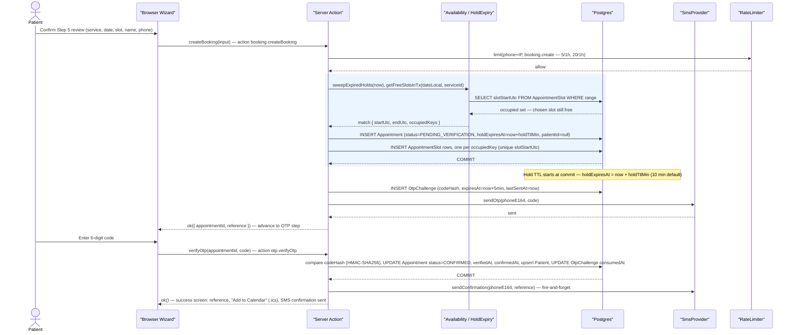

#### Walkthrough

1. The wizard's five steps are client-side only; nothing is written until the Step 5 confirm
   checkbox fires `createBooking` (C9.1).
2. `RateLimiter` is checked before any DB touch, against both `booking.create` rules keyed on
   HMAC-hashed phone and IP (C14) — a breach short-circuits to `RATE_LIMITED`.
3. The `rect` block is one `$transaction`: a fresh `getFreeSlotsInTx` re-check (never trusting the
   client's chosen slot), then one `Appointment` insert plus `durationSlots` `AppointmentSlot`
   inserts (Section 6.4). `holdExpiresAt` is written inside this commit, so the TTL clock starts
   when the row becomes visible to other transactions, not when the handler began.
4. `OtpChallenge` creation and `SmsProvider.sendOtp` happen *after* commit (C9.3): an SMS failure
   returns `OTP_SEND_FAILED` to the wizard, which offers resend, but never rolls back the hold.
5. `verifyOtp` is its own transaction: constant-time `codeHash` compare, then `Appointment` moves
   `PENDING_VERIFICATION -> CONFIRMED` (C4), `Patient` is upserted by `phoneE164` for the first time
   on this booking (C9.4, C9.6), and `holdExpiresAt` is cleared. The confirmation SMS that follows
   is fire-and-forget; the success screen reads `reference` (C8) and links
   `GET /api/appointments/[reference]/ics` (C13) for the calendar download.

### 7.2 Double-Booking Race

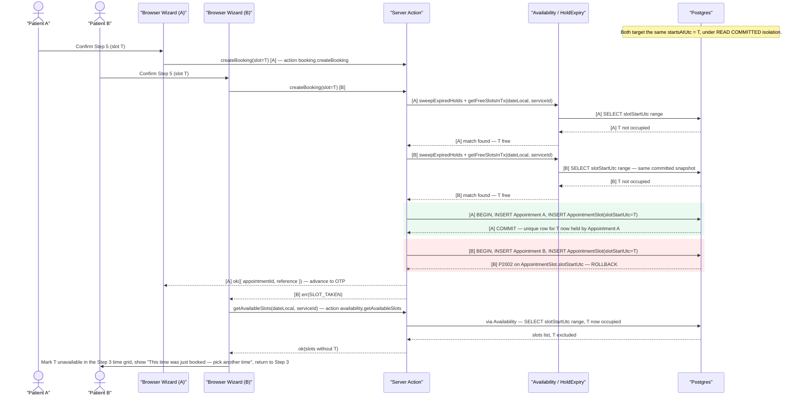

#### Walkthrough

1. Both requests pass the pre-check: `getFreeSlotsInTx` reads the same committed snapshot before
   either has written anything, so each legitimately sees T as free (Section 6.4, "why the recheck
   alone is not sufficient").
2. The two inserts are interleaved by commit order, not request order — the diagram fixes A ahead
   of B to make that order concrete, but either patient could win; the mechanism is identical.
3. A's transaction commits first and owns the only row `AppointmentSlot.slotStartUtc = T` can ever
   have (C5's unique index). B's insert of the same value raises Prisma `P2002`, mapped to
   `SLOT_TAKEN` (C9.2); B's transaction rolls back, taking its would-be `Appointment` row with it.
4. B never reaches OTP. The wizard's `SLOT_TAKEN` handler (Section 2.4 step 12) refetches
   `getAvailableSlots` — a fresh indexed read, not a cached list — which now shows T occupied, and
   routes B back to Step 3 (not Step 5, since name/phone/review state is still valid) with an
   inline "just booked" message.
5. A's booking proceeds exactly as in 7.1 from its `ok()` onward, unaffected by B's rollback.

### 7.3 Hold Expiry

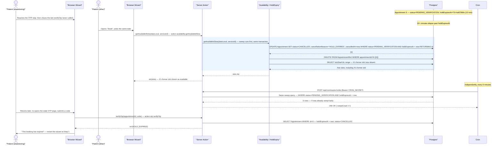

#### Walkthrough

1. Appointment X is created exactly as in 7.1, but Patient A never submits an OTP code; nothing
   server-side distinguishes "about to resume" from "gone for good" until `holdExpiresAt` passes.
2. The *lazy* sweep is what makes correctness independent of the cron actually running (C9.5): any
   other patient's `getAvailableSlots` call, inside its own transaction, runs the sweep UPDATE
   against the `[status, holdExpiresAt]` index, then its own `AppointmentSlot` range SELECT — so
   the freed slot is visible within the same request that triggered the sweep, no polling delay.
3. The sweep is one `UPDATE ... RETURNING id` followed by a `DELETE` on the returned ids —
   `AppointmentSlot` rows for X are removed in the same transaction, which makes the slot bookable
   again immediately, not just X's status change.
4. `POST /api/cron/expire-holds` runs the identical predicate every 5 minutes as defense-in-depth;
   here it finds zero rows because the lazy path already swept X. The two paths share one query
   and neither depends on the other firing.
5. When Patient A returns, `verifyOtp` checks `Appointment.holdExpiresAt` directly (Section 6.6,
   "hold expires mid-wizard") rather than only the `OtpChallenge`'s own `expiresAt` — this produces
   `HOLD_EXPIRED` specifically, distinct from an `OTP_EXPIRED` challenge-level failure (7.4), and
   tells the wizard to restart at Step 1 rather than offer a resend.

### 7.4 OTP Failure Modes

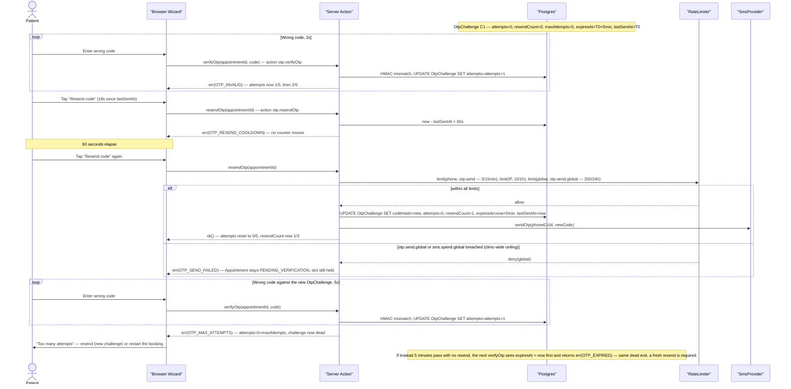

#### Walkthrough

1. Every wrong-code `verifyOtp` call increments `OtpChallenge.attempts` on the *same* row and
   returns `OTP_INVALID`; the challenge stays usable until `attempts` reaches `maxAttempts` (5,
   C10). Nothing else moves on this branch.
2. A resend inside the 60s cooldown is rejected by one read of `lastSentAt` — `OTP_RESEND_COOLDOWN`
   — and touches no counter; it is a pure read-then-reject, not an attempt or a resend.
3. A resend after the cooldown first passes the `otp.send` rate limit (3/15min/phone, 10/1h/IP,
   plus the clinic-wide `otp.send.global` ceiling, C14), independent of the per-challenge
   `resendCount` cap of 3, then *replaces* `codeHash` on the same row, resets `attempts` to 0,
   bumps `resendCount`, and extends `expiresAt` — one row, one lineage, never a second
   `OtpChallenge` for a plain resend (C10). Wrong attempts against the replaced code resume from 0,
   independent of the count before the resend.
4. At `attempts = maxAttempts` the challenge is dead: `OTP_MAX_ATTEMPTS` is returned and no further
   `verifyOtp` against this `OtpChallenge` id can succeed, resend or not — the only way forward is a
   fresh challenge via `resendOtp` (still capped at 3 resends total).
5. Natural expiry (`expiresAt < now`) is checked before the attempt-count check on every `verifyOtp`
   call — an assumption this section states explicitly, since C10/C12 list both outcomes without
   ordering them. An expired-but-not-exhausted challenge returns `OTP_EXPIRED`, not `OTP_INVALID`
   or `OTP_MAX_ATTEMPTS`, and per C10 neither code reveals whether the submitted digits were right.
6. The `otp.send.global` branch is the clinic-wide ceiling (C14): 200 sends per rolling 24h across
   all phone numbers, plus a daily `sms.spend.global` cap in `SMS_DAILY_CAP_MINOR`. A breach returns
   `OTP_SEND_FAILED` — the same code and the same no-rollback behavior as an `SmsProvider` failure
   in 7.1 step 4 — so the `Appointment` stays `PENDING_VERIFICATION` and its slot stays held; the
   clinic can still confirm it by hand. The breach also emits a CRITICAL log event and a persistent
   admin-dashboard banner, and `SMS_KILL_SWITCH=true` short-circuits sending outright for the
   duration of an attack.

### 7.5 Admin Login

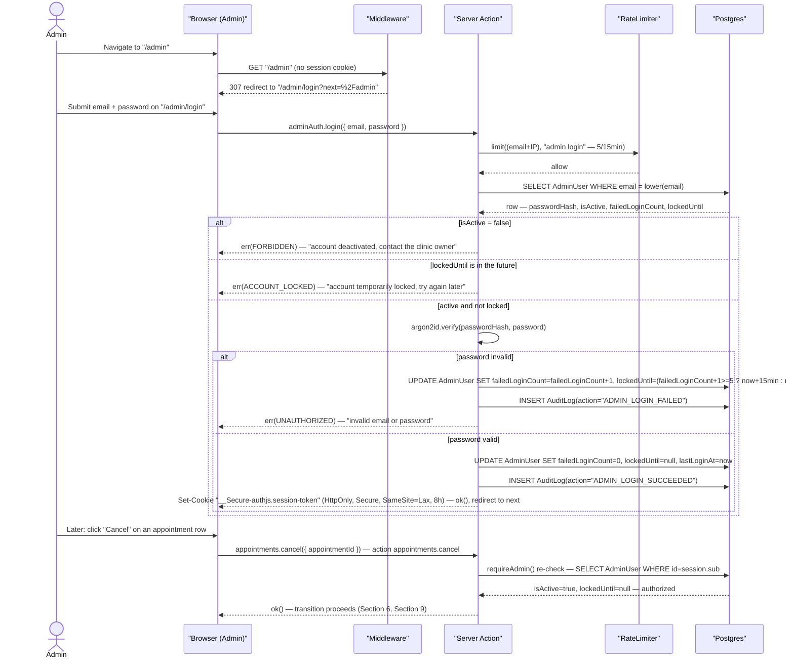

#### Walkthrough

1. `middleware.ts` only inspects whether a structurally valid session cookie is present (C11); an
   unauthenticated hit on any `/admin/:path*` other than `/admin/login` gets a same-origin,
   relative-path 307 to `/admin/login?next=<pathname>` — never an absolute external URL, closing
   the open-redirect vector.
2. `adminAuth.login` (`features/admin-auth/actions.ts`) still runs through `defineAction`: the
   `admin.login` rate limit (5/15min per `email+IP`, C14) is checked before the `AdminUser` row is
   even read.
3. `isActive` and `lockedUntil` are both read-and-checked independently of the `RateLimiter`
   verdict, in that order. `isActive = false` is permanent — a deactivated account, or a role
   revoked — and returns `FORBIDDEN`; a live `lockedUntil` window is temporary and self-clearing, a
   second DB-resident lockout keyed on the account (not IP) and set once `failedLoginCount` would
   reach 5 consecutive failures (C14), and returns `ACCOUNT_LOCKED` instead (C12) — never
   `FORBIDDEN` — so the UI copy can differ ("contact the clinic owner" versus "try again later").
   This section assumes the `RateLimiter` check runs first (cheap, no DB round-trip); see Contract
   Challenges.
4. Password verification is `argon2id` (`@node-rs/argon2`, C11) against the stored hash — never a
   plaintext comparison, never logged.
5. Every outcome writes an `AuditLog` row (`ADMIN_LOGIN_FAILED` or `ADMIN_LOGIN_SUCCEEDED`, C4) with
   no PII in `metaJson` (C19); only success also sets `lastLoginAt` and clears both counters.
6. The session is the Auth.js JWE cookie (C11), not a DB session row — "session-based" means an
   opaque, HttpOnly, Secure cookie the browser cannot read, not a server-side session table.
7. The later `appointments.cancel` call shows `requireAdmin()` firing *inside* the action, re-reading
   `AdminUser.isActive`/`lockedUntil` from the DB on every admin action — a session minted before an
   account was deactivated or locked stops working on its next action, not merely its next page
   load (C11 — "middleware is defense-in-depth, never the only check").

#### Contract Challenges

C14 defines two independent `admin.login` lockouts — the `RateLimiter`'s 5/15min window keyed on
`(email+IP)`, and `AdminUser.lockedUntil` set for 15 minutes after 5 *consecutive* failures keyed
on the account alone — without stating their check order or how they interact when they disagree.
A shared office IP can trip the IP-scoped limiter while an individual account's `lockedUntil` stays
clear, or a mobile admin on rotating IPs can lock their own account while never tripping the
IP-keyed limiter; the two also expire on different clocks (sliding window vs. fixed-until
timestamp), so a locked-out admin can see the error shape change from `RATE_LIMITED` to
`ACCOUNT_LOCKED` mid-wait with no action on their part (C12's split of `ACCOUNT_LOCKED` from
`FORBIDDEN` sharpens the symptom but does not resolve the ordering question below). This section
resolves it only by assuming the `RateLimiter` call runs first — C14 should state that ordering,
or fold the two into one authoritative check.

---

## 8. UI Plan

This section specifies every screen in C15's route table. 8.1 (below) is the page-by-page wireframe catalogue: layout, content, responsive behaviour, states, accessibility. 8.2 (separate fragment) is the component inventory against Section 3's paths; 8.3 maps design tokens to Tailwind, including C18's contrast table. This fragment covers 8.1 only, naming primitives without restating their props or tokens.

### 8.1 Page-by-page wireframes

**Shared conventions.** Breakpoints are Tailwind defaults (`sm` 640/`md` 768/`lg` 1024/`xl` 1280px); desktop diagrams are at `lg`, mobile at sub-`sm`. Every page reuses `PageHeader`, `EmptyState`, `StatusBadge`, `MoneyDisplay`, `ui/skeleton.tsx` and the one Sonner toast region (8.1.18) — not re-described per page. Touch targets are >=44px on `sm`/`md` (practical baseline, not AA-mandated). Status colour mapping (used throughout, matching 8.3.7's canonical table): `PENDING_VERIFICATION`->Warning `#F59E0B`, `CONFIRMED`->Info `#0EA5E9`, `COMPLETED`->Success `#16A34A`, `CANCELLED`->Danger `#DC2626`, `NO_SHOW`->neutral slate (`muted-foreground`, reusing an existing neutral tone rather than a fifth hue — see Contract Challenges). Status is icon+text, never colour alone (WCAG 1.4.1).

**Shared accessibility baseline** (assumed below, not repeated per page). Landmarks: public pages use `<header>`/`<nav aria-label="Primary">`/`<main>`/`<footer>`; admin pages use `<nav aria-label="Admin">` (sidebar) plus one `<main>` per route; a visually-hidden "Skip to content" link precedes every header. Focus order follows DOM order; a step/tab/dialog change moves focus to the new region's heading. Labels are a visible `<label>`/`<legend>` bound by `for`/`aria-describedby`, never a placeholder. One `aria-live="polite"` region per page announces async-action results; a blocking failure uses `role="alert"` instead. Per-page notes cover only what deviates from this baseline.

#### 8.1.1 Landing page — `/`

**Purpose.** Convert a visitor into a booking in one scroll pass via the "Book Appointment" CTA.

```
+----------------------------------------------------------------+
| LOGO MediBook  Services About How-it-works FAQ [Book Appt]      |
+----------------------------------------------------------------+
| HERO "Book your visit in under two minutes."  [Book Appt ->]    |
| SERVICES (3-col, sortOrder) [Gen.Consult 30m EUR50] [Dental..]   |
| ABOUT/DOCTORS  3 photo+name+specialty cards                      |
| HOW IT WORKS  (1) Choose service (2) Confirm by SMS (3) Visit    |
| TESTIMONIALS  "Booking took two minutes." - Johanna K.          |
| HOURS/LOCATION  Mon-Fri 09-18, Sat 09-13 & 16-20, Sun closed    |
| FAQ  <details><summary>How do I reschedule?</summary>...</details> |
| FOOTER  MediBook | phone | email | Privacy | Terms              |
+----------------------------------------------------------------+
```

**Content, brief order (8 sections).** Hero — H1, subhead, CTA to `/book`; `hero.jpg` is the LCP image (`priority`, C23). Services — one card per active `Service`, `sortOrder`-ordered: name, duration, `MoneyDisplay(priceMinor)`, description; "Select" deep-links `/book?service=<slug>`. About/Doctors — static copy + placeholder doctor grid (not modelled, C1). How It Works — 3 numbered steps per the brief. Testimonials — 3 short quotes, first name + initial. Hours & Location — built from `WorkingHour`/`ClinicSettings` at build time, Saturday split as two ranges; address, `mapUrl`, `phoneE164`. FAQ — zero-JS `<details>/<summary>`, 5 items (reschedule/cancel directs to phone; no patient self-service route exists, C1/C13). Footer — reused on `/privacy`/`/terms`.

**Responsive.** `sm`: 1-col stacked, nav behind a `Sheet` hamburger. `md`: Services/Doctors 2-col. `lg`/`xl`: 3-col grids, max-width 1280px.

**States.** Loading: none (SSG, C15). Empty: zero active services -> `EmptyState` ("Services are being updated"), per 6.6. Error: none. Success: default render.

**Accessibility.** One `<h1>`; each section is `<section aria-labelledby>` its own `<h2>`; nav is `<nav aria-label="Primary">`; Select links name the service; images carry descriptive `alt`.

#### 8.1.2 `/privacy` and `/terms`

**Purpose.** Legal disclosure (C20's retention policy on `/privacy`); findability over conversion.

```
+------------------------------------------+
| site-header (nav only)                     |
| H1 Privacy Policy    Last updated: <date>  |
| H2 What we collect | H2 Retention |        |
| H2 Your rights | H2 Contact                |
| site-footer                                |
+------------------------------------------+
```

**Content.** `/privacy`: data collected (name, phone, appointment history — not payment or medical data, C1), retention periods in plain language (C20), Twilio as the only third party. `/terms`: booking/cancellation/no-show terms.

**Responsive.** Single-column prose, ~72ch measure, at all widths.

**States.** SSG — no loading/empty/error; success is the only render.

**Accessibility.** One `<h1>`, sequential `<h2>`s, `<main>` landmark, visible focus outlines.

#### 8.1.3 `/book` — wizard shell

**Purpose.** Hold the 5-step wizard (Service/Date/Time/Details/Review) plus OTP behind one static shell (`force-static`, C15) so step changes stay client-side.

```
+------------------------------------------------------------+
| site-header (logo + "Need help? <phone>" only)               |
| (1)-(2)-(3)-(4)-(5)-(6) Service Date Time Details Review Verify |
| [x] [x] [o] [ ] [ ] [ ]           <- stepper                 |
|              << step content area >>                          |
| [ <- Back ]                           [ Continue -> ]          |
+------------------------------------------------------------+
```
Mobile:
```
+----------------------------+
| <- MediBook   Need help?   |
| Step 3 of 6: Time          |
| [=====------]              |
|       step content         |
| [ Back ]      [ Continue ] |
+----------------------------+
```

**Content.** Header: wordmark + phone link, no nav. Stepper nodes check off once complete; current step is solid `#0F766E`/white (AA-safe, C18 — never raw `#0D9488` with white text). Footer nav: Back (hidden step 1), Continue (disabled until local validation passes; relabels "Confirm & Send Code"/"Verify" on the last two steps).

**Responsive.** `sm`: progress bar + "Step N of 6", full-width buttons. `md`: 4-of-6 abbreviated labels. `lg`/`xl`: full labelled 6-node stepper, content capped ~720px.

**States.** Loading: `loading.tsx` skeleton shell during hydration. Error: `error.tsx` is a backstop only — failures are typed `ActionResult`s rendered in-step (C12), never thrown. Empty/Success: owned by individual steps.

**Accessibility.** One visually-hidden `<h1>`; each step (8.1.4-8.1.10) renders its own `<h2>` as the step prompt, so order is always h1 > h2 regardless of which step is active. Stepper is `<nav aria-label="Booking steps"><ol>` with `aria-current="step"`; the shared live region announces step transitions and validation errors; disabled Continue is `aria-disabled` with visible helper text.

#### 8.1.4 `/book` — Step 1: Service

**Purpose.** Capture `serviceId`, required input to every later slot computation (Section 6).

```
+--------------------------------------------+
| "What can we help you with?"                |
| [o Gen.Consult 30m EUR50] [o Dental 45m..]   |
| [o Phys.Therapy 60m EUR90] ...  radiogroup   |
+--------------------------------------------+
```

**Content.** One card per active `Service`, `sortOrder`-ordered: name, duration, `MoneyDisplay`, description. Selecting highlights the card and enables Continue; never auto-advances.

**Responsive.** `sm`/`md`: 1-col full-width cards. `lg`/`xl`: 3-col grid.

**States.** Loading: 6 skeleton cards. Empty: zero active services -> `EmptyState` ("No services bookable online"), per 6.6. Error: generic failure -> inline `Alert`+retry. Success: default grid, nothing selected.

**Accessibility.** Cards are `role="radiogroup"`/`radio` with `aria-checked`, arrow-key nav; price/duration are in each card's name.

#### 8.1.5 `/book` — Step 2: Date

**Purpose.** Narrow to one date, pre-disabling dates the engine already knows are unbookable (6.2).

```
+--------------------------------------------+
| "Pick a date"             < January 2026 >  |
| Su Mo Tu We Th Fr Sa                        |
|    1* 2  3  4  5  6*    * closed/past       |
| Legend: [dot] closed  [x] fully booked       |
+--------------------------------------------+
```

**Content.** `react-day-picker` grid (C2); `disabled` fed by `getAvailableDays` (6.2) — one of `PAST`/`BEYOND_WINDOW`/`CLOSED_DATE`/`NO_WORKING_HOURS`/`LEAD_TIME`/`FULLY_BOOKED`, rendered identically since the distinction adds no patient action. Month change re-fetches.

**Responsive.** `sm`: 44px min cells, single-letter weekday headers (full name hidden for AT). `lg`/`xl`: larger cells, 3-letter headers.

**States.** Loading: grid renders immediately, a thin skeleton marks availability until resolved (~100ms, C23). Empty: whole month disabled -> `EmptyState` ("No availability this month"). Error: `RATE_LIMITED`/`INTERNAL` -> inline `Alert`, grid stays on last valid month. Success: >=1 enabled day; selection advances prefetch.

**Accessibility.** `role="grid"`/`gridcell`, disabled cells carry `aria-disabled` + a reasoned `aria-label` ("January 6, closed"), stay in the roving-tabindex sequence; month-nav buttons have real names.

#### 8.1.6 `/book` — Step 3: Time

**Purpose.** Resolve to one start instant. **Assumption**: periods are Morning `<12:00`, Afternoon `12:00-17:00`, Evening `>=17:00`, clinic-local (C6).

```
+--------------------------------------------+
| "Available times - Tue, Jan 20"             |
| Morning   [09:00][09:15][09:30][09:45]       |
| Afternoon [13:00][13:15][14:00]              |
| Evening   [17:00][17:15]                     |
+--------------------------------------------+
```
Mobile:
```
+----------------------------+
| Tue, Jan 20 — Morning       |
| [09:00] [09:15] [09:30]    |
| Afternoon                  |
| [13:00] [13:15] [14:00]    |
| Evening  [17:00] [17:15]   |
+----------------------------+
```

**Content.** Each button shows `displayLocal` (clinic-local, C6); a caption states the zone once.

**Responsive.** `sm`: full-width wrapped buttons, periods stack. `md`: 2 periods/row. `lg`/`xl`: 3-column.

**States.** Loading: 8-12 skeleton pills under the three headings. Empty: zero slots -> `EmptyState` ("Fully booked for this day") + link back to Step 2 (Section 6.6's `FULLY_BOOKED`). Error: `VALIDATION_ERROR`/`INTERNAL` -> inline `Alert`, retry. Success: grid renders; a previously-picked slot stays highlighted if still present, otherwise absent (not 8.1.10's `SLOT_TAKEN` failure).

**Accessibility.** Each period is `<section aria-labelledby>` its own `<h3>`; slots form one `role="radiogroup"` per period, labelled fully ("9:00 AM, available").

#### 8.1.7 `/book` — Step 4: Patient details

**Purpose.** Collect full name and SMS-reachable phone (brief's Step 4).

```
+--------------------------------------------+
| "Your details"                               |
| Full name [ Jane Doe___________ ]             |
| Phone     [DE +49 v][30 1234 5678______]      |
| We'll text a 6-digit code to confirm.          |
+--------------------------------------------+
```

**Content.** Name: single input, inline Zod on blur. Phone: country `Combobox` (flag+dial code, default `CLINIC_DEFAULT_COUNTRY`, C16) + national-number input, validated E.164 (`lib/phone.ts`, C12).

**Responsive.** `sm`: fields stack full-width, popover becomes a `Sheet`. `md`+: inline.

**States.** Loading: n/a. Empty: both blank; Continue disabled until valid. Error: field-level `fieldErrors` under each input. Success: Continue enables.

**Accessibility.** Visible `<label>`s, not placeholder-as-label; combobox typeable/arrow-selectable; invalid fields get `aria-invalid`+`aria-describedby`.

#### 8.1.8 `/book` — Step 5: Review & confirm

**Purpose.** Force an explicit check of name/phone before any SMS is sent (the brief's confirmation gate).

```
+--------------------------------------------+
| "Review your booking"                        |
| Service  General Consultation                 |
| Date     Tue, Jan 20, 2026   Price EUR50.00    |
| Time     09:00 (CET)                           |
| Name     Jane Doe                [Edit]        |
| Phone    +49 30 1234 5678        [Edit]        |
| [ ] I confirm the name and phone above          |
|     are correct.                                |
| [ Confirm & Send Code -> ]  (disabled unchecked) |
+--------------------------------------------+
```

**Content.** Static summary of every field; each "Edit" returns to its owning step without discarding later state. The checkbox gates submit, which calls `booking.createBooking` (C9.2): success advances to OTP; `SLOT_TAKEN` routes to 8.1.10.

**Responsive.** `sm`: rows stack label-above-value, Edit becomes labelled icon buttons. `lg`/`xl`: two-column rows.

**States.** Loading: submit shows "Sending code...", disables Edit links. Empty: n/a. Error: `VALIDATION_ERROR` names the field; `RATE_LIMITED` -> generic retry-later copy; `SLOT_TAKEN` -> full handoff to 8.1.10, not an inline alert. Success: advances with the new `appointmentId`.

**Accessibility.** Checkbox's sentence is its label; disabled submit pairs with visible helper text, not styling alone.

#### 8.1.9 `/book` — Step 6: Verify (OTP)

**Purpose.** Prove phone reachability before `CONFIRMED` (C9.4).

```
+--------------------------------------------+
| "Enter the code sent to +49 30 ****5678"      |
| [1][2][3][4][5][6]                            |
| Resend code in 0:47                            |
| [ Verify -> ]                                  |
+--------------------------------------------+
```

**Content.** Six auto-advancing digit boxes feed `otp.verifyOtp`; phone is masked in the heading. Resend shows a live 60s countdown (C10), activating at `0:00`, capped at 3 resends — the 4th disables it ("Maximum resend attempts reached," C10). (No separate mobile diagram; no structural change beyond the shell, 8.1.3.)

**States, by code.** Loading: "Verifying…", boxes disabled. Empty: Verify disabled until all 6 digits are filled. `OTP_INVALID`: "That code didn't match" (no attempts-remaining counter, C12). `OTP_EXPIRED`/`OTP_MAX_ATTEMPTS`: the same generic "This code has expired," deliberately undistinguished (C10). `HOLD_EXPIRED`: a distinct blocking panel, "Your hold expired — pick a new time," back to Step 3 with service/date preserved. `OTP_SEND_FAILED`: inline `Alert`; cooldown still runs from `OtpChallenge.lastSentAt` (assumption: starts at creation, not at send success). Success: redirect to `/book/success/[reference]`.

**Accessibility.** Boxes are one `fieldset`/`legend`, each `aria-label="digit N of 6"`; the countdown itself isn't `aria-live` — only the terminal "now available" transition is announced; auto-advance moves visual and keyboard focus together.

#### 8.1.10 `/book` — `SLOT_TAKEN` recovery

**Purpose.** Recover from the 6.4 race: the slot's `AppointmentSlot` insert hit `P2002` since another booking committed first; reached from Step 5's submit, not a separate route.

```
+--------------------------------------------+
| (!) "That time was just booked by someone     |
|      else" — your other details are saved.    |
| Morning   [09:15][09:30][09:45]                |
| [ <- Choose a different date ]                  |
+--------------------------------------------+
```

**Content.** Warning-coded panel (expected race, not a fault) replaces the review card in place, re-rendering Step 3's grid via a fresh `getAvailableSlots`; picking a slot returns to Step 5 with the new time merged in.

**Responsive.** Same single-column panel at all widths; grid follows 8.1.6's own rules.

**States.** Loading: same skeleton pills as 8.1.6. Empty: day now fully booked -> 8.1.6's own `EmptyState`. Error: second failure -> inline `Alert`+retry. Success: new slot chosen -> returns to Step 5 (**assumption**: checkbox stays checked, since the time change doesn't affect name/phone).

**Accessibility.** Focus moves to the panel heading; the shared live region announces the change.

#### 8.1.11 `/book/success/[reference]`

**Purpose.** Confirm `CONFIRMED`, hand over the reference as a durable lookup token (C8); no account required (C1).

```
+--------------------------------------------+
| (check) "You're booked, Jane!"                |
| Reference  MB-7K3F9Q        [Copy]             |
| Service    General Consultation                |
| When       Tue, Jan 20, 2026, 09:00 (CET)       |
| Price      EUR 50.00                            |
| [ Add to Calendar (.ics) ]                       |
| What happens next                                |
| - Confirmation text sent to +49 30 ****5678    |
| - To reschedule or cancel, call <phone>          |
+--------------------------------------------+
```

**Content.** Summary mirrors Step 5's shape plus the final `reference` + `Copy`; "Add to Calendar" anchors to `GET /api/appointments/[reference]/ics` (file download via `Content-Disposition`, C13, not a client fetch); "What happens next" routes any change to a phone call, since no patient-side reschedule/cancel action exists (C1/C13).

**Responsive.** `sm`: rows stack, buttons full-width. `lg`/`xl`: inline.

**States.** Loading: dynamic SSR (`no-store`, C15), brief skeleton. Error: unknown/malformed `reference` -> route's own `not-found.tsx`, rate-limited 30/1h/IP (C14), copy that neither confirms nor denies the reference ever existed. Success: rendered state above.

**Accessibility.** `<h1>` is the greeting; the reference carries `aria-label="Booking reference"`; Copy announces via the toast region; the `.ics` link's name clarifies it downloads a file.

#### 8.1.12 `/admin/login`

**Purpose.** Gate `/admin/*` behind email+password (C11); never distinguish "no such email" from "wrong password."

```
+----------------------------+
|   Admin sign in             |
|   Email    [___________]    |
|   Password [___________]    |
|   [ Sign in ]                |
+----------------------------+
```

**Content.** Single centered card, no self-service reset (seed-only accounts, C1); success redirects to `?next=` if same-origin, else `/admin`.

**Responsive.** `sm`: full-width card minus gutter. `lg`/`xl`: fixed ~400px centered.

**States.** Loading: spinner, fields disabled. Empty: submit disabled until both filled. Error: single generic "Invalid email or password" for both failure types; a distinct lockout message when `lockedUntil` is active; a distinct rate-limit message (C14). Success: redirect, no in-page success state.

**Accessibility.** Visible labels; one `role="alert"` per attempt, `aria-describedby` on the form (not per-field); `autocomplete` set.

#### 8.1.13 `/admin` — dashboard

**Purpose.** One-screen snapshot of patients, revenue, and load over a selectable date range.

```
+------------------------------------------------------------+
| admin-sidebar | "Dashboard"        [date range: Last 30d v]  |
| [Patients 248][Revenue EUR12,450][Expected EUR3,100]          |
| [Today 6][Upcoming this wk 22]                                |
| [Revenue over time D|W|M]   [Appointments by service]          |
+------------------------------------------------------------+
```
Mobile:
```
+----------------------------+
| =  Dashboard   [range v]   |
| Patients            248    |
| Revenue         €12,450    |
| Expected         €3,100    |
| Today's Appts        6     |
| Upcoming This Wk     22    |
| Revenue chart   [D|W|M]    |
| Appts by service chart     |
+----------------------------+
```

**Content.** Five KPI cards (brief Section 3): Total patients, Total revenue (`COMPLETED` sum), Expected revenue (upcoming `CONFIRMED` sum), Today's appointments, Upcoming this week — label+number+icon. Two charts: Revenue over time (D/W/M toggle); Appointments by service as ranked bars in each service's seeded `colorHex`. One topbar date-range filter re-queries all 7 widgets via `searchParams` — never per-widget.

**Responsive.** `sm`: shown above (1-col cards, stacked charts, range -> `Sheet`). `md`: 2-col KPI cards. `lg`/`xl`: 5-across row, charts 50/50.

**States.** Loading: 5 skeleton cards + 2 skeleton charts (<400ms p95, C23). Empty: zero-appointment range renders true "0" values, charts show "No data in this range." Error: one widget's own `Alert`+retry; a failing chart never takes down the others. Success: default render.

**Accessibility.** Date-range control's name states its scope; one batched live-region announcement covers all 7 widgets; each KPI's name includes label+unit; charts carry a summarizing `aria-label` plus a hidden data-table equivalent.

#### 8.1.14 `/admin/calendar`

**Purpose.** See booked time as a day/week/month grid, colour-coded by status.

```
+------------------------------------------------------------+
| admin-sidebar | "Calendar" [Day|Week|Month]   < Jan 20 >    |
| Mon [CONFIRMED J.Doe]                                         |
| Tue      [PENDING hold]    [COMPLETED Dental]                 |
| Legend: Pending Confirmed Completed No-show(o) Cancelled       |
+------------------------------------------------------------+
```

**Content.** FullCalendar (daygrid/timegrid, C2) in a client island; `calendar-view-toggle.tsx` drives day/week/month. Event blocks show status+patient initials+service in the shared colour mapping, legend always visible beneath; clicking opens the same row-action menu as `/admin/appointments`.

**Responsive.** `sm`/`md`: defaults to Day view, toggle becomes a `Select`. `lg`/`xl`: defaults to Week, full 3-button toggle.

**States.** Loading: skeleton matching the current view's grid. Empty: zero events renders the bare grid (itself informative). Error: inline `Alert`, grid keeps its last-good view. Success: populated grid.

**Accessibility.** FullCalendar's native ARIA grid semantics are used as-is; view toggle is `role="tablist"`/`tab`; each event's name includes status+time+patient/service.

#### 8.1.15 `/admin/appointments`

**Purpose.** Find and act on any appointment — confirm/complete/no-show/cancel/reschedule — without leaving the list.

```
+------------------------------------------------------------+
| admin-sidebar | "Appointments"                                |
| [Search name/phone/ref___] [Status v][Service v][Range v]      |
| Ref       Patient  Service      Date/Time  Status      •••     |
| MB-7K3F9Q J. Doe   Gen.Consult  1/20 09:00 [CONFIRMED]          |
|                < Prev  1 2 3 ... 9  Next >                      |
+------------------------------------------------------------+
```
Mobile:
```
+----------------------------+
| =  Appointments [Filters]  |
| [ Search_______________ ]  |
| MB-7K3F9Q      [CONFIRMED] |
| J. Doe · Gen.Consult   ••• |
| Jan 20, 09:00               |
|      < 1 2 3 ... 9 >        |
+----------------------------+
```

**Content.** Search (name/phone/reference, plain scan per 4.7's gap) + status/service/date-range filters, all `searchParams`-driven (C15); row: reference, patient, service, date/time, `StatusBadge`, row-actions offering exactly the legal next transitions (C4 — `COMPLETED` offers none). "Reschedule" opens `reschedule-dialog.tsx`, re-embedding 8.1.5/8.1.6's pickers scoped to the existing service.

**Responsive.** `sm`: shown above (card list, filters in a `Sheet`, dialog -> full-height sheet). `md`: table returns, service column drops to a secondary line. `lg`/`xl`: full table.

**States.** Loading: skeleton rows/cards. Empty: no filter matches -> `EmptyState` ("No appointments match these filters," distinct from a true zero-appointment state). Error: a row action failure (`INVALID_TRANSITION`, `SLOT_TAKEN` on reschedule) toasts and rolls the optimistic row back. Success: toast confirms, row updates in place.

**Accessibility.** A real `<table>`, not div-grid; row-actions button names the row ("Actions for MB-7K3F9Q"); the dialog is `role="dialog"`/`aria-modal`, focus-trapped, returned on close.

#### 8.1.16 `/admin/patients`

**Purpose.** Read-only roster: who is this patient, what's their history. No mutation exists here (C1, Section 3).

```
+------------------------------------------------------------+
| admin-sidebar | "Patients"                                    |
| [ Search name or phone__________ ]                            |
| Name    Phone          Visits  Total spent   Last visit        |
| J. Doe  +49 30 ****5678  4      €220.00       Jan 20            |
+------------------------------------------------------------+
```

**Content.** Search by name or phone (same caveat as 8.1.15); the brief's five columns, no row actions, no drill-in page (none specified). Phone masked as in 8.1.9.

**Responsive.** `sm`: table -> stacked cards. `lg`/`xl`: full 5-column table.

**States.** Loading: skeleton rows. Empty: no search match -> `EmptyState`; zero patients at all -> distinct `EmptyState` ("No patients yet"). Error: page-level `Alert`+retry. Success: populated table.

**Accessibility.** Native `<table>`; masked phone's accessible name repeats the same masked string shown visually (privacy-motivated).

#### 8.1.17 `/admin/settings`

**Purpose.** Edit the clinic's operating parameters — hours, closures, scheduling grid, service catalogue — everything Section 6 reads as live config.

```
+------------------------------------------------------------+
| admin-sidebar | "Settings"                                    |
| [Hours][Closed Dates][Slot Interval][Services]  <- tabs        |
| Monday    09:00-18:00         [+Add shift] [Closed]            |
| Saturday  09:00-13:00 [+]     [+Add shift] [Closed]            |
|           16:00-20:00 [x]       (split shift)                   |
|                                   [ Save hours ]                 |
+------------------------------------------------------------+
```

**Content, by tab.** Hours — one row per weekday, open/close pairs ("+Add shift" appends a split row, matching the seeded Saturday pattern, 4.6), plus a "Closed" toggle; writes `WorkingHour`. Closed Dates — date+reason picker, removable list; removal never touches existing bookings. Slot Interval — named for the brief's field but editing all of `ClinicSettings` (`clinicName`/`timeZone`/`currency`/`slotIntervalMin`/`bufferMin`/`minLeadTimeMin`/`maxAdvanceDays`/`holdTtlMin`, `general-settings-form.tsx`), interval first (assumption: the brief names only that one field). Services — table of all `Service` rows + a "New service" dialog (name, duration, price, colour, active toggle); "Deactivate" flips `isActive`, never deletes, and propagates to the landing page via `revalidatePath('/')` (2.3).

**Responsive.** `sm`: tabs become a scrollable pill row, forms stack 1-col. `lg`/`xl`: fixed tab row, 2-col grids where fields are short.

**States.** Loading: skeleton matching the active tab. Empty: Closed Dates empty -> `EmptyState`; Services at zero echoes 8.1.1/8.1.4's "no bookable services" state. Error: `fieldErrors` inline + toast; client Zod (shared schema, C17) catches most before the request is sent. Success: toast confirms, tab re-renders from the server response, never optimistic.

**Accessibility.** Tabs are `role="tablist"`/`tab`/`tabpanel` with roving tabindex, matching the dashboard's toggle; each weekday toggle names the day; saves/errors route through the shared toast/alert pattern.

#### 8.1.18 Global shell

**Public header/footer** (`site-header.tsx`, `site-footer.tsx`). Header: logo to `/`, nav to the landing page's own section anchors, an always-visible "Book Appointment" CTA, `theme-toggle.tsx`; collapses to a `Sheet` on `sm`. The wizard shell (8.1.3) drops nav/toggle to reduce mid-flow exits. Footer: clinic contact + `/privacy`/`/terms`, reused verbatim on both.

**Admin sidebar/topbar** (`admin-sidebar.tsx`, `admin-topbar.tsx`, `admin-nav-items.ts`). Sidebar: logo + one item per nav entry (Dashboard/Calendar/Appointments/Patients/Settings), active route highlighted; collapses to an off-canvas `Sheet` on `sm`/`md`. Topbar: page title, user menu, theme toggle. This chrome is cosmetic — middleware plus `requireAdmin()` are the real gate (C11).

**Toast region** (`ui/sonner.tsx`, root `layout.tsx`). One stack (bottom-corner desktop, bottom-full-width mobile); success/info toasts are `role="status"`/`aria-live="polite"`, destructive outcomes `role="alert"`; auto-dismiss ~5s except unacknowledged errors — the one transient-confirmation mechanism used throughout.

**Not-found/error boundaries** (Section 3's `not-found.tsx`/`error.tsx` at root, `/book`, `/book/success/[reference]`, admin `(dashboard)`). Root `not-found.tsx` keeps the public shell with a link to `/`. Root `error.tsx` is a last-resort boundary for genuine bugs — action failures are already typed `ActionResult`s (C12); the two scoped files follow the same pattern.

#### Contract Challenges

C18 pins exactly four semantic status colours (Success/Warning/Danger/Info), but C4 defines five `AppointmentStatus` values. This section follows 8.3.7's resolution rather than independently inventing one: `CANCELLED` reuses Danger `#DC2626` (one of the four pinned colours) and `NO_SHOW` reuses the existing `muted-foreground` neutral tone, since icon+text already distinguishes the two (WCAG 1.4.1) and a fifth hue would be redundant. The underlying gap stands regardless — C18 should either name a fifth token itself or explicitly bless this reuse-the-neutral approach as the contract's own answer, rather than leaving two independently authored sections to converge on it by chance.

---

### 8.2 Component inventory

Every path below is copied verbatim from Section 3's tree; this fragment adds no new route or
feature-folder paths, only (where stated as an explicit assumption) a small number of additional
files inside the already-approved `src/components/` bucket. "Props sketch" is the component's own
prop type, not its internal implementation. "State owner" names who holds the authoritative value
the component renders — the component itself, a parent, a form library, the URL, or an external
library's internal state.

#### 8.2.1 shadcn/ui primitives in use

| Component | Path | Server or Client | Props sketch | Composed of | State owner | Notes (a11y, loading, error) |
|---|---|---|---|---|---|---|
| Button | `src/components/ui/button.tsx` | Server | `` `interface ButtonProps extends React.ButtonHTMLAttributes<HTMLButtonElement>, VariantProps<typeof buttonVariants> { asChild?: boolean }` `` | cva `buttonVariants` | N/A (parent controls disabled/loading) | Focus ring never removed (C18); loading = parent passes `disabled` + spinner child, not built in |
| Input | `src/components/ui/input.tsx` | Server | `` `interface InputProps extends React.InputHTMLAttributes<HTMLInputElement> {}` `` | — | RHF `Controller`/`register` | `aria-invalid`/`aria-describedby` wired by `ui/form.tsx`, not here |
| Label | `src/components/ui/label.tsx` | Server | `` `React.ComponentProps<typeof LabelPrimitive.Root>` `` | `@radix-ui/react-label` | N/A | Always paired with `htmlFor`/`id` from `ui/form.tsx` |
| Select | `src/components/ui/select.tsx` | Client (`"use client"`, Radix) | `` `Select.Root/Trigger/Content/Item` compound `` | `@radix-ui/react-select` | Uncontrolled unless `value`/`onValueChange` passed | Revenue granularity + status filter; keyboard nav from Radix |
| Calendar | `src/components/ui/calendar.tsx` | Client (`"use client"`, react-day-picker) | `` `type CalendarProps = React.ComponentProps<typeof DayPicker>` `` | react-day-picker | Controlled by caller (`selected`, `onSelect`, `disabled`) | `disabled` matcher fed by `getAvailableDays()` (Section 6); grid nav is arrow-key accessible |
| Dialog | `src/components/ui/dialog.tsx` | Client (`"use client"`, Radix) | `` `Dialog.Root/Trigger/Content/Title/Description` `` | `@radix-ui/react-dialog` | Uncontrolled unless `open`/`onOpenChange` passed | Focus-trapped, Esc closes, labelled by `DialogTitle` — required by ConfirmDialog/ServiceFormDialog/RescheduleDialog |
| Sheet | `src/components/ui/sheet.tsx` | Client (`"use client"`, Radix Dialog variant) | `` `same as Dialog + { side?: "left" | "right" }` `` | `@radix-ui/react-dialog` | Uncontrolled | Mobile admin nav drawer + mobile filters drawer; same focus-trap guarantee as Dialog |
| DropdownMenu | `src/components/ui/dropdown-menu.tsx` | Client (`"use client"`, Radix) | `` `DropdownMenu.Root/Trigger/Content/Item` `` | `@radix-ui/react-dropdown-menu` | Uncontrolled | Icon-only trigger needs an accessible name — supplied by composing `ui/tooltip` at the call site |
| Table | `src/components/ui/table.tsx` | Server | `` `Table, TableHeader, TableRow, TableHead, TableCell` wrappers over `React.ComponentProps<"table">` `` | — | N/A | Semantic `<table>`; `scope="col"` on `TableHead`; no built-in sort/paging |
| Tabs | `src/components/ui/tabs.tsx` | Client (`"use client"`, Radix) | `` `Tabs.Root/List/Trigger/Content` `` | `@radix-ui/react-tabs` | Controlled (`value`/`onValueChange`, URL-synced at call site) | Roving tabindex (Radix); revenue granularity + calendar view toggle |
| Badge | `src/components/ui/badge.tsx` | Server | `` `interface BadgeProps extends React.HTMLAttributes<HTMLSpanElement>, VariantProps<typeof badgeVariants> {}` `` | cva `badgeVariants` | N/A | Base for StatusBadge; never the only status signal (C18, WCAG 1.4.1) |
| Card | `src/components/ui/card.tsx` | Server | `` `Card, CardHeader, CardTitle, CardDescription, CardContent, CardFooter` `` | — | N/A | `rounded-2xl` per C18; KPI cards + landing service/testimonial cards |
| Form | `src/components/ui/form.tsx` | Client (`"use client"`, wraps RHF context) | `` `FormField<TFieldValues>, FormItem, FormLabel, FormControl, FormMessage` `` | RHF `useFormContext` | React Hook Form | `FormMessage` renders Zod `fieldErrors`; the one place `aria-invalid`/`aria-describedby` are wired automatically |
| Sonner (Toaster) | `src/components/ui/sonner.tsx` | Client (`"use client"`, mounts a portal) | `` `ToasterProps { theme?: "light" | "dark"; position?: string }` `` | `sonner` | Internal to `sonner` | `role="status"`/live-region via `sonner` internals; mounted once in root layout |
| Skeleton | `src/components/ui/skeleton.tsx` | Server | `` `React.HTMLAttributes<HTMLDivElement>` `` | — | N/A | Used by every `loading.tsx`; pulse animation disabled under `prefers-reduced-motion` (C18) |
| Separator | `src/components/ui/separator.tsx` | Server | `` `React.ComponentProps<typeof SeparatorPrimitive.Root>` `` | `@radix-ui/react-separator` | N/A | Decorative; `role="none"` when purely visual |
| Popover | `src/components/ui/popover.tsx` | Client (`"use client"`, Radix) | `` `Popover.Root/Trigger/Content` `` | `@radix-ui/react-popover` | Uncontrolled unless `open`/`onOpenChange` passed | Hosts PhoneInput's country combobox and DateRangePicker's calendar |
| Alert | `src/components/ui/alert.tsx` | Server | `` `Alert, AlertTitle, AlertDescription` + `{ variant?: "default" | "destructive" }` `` | cva | N/A | `role="alert"` region for `SLOT_TAKEN`/`OTP_SEND_FAILED`/settings-save-failure banners (C12 `message`) |
| Checkbox | `src/components/ui/checkbox.tsx` | Client (`"use client"`, Radix) | `` `React.ComponentProps<typeof CheckboxPrimitive.Root>` `` | `@radix-ui/react-checkbox` | RHF-controlled | ReviewStep confirmation; required via Zod `z.literal(true)`, not the HTML attribute alone |
| Pagination | `src/components/ui/pagination.tsx` | Server (links trigger navigation) | `` `Pagination, PaginationContent, PaginationItem, PaginationLink, PaginationNext, PaginationPrevious` `` | — | URL searchParams (`page`) | `aria-current="page"` on the active link; composed only via DataTablePagination |
| Tooltip | `src/components/ui/tooltip.tsx` | Client (`"use client"`, Radix) | `` `Tooltip.Root/Trigger/Content` + `TooltipProvider` `` | `@radix-ui/react-tooltip` | Uncontrolled | Supplies the accessible name for icon-only buttons (WCAG 4.1.2) — row-action trigger, CopyButton |
| Command | `src/components/ui/command.tsx` | Client (`"use client"`, `cmdk`) | `` `Command, CommandInput, CommandList, CommandItem, CommandEmpty` `` | `cmdk` + Popover | Internal filter state | Country list inside PhoneInput's popover; `CommandEmpty` covers "no results" |

#### 8.2.2 Shared app composites

| Component | Path | Server or Client | Props sketch | Composed of | State owner | Notes (a11y, loading, error) |
|---|---|---|---|---|---|---|
| PageHeader | `src/components/page-header.tsx` | Server | `` `interface PageHeaderProps { title: string; description?: string; actions?: React.ReactNode }` `` | plain layout only | Stateless | One `<h1>` per route, consistent heading order on every `/admin/*` page |
| EmptyState | `src/components/empty-state.tsx` | Server | `` `interface EmptyStateProps { icon?: LucideIcon; title: string; description?: string; action?: React.ReactNode }` `` | lucide-react icon | Stateless | `role="status"` so a filtered-to-empty table announces, not just visually changes |
| StatusBadge | `src/components/status-badge.tsx` | Server | `` `interface StatusBadgeProps { status: AppointmentStatus }` `` (C4 union, `src/lib/enums.ts`) | `ui/badge` + lucide icon | Stateless, pure map | Icon + color + text, never color alone (C18, WCAG 1.4.1); same color map reused by charts (8.2.12) |
| ConfirmDialog | `src/components/confirm-dialog.tsx` | Client (`"use client"` — owns open/pending state) | `` `interface ConfirmDialogProps { trigger: React.ReactNode; title: string; description: string; confirmLabel?: string; destructive?: boolean; onConfirm: () => Promise<void> }` `` | `ui/dialog` + `ui/button` | Own `open` + pending state (`useState`/`useTransition`) | Confirm button disables + spinner during the transition; focus returns to trigger on close |
| DataTablePagination | `src/components/data-table-pagination.tsx` | Server | `` `interface DataTablePaginationProps { page: number; pageSize: number; total: number; makeHref: (page: number) => string }` `` | `ui/pagination` | URL searchParams (via `makeHref`) | Purely presentational over a caller-supplied `total`; never fetches |
| DateRangePicker | `src/components/date-range-picker.tsx` | Client (`"use client"` — Radix popover + range calendar) | `` `interface DateRangePickerProps { value: { from: Date; to: Date } | null; onChange: (r: { from: Date; to: Date }) => void; align?: "start" | "end" }` `` | `ui/popover` + `ui/calendar` + `ui/button` | Controlled by caller | Dashboard and appointments filters each own the URL-sync wrapper; this stays presentation-only (8.2.12) |
| MoneyDisplay | `src/components/money-display.tsx` | Server | `` `interface MoneyDisplayProps { minor: number; currency: string; locale?: string }` `` | `src/lib/money.ts` `formatMoney()` | Stateless | The only component allowed to render money text directly (8.2.13) |
| SiteHeader | `src/components/site-header.tsx` | Server (mobile toggle below is client) | `` `interface SiteHeaderProps {}` `` | AppLogo, ThemeToggle, `ui/sheet` (mobile) | Stateless (menu-open lives in the Sheet) | Static nav: `/`, `/privacy`, `/terms`, `/book` |
| SiteFooter | `src/components/site-footer.tsx` | Server | `` `interface SiteFooterProps {}` `` | reads `src/content/site.ts` | Stateless | Reused by `/privacy` and `/terms`, not landing-only (per Section 3) |
| ThemeToggle | `src/components/theme-toggle.tsx` | Client (`"use client"` — reads/writes theme) | `` `interface ThemeToggleProps { className?: string }` `` | `ui/button` + lucide `Sun`/`Moon` | `localStorage` + `<html class="dark">` (C18 class strategy) | `aria-pressed` reflects mode; icon swap respects `prefers-reduced-motion` |
| AppLogo | `src/components/app-logo.tsx` | Server | `` `interface AppLogoProps { href?: string }` `` | `next/link` | Stateless | Single source so the mark never drifts between header and sidebar |

#### 8.2.3 Landing components

All Server Components — SSG, no runtime fetch (C15); props come from `queries.ts`/`content/site.ts` at build time; feature has no client state at all (Section 3).

| Component | Path | Server or Client | Props sketch | Composed of | State owner | Notes (a11y, loading, error) |
|---|---|---|---|---|---|---|
| HeroSection | `src/features/landing/components/hero-section.tsx` | Server | `` `interface HeroSectionProps { ctaHref: string }` `` | `next/image` (priority, LCP) + `ui/button` | Stateless | LCP image preloaded via `next/image priority` (C23); no error state possible (static) |
| ServicesSection | `src/features/landing/components/services-section.tsx` | Server | `` `interface ServicesSectionProps { services: ServiceCardView[] }` `` | `ui/card` + MoneyDisplay | Stateless | Rendered as `<ul>` of cards, not bare `<div>`s, for AT list semantics |
| AboutSection | `src/features/landing/components/about-section.tsx` | Server | `` `interface AboutSectionProps { doctors: { name: string; role: string; photoSrc: string }[] }` `` | `next/image` | Stateless | Each headshot's `alt` is name + role, never "doctor photo" |
| HowItWorksSection | `src/features/landing/components/how-it-works-section.tsx` | Server | `` `interface HowItWorksSectionProps {}` `` (3 fixed steps, `content/site.ts`) | lucide icons | Stateless | `<ol>` semantics for "3 steps," not a visual-only grid |
| TestimonialsSection | `src/features/landing/components/testimonials-section.tsx` | Server | `` `interface TestimonialsSectionProps { testimonials: { quote: string; author: string }[] }` `` | `ui/card` | Stateless | `<blockquote>` + `<cite>`, not plain `<p>` |
| HoursLocationSection | `src/features/landing/components/hours-location-section.tsx` | Server | `` `interface HoursLocationSectionProps { hours: { weekday: number; openMinute: number; closeMinute: number }[]; address: string; mapUrl: string }` `` | — | Stateless | Today's row marked by text ("Open today"), never color alone |
| FaqSection | `src/features/landing/components/faq-section.tsx` | Server | `` `interface FaqSectionProps { items: { question: string; answer: string }[] }` `` | native `<details>`/`<summary>` | Native disclosure widget | Zero client JS for the accordion — correct a11y for free, keeps landing's ≤90KB gz budget (C23); this is also why `ui/accordion` is absent from 8.2.1's closed list of 22 |

#### 8.2.4 Booking-wizard components

| Component | Path | Server or Client | Props sketch | Composed of | State owner | Notes (a11y, loading, error) |
|---|---|---|---|---|---|---|
| BookingWizard | `src/features/booking/components/booking-wizard.tsx` | Client (`"use client"` — the step-sequencing island, C15) | `` `interface BookingWizardProps { services: Pick<Service, "id" | "slug" | "name" | "durationMin" | "priceMinor">[] }` `` | ServiceStep…ReviewStep (own feature) + OtpInput, OtpResendButton (`features/otp`, cross-feature import — fine, both are `features/*`, see 2.2) | `use-booking-wizard` reducer (8.2.11) | Mounts on the static `/book` shell; the only client boundary on that route |
| ServiceStep | `src/features/booking/components/service-step.tsx` | Client | `` `interface ServiceStepProps { services: Pick<Service, "id" | "name" | "durationMin" | "priceMinor">[]; onSelect: (serviceId: string) => void }` `` | `ui/card` (selectable) | Parent reducer | Cards are `<button role="radio">` inside `role="radiogroup"` — single choice, not a checkbox grid |
| DateStep | `src/features/booking/components/date-step.tsx` | Client | `` `interface DateStepProps { serviceId: string; onSelect: (dateLocal: string) => void }` `` | `ui/calendar`; calls `getAvailableDays(month, serviceId)` (Section 6) | Parent reducer + local "disabled days for visible month" cache | Skeleton over the grid while a month fetch is in flight; `ui/alert` if the call returns `!ok` |
| TimeStep | `src/features/booking/components/time-step.tsx` | Client | `` `interface TimeStepProps { serviceId: string; dateLocal: string; onSelect: (slot: { startUtc: string; endUtc: string; displayLocal: string }) => void }` `` | SlotPicker | Parent reducer | Always re-fetches on mount (6.3) so DateStep's prefetch is never trusted as bookable; EmptyState for "no times left today" |
| DetailsStep | `src/features/booking/components/details-step.tsx` | Client | `` `interface DetailsStepProps { defaultValues: Pick<BookingDraft, "fullName" | "phoneE164">; onSubmit: (v: { fullName: string; phoneE164: string }) => void }` `` | `ui/form` + `ui/input` + PhoneInput | React Hook Form, local to this step (8.2.11) | `FormMessage` surfaces the fullName/phoneE164 Zod rules before any server round-trip |
| PhoneInput | `src/features/booking/components/phone-input.tsx` | Client | `` `interface PhoneInputProps { value: string; onChange: (e164: string) => void; defaultCountry?: string; error?: string }` `` | `ui/popover` + `ui/command` + `src/lib/phone.ts` | Controlled (RHF field value) | Country list is keyboard-searchable; resolved E.164 preview is `aria-live`, not visual-only |
| ReviewStep | `src/features/booking/components/review-step.tsx` | Client | `` `interface ReviewStepProps { draft: BookingDraft; priceMinor: number; currency: string; startUtc: string; onConfirm: () => void }` `` | MoneyDisplay, DateTimeInClinicTz (8.2.12), `ui/checkbox` | Parent reducer + RHF (single checkbox field) | Confirmation checkbox is a required Zod `z.literal(true)`, not just a disabled-until-checked button — satisfies the brief's "explicitly confirm" |
| SlotPicker | `src/features/booking/components/slot-picker.tsx` | Client | `` `interface SlotPickerProps { slots: { startUtc: string; endUtc: string; displayLocal: string }[]; selected?: string; onSelect: (startUtc: string) => void }` `` | `ui/button` (toggle-style) | Controlled by caller (DateStep passes day fullness, TimeStep passes slots) | Each slot's accessible name includes start AND end time ("10:00–10:30"), not a bare time |

#### 8.2.5 OTP components

| Component | Path | Server or Client | Props sketch | Composed of | State owner | Notes (a11y, loading, error) |
|---|---|---|---|---|---|---|
| OtpInput | `src/features/otp/components/otp-input.tsx` | Client | `` `interface OtpInputProps { length?: 6; onComplete: (code: string) => void; disabled?: boolean; error?: string }` `` | `ui/input` × 6 cells | Local char-array state; result pushed up via `onComplete` | `inputmode="numeric"`, `autocomplete="one-time-code"` for SMS autofill; error via `aria-describedby`, not color alone |
| OtpResendButton | `src/features/otp/components/otp-resend-button.tsx` | Client | `` `interface OtpResendButtonProps { resendCount: number; cooldownSeconds: number; onResend: () => Promise<void> }` `` | `ui/button`, CountdownTimer (8.2.12) | Owns its own countdown interval (per Section 3) | Disabled + "Resend in 0:47" during cooldown; `resendsLeft = 3 - resendCount` (C10) rendered as text, not inferred visually |

#### 8.2.6 Admin shell components

Includes the route-private chrome under `app/admin/(dashboard)/_components/` and the login form, which has no better home in the task's grouping than "admin shell."

| Component | Path | Server or Client | Props sketch | Composed of | State owner | Notes (a11y, loading, error) |
|---|---|---|---|---|---|---|
| AdminSidebar | `src/app/admin/(dashboard)/_components/admin-sidebar.tsx` | Server (renders client Sheet for mobile) | `` `interface AdminSidebarProps { activeHref: string }` `` | AppLogo, `admin-nav-items.ts`, `ui/sheet` (mobile) | Stateless (mobile open/close owned by `ui/sheet`) | `aria-current="page"` on active item; collapses to a Sheet below the admin breakpoint (`use-media-query`, `src/hooks`) |
| AdminTopbar | `src/app/admin/(dashboard)/_components/admin-topbar.tsx` | Client (`"use client"` — user menu) | `` `interface AdminTopbarProps { adminName: string }` `` | `ui/dropdown-menu`, ThemeToggle, AppLogo | Local menu-open state (Radix) | Sign-out is a form action to Auth.js `signOut`, not a client fetch — works without JS |
| AdminNavItems | `src/app/admin/(dashboard)/_components/admin-nav-items.ts` | N/A — data module | `` `type AdminNavItem = { href: string; label: string; icon: LucideIcon }` `` | — | N/A | Not a component; the one file a new `/admin` page's task touches (Section 3 cross-ref) |
| LoginForm | `src/features/admin-auth/components/login-form.tsx` | Client (`"use client"` — RHF + `signIn()`) | `` `interface LoginFormProps { callbackUrl?: string }` `` | `ui/form`, `ui/input`, `ui/button`, `ui/alert` | React Hook Form + `loginSchema` | Generic "invalid email or password" regardless of which field was wrong (no user-enumeration); lockout (C14) surfaces via `ui/alert`, not a field error |

#### 8.2.7 Dashboard components

| Component | Path | Server or Client | Props sketch | Composed of | State owner | Notes (a11y, loading, error) |
|---|---|---|---|---|---|---|
| KpiGrid | `src/features/dashboard/components/kpi-grid.tsx` | Server | `` `interface KpiGridProps { kpis: KpiSnapshot }` `` | KpiCard × 5 | Stateless | `<dl>` term/value semantics over 5 cards, not a bare grid of `<div>`s |
| KpiCard | `src/features/dashboard/components/kpi-card.tsx` | Server | `` `interface KpiCardProps { label: string; value: React.ReactNode; icon?: LucideIcon; trend?: { deltaPct: number; direction: "up" | "down" } }` `` | `ui/card`, MoneyDisplay (the two revenue KPIs) | Stateless | Trend arrow paired with signed "±N%" text, never arrow/color alone (C18, WCAG 1.4.1) |
| RevenueChart | `src/features/dashboard/components/revenue-chart.tsx` | Client (`"use client"` — Recharts needs the DOM) | `` `interface RevenueChartProps { data: RevenuePoint[]; granularity: "daily" | "weekly" | "monthly" }` `` | Recharts `ResponsiveContainer`/`LineChart` + `ui/tabs` | Controlled by DateRangeFilter via URL searchParams | Series color matches StatusBadge/Service color tokens (8.2.12); visually-hidden `<table>` fallback for screen readers |
| AppointmentsByServiceChart | `src/features/dashboard/components/appointments-by-service-chart.tsx` | Client (`"use client"`) | `` `interface AppointmentsByServiceChartProps { data: ServiceBreakdownPoint[] }` `` | Recharts `BarChart`/`PieChart` | Props-only (parent fetched via `queries.ts`) | Same visually-hidden data-table fallback pattern as RevenueChart |
| DateRangeFilter | `src/features/dashboard/components/date-range-filter.tsx` | Client (`"use client"` — pushes router state) | `` `interface DateRangeFilterProps { value: DateRange }` `` (`server/action.ts` `DateRange` generic) | DateRangePicker (shared) | URL searchParams (`router.replace`, shallow) | The dashboard-specific URL-sync wrapper Section 3 calls out; DateRangePicker itself stays presentation-only |

#### 8.2.8 Appointments components

| Component | Path | Server or Client | Props sketch | Composed of | State owner | Notes (a11y, loading, error) |
|---|---|---|---|---|---|---|
| AppointmentsTable | `src/features/appointments/components/appointments-table.tsx` | Server | `` `interface AppointmentsTableProps { rows: AppointmentRow[]; sort?: { field: string; dir: "asc" | "desc" } }` `` | `ui/table`, StatusBadge, MoneyDisplay, DateTimeInClinicTz, AppointmentRowActions, DataTablePagination | URL searchParams (sort/page owned by `page.tsx`) | EmptyState row when empty; column headers are sort `<a href>`s, degrade without JS |
| AppointmentsFilters | `src/features/appointments/components/appointments-filters.tsx` | Client (`"use client"` — debounced search) | `` `interface AppointmentsFiltersProps { defaultValues: AppointmentsFilters }` `` | `ui/input`, `ui/select`, DateRangePicker, `use-debounced-value` (`src/hooks`) | URL searchParams (`router.replace`) | Search debounced 300ms before touching the URL, so typing doesn't thrash history |
| AppointmentRowActions | `src/features/appointments/components/appointment-row-actions.tsx` | Client (`"use client"` — menu + action calls) | `` `interface AppointmentRowActionsProps { appointment: AppointmentRow }` `` | `ui/dropdown-menu`, ConfirmDialog, RescheduleDialog, `ui/tooltip` | Local menu state; each action is a `useTransition`-wrapped Server Action call | Menu renders only legal next statuses (C4) — `INVALID_TRANSITION` stays a server-side defense, never a reachable UI path |
| RescheduleDialog | `src/features/appointments/components/reschedule-dialog.tsx` | Client (`"use client"` — dialog + embedded slot picking) | `` `interface RescheduleDialogProps { appointment: AppointmentRow; trigger: React.ReactNode }` `` | `ui/dialog`, `booking/slot-picker.tsx` (reused), DateTimeInClinicTz | Local date/slot selection, submitted via `appointments.reschedule` | Re-fetches availability on open (6.5 discipline); `SLOT_TAKEN` re-opens the picker with a fresh fetch, not a dead error |
| AdminCalendar | `src/features/appointments/components/admin-calendar.tsx` | Client (`"use client"` — FullCalendar is DOM-driven, C15) | `` `interface AdminCalendarProps { initialView: "dayGridMonth" | "timeGridWeek" | "timeGridDay"; events: EventInput[] }` `` | `@fullcalendar/react` + plugins, StatusBadge color map | FullCalendar's internal view/date state, synced to URL by CalendarViewToggle | Color-codes using StatusBadge's exact per-status map (8.2.12) so calendar and table never disagree |
| CalendarViewToggle | `src/features/appointments/components/calendar-view-toggle.tsx` | Client (`"use client"` — calls `calendarRef.current.changeView()`) | `` `interface CalendarViewToggleProps { calendarRef: React.RefObject<FullCalendar>; value: CalendarView; onChange: (v: CalendarView) => void }` `` | `ui/tabs` | URL searchParams (`view`), mirrored into FullCalendar via the ref | Imperative ref bridge isolated to this one file, kept custom instead of FullCalendar's own toolbar for C18 styling (per Section 3) |

#### 8.2.9 Patients components

| Component | Path | Server or Client | Props sketch | Composed of | State owner | Notes (a11y, loading, error) |
|---|---|---|---|---|---|---|
| PatientsTable | `src/features/patients/components/patients-table.tsx` | Server | `` `interface PatientsTableProps { rows: PatientRow[] }` `` | `ui/table`, MoneyDisplay, DateTimeInClinicTz, DataTablePagination | URL searchParams (owned by `page.tsx`) | Read-only — no row-actions column at all (C1: no patient-record mutation in v1), unlike the other two admin tables |

#### 8.2.10 Settings components

Includes `features/services/components/*` by inclusion, not path: C17 lists `services` as its own feature, but the task's grouping taxonomy has no separate "services" group and the brief places Services CRUD under "Settings" functionally. Paths below are each component's real path.

| Component | Path | Server or Client | Props sketch | Composed of | State owner | Notes (a11y, loading, error) |
|---|---|---|---|---|---|---|
| WorkingHoursForm | `src/features/settings/components/working-hours-form.tsx` | Client (`"use client"` — RHF field array) | `` `interface WorkingHoursFormProps { initialValues: { weekday: number; openMinute: number; closeMinute: number }[] }` `` | `ui/form`, RHF `useFieldArray`, `ui/select` (weekday), `ui/input` (minutes) | React Hook Form (`useFieldArray` for split shifts) | N rows per weekday (split shifts, C5); client checks `openMinute < closeMinute` per row, server re-validates via `workingHourSchema` regardless |
| ClosedDatesForm | `src/features/settings/components/closed-dates-form.tsx` | Client (`"use client"` — RHF + list add/remove) | `` `interface ClosedDatesFormProps { initialValues: { date: string; reason?: string }[] }` `` | `ui/form`, `ui/calendar`, `ui/button`, ConfirmDialog (remove) | React Hook Form + local list state | Removing a date with existing `CONFIRMED` bookings is allowed (6.6); inline `ui/alert` note, not a blocking error |
| GeneralSettingsForm | `src/features/settings/components/general-settings-form.tsx` | Client (`"use client"` — RHF) | `` `interface GeneralSettingsFormProps { initialValues: ClinicSettingsView }` `` | `ui/form`, `ui/input`, `ui/select` (timeZone/currency) | React Hook Form + `clinicSettingsSchema` | Changing `slotIntervalMin`/`timeZone` warns inline that only future candidates are affected (6.6) — a support-ticket preventer, not a validation rule |
| ServicesTable | `src/features/services/components/services-table.tsx` | Server | `` `interface ServicesTableProps { rows: ServiceRow[] }` `` | `ui/table`, MoneyDisplay, `ui/badge` (active/inactive), ServiceFormDialog (edit trigger) | Parent page (no URL filters — low row count, no pagination) | Deactivated services show a muted row + "Inactive" badge, never removed (soft-delete via `isActive`, never hard-delete) |
| ServiceFormDialog | `src/features/services/components/service-form-dialog.tsx` | Client (`"use client"` — dialog + RHF) | `` `interface ServiceFormDialogProps { service?: ServiceRow; trigger: React.ReactNode }` `` | `ui/dialog`, `ui/form`, `ui/input`, ConfirmDialog (deactivate path) | React Hook Form + `serviceInputSchema` | Create vs. edit is one component branching on whether `service` is passed, not two files |

#### 8.2.11 State ownership and data flow in the wizard

**Where state lives.** `src/features/booking/hooks/use-booking-wizard.ts` owns one `useReducer` inside `BookingWizard` — the sole client boundary on `/book` (C15). State shape:

```ts
type StepId = "service" | "date" | "time" | "details" | "review" | "otp" | "success";

interface BookingDraft {
  serviceId: string | null;
  dateLocal: string | null;      // "YYYY-MM-DD", clinic-local
  slotStartUtc: string | null;   // candidate the server returned (6.3)
  fullName: string;
  phoneE164: string;
  reviewConfirmed: boolean;
}

interface BookingWizardState {
  step: StepId;
  draft: BookingDraft;
  appointmentId: string | null;  // set once createBooking succeeds
  reference: string | null;
  status: "idle" | "submitting" | "error";
  error: ActionError | null;
}
```

`step` is a field the reducer sets on explicit transitions, not a pure function re-derived from `draft`'s completeness: knowing `fullName`/`phoneE164`/`reviewConfirmed` are all set does not, by itself, say whether `createBooking` has already fired, so the reducer — not a selector — is the authority, and each transition is guarded by what the reducer already knows is true (e.g. dispatching toward `"time"` without a non-null `draft.dateLocal` is rejected). `step` is explicitly **not** a URL segment or searchParam: `/book` stays one URL for all five steps. Justification: (1) `/book` is `dynamic = 'force-static'` (C15) — Section 3's tree has exactly one `app/book/page.tsx`, no `app/book/[step]/` segment, so a URL-driven step would add routing surface the canonical tree doesn't have; (2) browser back/forward through the five steps is actively undesirable once an `appointmentId` exists — a back-navigation after OTP has been sent must not resurrect a hold that may have expired (C9.5) — and keeping `step` out of history sidesteps that failure mode entirely rather than guarding it per-URL.

**sessionStorage.** Key `medibook:booking-draft:v1`, written (debounced, wrapped in `try/catch` for private-browsing/storage-disabled safety) on every state change, restored in the reducer's `useReducer` init function. Persisted: `draft.serviceId`, `draft.dateLocal`, `draft.slotStartUtc`, `draft.fullName`, `draft.phoneE164`, `step` (clamped backward if revalidation below fails). **Not persisted, deliberately:** `appointmentId`/`reference` — rehydrating these could present a live-looking OTP screen against a `PENDING_VERIFICATION` hold whose `holdExpiresAt` already lapsed (C9.5); `draft.reviewConfirmed` — a consent checkbox must be re-affirmed, not restored true; and all OTP timing (`resendCount`, cooldown) — that is `OtpChallenge` server state (C10) and must come from the server, never be reconstructed client-side.

**Revalidating the slot on re-entry.** On mount, and on the `visibilitychange` → visible transition (the "left the tab open overnight" case), if `draft.slotStartUtc` is non-null, `step` is `"details"` or later, and no `appointmentId` exists yet, the wizard re-runs the same `getAvailableSlots(dateLocal, serviceId)` query TimeStep uses (6.3) and checks `slotStartUtc` is still in the returned set. Pass: no visible change. Fail: a `SLOT_NO_LONGER_AVAILABLE` action clears `draft.slotStartUtc`, forces `step` back to `"time"`, and shows an `ui/alert` ("that time is no longer available"). This reuses 6.3 rather than inventing a second availability check, and is explicitly a UX nicety — 6.4's "why the recheck alone is not sufficient" applies here too: the DB unique index on `AppointmentSlot.slotStartUtc`, exercised at `createBooking` time, remains the only real guarantee.

**React Hook Form + shared Zod wiring.** Only the steps collecting free-text input run their own `useForm` scoped to a slice of the shared schema — e.g. `detailsStepSchema = createBookingInputSchema.pick({ fullName: true, phoneE164: true })` (`features/booking/schemas.ts`, C17) — because the selection steps (service/date/time) are not form fields and don't need RHF's dirty/touched tracking. A step's `handleSubmit` dispatches its validated values into the reducer via the `onSelect`/`onSubmit` props shown in 8.2.4, which is what advances `step`. The reducer is the single source of truth for cross-step data; RHF is the local source of truth only for a field still being typed within one step — a field lives in exactly one of them at a time, promoted on that step's confirmed submit, so they never fight over the same value. The final `createBooking` call from ReviewStep re-sends the full draft through `createBookingInputSchema` a second time, inside `defineAction`'s own parse (C12) — the server never trusts a step's client-side pass, mirroring 2.4's `defineAction` order (Zod parse → rate limit → auth → handler) exactly.

#### 8.2.12 Shared primitives worth building once

| Primitive | Home | Invariant centralized |
|---|---|---|
| StatusBadge | `src/components/status-badge.tsx` (exists) | Single `AppointmentStatus` (C4) → `{ icon, color, label }` map; table rows, calendar fills, KPI trend arrows and chart legends all read this map instead of re-deriving a color from a status string; enforces WCAG 1.4.1 |
| Money | `src/lib/money.ts` `formatMoney()` + `src/components/money-display.tsx` (both exist) | Minor-unit formatting with the `Intl`-derived exponent (C7); the only place `/100`-shaped arithmetic may exist in the whole codebase |
| DateTimeInClinicTz | **Assumption:** add `src/components/date-time.tsx` — not individually enumerated in Section 3's 11-file shared-composite budget (extends it to 12) | Wraps `src/lib/dates.ts`'s `formatInTimeZone` against `ClinicSettings.timeZone`; without it, every table/calendar/review-step cell would re-import `date-fns-tz` directly, risking at the component layer exactly the drift C6/C22 already ban at the server layer |
| EmptyState | `src/components/empty-state.tsx` (exists) | One icon+title+description+`role="status"` pattern for "nothing matches," reused by all three admin tables and TimeStep's no-slots case |
| PageHeader | `src/components/page-header.tsx` (exists) | One `<h1>` + actions-slot layout, so heading structure is identical across every `/admin/*` page |
| DataTable (URL-synced state) | Not a single component — Section 3 lists three separate table files, no generic `DataTable` | The invariant — "the URL, never component state, is the source of truth for filter/sort/page" — lives instead in each feature's filters schema (e.g. `appointmentsFiltersSchema`, parsed once in `page.tsx` from `searchParams`) and in `DataTablePagination`'s `makeHref` pattern; every filter control writes via `router.replace`, so refresh/share/back-button always reproduce the same table state |
| ConfirmDialog | `src/components/confirm-dialog.tsx` (exists) | One focus-trap + pending-state + destructive-styling pattern for every "are you sure" (cancel, no-show, deactivate service, remove closed date) instead of four bespoke dialogs |
| CopyButton | **Assumption:** add `src/components/copy-button.tsx` — not enumerated in Section 3, the same "several files not individually enumerated" device Section 3 itself uses for `public/images/doctors/` | One `navigator.clipboard` write with a graceful fallback when it's unavailable (non-secure context, older Safari) and one `aria-live` "Copied" announcement — used on `/book/success`'s reference code today, reusable the moment any admin surface needs to copy a reference or phone |
| CountdownTimer | **Assumption:** promote the interval Section 3 describes as living inside `otp-resend-button.tsx` into `src/components/countdown-timer.tsx`, so ReviewStep can also show a hold-expiry warning ("this slot is held for 9m") | One `expiresAt → mm:ss` interval with a sparse `aria-live="polite"` announcement (not every tick, to avoid a11y noise), wrapping any instant instead of two independent timer implementations |
| PhoneField | `src/features/booking/components/phone-input.tsx` (exists as `PhoneInput`) | Single `libphonenumber-js` parse/format/validate path (`src/lib/phone.ts`) behind one controlled input, so E.164 conversion never happens ad hoc inside a form's `onSubmit` |
| Chart wrappers | Not a separate `ui/chart.tsx` — 8.2.1's shadcn primitive list is closed at 22 and has none | The invariant lives inside `revenue-chart.tsx` and `appointments-by-service-chart.tsx` themselves: both read series color from the same StatusBadge/Service color map (never a hardcoded hex), wrap Recharts' `ResponsiveContainer` at the same aspect ratio, and render a visually-hidden `<table>` fallback of the same data, since Recharts' SVG output is not AT-readable on its own |

#### 8.2.13 Component conventions

**Server-by-default.** Every file under `src/features/**/components` and `src/components` is a Server Component unless it needs at least one of: (a) mutable UI state (`useState`/`useReducer`), (b) a browser API (`localStorage`, `matchMedia`, `navigator.clipboard`, `IntersectionObserver`), (c) a DOM-dependent library (Radix, `cmdk`, FullCalendar, Recharts, react-day-picker), or (d) a Server Action call wrapped in `useTransition` for pending UI. From the inventory above, that is: every booking-wizard step and OtpInput/OtpResendButton; every RHF-bearing form (LoginForm, WorkingHoursForm, ClosedDatesForm, GeneralSettingsForm, ServiceFormDialog, DetailsStep, ReviewStep); every dialog/menu that drives a mutation (ConfirmDialog, RescheduleDialog, AppointmentRowActions, ServiceFormDialog); every filter/search control (AppointmentsFilters, DateRangeFilter, DateRangePicker); AdminTopbar and ThemeToggle; RevenueChart, AppointmentsByServiceChart, AdminCalendar, CalendarViewToggle; and the Radix-backed primitives in 8.2.1 (`select`, `calendar`, `dialog`, `sheet`, `dropdown-menu`, `tabs`, `popover`, `checkbox`, `tooltip`, `command`, `sonner`, `form`). Everything else — every table, card, badge, PageHeader, MoneyDisplay/DateTimeInClinicTz, and all seven landing sections — stays server.

**forwardRef.** Every shadcn primitive and every shared composite wrapping a native form element (Input, PhoneInput, OtpInput, CopyButton's trigger) forwards its ref with `React.forwardRef`, because both RHF's `register`/`Controller` and Radix's internal focus management need the DOM node directly; skipping it breaks `FormMessage`'s focus-on-error and Radix's "return focus to trigger on close." Convention: `const Input = React.forwardRef<HTMLInputElement, InputProps>(function Input(props, ref) { ... })` — a named function expression, so DevTools and error stacks show `Input`, not `ForwardRef`.

**`cn()`.** One helper, `src/lib/utils.ts` (`clsx` + `tailwind-merge`). Every component accepts an optional `className?: string` as the last prop, merged as `cn(base, variantClasses, className)` — a caller's override always wins, with `tailwind-merge` resolving conflicting utility classes rather than concatenating them.

**cva variants.** Button, Badge and Alert each define `const xVariants = cva(base, { variants: {...}, defaultVariants: {...} })`; the component's props extend `VariantProps<typeof xVariants>`. No component hand-writes a variant switch over class strings — `cva` is the one place that mapping exists, which is also what makes C18's contrast rules (e.g. "coral-filled CTAs use `#0F172A` text") enforceable in exactly one spot per primitive instead of at each call site.

**Loading and error boundary placement.** Next's file convention is the only place loading/error UI is declared: every route segment in Section 3 with a `loading.tsx` renders `Skeleton` compositions matching that segment's eventual layout, never a bare spinner; every `error.tsx` is itself a Client Component (Next's requirement), logs via the shared logger with no PII (C19), and renders a generic retry affordance via `ui/alert` + `ui/button` — it never surfaces a thrown exception's raw message, since C12's `message` field exists only on `ActionResult`, not on anything thrown. No component gets its own nested error boundary below the segment's `error.tsx` — a Server Action call inside ConfirmDialog, AppointmentRowActions, or any RHF form's submit handler instead branches on `ActionResult.ok === false` as ordinary control flow (C12: actions never throw to the client), rendering `error.fieldErrors` through `FormMessage` or `error.message` through `ui/alert`.

**No component formats money or dates itself.** `formatMoney` (`src/lib/money.ts`) and `formatInTimeZone`/`DateTimeInClinicTz` (`src/lib/dates.ts`, 8.2.12) are the only call sites for currency and date-to-string conversion anywhere in `src/components` or `src/features/**/components` — enforced the same way C16/C22 enforce their own single-call-site rules, via an ESLint `no-restricted-imports` entry banning `date-fns-tz` imports and `Intl.NumberFormat` calls outside `src/lib/`. A fix to a locale, currency-exponent, or time-zone bug in one of those two files is therefore a fix everywhere; a review-time grep for either API outside its own definition file should return zero hits.

#### 8.2.14 React Hook Form wiring

**`useForm` shape, one pattern for every step.** Every form-bearing step or dialog in this plan (DetailsStep, ReviewStep, the OTP step below, LoginForm, WorkingHoursForm, ClosedDatesForm, GeneralSettingsForm, ServiceFormDialog) calls `useForm` the same way: `` `useForm<TStepValues>({ resolver: zodResolver(stepSchema), mode: "onBlur", reValidateMode: "onChange", defaultValues })` ``. `stepSchema` is always a `.pick()`/`.extend()` view of the SAME object `features/<feature>/schemas.ts` exports and the matching server action parses with (C17) — e.g. `detailsStepSchema = createBookingInputSchema.pick({ fullName: true, phoneE164: true })` (8.2.11) — never a second, hand-maintained client schema. `mode: "onBlur"` means a field is first validated when it loses focus, not on every keystroke; `reValidateMode: "onChange"` means once a field IS in error, every subsequent keystroke re-checks it immediately — so a first-time visitor is never scolded mid-word, but a correction is confirmed the instant it's fixed. `defaultValues` for every wizard-step form is read out of `BookingWizardState.draft` (8.2.11) at mount, never a step-local literal — returning to `DetailsStep` after visiting `ReviewStep` shows the reducer's current `fullName`/`phoneE164`, not a blank form.

**Step advancement lives in the reducer, not the step.** A step's only submit path is `handleSubmit(values => onSelect(values))` / `handleSubmit(values => onSubmit(values))` — exactly the `onSelect`/`onSubmit` props enumerated in 8.2.4, and that call is the ENTIRE contents of the step's submit handler. No step component contains a `dispatch`, a "go to next step" branch, or any knowledge of what step follows it. `BookingWizard`'s reducer (8.2.11) is what reacts to a validated slice by advancing `step`; delete or reorder a step and the sequencing logic that must change lives in exactly one file (`use-booking-wizard.ts`), never inside the step itself. This is also why `ReviewStep` cannot submit ahead of `DetailsStep`: only `DetailsStep`'s own `handleSubmit` ever populates `draft.fullName`/`draft.phoneE164`, and the reducer rejects a transition toward `"review"` while either is null (8.2.11).

**Server field errors mapped back with `setError`.** On `result.ok === false` (C12):

| `error.code` | Handling |
|---|---|
| `VALIDATION_ERROR` | For every key in `error.fieldErrors`, call `form.setError(key, { type: "server", message: error.fieldErrors[key][0] })`. Keys need no translation table: `fieldErrors` is the server's own Zod `.flatten().fieldErrors` over the identical schema object the client's `zodResolver` already validated against. |
| `OTP_INVALID` / `OTP_EXPIRED` / `OTP_MAX_ATTEMPTS` | `form.setError("code", { type: "server", message: error.message })` on the OTP step's own form — the one non-`VALIDATION_ERROR` code that still names a field, because the failure and the field are the same thing. |
| `SLOT_TAKEN` / `HOLD_EXPIRED` / `SLOT_UNAVAILABLE` / `CLOSED_DAY` / `OUTSIDE_BOOKING_WINDOW` | Never reach `setError` — none names a form field. ReviewStep instead drives the wizard-level recovery path already specified for `SLOT_NO_LONGER_AVAILABLE` (8.2.11): clear `draft.slotStartUtc`, force `step` back to `"time"`, surface `error.message` via `ui/alert`. |
| `RATE_LIMITED` / `OTP_SEND_FAILED` / `ACCOUNT_LOCKED` / `FORBIDDEN` | Never field-level. Each surfaces via `ui/alert` at the step/form/dialog level (LoginForm's existing "lockout surfaces via `ui/alert`, not a field error," 8.2.6, is the `ACCOUNT_LOCKED` case; `FORBIDDEN` on the same form reads the same way, since singling out a field for either would itself be a user-enumeration leak). |

**shadcn `Form` composition.** Every field above is written `FormField` → `FormItem` → `FormLabel` + `FormControl` → `FormMessage` (never a bare `ui/input` wired by hand). `FormField` wraps RHF's `Controller` and generates a stable id via `useId()`; `FormItem` provides that id through context; `FormLabel` renders `htmlFor` from it; `FormControl` clones its child with `id`, `aria-invalid={!!fieldState.error}`, and `aria-describedby` pointing at `FormMessage`'s id (omitted entirely when the field has no error, so a clean field carries no dangling `aria-describedby`); `FormMessage` renders `fieldState.error?.message` with `role="alert"`. This is the full mechanics behind the "one place `aria-invalid`/`aria-describedby` are wired automatically" already named in 8.2.1's `Form` row.

**`PhoneField` (`PhoneInput`, 8.2.4/8.2.12).** Bound via RHF's `Controller`, never `register`, because the value RHF holds (`phoneE164`, always E.164) and the value on screen (national-format digits under whichever country the combobox has selected) are different strings. `Controller`'s `field.value`/`field.onChange` carry only the E.164 form; the selected country and the in-progress national-format text are `PhoneInput`'s own local state, reformatted on every keystroke via `src/lib/phone.ts`. `field.onChange` fires only once `libphonenumber-js` reports the number valid for the selected country — so `field.value`, the form's `defaultValues`, `createBookingInputSchema`, and the payload the server parses are always E.164, and the national-format display never leaks past this one component.

**Review step confirmation.** `reviewConfirmed` is `z.literal(true)` inside `createBookingInputSchema` (not `z.boolean()`), so `zodResolver` itself is what keeps `form.formState.isValid` false — and the submit button's `disabled`, per 8.2.4's ReviewStep row — until the RHF-controlled `ui/checkbox` is checked. The disabled state is therefore a direct consequence of the schema, not a second boolean tracked by hand alongside it.

**OTP step.** `OtpInput` (8.2.5) is the visual half of one logical field, `code`, bound through a single `Controller` inside the OTP step's own `useForm<{ code: string }>({ resolver: zodResolver(otpVerifySchema), mode: "onBlur", reValidateMode: "onChange", defaultValues: { code: "" } })` (`otpVerifySchema` from `features/otp/schemas.ts`, C17). The six cells are `OtpInput`'s own local char-array state; every keystroke joins that array and calls `field.onChange` with the result (a partial string mid-entry is a normal in-progress value, not an error); a paste into any cell splits the clipboard contents across the remaining slots and runs the same join-and-`onChange` path; focus auto-advances to the next empty cell on input and steps back on backspace into an empty one. Because all six cells feed one RHF field, there is exactly one `FormMessage` for the control, driven by the `OTP_INVALID`/`OTP_EXPIRED`/`OTP_MAX_ATTEMPTS` row above — never six.

**Deliberately NOT RHF.** `ServiceStep`'s card grid, `DateStep`'s `ui/calendar`, and `TimeStep`'s `SlotPicker` stay outside React Hook Form entirely and write straight to the reducer via `onSelect` (8.2.4). None collects freeform text needing dirty/touched/blur-revalidation; each already has one authoritative value (the clicked service id, date, or slot) with no intermediate "invalid" state to track — there is no such thing as a half-selected date. Routing them through RHF would mean inventing a schema whose only rule is "is not null" to buy validation machinery these steps have no use for; a direct `onSelect` call is handled by the reducer exactly like any other step's `handleSubmit` output (8.2.11), which does not know or care whether a slice arrived via RHF or a plain `onClick`.

#### Contract Challenges

C17 scopes `components/ui/` to "shadcn primitives, vendored" with no documented seam for a project-authored, non-shadcn primitive that is still primitive-shaped rather than feature-shaped. Section 3 operationalizes that bucket as a closed list of 22 files (3.2's file-count budget) with no chart primitive in it. The practical effect, worked out in 8.2.12: the "chart series color must match StatusBadge's color map" and "render a visually-hidden data table fallback for screen readers" invariants cannot live in one `ui/chart.tsx` the way every other cross-cutting invariant in this plan lives in exactly one file (`money.ts`, `dates.ts`, `enums.ts`, `status-badge.tsx`), and have to be duplicated instead across `revenue-chart.tsx` and `appointments-by-service-chart.tsx`. That is a direct, if minor, inconsistency with C17's own one-file-per-invariant philosophy everywhere else in the contract. Recommend C17 either (a) explicitly permit a non-shadcn file inside `components/ui/` when it is primitive-shaped (used by ≥2 feature components, holds no feature-specific logic), or (b) name a `components/charts/` bucket as a third sibling to `ui/` and the shared-composites bucket, so a future chart-bearing feature has a stated home instead of re-deriving one per section.

---

### 8.3 Design tokens mapped to Tailwind config

Lives in `src/app/globals.css` and `tailwind.config.ts` (Section 3's root-level file list). Tailwind
3.4.x, class-strategy dark mode (C2). Every color is declared once as an HSL-channel CSS variable
(shadcn convention) and consumed through `hsl(var(--x) / <alpha-value>)`, so a Tailwind opacity
modifier (`bg-primary/50`) still works and no component ever hand-writes a hex. Three additions
beyond the brief's literal palette appear below, each flagged where it's introduced: a dedicated
`--primary-button`/`--primary-button-hover` pair (naming the distinct operating color C18 already
mandates), a fifth chart hue (8.3.8), and `--muted-foreground` (the brief's own `#475569` "muted
text," which otherwise has no CSS home).

#### 8.3.1 Token table

Brief colors only, hexes verbatim. Derived/adjusted shades (ink variants, dark-mode values,
`--primary-button`, chart-5) are introduced in 8.3.2–8.3.8 and are not "brief tokens."

| Token name | Hex | HSL channels | CSS variable | Tailwind utility | Where used |
|---|---|---|---|---|---|
| Primary (Teal) | `#0D9488` | `175 84% 32%` | `--primary` | `bg-primary` `text-primary` `ring-primary` `border-primary` | Icons, focus rings, borders, large/bold text, chart-1 — never normal-weight text on white (8.3.4) |
| Primary hover | `#0F766E` | `175 77% 26%` | `--primary-button` | `bg-primary-button` | **The actual** solid-button fill (Button `default` variant, wizard Next/Confirm, admin primary actions) — not `--primary` itself (8.3.4) |
| Secondary (Indigo) | `#4F46E5` | `243 75% 59%` | `--secondary` | `text-secondary` `border-secondary` `bg-secondary` | Secondary/outline buttons, links, selected-tab indicator, chart-2 |
| Accent (Soft Coral) | `#F97066` | `4 92% 69%` | `--accent` | `bg-accent` | Hero "Book Appointment" CTA fill only (brief: "used sparingly") — paired with `text-foreground`, never its own text color (8.3.4) |
| Background | `#F8FAFC` | `210 40% 98%` | `--background` | `bg-background` | Page canvas (`<body>`) |
| Surface | `#FFFFFF` | `0 0% 100%` | `--card`, `--popover` | `bg-card` `bg-popover` | Cards, dialogs, popovers, table rows |
| Border | `#E2E8F0` | `214 32% 91%` | `--border`, `--input`, `--muted` | `border-border` `bg-muted` | Dividers, input borders, disabled/subtle fills — reused as `--muted` too; the brief gives no separate "subtle surface" hex, and this is already the clinic's one neutral-gray |
| Text (primary) | `#0F172A` | `222 47% 11%` | `--foreground` | `text-foreground` | Body/heading text everywhere; also `--primary-foreground`-equivalent dark-mode value (8.3.4) |
| Text (muted) | `#475569` | `215 19% 35%` | `--muted-foreground` | `text-muted-foreground` | Secondary copy, captions, table meta — **added token**: the brief names this color explicitly but 8.3.2's suggested variable list omits a muted-text pairing; omitting the variable would leave an explicitly-specified brief color with no CSS home |
| Success | `#16A34A` | `142 76% 36%` | `--success` | `text-success` `border-success` | Status icon/dot/border only, never normal text (8.3.4, 8.3.7) |
| Warning | `#F59E0B` | `38 92% 50%` | `--warning` | `fill-warning` (chart tint only) | Reserved for large fills/tints; icon/text/border use goes through `warning-ink` (8.3.3, 8.3.4) |
| Danger | `#DC2626` | `0 72% 51%` | `--destructive` | `text-destructive` `border-destructive` | Status icon/border, destructive button/link text — passes as text directly, no ink shade needed (8.3.4) |
| Info | `#0EA5E9` | `199 89% 48%` | `--info` | `fill-info` (chart tint only) | Reserved for large fills/tints; icon/text/border use goes through `info-ink` (8.3.3, 8.3.4) |

#### 8.3.2 globals.css

**Canonical vocabulary (A8).** The CSS variable names declared below — in both `:root` and
`.dark` — are the *only* canonical names; nothing else may be introduced by an implementer.
`--primary-hover`, `--primary-hover-dark`, `--surface` and `--danger` are BANNED aliases and must
never appear in component or config code. Map any such name on sight: `--primary-hover` →
`--primary-button`, `--primary-hover-dark` → `--primary-button-hover` (its dark-mode value lives
in the same `.dark` block below, not a separate variable), `--surface` → `--card` or `--popover`
(whichever surface is meant), `--danger` → `--destructive`.

```css
@tailwind base;
@tailwind components;
@tailwind utilities;

@layer base {
  :root {
    /* Neutrals */
    --background: 210 40% 98%;        /* #F8FAFC */
    --foreground: 222 47% 11%;        /* #0F172A */
    --card: 0 0% 100%;                /* #FFFFFF */
    --card-foreground: 222 47% 11%;   /* #0F172A — same as --foreground, see 8.3.4 */
    --popover: 0 0% 100%;             /* #FFFFFF */
    --popover-foreground: 222 47% 11%; /* #0F172A — same as --foreground, see 8.3.4 */
    --muted: 214 32% 91%;             /* #E2E8F0 */
    --muted-foreground: 215 19% 35%;  /* #475569 — brief "Text (muted)"; see 8.3.1 */
    --border: 214 32% 91%;            /* #E2E8F0 */
    --input: 214 32% 91%;             /* #E2E8F0 */

    /* Brand */
    --primary: 175 84% 32%;           /* #0D9488 — large text, icons, rings, chart-1 only */
    --primary-button: 175 77% 26%;    /* #0F766E — the actual solid-button fill, C18 */
    --primary-button-hover: 176 69% 22%; /* #115E59 */
    --primary-foreground: 0 0% 100%;  /* #FFFFFF — text on --primary-button */
    --secondary: 243 75% 59%;         /* #4F46E5 */
    --secondary-foreground: 0 0% 100%; /* #FFFFFF — 6.3:1 on --secondary, see 8.3.4 */
    --accent: 4 92% 69%;              /* #F97066 — fill only; text on it is --foreground */
    --accent-foreground: 222 47% 11%; /* #0F172A — same as --foreground, 6.4:1 on --accent, see 8.3.4 */
    --ring: 175 84% 32%;              /* reuses --primary */

    /* Status (icon / border / non-text use — see 8.3.4, 8.3.7) */
    --destructive: 0 72% 51%;         /* #DC2626 */
    --destructive-foreground: 0 0% 100%; /* #FFFFFF — 4.8:1 on --destructive, see 8.3.4 */
    --success: 142 76% 36%;           /* #16A34A */
    --warning: 38 92% 50%;            /* #F59E0B */
    --info: 199 89% 48%;              /* #0EA5E9 */

    /* Chart series (8.3.8) */
    --chart-1: 175 84% 32%;           /* teal   = --primary */
    --chart-2: 243 75% 59%;           /* indigo = --secondary */
    --chart-3: 26 90% 37%;            /* amber-ink  #B45309 — see 8.3.3/8.3.7 */
    --chart-4: 201 96% 32%;           /* sky-ink    #0369A1 — see 8.3.3/8.3.7 */
    --chart-5: 295 72% 40%;           /* fuchsia #A21CAF — net-new hue, 8.3.8 */

    --radius: 1rem;

    /* Semantic indirection: next/font injects --font-inter / --font-plus-
       jakarta-sans via a className on <html> (layout.tsx, Section 3); this
       maps "role" to "physical font" and adds a system-font fallback. */
    --font-sans: var(--font-inter), ui-sans-serif, system-ui, -apple-system,
      "Segoe UI", Roboto, "Helvetica Neue", Arial, sans-serif;
    --font-display: var(--font-plus-jakarta-sans), var(--font-sans);
  }

  .dark {
    --background: 222 47% 11%;        /* #0F172A */
    --foreground: 210 40% 96%;        /* #F1F5F9 */
    --card: 217 33% 17%;              /* #1E293B */
    --card-foreground: 210 40% 96%;   /* #F1F5F9 — same as --foreground, 13.4:1, see 8.3.4 */
    --popover: 217 33% 17%;           /* #1E293B */
    --popover-foreground: 210 40% 96%; /* #F1F5F9 — same as --foreground, 13.4:1, see 8.3.4 */
    --muted: 215 25% 27%;             /* #334155 */
    --muted-foreground: 215 20% 65%;  /* #94A3B8 */
    --border: 215 25% 27%;            /* #334155 */
    --input: 215 25% 27%;             /* #334155 */

    --primary: 172 66% 50%;           /* #2DD4BF — brightened; passes as text, see 8.3.4 */
    --primary-button: 172 66% 50%;    /* same bright teal is now light enough to be the fill */
    --primary-button-hover: 173 60% 44%; /* #26B8A5 */
    --primary-foreground: 222 47% 11%; /* #0F172A — dark text; flips polarity, see 8.3.4 */
    --secondary: 234 89% 74%;         /* #818CF8 */
    --secondary-foreground: 222 47% 11%; /* #0F172A — dark text, flips polarity, 6.0:1, see 8.3.4 */
    --accent: 4 92% 69%;              /* unchanged — still clears dark text, see 8.3.4 */
    --accent-foreground: 222 47% 11%; /* #0F172A — unchanged from light mode, 6.4:1, see 8.3.4 */
    --ring: 172 66% 50%;

    --destructive: 0 91% 71%;         /* #F87171 */
    --destructive-foreground: 222 47% 11%; /* #0F172A — dark text, flips polarity, 6.5:1, see 8.3.4 */
    --success: 142 69% 58%;           /* #4ADE80 */
    --warning: 43 96% 56%;            /* #FBBF24 */
    --info: 198 93% 60%;              /* #38BDF8 */

    --chart-1: 172 66% 50%;
    --chart-2: 234 89% 74%;
    --chart-3: 43 96% 56%;            /* brightened amber, no ink needed in dark mode (8.3.4) */
    --chart-4: 198 93% 60%;           /* brightened sky, no ink needed in dark mode */
    --chart-5: 292 91% 73%;           /* #E879F9 */
  }
}

@layer base {
  * {
    @apply border-border;
  }
  body {
    @apply bg-background text-foreground font-sans antialiased;
  }
}

/* C18: all transitions <=200ms and disabled wholesale under reduced motion.
   Focus ring is explicitly exempted — outline-color/box-shadow on :focus-visible
   is never part of this rule, so keyboard focus is never silently removed. */
@media (prefers-reduced-motion: reduce) {
  *,
  *::before,
  *::after {
    animation-duration: 0.01ms !important;
    animation-iteration-count: 1 !important;
    transition-duration: 0.01ms !important;
    scroll-behavior: auto !important;
  }
}
```

#### 8.3.3 tailwind.config.ts

```ts
import type { Config } from "tailwindcss";

const config: Config = {
  darkMode: ["class"],
  content: [
    "./src/app/**/*.{ts,tsx}",
    "./src/features/**/*.{ts,tsx}",
    "./src/components/**/*.{ts,tsx}",
    "./src/content/**/*.{ts,tsx}",
  ],
  theme: {
    // Replaces (never extends — extend can only ADD keys) the default scale.
    // Tailwind's default keys are 4px steps, so the even-numbered keys ("2"
    // = 8px, "4" = 16px, ...) already land on the 8px grid; the odd ones
    // (4px, 12px, 20px, 28px...) are dropped, so e.g. "p-5"/"gap-7" stop
    // existing as valid classes.
    spacing: {
      0: "0px", px: "1px", // hairline borders, exempt from the grid
      2: "0.5rem", 4: "1rem", 6: "1.5rem", 8: "2rem",
      10: "2.5rem", 12: "3rem", 14: "3.5rem", 16: "4rem",
      20: "5rem", 24: "6rem", 28: "7rem", 32: "8rem",
      40: "10rem", 48: "12rem", 56: "14rem", 64: "16rem",
      // pattern continues to 96 — every surviving key is px % 8 === 0
    },
    extend: {
      colors: {
        background: "hsl(var(--background) / <alpha-value>)",
        foreground: "hsl(var(--foreground) / <alpha-value>)",
        card: {
          DEFAULT: "hsl(var(--card) / <alpha-value>)",
          foreground: "hsl(var(--card-foreground) / <alpha-value>)",
        },
        popover: {
          DEFAULT: "hsl(var(--popover) / <alpha-value>)",
          foreground: "hsl(var(--popover-foreground) / <alpha-value>)",
        },
        border: "hsl(var(--border) / <alpha-value>)",
        input: "hsl(var(--input) / <alpha-value>)",
        ring: "hsl(var(--ring) / <alpha-value>)",
        muted: {
          DEFAULT: "hsl(var(--muted) / <alpha-value>)",
          foreground: "hsl(var(--muted-foreground) / <alpha-value>)",
        },
        primary: {
          DEFAULT: "hsl(var(--primary) / <alpha-value>)",
          button: "hsl(var(--primary-button) / <alpha-value>)",
          "button-hover": "hsl(var(--primary-button-hover) / <alpha-value>)",
          foreground: "hsl(var(--primary-foreground) / <alpha-value>)",
        },
        secondary: {
          DEFAULT: "hsl(var(--secondary) / <alpha-value>)",
          foreground: "hsl(var(--secondary-foreground) / <alpha-value>)",
        },
        accent: {
          DEFAULT: "hsl(var(--accent) / <alpha-value>)",
          foreground: "hsl(var(--accent-foreground) / <alpha-value>)",
        },
        destructive: {
          DEFAULT: "hsl(var(--destructive) / <alpha-value>)",
          foreground: "hsl(var(--destructive-foreground) / <alpha-value>)",
        },
        success: "hsl(var(--success) / <alpha-value>)",
        warning: "hsl(var(--warning) / <alpha-value>)",
        info: "hsl(var(--info) / <alpha-value>)",
        // Light-mode-only "ink" shades for warning/info icon/text/border use
        // (8.3.4, 8.3.7). Not CSS variables: dark mode brightens the base
        // --warning/--info value instead of darkening it further, so the
        // theme switch is a `dark:` class swap, not a variable override.
        "warning-ink": "#B45309",
        "info-ink": "#0369A1",
        chart: {
          1: "hsl(var(--chart-1) / <alpha-value>)",
          2: "hsl(var(--chart-2) / <alpha-value>)",
          3: "hsl(var(--chart-3) / <alpha-value>)",
          4: "hsl(var(--chart-4) / <alpha-value>)",
          5: "hsl(var(--chart-5) / <alpha-value>)",
        },
      },
      fontFamily: {
        sans: ["var(--font-sans)"],
        display: ["var(--font-display)"],
      },
      // lg = --radius (16px, equals Tailwind's own unmodified `rounded-2xl`);
      // md = --radius-4px (12px, equals unmodified `rounded-xl`). Hand-
      // authored components use the literal 2xl/xl utilities (C18); this
      // remap makes vendored, never-hand-edited shadcn primitives (C17,
      // which call `rounded-lg`/`rounded-md` internally) resolve to the
      // same pixel values from the same variable.
      borderRadius: {
        lg: "var(--radius)",                    // 16px
        md: "calc(var(--radius) - 4px)",         // 12px
        sm: "calc(var(--radius) - 8px)",         // 8px
      },
      boxShadow: {
        "soft-sm": "0 1px 2px 0 rgb(15 23 42 / 0.04), 0 1px 1px 0 rgb(15 23 42 / 0.03)",
        "soft-md": "0 4px 12px -2px rgb(15 23 42 / 0.08), 0 2px 4px -2px rgb(15 23 42 / 0.04)",
        "soft-lg": "0 12px 32px -8px rgb(15 23 42 / 0.12), 0 4px 8px -4px rgb(15 23 42 / 0.06)",
      },
      keyframes: {
        "fade-in": { from: { opacity: "0" }, to: { opacity: "1" } },
        "slide-up-fade": {
          from: { opacity: "0", transform: "translateY(4px)" },
          to: { opacity: "1", transform: "translateY(0)" },
        },
      },
      animation: {
        "fade-in": "fade-in 150ms ease-out",
        "slide-up-fade": "slide-up-fade 200ms ease-out",
      },
    },
  },
  plugins: [require("tailwindcss-animate")],
};

export default config;
```

#### 8.3.4 Contrast audit

C18's resolution, stated plainly: white text on `#0D9488` fails AA for normal-size text, so solid
primary buttons use `#0F766E` (hover `#115E59`) with white labels, and `#0D9488` itself is reserved
for large/bold text, icons, borders, focus rings and `chart-1`. Coral `#F97066` is fill-only —
`#0F172A` text on coral, never coral text on anything. Measured precisely (one decimal place; AA
normal text = 4.5:1, large text/UI components/icons = 3:1):

**Brand and neutral pairs (light mode)**

| Foreground | Background | Use | Ratio | Threshold | Verdict |
|---|---|---|---|---|---|
| `#FFFFFF` | `#0D9488` | normal-size button label (hypothetical — not actually used) | 3.7:1 | 4.5:1 | **FAIL** |
| `#FFFFFF` | `#0F766E` | solid primary button label (actual) | 5.5:1 | 4.5:1 | PASS |
| `#FFFFFF` | `#115E59` | primary button hover label | 7.6:1 | 4.5:1 | PASS |
| `#0D9488` | `#FFFFFF` / `#F8FAFC` | icon, border, focus ring, chart-1 | 3.7:1 / 3.6:1 | 3:1 | PASS |
| `#0F172A` | `#F97066` | coral CTA label (actual) | 6.4:1 | 4.5:1 | PASS |
| `#F97066` | `#FFFFFF` | coral AS text on white — banned | 2.8:1 | 4.5:1 | **FAIL** |
| `#475569` | `#F8FAFC` / `#FFFFFF` | muted body text | 7.2:1 / 7.6:1 | 4.5:1 | PASS |
| `#0F172A` | `#F8FAFC` / `#FFFFFF` | primary body/heading text | 17.1:1 / 17.9:1 | 4.5:1 | PASS |
| `#4F46E5` | `#FFFFFF` / `#F8FAFC` | secondary link/button text, border | 6.3:1 / 6.0:1 | 4.5:1 | PASS |
| `#E2E8F0` | `#FFFFFF` | decorative divider/border | 1.2:1 | n/a (decorative) | — |

**Status colors on white and on the page background (light mode)**

| Foreground | Background | Use | Ratio | Threshold | Verdict |
|---|---|---|---|---|---|
| `#16A34A` | `#FFFFFF` / `#F8FAFC` | success icon/border (non-text) | 3.3:1 / 3.2:1 | 3:1 | PASS |
| `#16A34A` | `#FFFFFF` | success AS normal text (not used) | 3.3:1 | 4.5:1 | **FAIL** |
| `#DC2626` | `#FFFFFF` / `#F8FAFC` | danger icon, border, and text (used directly) | 4.8:1 / 4.6:1 | 4.5:1 | PASS |
| `#B91C1C` | `#FFFFFF` | danger/destructive hover text | 6.5:1 | 4.5:1 | PASS |
| `#F59E0B` | `#FFFFFF` / `#F8FAFC` | warning AS SPECIFIED, icon/border | 2.1:1 / 2.1:1 | 3:1 | **FAIL** |
| `#B45309` (warning-ink) | `#FFFFFF` / `#F8FAFC` | warning icon/text — shade actually used | 5.0:1 / 4.8:1 | 3:1 | PASS |
| `#0EA5E9` | `#FFFFFF` / `#F8FAFC` | info AS SPECIFIED, icon/border | 2.8:1 / 2.7:1 | 3:1 | **FAIL** |
| `#0369A1` (info-ink) | `#FFFFFF` / `#F8FAFC` | info icon/text — shade actually used | 5.9:1 / 5.7:1 | 3:1 | PASS |

Finding beyond what C18 flags: the brief's `warning`/`info` hexes fail even the 3:1 *non-text* floor
against both white and the page background — too light for an icon stroke, badge border or chart
line, not merely borderline for text. Success and danger don't have this problem (3.3:1/4.8:1
against white already clear 3:1, danger clears 4.5:1 outright). Resolution, mirroring C18's own
primary/accent pattern: `--warning`/`--info` stay at the brief's exact hex, used only for large
fills/tints where no AA minimum applies (a badge's tint, a calendar event's fill — 8.3.7); every
icon/border/status-text use instead goes through `warning-ink` (`#B45309`) / `info-ink` (`#0369A1`)
(8.3.3). No status color is ever its own colored text on white — every `StatusBadge` label uses
`text-foreground`, color carried by the icon alone — which is also why `success`/`danger`'s raw
hexes need no adjustment: they only ever have to clear 3:1 (icon), or 4.5:1 for danger's occasional
use as link text, both already true.

**Dark mode**

Dark-mode brand/status values are brightened for visibility against a dark surface, which flips
`--primary-foreground` from white to dark (`#0F172A`): the same teal that's too dark for white
text in light mode becomes, once brightened for dark mode, too light for white text and needs dark
text instead — the mirror-image problem. `--secondary` has the identical issue if ever solid-filled
(not currently done — see table), which is exactly why destructive is specified as an outline/text
treatment in both themes (8.3.6/8.3.7): no shipped component actually needs a third per-theme
foreground override. `--secondary-foreground` and `--destructive-foreground` are nonetheless
declared in full in 8.3.2 (white in light mode, `#0F172A` in dark mode — the same flip as
`--primary-foreground`), satisfying A8's closed token vocabulary even though today's components
keep secondary and destructive as outline/text treatments rather than solid fills.

| Foreground | Background | Use | Ratio | Threshold | Verdict |
|---|---|---|---|---|---|
| `#F1F5F9` | `#0F172A` / `#1E293B` | body text on bg / card | 16.3:1 / 13.4:1 | 4.5:1 | PASS |
| `#94A3B8` | `#0F172A` / `#1E293B` | muted text | 7.0:1 / 5.7:1 | 4.5:1 | PASS |
| `#2DD4BF` | `#0F172A` | primary icon/text/ring directly on bg | 9.6:1 | 3:1 (icon) / 4.5:1 (text) | PASS (both) |
| `#0F172A` | `#2DD4BF` | dark text on bright primary fill (= dark `--primary-foreground`) | 9.6:1 | 4.5:1 | PASS |
| `#FFFFFF` | `#818CF8` | white text on secondary fill — not used, shown to justify why | 3.0:1 | 4.5:1 | **FAIL** |
| `#0F172A` | `#818CF8` | dark text on secondary fill, if ever solid-filled | 6.0:1 | 4.5:1 | PASS |
| `#F97066` | `#0F172A` | accent icon/text directly on bg (unchanged hex) | 6.4:1 | 4.5:1 | PASS |
| `#F87171` | `#0F172A` | destructive text/icon directly on bg | 6.5:1 | 4.5:1 | PASS |
| `#FFFFFF` | `#F87171` | white text on destructive fill — not used, shown to justify why | 2.8:1 | 4.5:1 | **FAIL** |
| `#4ADE80` / `#FBBF24` / `#38BDF8` | `#0F172A` | success/warning/info text/icon directly on bg | 10.3:1 / 10.7:1 / 8.3:1 | 4.5:1 | PASS — no ink shade needed in dark mode |

#### 8.3.5 Typography scale

Plus Jakarta Sans (`--font-display`) for headings and large numerals, Inter (`--font-sans`) for UI
text and body copy, both via `next/font/google` with `display: "swap"` and a `variable` export
(`src/app/layout.tsx`, Section 3). Self-hosted: `next/font` downloads the font files at build time
and serves them from the app's own origin with no runtime request to Google, which is what keeps
the landing page's third-party-script count at zero (C23) and avoids leaking visitor IPs to a
third-party font host (privacy, C20's spirit).

| Role | Element | Size | Line height | Weight | Tracking | Tailwind class |
|---|---|---|---|---|---|---|
| Hero display | Landing `<h1>` | fluid, `clamp(2.25rem, 1.9rem + 2.5vw, 3.75rem)` | 1.1 | 800 | `-0.02em` | `font-display text-[clamp(2.25rem,1.9rem+2.5vw,3.75rem)] font-extrabold leading-[1.1] tracking-tight` |
| H1 | Section/page title | 1.875rem → 2.25rem (`md:`) | 1.2 | 700 | `-0.01em` | `font-display text-3xl md:text-4xl font-bold leading-tight tracking-tight` |
| H2 | Subsection heading | 1.5rem → 1.875rem (`md:`) | 1.25 | 700 | normal | `font-display text-2xl md:text-3xl font-bold leading-snug` |
| H3 | Card/dialog title | 1.25rem | 1.3 | 600 | normal | `font-display text-xl font-semibold leading-snug` |
| KPI figure | Dashboard KPI number | 1.875rem → 2.25rem (`md:`) | 1.1 | 700 | normal | `font-display text-3xl md:text-4xl font-bold leading-none tabular-nums` |
| Eyebrow | Section label above an H2 | 0.875rem | 1.2 | 600 | `0.08em`, uppercase | `font-sans text-sm font-semibold uppercase tracking-wide text-muted-foreground` |
| Body (lead) | Hero/section intro paragraph | 1.125rem | 1.6 | 400 | normal | `font-sans text-lg leading-relaxed text-muted-foreground` |
| Body | Default paragraph | 1rem | 1.6 | 400 | normal | `font-sans text-base leading-relaxed` |
| Body small | Table cells, captions | 0.875rem | 1.5 | 400 | normal | `font-sans text-sm leading-normal` |
| Label | Form field label | 0.875rem | 1 | 500 | normal | `font-sans text-sm font-medium leading-none` |
| Button | Button/tab text | 0.875rem | 1 | 600 | `0.01em` | `font-sans text-sm font-semibold leading-none tracking-wide` |
| Badge | StatusBadge text | 0.75rem | 1 | 600 | `0.03em`, uppercase | `font-sans text-xs font-semibold uppercase tracking-wide` |

#### 8.3.6 Spacing, radius, elevation, motion

**Spacing.** 8px grid, enforced by replacing `theme.spacing` outright (8.3.3) rather than extending
it — the restriction is only meaningful if the odd 4px-stepped keys genuinely stop resolving to a
class; `theme.extend.spacing` cannot remove inherited keys, only add to them.

**Radius.** One source value, `--radius: 1rem`. Cards, dialogs and sheets: `rounded-2xl` (16px, a
plain Tailwind default already equal to `--radius`). Buttons, inputs, selects: `rounded-xl` (12px,
already equal to `--radius` minus 4px). `borderRadius.lg`/`.md` are remapped to the same two
pixel values so vendored shadcn primitives (which call `rounded-lg`/`rounded-md` internally and are
never hand-edited, C17) land on the identical radii without anyone touching the vendored files.

**Elevation.** Three levels, soft and low-opacity (brief: "soft shadows"), slate-tinted rather than
pure black so they read as a lift in the page's own neutral: `shadow-soft-sm` (resting card),
`shadow-soft-md` (hover/raised card, open dropdown), `shadow-soft-lg` (modal/popover/sheet). Dark
mode keeps the same values but they contribute little against a dark surface by construction (a
black-tinted shadow is nearly invisible on `#0F172A`); dark-mode elevation instead comes from the
`--card`/`--background` lightness step (8.3.2) plus a 1px `--border` — stated explicitly since it's
an easy thing to forget once a dark toggle ships and cards start looking flat.

**Motion.** All transitions ≤200ms (C18), `ease-out` entering/growing and the reverse leaving/
shrinking — matches `tailwindcss-animate`'s Radix `data-state` enter/exit animations for Dialog/
Sheet/Popover/DropdownMenu/Tooltip (C2; those keyframes are the plugin's, not hand-rolled). The two
hand-rolled keyframes above cover what nothing else owns: `/book/success`'s reference-code reveal
and `OtpResendButton`'s cooldown-complete state change. Only opacity and `transform: translateY`
animate — never `width`/`height`/`top`/`left`, which would force layout and can't be disabled by
`prefers-reduced-motion` without a visible jump. The reduced-motion override (8.3.2) collapses every
duration to effectively zero and disables smooth scrolling; it never touches `:focus-visible`
outline/ring styles, which are never animated or removed (C18).

#### 8.3.7 Status colour mapping

Five `AppointmentStatus` values (C4) against four brief status colors — `NO_SHOW` reuses the neutral
`muted-foreground` gray rather than inventing a fifth hue, since color is never the sole signal
(WCAG 1.4.1): icon and text label are both always present, so two statuses may legitimately share a
color family as long as their icon and label differ, which `CANCELLED` and `NO_SHOW` do here.

| Status | Icon (lucide) | Badge color (light) | Badge color (dark) | Calendar event color | Chart color |
|---|---|---|---|---|---|
| `PENDING_VERIFICATION` | `Clock3` | `warning-ink` `#B45309` | `warning` `#FBBF24` | `--warning` fill, `warning-ink` label | — (excluded: never a completed/booked outcome) |
| `CONFIRMED` | `CalendarCheck2` | `info-ink` `#0369A1` | `info` `#38BDF8` | `--info` fill, `info-ink` label | `--chart-2` (indigo) in "expected revenue" |
| `COMPLETED` | `CheckCircle2` | `success` `#16A34A` | `success` `#4ADE80` | `--success` fill | `--chart-1` (teal) in revenue-over-time |
| `CANCELLED` | `XCircle` | `destructive` `#DC2626` | `destructive` `#F87171` | `--destructive` fill | — (excluded from revenue) |
| `NO_SHOW` | `UserX` | `muted-foreground` `#475569` | `muted-foreground` `#94A3B8` | `--muted` fill, `muted-foreground` label | — (excluded from revenue) |

Badge implementation: `ui/badge` with a low-opacity tint background (`bg-{color}/10`) and the icon +
label in the ink/dark-mode color above — never the status color as the badge's own full-opacity
background with reversed text (the fill-vs-text polarity problem from 8.3.4). `AdminCalendar`'s
event fill is the one place a status color IS a sizeable background; no AA minimum applies to a
background in isolation, but the label drawn on top of it still renders in the same `warning-ink`/
`info-ink` tone used elsewhere for that status, keeping one consistent "ink" per status across
badge, calendar and chart rather than a one-off third shade.

#### 8.3.8 Chart palette

`chart-1`/`chart-2` reuse the brand hues (teal, indigo); `chart-3`/`chart-4` reuse `warning-ink`/
`info-ink` (8.3.3) rather than the raw `warning`/`info` hexes, for the same reason those failed the
icon/border audit — a thin line at the raw hex is nearly invisible against `#FFFFFF`/`#F8FAFC`
(2.1:1/2.7:1, 8.3.4). `chart-5` (`#A21CAF`, fuchsia) is a net-new hue: the brief's seven named colors
leave none spare for a fifth categorical series, so one addition was unavoidable, and it was chosen
— not defaulted — for two properties:

- **Grayscale.** The five relative luminances (teal 0.230, indigo 0.117, amber-ink 0.070, sky-ink
  0.098, fuchsia 0.056 — computed) are spread widely enough that a grayscale conversion still
  orders all five by visibly different lightness; none collapse together.
- **CVD.** Deuteranopia/protanopia (red-green) compress hues within that band; none of the five
  sits there alone — teal/sky are cyan-leaning blues, indigo/fuchsia are blue-violet/magenta,
  amber-ink is orange. Tritanopia (blue-yellow, rarer) is the harder case for a blue-heavy set;
  amber-ink is the one warm hue that gives it a non-blue anchor.
- **Never hue-alone.** Both chart components render a visually-hidden `<table>` fallback (8.2.12),
  and Recharts' tooltip/legend pair every swatch with its label and value — color is a convenience,
  never the only way to read a series (WCAG 1.4.1, same principle as 8.3.7).
- **Axis/grid/tooltip.** Gridlines/ticks: `stroke-border` at `/60` opacity — decorative, so the 3:1
  floor doesn't apply. Axis labels: `fill-muted-foreground` (passes 4.5:1 in both themes, 8.3.4).
  Tooltip: `bg-popover` + `shadow-soft-md` + `text-foreground` — the same tokens as any other
  floating panel, not a chart-specific one.

#### Contract Challenges

1. **C18's own worked example doesn't round-trip to its hex.** C18 writes `--primary: 174 80% 32%`
   for `#0D9488`; converting that triple back to RGB gives approximately `#109386`, a visible drift
   if copied literally. The precise conversion, used in 8.3.2, is `175 84% 32%`. C18 should state
   the conversion rule (RGB→HSL, each channel rounded to the nearest integer) rather than one
   hand-rounded example, so independent sections don't quietly disagree on the one token meant to
   be the shared source of truth for the brand teal.
2. **C18 flags only primary/accent; `warning`/`info` have the same defect, worse.** C18 names
   exactly two adjustments (primary's button shade, coral's text-on-fill ban). Measured here
   (8.3.4), the brief's `warning`/`info` hexes fail not just AA text contrast but the lower 3:1
   non-text floor against both white and the page background — unusable even as an icon stroke or
   border, unlike `success`/`danger`. C18 should pin `warning-ink`/`info-ink`-equivalent shades
   itself (as it already pins `#0F766E` for primary), rather than leaving 8.3.7's badges, 8.3.8's
   chart-3/chart-4, and any future admin-calendar work to each separately re-derive the same fix.

---

## 9. Admin Dashboard Metrics

All queries live in `features/dashboard/queries.ts` (C17): `getDashboardKpis(range, clock)`,
`getRevenueSeries(range, granularity, clock)`, `getAppointmentsByService(range, clock)` — the three
functions Section 3 already names. Shapes returned are `KpiSnapshot`, `RevenuePoint[]`,
`ServiceBreakdownPoint[]` (`features/dashboard/types.ts`):

```ts
export type KpiSnapshot = {
  totalPatients: number;
  totalRevenueMinor: number;
  expectedRevenueMinor: number;
  todaysAppointments: number;
  upcomingThisWeek: number;
};
export type RevenuePoint = { bucketKey: string; bucketLabel: string; revenueMinor: number };
export type ServiceBreakdownPoint = { serviceId: string; serviceName: string; colorHex: string; count: number };
```

### 9.1 Shared semantics

| Metric | Anchor timestamp | Status filter | Range-filtered by the picker? |
|---|---|---|---|
| Total patients | — (none; cumulative) | — | No* |
| Total revenue | `startsAtUtc` | `COMPLETED` | Yes |
| Expected revenue | `startsAtUtc` | `CONFIRMED` | No* — forward from `now`, ignores the picker |
| Today's appointments | `startsAtUtc` | `CONFIRMED`, `COMPLETED`, `NO_SHOW` | No* — fixed to today |
| Upcoming this week | `startsAtUtc` | `CONFIRMED` | No* — fixed to this week |
| Revenue over time | `startsAtUtc` | `COMPLETED` | Yes |
| Appointments by service | `startsAtUtc` | `CONFIRMED`, `COMPLETED`, `NO_SHOW` | Yes |

\* **Deviation from the brief**, not an implementation detail — see the callout immediately below.

**Why `startsAtUtc`, never `completedAt`/`confirmedAt`/`createdAt`.** Revenue and appointment counts
answer "how much clinic activity happened/will happen on day X," not "when did an admin click a
button." Anchoring every metric to `startsAtUtc` is also what makes the internal-consistency rule
below true by construction: a KPI and the chart that should sum to it both filter the *same* column
with the *same* status predicate, so partitioning that one filtered set into day/week/month buckets
and re-summing it can never diverge from summing it directly.

**Internal-consistency commitment.** For any range, `Σ(Revenue over time buckets) == Total revenue`,
and `Σ(Appointments by service) == COUNT(Appointment WHERE status IN (CONFIRMED,COMPLETED,NO_SHOW)
AND startsAtUtc IN range)`. Both hold because the chart query and the KPI query share one anchor
column and one status predicate (table above) — the chart is a `GROUP BY` over the exact row set the
KPI `SUM`/`COUNT`s, so no row is double-counted or dropped between the two.

**Deviation from the brief's "applied to all KPIs and charts" (Section 3).** Read literally, a
single picked window can't simultaneously mean "the last 30 days" (Total revenue — backward) and
"today" / "this week" / "upcoming" (three forward- or fixed-looking cards). This plan does **not**
implement the brief literally here, and that is a deviation of the same kind as Section 1 §1.2's
D1–D6, not merely an implementation note: **the picker filters only the metrics for which a
user-chosen historical window is a coherent axis** — Total revenue, Revenue over time, Appointments
by service. Total patients, Today's appointments, Upcoming this week, and Expected revenue are each
already a complete, self-contained window by definition and are left unaffected by the control,
diverging from the brief's literal text. This is the standard pattern on this class of dashboard (a
"today" tile that isn't itself range-filtered) and avoids the alternative's broken default case: a
trailing 30-day window intersected with "upcoming" (`startsAtUtc >= now`) is empty whenever the
window ends at `now`, which would make Expected revenue read 0 under the default range.
**Stakeholder visibility**: this scope narrowing is tracked as Section 1 §1.4's **OQ14** (clock-
anchored cards vs. the shared picker; default: ship the carve-out, both cards stay clock-anchored and
visually marked as such) — see Section 1, §1.4 — so a reader comparing the brief to the plan finds it
as a stated, numbered divergence rather than something Section 9 narrowed silently. It is recorded
here, in full, as the authoritative definition that OQ14's default encodes.

**Half-open intervals, always.** Every range below is `[startLocal, endLocal)` in
`ClinicSettings.timeZone` wall time, converted once via `fromZonedTime` (C6) into
`{ startUtc, endUtc }` (the `DateRange` type lives in `src/server/action.ts`, Section 3). Comparisons
are never done on local calendar strings — only on the resulting UTC instants.

**Default range + presets** (`features/dashboard/schemas.ts`):

```ts
export const dashboardRangeSchema = z.object({
  preset: z.enum(["7d", "30d", "90d", "thisMonth", "custom"]).default("30d"),
  from: z.string().date().optional(), // required iff preset === "custom"
  to: z.string().date().optional(),
  granularity: z.enum(["day", "week", "month"]).default("day"),
});
```

Default `"30d"` resolves to `[tomorrowLocalMidnight - 30d, tomorrowLocalMidnight)` — a 30-calendar-day
window that includes all of today. `"thisMonth"` is `[startOfMonth(today), tomorrowLocalMidnight)`.
`"custom"` takes `from`/`to` dates inclusive, converted the same way.

**Money.** Every sum below is computed in integer minor units over `priceMinorAtBooking`, never
`Service.priceMinor` (C5, C7) — a historical appointment's revenue is immune to a later price edit.
Formatting to a display string happens exactly once, at the component boundary, via
`lib/money.ts formatMoney` — every query in this section returns a plain integer.

**Clock.** Every "now" below comes from the injected `Clock` (C22), never `new Date()`. Worked
examples use `FixedClock("2026-01-15T09:00:00Z")` — exactly `SEED_NOW` from the seed script
(Section 4.6) — so these numbers and Section 11's assertions are the same numbers.

**Sweep independence.** Unlike Section 6's availability reads, no dashboard query needs to run the
hold-expiry sweep first: every count/sum here excludes `PENDING_VERIFICATION` outright (table above),
so a `PENDING_VERIFICATION` row already past `holdExpiresAt` but not yet swept (Section 4.6 seeds two
on purpose) affects zero KPIs either way. Dashboard numbers are deterministic independent of whether
`POST /api/cron/expire-holds` has run recently.

### 9.2 Total patients

**Definition.** The count of `Patient` rows — one per phone number that has completed OTP
verification at least once (C9.6).

- Counts a patient whose **only** appointment is now `CANCELLED` — the `Patient` row was created at
  that appointment's verification (`CONFIRMED`), and `Appointment.patientId` is "set once ... never
  cleared" (C5) regardless of later status changes. A patient's membership in this count is anchored
  to the verification event, not to any appointment's present status.
- Excludes a phone number that only ever reached `PENDING_VERIFICATION` and was abandoned or swept —
  no `Patient` row was ever created for it (C9.6, 4.3.2).
- Not range-filtered (9.1): a running, all-time total, not "patients active in the selected window."

**Date anchor.** None — `Patient` carries no filter condition for this KPI.

```ts
const totalPatients = await db.patient.count();
```

```sql
SELECT COUNT(*) AS total_patients FROM "Patient";
```

**Indexes used.** None beyond the PK/`phoneE164` unique index — an unfiltered `COUNT(*)` at this
table size (A16: a single clinic's realistic volume) is served from the smallest index Postgres has.

**Expected cost.** Index-only scan; effectively O(1) at seeded/production scale.

**Edge cases.** Retention (C20/4.7) hard-deletes a `Patient` with no appointment in the last 24
months — this is a current snapshot, not a historical high-water mark, and can decrease over time.

**Reconciliation (the check this section commits to).**

```sql
SELECT COUNT(DISTINCT "holdPhoneE164") FROM "Appointment" WHERE "patientId" IS NOT NULL;
```

must equal `COUNT(Patient)` exactly, because `patientId` is set only by the phone-keyed upsert at
verification (C9.4) — the same phone always resolves to the same `Patient` row.

**Worked example.** Section 4.6 pins 52 verified appointments (28 `COMPLETED` + 6 `NO_SHOW` + 12
`CONFIRMED` + 6 explicit `CANCELLED`; the other 8 of the seed's 60 rows — 4 `PENDING_VERIFICATION`, 4
hold-expiry `CANCELLED` — never reached verification and are excluded). Section 4 does not pin how
many *distinct* phones those 52 appointments represent; this section fixes that number for exact
test assertions: **45 distinct patients**, 7 of whom book twice (14 appointments) and 38 of whom book
once (38 appointments), `14 + 38 = 52`. One of the 38 singletons is the patient behind the `CANCELLED`
Dental Cleaning appointment on 2026-01-15 (fixture `F4`, 9.5) — originally `CONFIRMED` and verified,
later cancelled, with no other appointment in the seed. Per the inclusion rule above, that patient
still counts. `Total patients = 45`; `COUNT(DISTINCT holdPhoneE164 WHERE patientId IS NOT NULL) = 45`
reconciles exactly.

### 9.3 Total revenue

**Definition.** The sum of `priceMinorAtBooking` over `COMPLETED` appointments whose `startsAtUtc`
falls in the selected range.

- Includes `COMPLETED` only — revenue is recognized when the visit happened and was marked done.
- Excludes `PENDING_VERIFICATION`, `CONFIRMED` (not yet delivered), `CANCELLED` and `NO_SHOW`
  (nothing was delivered in either case).
- Reads `priceMinorAtBooking`, never `Service.priceMinor` (C5).

**Date anchor.** `startsAtUtc`, range `[range.startUtc, range.endUtc)` from the picker (9.1).

```ts
const { _sum } = await db.appointment.aggregate({
  _sum: { priceMinorAtBooking: true },
  where: { status: "COMPLETED", startsAtUtc: { gte: range.startUtc, lt: range.endUtc } },
});
const totalRevenueMinor = _sum.priceMinorAtBooking ?? 0;
```

```sql
SELECT COALESCE(SUM("priceMinorAtBooking"), 0) AS total_revenue_minor
FROM "Appointment"
WHERE status = 'COMPLETED' AND "startsAtUtc" >= $1 AND "startsAtUtc" < $2;
```

**Indexes used.** `@@index([status, startsAtUtc])` — exact composite match; `status='COMPLETED'` is a
highly selective leading predicate (1 of 5 values), then a direct range scan on `startsAtUtc`.

**Expected cost.** Single index range scan; at seed scale, 28 candidate rows total — sub-millisecond,
and the cost stays flat as unrelated statuses accumulate because the index partitions by status first.

**Edge cases.** A `COMPLETED` appointment one minute past the range's upper (exclusive) boundary is
excluded — deliberate, not an off-by-one bug (9.1's half-open rule). v1 has one active currency
(C7); summing across a currency change is out of scope and not modeled.

**Worked example.** Default range `[2025-12-17T00:00, 2026-01-16T00:00)` Europe/Berlin →
`[2025-12-16T23:00:00Z, 2026-01-15T23:00:00Z)`. Ten `COMPLETED` rows fall inside it (full list and
per-bucket breakdown in 9.9's table): **Total revenue = 55,000 minor units (€550.00)**.

### 9.4 Expected revenue

**Definition.** The sum of `priceMinorAtBooking` over `CONFIRMED` appointments whose `startsAtUtc`
is at or after the current instant.

- Includes `CONFIRMED` only, with `startsAtUtc >= clock.now()`.
- Excludes `PENDING_VERIFICATION` (not yet a real booking), `COMPLETED`/`NO_SHOW`/`CANCELLED`
  (already resolved — nothing left to "expect"), and any `CONFIRMED` row whose `startsAtUtc` has
  already passed (administratively unprocessed, but no longer upcoming).
- **"Upcoming" is defined strictly against the `Clock`** (`startsAtUtc >= now`), not against the
  dashboard's date-range picker — see 9.1's resolution.

**Date anchor.** `startsAtUtc >= now`; naturally bounded above by `ClinicSettings.maxAdvanceDays`
(60 days, Section 6) — no `CONFIRMED` row can exist further out than that, so no explicit upper
bound is needed in the query.

```ts
const { _sum } = await db.appointment.aggregate({
  _sum: { priceMinorAtBooking: true },
  where: { status: "CONFIRMED", startsAtUtc: { gte: clock.now() } },
});
const expectedRevenueMinor = _sum.priceMinorAtBooking ?? 0;
```

```sql
SELECT COALESCE(SUM("priceMinorAtBooking"), 0) AS expected_revenue_minor
FROM "Appointment"
WHERE status = 'CONFIRMED' AND "startsAtUtc" >= $1;  -- $1 = clock.now()
```

**Indexes used.** `@@index([status, startsAtUtc])`.

**Expected cost.** Same shape as 9.3; result set is additionally bounded to ≤60 days of booked
capacity by construction.

**Edge cases.** A `CONFIRMED` row exactly at `clock.now()` is included (`>=`). Production reads the
process clock; `FixedClock` makes this deterministic in tests (C22) — no reliance on DB-side `now()`.

**Worked example.** All 12 `CONFIRMED` appointments in the seed have `startsAtUtc >= SEED_NOW`
(2026-01-15T09:00:00Z): 4 land this week (fixtures `F1`, `F2`, `F5`, `F6` — 9.6) summing to 29,000;
the remaining 8, spread through the rest of the 60-day window, sum to 58,500. **Expected revenue =
87,500 minor units (€875.00)**, across 12 appointments.

### 9.5 Today's appointments

**Definition.** The count of appointments with `status IN (CONFIRMED, COMPLETED, NO_SHOW)` whose
`startsAtUtc` falls within today's clinic-local calendar day.

- Includes the three "booked" statuses — a hold that was never confirmed, or a slot that was freed
  by cancellation, isn't a real appointment on today's schedule.
- Excludes `PENDING_VERIFICATION`, `CANCELLED`.
- Not range-filtered (9.1) — always "today," regardless of the picker.

**Date anchor.** `startsAtUtc ∈ [todayStartUtc, todayEndUtc)`, where the boundaries are
`fromZonedTime(todayLocalMidnight, tz)` and `fromZonedTime(tomorrowLocalMidnight, tz)` — **never** a
bare UTC day-floor, or a clinic east/west of UTC sees "today" shifted by its own offset.

```ts
const todaysAppointments = await db.appointment.count({
  where: {
    status: { in: ["CONFIRMED", "COMPLETED", "NO_SHOW"] },
    startsAtUtc: { gte: todayStartUtc, lt: todayEndUtc },
  },
});
```

```sql
SELECT COUNT(*) AS todays_appointments
FROM "Appointment"
WHERE status IN ('CONFIRMED','COMPLETED','NO_SHOW')
  AND "startsAtUtc" >= $1 AND "startsAtUtc" < $2;
```

**Indexes used.** `@@index([startsAtUtc])` — with 3 of 5 status values matching, the status predicate
is not selective enough for `[status, startsAtUtc]` to beat a plain range scan on `startsAtUtc`
followed by a cheap in-row status filter; unlike 9.3/9.4, status here is the *less* selective side.

**Expected cost.** At most a few dozen rows (one day's worth of slots at 15-minute granularity,
bounded by working hours) — trivial regardless of which index the planner picks.

**Edge cases.** A `CANCELLED` appointment scheduled for today is excluded — demonstrated by the
worked example below. "Today" crossing the UTC day boundary (Europe/Berlin is UTC+1/+2, so clinic-
local midnight is 23:00 or 22:00Z the previous day) must use `fromZonedTime`, never
`startOfDay(startsAtUtc)` on the raw UTC value.

**Worked example.** 2026-01-15 (clinic-local Thursday), window
`[2026-01-14T23:00:00Z, 2026-01-15T23:00:00Z)`:

| Fixture | Status | Service | `startsAtUtc` | Counted? |
|---|---|---|---|---|
| F1 | CONFIRMED | General Consultation | 13:00Z (14:00 local) | Yes |
| F2 | CONFIRMED | Follow-up Visit | 15:30Z (16:30 local) | Yes |
| F3 | COMPLETED | Vaccination | 07:00Z (08:00 local) | Yes |
| F4 | CANCELLED | Dental Cleaning | 10:00Z (11:00 local) | **No** — excluded status |

**Today's appointments = 3.**

### 9.6 Upcoming appointments this week

**Definition.** The count of `CONFIRMED` appointments with `startsAtUtc` at or after now and before
the end of the current clinic-local calendar week.

- **Week definition — assumption, stated once, reused by 9.9's weekly revenue bucket**: an ISO
  calendar week, Monday 00:00 to the following Monday 00:00, clinic-local — not a rolling 7-day
  window. The brief doesn't pin this; calendar-week matches how clinic staff plan a shift roster, and
  one definition serving both this KPI and the weekly chart bucket avoids two different "week"
  semantics in the same dashboard.
- Includes `CONFIRMED` only, same "upcoming against the clock" rule as 9.4, scoped to this week.
- Excludes `COMPLETED`/`NO_SHOW` (already happened), `CANCELLED`, `PENDING_VERIFICATION`.
- Not range-filtered (9.1).
- Intentional overlap: a `CONFIRMED` appointment later today counts in both 9.5 and this KPI — today
  is a subset of this week. The 9.1 consistency rule concerns bucket-sum-equals-KPI, not disjointness
  between unrelated cards.

**Date anchor.** `startsAtUtc ∈ [now, weekEndUtc)`, where `weekEndUtc = fromZonedTime(nextMonday
LocalMidnight, tz)`. `now`, not the week's Monday, is the effective lower bound — a day already past
within this week is not "upcoming."

```ts
const upcomingThisWeek = await db.appointment.count({
  where: { status: "CONFIRMED", startsAtUtc: { gte: clock.now(), lt: weekEndUtc } },
});
```

```sql
SELECT COUNT(*) AS upcoming_this_week
FROM "Appointment"
WHERE status = 'CONFIRMED' AND "startsAtUtc" >= $1 AND "startsAtUtc" < $2;  -- $1 = now, $2 = weekEndUtc
```

**Indexes used.** `@@index([status, startsAtUtc])` — `status='CONFIRMED'` is selective (1 of 5),
composite index earns its keep here.

**Expected cost.** Trivial; at most a week's worth of `CONFIRMED` bookings.

**Edge cases.** A week straddling a month/year boundary (e.g. Dec 29–Jan 4) is still exactly one ISO
week — no special-casing needed; the boundary only matters for the monthly chart bucket (9.9).

**Worked example.** ISO week 2026-01-12–2026-01-19, now = `SEED_NOW` (Jan 15, 09:00Z):

| Fixture | `startsAtUtc` (local) | In week & future? |
|---|---|---|
| F1 | Jan 15, 14:00 | Yes |
| F2 | Jan 15, 16:30 | Yes |
| F5 | Jan 16 (Fri), 09:00 | Yes |
| F6 | Jan 17 (Sat), 10:00 | Yes |

**Upcoming appointments this week = 4.**

### 9.7 Revenue over time (daily / weekly / monthly)

**Definition.** `COMPLETED` revenue, same anchor and filter as 9.3, bucketed by `startsAtUtc` into
clinic-local calendar days, ISO weeks, or calendar months per the UI toggle, for the selected range.

- Same inclusion/exclusion as 9.3 — required for the bucket-sum-equals-total invariant (9.1).
- Range-filtered (9.1), same `range` as 9.3.
- Bucketing mechanics (portability, empty-bucket fill, DST) are 9.9's own subsection.

**Date anchor.** `startsAtUtc`, grouped by a clinic-local calendar key derived from it (9.9) — never
a DB-side `date_trunc`.

```ts
export async function getRevenueSeries(
  range: DateRange, granularity: "day" | "week" | "month", clock: Clock,
): Promise<RevenuePoint[]> {
  const rows = await db.appointment.findMany({
    where: { status: "COMPLETED", startsAtUtc: { gte: range.startUtc, lt: range.endUtc } },
    select: { startsAtUtc: true, priceMinorAtBooking: true },
  });
  return bucketAndFill(rows, range, granularity, settings.timeZone); // 9.9
}
```

```sql
SELECT "startsAtUtc", "priceMinorAtBooking"
FROM "Appointment"
WHERE status = 'COMPLETED' AND "startsAtUtc" >= $1 AND "startsAtUtc" < $2;
-- bucketing happens in application code, not SQL — see 9.9
```

**Indexes used.** `@@index([status, startsAtUtc])` — identical access path to 9.3; this query differs
from 9.3 only in selecting raw rows instead of `SUM`, since the aggregation step moves to TypeScript.

**Expected cost.** Row count is bounded by range and `COMPLETED`-only — at most a few hundred rows
even over a year of a single clinic's volume (A16); well inside the C23 admin budget.

**Edge cases.** See 9.9 (empty buckets, DST-straddling weeks/months).

**Worked example.** See 9.9's table — daily/weekly/monthly series all sum to 55,000, matching 9.3.

### 9.8 Appointments by service

**Definition.** The count of `{CONFIRMED, COMPLETED, NO_SHOW}` appointments per `Service`, by
`startsAtUtc`, within the selected range.

- Same three-status inclusion as 9.5 (the "booked" set), applied here per-service instead of
  clinic-wide.
- Range-filtered (9.1).
- No separate "total appointments" KPI card exists; the per-service counts summing to the filtered
  row count *is* the consistency check (9.1).

**Date anchor.** `startsAtUtc`, range-filtered. No date bucketing — this is a single `GROUP BY
serviceId`, not a time series, so the portability problem in 9.9 doesn't apply here.

```ts
export async function getAppointmentsByService(range: DateRange): Promise<ServiceBreakdownPoint[]> {
  const counts = await db.appointment.groupBy({
    by: ["serviceId"],
    _count: { _all: true },
    where: {
      status: { in: ["CONFIRMED", "COMPLETED", "NO_SHOW"] },
      startsAtUtc: { gte: range.startUtc, lt: range.endUtc },
    },
  });
  const services = await getActiveServiceCached(); // React cache(), ~7 rows, Section 6.7
  return joinServiceNamesAndColors(counts, services);
}
```

```sql
SELECT "serviceId", COUNT(*) AS appointment_count
FROM "Appointment"
WHERE status IN ('CONFIRMED','COMPLETED','NO_SHOW')
  AND "startsAtUtc" >= $1 AND "startsAtUtc" < $2
GROUP BY "serviceId";
```

**Indexes used.** `@@index([startsAtUtc, status, serviceId])` (A2) — a covering index built for
exactly this shape. Neither `[serviceId, startsAtUtc]` (`serviceId` is a `GROUP BY` key here, not a
filter, so a service-leading index can't lead on it) nor `[status, startsAtUtc]` (status isn't
selective enough across 3-of-5 values to earn the leading position) served this query under the
pre-A2 index list. Leading with `startsAtUtc` serves the range directly, and carrying `status` and
`serviceId` alongside it means every column this query touches — the range filter, the status
filter, and the `GROUP BY` key — is answered from the index alone. `COUNT(*)` needs no column beyond
those three, so Postgres satisfies this query with an **index-only scan**: no heap lookup per row,
only a visibility-map check.

**Expected cost.** Bounded by the range (same row volume as 9.7); the index-only scan removes the
per-row heap fetch entirely, and grouping the ~7-service result in memory is negligible.

**Edge cases.** A service deactivated mid-range (`isActive=false`) still appears in the breakdown if
it has in-range appointments — historical rows never need the `Service` join for name/price (C5's
`...AtBooking` snapshots), only for display name/color here, via the small cached active+inactive
service list.

**Worked example.** Default range `[2025-12-17, 2026-01-16)`, adding fixtures `F1`/`F2` (CONFIRMED,
today, 9.5), `N1` (NO_SHOW, General Consultation, 2025-12-19), `N2` (NO_SHOW, Follow-up Visit,
2026-01-09) to the 10 `COMPLETED` rows from 9.3/9.9:

| Service | Count |
|---|---|
| General Consultation | 5 |
| Follow-up Visit | 4 |
| Vaccination | 2 |
| Dental Cleaning | 1 |
| Physical Therapy Session | 1 |
| Diagnostic Ultrasound | 1 |
| Minor Outpatient Procedure | 0 |
| **Total** | **14** |

Check: 10 `COMPLETED` + 2 `CONFIRMED` (`F1`, `F2`) + 2 `NO_SHOW` (`N1`, `N2`) = 14 — matches the
per-service sum exactly, confirming the 9.1 invariant for this metric.

### 9.9 Bucketing strategy

**The portability problem.** Postgres's `date_trunc('week', "startsAtUtc" AT TIME ZONE $tz)` has no
SQLite equivalent (C3 already bans native `@db.` attributes and provider-specific SQL for this exact
reason). **Pinned approach**: `getRevenueSeries` never buckets in SQL. It fetches the raw, already
range-and-status-filtered `(startsAtUtc, priceMinorAtBooking)` rows (9.7's query — a small result set
by construction) and buckets them in TypeScript with `date-fns-tz`, identically on both providers.

**Trade-off, stated explicitly**: this moves grouping work from the database to the application and
pulls more rows over the wire than a `GROUP BY` would. Acceptable because the row count is bounded by
the same range filter that bounds 9.3 (at most a few hundred rows per A16's volume), and because it is
the only approach that produces byte-identical bucket keys on Postgres dev/CI (SQLite) and prod
(Postgres) — the alternative (two separately-written and separately-tested bucketing queries, one per
provider) is the actual rejected option, not "SQL bucketing" in the abstract.

```ts
function bucketKey(utc: Date, tz: string, granularity: "day" | "week" | "month"): string {
  const local = toZonedTime(utc, tz);
  if (granularity === "day") return formatInTimeZone(utc, tz, "yyyy-MM-dd");
  if (granularity === "month") return formatInTimeZone(utc, tz, "yyyy-MM");
  return formatInTimeZone(startOfWeek(local, { weekStartsOn: 1 }), tz, "yyyy-MM-dd"); // Monday key
}
```

**Empty buckets.** The chart must show zero-revenue days/weeks/months, not gaps. `bucketAndFill`
generates every expected key for `[range.startUtc, range.endUtc)` with `eachDayOfInterval` /
`eachWeekOfInterval` / `eachMonthOfInterval` over the **clinic-local** interval (not the UTC one),
builds a `Map<bucketKey, 0>` seeded with all of them, then overlays the summed real rows on top —
left-join semantics, never an inner join that would silently drop zero-revenue buckets.

**DST-straddling buckets.** A week or month that crosses a DST transition is still exactly one bucket
— the bucket *key* is a clinic-local wall-time label (`"2026-03-30"`, `"2026-W14"`, `"2026-03"`), not
a fixed-width UTC duration. Only the per-row key computation (`formatInTimeZone`, above) needs to be
timezone-aware; a 23-hour or 25-hour local day/week still produces one unambiguous key, so no bucket
is ever split or merged by a transition.

**Worked example (default range, daily/weekly/monthly, from 9.3's 10-row fixture):**

| Date (local) | Service | Amount (minor) |
|---|---|---|
| 2025-12-18 | General Consultation | 5,000 |
| 2025-12-20 | Follow-up Visit | 3,000 |
| 2025-12-23 | Vaccination | 2,500 |
| 2025-12-30 | General Consultation | 5,000 |
| 2026-01-02 | Dental Cleaning | 8,000 |
| 2026-01-05 | Physical Therapy Session | 9,000 |
| 2026-01-08 | Follow-up Visit | 3,000 |
| 2026-01-12 | Diagnostic Ultrasound | 12,000 |
| 2026-01-14 | General Consultation | 5,000 |
| 2026-01-15 | Vaccination | 2,500 |

Weekly roll-up (Mon-start): Dec15–21 = 8,000; Dec22–28 = 2,500; Dec29–Jan4 = 13,000; Jan5–11 =
12,000; Jan12–18 = 19,500 → **55,000**. Monthly roll-up: December = 15,500; January = 39,500 →
**55,000**. Daily sum is the same 10 values → **55,000**. All three granularities reconcile to
9.3's Total revenue, each with zero-value buckets filled for the other 20 days/weeks/months in range
that have no `COMPLETED` row.

### 9.10 Query architecture and caching

**One combined round trip for the four `Appointment`-anchored KPIs**, plus one parallel
`Patient.count()` — not five separate queries, **on the canonical Postgres path**. (The SQLite
fallback takes a different path for this one query — see below.)

Illustrative — the SQL Postgres actually receives once Prisma binds the parameters (`$1`...`$7`
are Postgres's own bound-parameter placeholders, filled in automatically; see `kpiAggregateSql`
below for what is actually written):

```sql
SELECT
  COALESCE(SUM("priceMinorAtBooking") FILTER (
    WHERE status = 'COMPLETED' AND "startsAtUtc" >= $1 AND "startsAtUtc" < $2), 0) AS total_revenue_minor,
  COALESCE(SUM("priceMinorAtBooking") FILTER (
    WHERE status = 'CONFIRMED' AND "startsAtUtc" >= $3), 0)                        AS expected_revenue_minor,
  COUNT(*) FILTER (
    WHERE status IN ('CONFIRMED','COMPLETED','NO_SHOW')
      AND "startsAtUtc" >= $4 AND "startsAtUtc" < $5)                              AS todays_appointments,
  COUNT(*) FILTER (
    WHERE status = 'CONFIRMED' AND "startsAtUtc" >= $6 AND "startsAtUtc" < $7)     AS upcoming_this_week
FROM "Appointment";
```

`FILTER` is standard SQL and SQLite ≥3.30 supports the clause too, but that is not what decides
this query's portability. `kpiAggregateSql(...)` builds a `Prisma.sql`-composed `Sql` object
(Prisma's query builder has no `FILTER` support, so this is the one raw-SQL site, Section 10's
VAL-4) — SQL text as a static template, every date/range value bound through `Prisma.sql`'s own
tagged-template `${}` interpolation, which Prisma parameterizes into the connected provider's
bound-parameter syntax itself. This is **not** string concatenation and is **not**
`$queryRawUnsafe`: Prisma intercepts every `${}` slot in a `Prisma.sql`/tagged-template literal and
sends it as a driver-level bound parameter, injection-safe by construction — VAL-3's ban on
`$queryRawUnsafe`/`$executeRawUnsafe` and on hand-built SQL text is what this call deliberately
stays inside of. (Plain-string-plus-positional-args, by contrast, is exactly `$queryRawUnsafe`'s
signature, not `$queryRaw`'s — `$queryRaw` only ever accepts a tagged-template literal or a
`Prisma.sql`-built `Sql` object, so a plain `string` there is a TypeScript compile error under
strict mode, C2.) What stays Postgres-only is the SQL **text itself**: the `FILTER (WHERE ...)`
aggregate syntax below is written and exercised against Postgres only, and safely binding
parameters is all Prisma does for a raw-SQL call — it does not translate or re-validate that SQL
text for a second provider. **Consequence, stated plainly: this combined aggregate is Postgres-only
by design, not an accident of parameter syntax.** Unlike every per-metric query in 9.3–9.8 — each
built with the Prisma Client query builder, which Prisma *does* translate per provider — this one
raw-SQL site carries no portability claim, and `getDashboardKpis` never issues it against the
SQLite fallback (3.1). See the SQLite path below.

```ts
// The one raw-SQL site (Section 10 VAL-4): a `Prisma.sql`-composed `Sql` object, never a plain
// string. Every `${}` slot is a value, bound safely by Prisma itself — this is the ONLY valid
// form for a `FILTER`-based aggregate `$queryRaw` can run; a plain `string` here is a strict-mode
// (C2) compile error, since `$queryRaw` accepts only a tagged-template literal or a `Prisma.sql`
// `Sql` object, never `(sqlString, ...positionalArgs)` — that signature belongs to
// `$queryRawUnsafe`, which VAL-3 bans outright.
function kpiAggregateSql(
  range: DateRange, now: Date, today: { start: Date; end: Date }, week: { end: Date },
): Prisma.Sql {
  return Prisma.sql`
    SELECT
      COALESCE(SUM("priceMinorAtBooking") FILTER (
        WHERE status = 'COMPLETED' AND "startsAtUtc" >= ${range.startUtc} AND "startsAtUtc" < ${range.endUtc}), 0) AS total_revenue_minor,
      COALESCE(SUM("priceMinorAtBooking") FILTER (
        WHERE status = 'CONFIRMED' AND "startsAtUtc" >= ${now}), 0)                                                AS expected_revenue_minor,
      COUNT(*) FILTER (
        WHERE status IN ('CONFIRMED','COMPLETED','NO_SHOW')
          AND "startsAtUtc" >= ${today.start} AND "startsAtUtc" < ${today.end})                                    AS todays_appointments,
      COUNT(*) FILTER (
        WHERE status = 'CONFIRMED' AND "startsAtUtc" >= ${now} AND "startsAtUtc" < ${week.end})                   AS upcoming_this_week
    FROM "Appointment";
  `;
}

const isSqliteFallback = env.DATABASE_URL.startsWith("file:"); // C3's dev-only fallback; prod is Postgres

export async function getDashboardKpis(range: DateRange, clock: Clock): Promise<KpiSnapshot> {
  const { timeZone } = await getSettingsCached();           // Section 6.7's cache(), reused here
  const now = clock.now();
  const today = todayBoundsUtc(now, timeZone);
  const week = { end: weekEndUtc(now, timeZone) };
  const [agg, totalPatients] = await Promise.all([
    isSqliteFallback
      ? getKpiAggregateViaClient(range, now, today, week)                       // SQLite path, below
      : db.$queryRaw<AggRow[]>(kpiAggregateSql(range, now, today, week))
          .then((rows) => rows[0]),                                             // canonical Postgres path
    db.patient.count(),
  ]);
  return toKpiSnapshot(agg, totalPatients);
}

// SQLite fallback (3.1, C3) only. kpiAggregateSql above is Postgres-only (see above), so this
// computes the same four numbers via four separate Prisma Client calls — the exact query-builder
// shapes already shown in 9.3, 9.4, 9.5 and 9.6 — run concurrently instead of as one round trip.
async function getKpiAggregateViaClient(
  range: DateRange, now: Date, today: { start: Date; end: Date }, week: { end: Date },
): Promise<AggRow> {
  const [revenue, expected, todaysAppointments, upcomingThisWeek] = await Promise.all([
    db.appointment.aggregate({ _sum: { priceMinorAtBooking: true },               // 9.3
      where: { status: "COMPLETED", startsAtUtc: { gte: range.startUtc, lt: range.endUtc } } }),
    db.appointment.aggregate({ _sum: { priceMinorAtBooking: true },               // 9.4
      where: { status: "CONFIRMED", startsAtUtc: { gte: now } } }),
    db.appointment.count({                                                        // 9.5
      where: { status: { in: ["CONFIRMED", "COMPLETED", "NO_SHOW"] },
        startsAtUtc: { gte: today.start, lt: today.end } } }),
    db.appointment.count({                                                        // 9.6
      where: { status: "CONFIRMED", startsAtUtc: { gte: now, lt: week.end } } }),
  ]);
  return {
    total_revenue_minor: revenue._sum.priceMinorAtBooking ?? 0,
    expected_revenue_minor: expected._sum.priceMinorAtBooking ?? 0,
    todays_appointments: todaysAppointments,
    upcoming_this_week: upcomingThisWeek,
  };
}
```

**Trade-off, stated explicitly**: one `CASE`/`FILTER` aggregate over the whole `Appointment` table
cannot use four different ideal indexes at once — it picks one access path and filters the rest
in-row. At A16's clinic scale (well under a few thousand rows total) a full-table filtered aggregate
costs low-single-digit milliseconds, which is cheaper than the *network* round-trip latency four
separately-indexed queries would add. This should be revisited (split back into the four per-metric
queries in 9.3–9.6, each already shown with its own ideal index) if `Appointment` ever grows past a
single clinic's realistic volume.

**SQLite trade-off, stated explicitly**: `getKpiAggregateViaClient` pays the four separate round
trips the combined aggregate exists to avoid. Acceptable because the SQLite path (C3) is a
disconnected, zero-dependency **dev** fallback only — never prod, never a CI run against the
canonical Postgres schema (3.1) — so this regresses local dev iteration speed, not the C23 budget
below, which is measured against the canonical Postgres path.

**Where it lives**: `features/dashboard/queries.ts` (C17); `getRevenueSeries` and
`getAppointmentsByService` are separate calls with different output shapes, issued by `/admin`'s
`page.tsx` (RSC) via one `Promise.all([getDashboardKpis(...), getRevenueSeries(...),
getAppointmentsByService(...)])` — wall-clock cost is `max()` of the three, not their sum.

**`React.cache()`**: `getSettingsCached()` (Section 6.7) is reused here, not re-implemented — all
three dashboard calls resolve `timeZone` from one request-scoped read, so a single `/admin` render
issues exactly one `ClinicSettings` read regardless of how many of the three functions need it.

**`unstable_cache`: deliberately not used.** `/admin` is `export const dynamic = 'force-dynamic'`
(C15) specifically because every KPI must reflect the latest write — an admin who just marked a visit
`COMPLETED` expects Total revenue to move on the very next page load. Time-based memoization beyond
one request is actively wrong for this feature; the only caching layer in this section is the
per-request `cache()` already covered above.

**Budget fit (C23).** The admin KPI aggregate budget is 400ms p95, measured against the canonical
Postgres path. Two round trips in the KPI path (combined aggregate + patient count, run via
`Promise.all`) plus two more (revenue series, service breakdown) all fire concurrently from one page
render against the pooled connection (`DATABASE_URL`, C23); each is a single bounded,
indexed-or-small-table operation. Comfortably inside budget at A16's volume; this is the first query
path in the plan that should be re-measured if appointment volume materially grows (see the
trade-off above). The SQLite fallback's five round trips (`getKpiAggregateViaClient` plus
`Patient.count()`) are exempt from this budget, per the SQLite trade-off above — dev-only, not the
path C23 is budgeting.

### 9.11 Accuracy test hooks

Exactly what Section 11 should assert against `FixedClock(SEED_NOW)` and the seed fixtures pinned in
this section (9.2–9.9); the "repeat-patient" distribution and specific fixture dates/amounts are this
section's own elaboration of Section 4.6's category totals, introduced because Section 4 pins
category counts but not day-level placement, and KPI accuracy tests need exact numbers.

| Metric | Seeded expected value | Why that number |
|---|---|---|
| Total patients | 45 | `COUNT(Patient)`; 52 verified appointments (9.2) map to 45 distinct phones under this section's 7-repeat / 38-singleton split |
| Total revenue (default 30d range) | 55,000 minor units (€550.00) | Sum of `priceMinorAtBooking` over the 10 pinned `COMPLETED` rows in `[2025-12-16T23:00Z, 2026-01-15T23:00Z)` (9.3) |
| Expected revenue | 87,500 minor units (€875.00) | Sum over all 12 seeded `CONFIRMED` rows, all with `startsAtUtc >= SEED_NOW` (9.4) |
| Today's appointments (2026-01-15) | 3 | `F1`, `F2` (CONFIRMED), `F3` (COMPLETED); `F4` (CANCELLED) correctly excluded (9.5) |
| Upcoming appointments this week (ISO week Jan 12–18) | 4 | `F1`, `F2`, `F5`, `F6` — CONFIRMED and `startsAtUtc >= now` (9.6) |
| Revenue over time — daily/weekly/monthly, default range | 10 / 5 / 2 non-empty buckets, all summing to 55,000 | 9.9's bucket table; asserts the bucket-sum-equals-total invariant across all three granularities |
| Appointments by service, default range | 7 service rows summing to 14 | 9.8's breakdown; no separate "total appointments" KPI exists, so this sum **is** the consistency check |
| Reconciliation: `COUNT(DISTINCT holdPhoneE164 WHERE patientId NOT NULL)` | 45 | Must equal the Total patients row above exactly (9.2) |

#### Contract Challenges

- None. (The prior item here — no composite index served "Appointments by service" (9.8) — is
  resolved: `@@index([startsAtUtc, status, serviceId])` is now in the contract (C24 A2) and in
  Section 4's required-index list, and 9.8 cites it directly.)

---

## 10. Security and Privacy Checklist

Controls are organized by trust boundary, matching Section 2's layering (`middleware.ts` → Server Actions → `server/` → `lib/`). Every **Status** is `Planned` — nothing here is built yet; "How verified" names the test, lint rule, header check, or manual step that will prove it. Paths are canonical per Section 3; `(new)` flags this section's own proposed addition.

### 10.1 Input validation and injection

| ID | Control | Where implemented | How verified | Status |
|---|---|---|---|---|
| VAL-1 | Every Server Action's input is Zod-parsed inside `defineAction` before the handler runs; a client bypass cannot skip server re-parsing (C12) | `src/server/action.ts` | `schemas.test.ts`; manual replay of a tampered action POST confirms `VALIDATION_ERROR` | Planned |
| VAL-2 | One schema object per feature, imported by both the form and `actions.ts` — client validation is UX only, never authoritative (2.2) | `src/features/booking/schemas.ts` and siblings | PR review: action's schema import resolves to the same export as the form's | Planned |
| VAL-3 | Prisma is the only DB access path; `$queryRawUnsafe`/`$executeRawUnsafe` banned repo-wide; `$queryRaw` allowed only at the one site in VAL-4 | `eslint.config.mjs`, new `no-restricted-properties` rule `(new)` | ESLint CI step fails on any disallowed call | Planned |
| VAL-4 | The one raw-SQL site: the KPI aggregate (9.10). SQL text is a static constant; all date/range values bind via `Prisma.sql`'s own tagged-template `${}` interpolation, which Prisma parameterizes automatically — never string-concatenated | `src/features/dashboard/queries.ts` | Lint rule bans `$queryRawUnsafe`/`$executeRawUnsafe` calls and raw string concatenation into SQL text, while explicitly allowing `${}` interpolation inside a `Prisma.sql`/tagged-template call; code review | Planned |
| VAL-5 | Phone normalization: E.164 parse/validate shared client+server via libphonenumber-js, never a bare regex | `src/lib/phone.ts`, used by `booking/schemas.ts` | `phone.test.ts` — invalid, missing-country-code, cross-country cases | Planned |
| VAL-6 | Name normalization: 2–80 chars, Unicode letters (`\p{L}`)/spaces/hyphens/apostrophes (assumption: Unicode, not ASCII-only, so non-English names aren't rejected). Injection-shaped strings are stored as inert text, never executed — Prisma parameterizes every write | `booking/schemas.ts` (`fullNameSchema`) | Table-driven `schemas.test.ts`: accented names, SQL-metacharacter strings | Planned |
| VAL-7 | Pagination/range bounds on every list query (`page`≥1, `pageSize` 1–100) and max-length caps on free-text fields (`adminNote`, settings strings), enforced server-side regardless of UI | `appointments/patients/dashboard/schemas.ts`, shared `Paginated<T>` in `server/action.ts` | Unit tests assert out-of-range values are rejected, never passed to Prisma's `skip`/`take` | Planned |

### 10.2 Authentication and session

| ID | Control | Where implemented | How verified | Status |
|---|---|---|---|---|
| AUTHN-1 | argon2id, `memoryCost 19456 KiB, timeCost 2, parallelism 1` (OWASP 2024 baseline, C11) | `src/auth.ts` via `@node-rs/argon2` | Unit test asserts the exact options object passed to `hash()`/`verify()` | Planned |
| AUTHN-2 | Cookie: `HttpOnly`, `Secure`, `SameSite=Lax`, `__Secure-authjs.session-token` in prod, 8h `maxAge`, rolling refresh (C11) | `src/auth.ts` | `admin-login.spec.ts` inspects `Set-Cookie` attributes; manual devtools check on staging | Planned |
| AUTHN-3 | Session rotation on login: a fresh JWE mints at every sign-in (no fixation vector); `failedLoginCount` resets to 0 on success | `src/auth.ts` | E2E logs in twice in two contexts, asserts distinct cookie values | Planned |
| AUTHN-4 | Logout invalidation, caveat stated honestly: `signOut()` clears the cookie client-side, but the JWE stays cryptographically valid until its 8h `maxAge` — Credentials sessions aren't DB-backed (C11), so there is **no server-side revocation** in v1 | `src/auth.ts` (no revocation store) | Manual: capture cookie pre-logout, sign out, replay it against an admin route; document the result (feeds 10.11) | Planned |
| AUTHN-5 | Lockout: `lockedUntil = now+15min` after 5 consecutive failures, checked **before** the password compare and returning the dedicated `ACCOUNT_LOCKED` code — distinct from `FORBIDDEN`, which now means only a permanent condition (`isActive=false` or insufficient role) (C14; C12 amendment A4) | `src/auth.ts` | Unit test: 6th attempt returns `ACCOUNT_LOCKED`, not a generic failure, even when the password is correct | Planned |
| AUTHN-6 | Login-time outcomes stay enumeration-safe under the amended codes (A4). "Unknown email," "wrong password," and "deactivated" (`isActive=false`) all return the identical generic `CredentialsSignin` failure — a deactivated account is rejected by the same `authorize()` check as a wrong password, never by `FORBIDDEN` (`FORBIDDEN` is reachable only post-login, from `requireAdmin()` on an already-authenticated session, AUTHZ-3 — i.e. only after correct credentials). "Locked" now returns the distinct `ACCOUNT_LOCKED`, but this stays uniform across unknown and known emails too: reaching it requires 5 consecutive prior failures already recorded against that exact identifier, and RATE-6's soft (email+IP) limiter saturates at that same threshold and window, so a 6th probe inside 15 minutes gets the identical `RATE_LIMITED` response whether or not the email is real — the locked/not-locked split is never observable within one probing window | `features/admin-auth/actions.ts` single `CredentialsSignin` path for the generic case; the `ACCOUNT_LOCKED` branch is checked separately (C14, C12 A4) | Unit test asserts byte-identical `ActionError.message` for unknown-email/wrong-password/deactivated; a second test confirms a 6th same-window attempt returns `RATE_LIMITED` (never `ACCOUNT_LOCKED`) for both a real locked account and a nonexistent one | Planned |
| AUTHN-7 | No password reset in v1 (no email channel, C1). Consequence: recovery is manual — an operator re-runs the seed admin upsert with a new `SEED_ADMIN_PASSWORD`, or updates `AdminUser` directly | README.md "Admin recovery" `(new)` | Manual drill: reset a locked seed admin on a non-prod branch database | Planned |

### 10.3 Authorization

Every admin boundary is checked twice: `middleware.ts` (Edge, shallow JWE check) and `requireAdmin()` inside the action (Node, re-reads live `AdminUser` state) — middleware is defense-in-depth only (C11). The booking `reference` gets separate treatment: it **is** the authorization for `/book/success/[reference]` and the `.ics` download, with no login (C8); both are classified a **token-resolving page** (C13/C15 amendment A5 — full control set at AUTHZ-7). Entropy: 6 chars over a 30-symbol alphabet is `30^6 = 729,000,000` (~7.3×10^8 values, **~29.4 bits** — C8 amendment A3). The real control is layering, not keyspace: `reference.lookup` capped 30/1h/IP (C14), enforced inside the page's own data loader rather than in client code, makes exhaustive guessing infeasible — even enumerating 0.01% of the keyspace from a single IP at that cap is a centuries-long undertaking; `noindex, nofollow` plus `no-store` (C15, A5) keeps a leaked reference out of search/caches; an unknown, malformed, or expired reference all render the identical not-found view with no timing or wording difference, so a response can never be used to binary-search the keyspace; and the page exposes only one appointment's logistics — information the booker already supplied, never an email, address, or medical record — so a guess discloses one booking, never a patient record.

| ID | Control | Where implemented | How verified | Status |
|---|---|---|---|---|
| AUTHZ-1 | Middleware matcher protects `/admin/:path*` except `/admin/login`; unauth redirects to login (C11, C15) | `src/middleware.ts` | `admin-login.spec.ts`: every `/admin/*` page redirects logged-out; login itself doesn't | Planned |
| AUTHZ-2 | `requireAdmin()` independently re-checked in every admin action, not inferred from middleware | `src/server/auth-guards.ts`, called from `appointments/services/settings/actions.ts` | Unit test invokes a handler directly (no routing) with no/expired/deactivated/locked sessions, asserts `UNAUTHORIZED`/`FORBIDDEN`/`ACCOUNT_LOCKED` (C12 amendment A4) | Planned |
| AUTHZ-3 | `requireAdmin()` reads live `isActive`/`lockedUntil`, not just token validity — deactivation takes effect mid-session. `isActive=false` returns `FORBIDDEN` (permanent); a live `lockedUntil` window returns the distinct, temporary `ACCOUNT_LOCKED` (C12 amendment A4) | `src/server/auth-guards.ts` | Integration test: deactivate an admin mid-session, next call returns `FORBIDDEN`; a parallel test sets `lockedUntil` on an active session's `AdminUser` and asserts the next call returns `ACCOUNT_LOCKED` | Planned |
| AUTHZ-4 | Open-redirect-safe `next`: accepted only if it matches `^/admin(?:/.*)?$`, else falls back to `/admin` | `src/middleware.ts`; `admin-auth/actions.ts` | Unit test feeds `https://evil.com`, `//evil.com`, `../../etc`; asserts fallback every time | Planned |
| AUTHZ-5 | Booking reference as capability token — entropy/rate-limit/noindex analysis above (C8 amendment A3); full page-level control set at AUTHZ-7 | `src/lib/reference.ts` (C8); `ratelimit/rules.ts`; `book/success/[reference]/page.tsx`; `api/appointments/[reference]/ics/route.ts` | `reference.test.ts` `(new)` asserts the 30-symbol alphabet's exclusion/distribution; E2E: 31st lookup/hour returns `RATE_LIMITED` | Planned |
| AUTHZ-6 | No PII in any URL beyond the reference — no route embeds `phoneE164`, email, or an `Appointment.id` | Convention across `src/app/**` | CI grep `(new)`: no `params.*id` renders patient data into a URL | Planned |
| AUTHZ-7 | `/book/success/[reference]` and the `.ics` route are a classified **token-resolving page** (C13/C15 amendment A5): dynamic SSR, `Cache-Control: no-store`, `robots: noindex, nofollow`; the `reference.lookup` limit (RATE-5) runs inside the page's own Server Component data loader and inside the route handler, keyed by IP, never in client code; an unknown, malformed, or expired reference renders the identical not-found view, with no timing or wording difference between the three `(new)` | `book/success/[reference]/page.tsx`; `api/appointments/[reference]/ics/route.ts` | E2E: unknown/malformed/expired references produce byte-identical not-found HTML; a response-time assertion confirms no measurable gap between the three; header check confirms `no-store` and `noindex, nofollow` on both routes | Planned |

### 10.4 CSRF and request integrity

| ID | Control | Where implemented | How verified | Status |
|---|---|---|---|---|
| CSRF-1 | Server Actions: Next's built-in same-origin Origin/Host check runs before the action body executes (2.4) — framework-level, not app code | `next.config.mjs` (`allowedOrigins` restricted to prod domain) | Manual cross-origin fetch from a foreign-origin context confirms rejection | Planned |
| CSRF-2 | Auth.js's own double-submit CSRF cookie protects the Credentials sign-in POST — a Route Handler, not covered by CSRF-1 | `src/auth.ts` / `api/auth/[...nextauth]/route.ts` | `admin-login.spec.ts` posts with the csrf cookie stripped/mismatched, asserts rejection | Planned |
| CSRF-3 | `SameSite=Lax` blocks the cookie on cross-site POST/fetch while allowing it on a clicked link; no GET handler has a side effect, so Lax's one gap doesn't apply | `src/auth.ts` cookie config | Code review: no `route.ts` GET or RSC page calls `db.*.create/update/delete` | Planned |
| CSRF-4 | Cron route is Bearer-authenticated, not CSRF-protected — its caller (Vercel Cron) has no cookie jar or matching Origin; CSRF assumes a browser attacker and would block the legitimate caller | `api/cron/expire-holds/route.ts`, `CRON_SECRET` (C13) | Integration test: missing/wrong `Authorization` header → `401`, zero DB writes | Planned |

### 10.5 Rate limiting and abuse

The pinned C14 rules, restated with where each is enforced, plus SMS-pumping-specific controls — including the clinic-wide ceilings at RATE-9, since per-phone and per-IP limits alone cannot bound an attacker who simply rotates through many distinct numbers:

| ID | Rule / limit | Where implemented | How verified | Status |
|---|---|---|---|---|
| RATE-1 | `availability.read`: 60/1min/IP | `ratelimit/rules.ts`; `availability.getAvailableDays/Slots` | `ratelimit.test.ts`: 61st call/min is `RATE_LIMITED` | Planned |
| RATE-2 | `booking.create`: 5/1h/phone AND 20/1h/IP | `rules.ts`; `booking/actions.ts` `createBooking` | `ratelimit.test.ts`: both keys trip independently | Planned |
| RATE-3 | `otp.send`: 3/15min/phone AND 10/1h/IP | `rules.ts`; `otp/actions.ts` `resendOtp` + internal send in `createBooking` | `ratelimit.test.ts`; E2E distinguishes `OTP_RESEND_COOLDOWN` (60s timer, C10) from `RATE_LIMITED` (this cap) | Planned |
| RATE-4 | `otp.verify`: 10/15min/appointment | `rules.ts`; `otp/actions.ts` `verifyOtp` | `ratelimit.test.ts`; distinct from `OtpChallenge.maxAttempts=5`, which caps one challenge row | Planned |
| RATE-5 | `reference.lookup`: 30/1h/IP | `rules.ts`; enforced inside `book/success/[reference]/page.tsx`'s data loader (not a client fetch) + `api/appointments/[reference]/ics/route.ts` (C13/C15 amendment A5) | `ratelimit.test.ts` + E2E | Planned |
| RATE-6 | `admin.login`: 5/15min/(email+IP) soft + `lockedUntil` hard (authoritative across instances) | `rules.ts` (soft) + `AdminUser.lockedUntil` (hard, C14) | Integration test: DB lockout alone catches a 6th failure under two independent limiter instances | Planned |
| RATE-7 | Challenges per appointment bounded structurally: `resendCount` maxes at 3 (C10), so one `OtpChallenge` sends ≤4 SMS; a new challenge needs a fresh `booking.create` (RATE-2). Assumption: a 4th resend maps to `OTP_MAX_ATTEMPTS` — C12 has no dedicated "resend exceeded" code (Contract Challenges) | `otp/actions.ts` `resendCount` check | `otp.test.ts` asserts the 4th resend is rejected, no 4th SMS sent | Planned |
| RATE-8 | Country allowlist on the phone selector: both UI and server-side validation reject numbers outside a configured list — the single largest lever against SIM-farm pumping. Assumption: static list seeded from `CLINIC_DEFAULT_COUNTRY` (C16), not a new env var | `src/lib/phone.ts` `ALLOWED_COUNTRIES` `(new)` | `phone.test.ts`: disallowed-country numbers rejected regardless of E.164 validity | Planned |
| RATE-9 | Clinic-wide SMS ceilings (C14 amendment A6a), because RATE-2/RATE-3's per-phone and per-IP caps bound one number or one IP each, not a fleet of rotated numbers: `otp.send.global` caps sends at 200 per rolling 24h across all phone numbers; `sms.spend.global` caps spend at `SMS_DAILY_CAP_MINOR` minor units per UTC day — both checked before every `SmsProvider` call. On breach: sending stops, the call returns `OTP_SEND_FAILED` (the appointment still succeeds as `PENDING_VERIFICATION` so the clinic can confirm it by hand — the slot is held, not lost, C9.3), a `CRITICAL` log event fires, and a persistent banner shows in the admin dashboard. `SMS_KILL_SWITCH=true` short-circuits all sending immediately, for use mid-attack | `server/sms/index.ts` wrapper `(new)` | `sms/provider.test.ts` `(new)`: the 201st global send in 24h, and the first send that would exceed `SMS_DAILY_CAP_MINOR`, both fail without reaching Twilio; manual kill-switch drill in staging | Planned |
| RATE-10 | Monitoring for a spike in unverified bookings: the `PENDING_VERIFICATION`:`CONFIRMED` ratio over a rolling hour is the earliest pumping signal; `GET /api/health` returns a coarse boolean flag (no raw counts) once it crosses a threshold vs. the seeded baseline (~6.7%, 4.6) | `api/health/route.ts` (extended) | Manual: synthetic load creates 50 unverified holds, confirms the flag flips | Planned |
| RATE-11 | Test-only limiter bypass (C14 amendment A6b): `POST /api/test/reset` calls the limiter's `resetAll()` and clears `AdminUser.failedLoginCount`/`lockedUntil`; registered only when `NODE_ENV !== "production"` AND `E2E_TEST_HOOKS === "true"`; used by Playwright's global setup and between specs so E3/E6 don't fail on a same-day second CI run. A production limit is never weakened to make a test pass | `src/app/api/test/reset/route.ts` `(new)`, gated via `src/lib/env.ts`'s `E2E_TEST_HOOKS` | Security-suite test `(new)` asserts the route is absent (no handler/404) from a production build (`NODE_ENV=production`, `E2E_TEST_HOOKS` unset) | Planned |

### 10.6 Secrets and configuration

| ID | Control | Where implemented | How verified | Status |
|---|---|---|---|---|
| CFG-1 | Secrets live only in `.env`, never committed or hardcoded | `.env` (not in repo) | CI secret-scan step `(new)`; `git log --all -- .env` shows no history | Planned |
| CFG-2 | `.env.example` lists exactly C16's var names, no values | `.env.example` | CI step `(new)` diffs names parsed from the file against the literal C16 list | Planned |
| CFG-3 | `src/lib/env.ts` is the sole `process.env` reader, Zod-validated once at startup | `src/lib/env.ts`; ESLint ban elsewhere (C16) | ESLint CI step fails on any other `process.env` access | Planned |
| CFG-4 | Secrets reach production as Vercel Project Environment Variables, scoped per environment, never via a committed file (2.6) | Vercel dashboard / `vercel env add` | Manual deploy checklist: every C16 var present in Production | Planned |
| CFG-5 | `AUTH_SECRET` rotation is clean — every JWE instantly fails verification, forcing re-auth, no DB cleanup needed. `OTP_PEPPER` rotation is destructive mid-flight — unconsumed `OtpChallenge.codeHash` rows become unverifiable; rotate only with zero pending challenges | README.md "Secret rotation" `(new)` | Manual: staging drill rotates `OTP_PEPPER` mid-flight, confirms the predicted `OTP_INVALID` | Planned |
| CFG-6 | `.gitignore` covers `node_modules`, `.next`, `.env*`, `prisma/schema.sqlite.prisma`, and the SQLite fallback's `dev.sqlite` (C3, C17) | `.gitignore` | Manual: `git status` after exercising both Postgres and SQLite setups shows no stray files | Planned |
| CFG-7 | Three vars added to C16 by amendment A7, backing RATE-9/RATE-11 above: `SMS_DAILY_CAP_MINOR` and `SMS_KILL_SWITCH` are operational knobs an owner may need to flip without a redeploy; `E2E_TEST_HOOKS` gates `POST /api/test/reset` and MUST be unset/false in production | `src/lib/env.ts` Zod schema; Vercel Project Environment Variables per environment | CI step `(new)` extends CFG-2's name-diff to cover these three; RATE-11's security-suite test fails the build if `E2E_TEST_HOOKS=true` in a production environment config | Planned |

### 10.7 Transport and headers

All headers below are set in one place so no route can ship without them:

```
Strict-Transport-Security: max-age=63072000; includeSubDomains; preload
Content-Security-Policy:
  default-src 'self'; script-src 'self' 'nonce-{requestNonce}' 'strict-dynamic';
  style-src 'self' 'unsafe-inline'; img-src 'self' data:; font-src 'self';
  connect-src 'self'; object-src 'none'; base-uri 'self'; form-action 'self';
  frame-ancestors 'none'; upgrade-insecure-requests
X-Frame-Options: DENY
Referrer-Policy: strict-origin-when-cross-origin
X-Content-Type-Options: nosniff
Permissions-Policy: camera=(), microphone=(), geolocation=(), payment=(), usb=(), interest-cohort=()
```

`script-src` needs a per-request nonce (minted in `middleware.ts`, threaded via an `x-nonce` header into `layout.tsx`) plus `strict-dynamic`, since Next's own hydration bootstrap injects further scripts at runtime that cannot carry their own nonce. `style-src 'unsafe-inline'` is a necessary, stated relaxation: Radix primitives behind `ui/dialog`/`popover`/`select`/`tooltip`/`sheet` inject inline positioning styles that neither Radix nor FullCalendar can nonce in this stack — removing it breaks those components. `connect-src 'self'` suffices because Twilio/Upstash/Postgres are server-only (2.5). `frame-ancestors 'none'` plus `X-Frame-Options: DENY` is belt-and-suspenders against clickjacking `/admin/login`. Adding any third-party script/font/widget would violate this policy (and C18/C23's zero-third-party budget first).

| ID | Control | Where implemented | How verified | Status |
|---|---|---|---|---|
| HDR-1 | HSTS, 2-year max-age, preload | `next.config.mjs` `headers()` | Manual `curl -I` against production post-deploy | Planned |
| HDR-2 | CSP above, nonce minted per request | `next.config.mjs` + `middleware.ts` (nonce) + `layout.tsx` (reads it) | E2E asserts the header on every route (Section 3); zero devtools CSP-violation reports across a manual pass; Lighthouse CI Best Practices (C23) | Planned |
| HDR-3 | `X-Frame-Options: DENY` / `frame-ancestors 'none'` | `next.config.mjs` `headers()` | Same E2E assertion; manual clickjacking PoC against `/admin/login` confirms refusal | Planned |
| HDR-4 | `Referrer-Policy: strict-origin-when-cross-origin` — chosen because the reference lives in the success/`.ics` URL path (AUTHZ-5) | `next.config.mjs` `headers()` | E2E assertion; manual network check confirms no outbound `Referer` carries the reference | Planned |
| HDR-5 | `X-Content-Type-Options: nosniff`; `.ics` route also sets explicit `Content-Type: text/calendar; charset=utf-8` | `next.config.mjs`; `api/appointments/[reference]/ics/route.ts` | E2E assertion targeted at the `.ics` route | Planned |
| HDR-6 | `Permissions-Policy` disables every unused browser feature; `ClinicSettings.mapUrl` is a plain external link, never an embedded map | `next.config.mjs` `headers()` | E2E assertion | Planned |

### 10.8 Logging and PII

Restating C19 as controls:

| ID | Control | Where implemented | How verified | Status |
|---|---|---|---|---|
| LOG-1 | One logger (pino) with a redaction serializer wrapping every call site | `src/lib/logger.ts` | `logger.test.ts` `(new)` asserts redaction fires even for an accidental banned key | Planned |
| LOG-2 | Never logged: `phoneE164`/`holdPhoneE164`, `fullName`/`holdFullName`, `OtpChallenge.codeHash` and the raw OTP (never assigned to a loggable variable at all, C10), `AdminUser.passwordHash`/submitted password, the session cookie, `Appointment.reference`, any raw request body | `logger.ts`'s `redact` paths; action logs built from a fixed allowlist, never spread `input`/`output` | `logger.test.ts` covers the full redact list | Planned |
| LOG-3 | `phoneHash` correlation: first 8 hex chars of `HMAC-SHA256(phone, OTP_PEPPER)` — same function/pepper the rate limiter uses for hashed keys (C14), one call site not two | `src/lib/phone.ts` `hashPhone()` `(new, shared)` | `phone.test.ts`: deterministic, 8 hex chars never equal the input | Planned |
| LOG-4 | Error reporting, if ever added, must scrub request/response bodies before transmission, mirroring LOG-2. No error-reporting SaaS is in C2's stack for v1 — stated constraint for a future addition | Code comment in `logger.ts`; README note | Manual: a future PR adding such an SDK must show scrubbing before LOG-6's checkbox is checked | Planned |
| LOG-5 | Action logging is PII-free by construction: `{ action, durationMs, outcome }` only — never the parsed input (C23) | `src/server/action.ts` `defineAction` | Unit test asserts the logger receives exactly those three keys regardless of input/output | Planned |
| LOG-6 | PR template checkbox: "any new log line touching patient data reviewed for PII" | `.github/pull_request_template.md` (C17) | Procedural — human review, not an automated gate | Planned |

### 10.9 Privacy and data protection

**Minimal data**: only `fullName`/`holdFullName` and `phoneE164`/`holdPhoneE164` identify a patient anywhere in the schema (C5) — no email (`AdminUser.email` is a staff credential), no address, no clinical notes; `Appointment.adminNote` is logistics-only ("patient called to confirm," 4.3.3), never patient-visible, never diagnostic (C1 excludes EHR). **Lawful basis**: contract performance / legitimate interest in the appointment the patient is actively requesting; whether a service name counts as health-adjacent data is an open legal question (Section 1). The review step pairs its required checkbox with consent copy — *"By confirming, you agree we'll store your name and phone number to manage this appointment and send you SMS updates about it. See our Privacy Policy."* — linked to `/privacy`. **DSAR/erasure**: no patient portal exists (C1), so an operator looks up the `Patient` by phone and either exports the record (access) or runs `retention.ts`'s anonymize/delete logic immediately for that one `patientId` instead of waiting 24 months (erasure) — assumption: `retention.ts` gains an optional `--patient-id` flag. **Processors**: the hosting/Postgres provider (holds everything); Twilio (receives phone + OTP/confirmation text only, never the patient's own name); Upstash if enabled (receives only HMAC-hashed keys). Patient phone numbers leave the system **only to Twilio**. **Cookies**: exactly one, the admin session cookie, set only after admin login — the booking wizard's state lives in client state/URL, so patients get zero cookies and no consent banner is required.

| ID | Control | Where implemented | How verified | Status |
|---|---|---|---|---|
| PRIV-1 | Minimal-data argument (name + phone only) | `prisma/schema.prisma` (4) | Code review: a PR adding a new patient-facing free-text field must update this section and `/privacy` | Planned |
| PRIV-2 | Lawful basis + consent copy at the review step | `booking/components/review-step.tsx`; `app/privacy/page.tsx` | `review-step.test.tsx` (C17) asserts copy/link render, "Continue" disabled until checked | Planned |
| PRIV-3 | DSAR/erasure served operationally via an extended retention script | `scripts/retention.ts` + `--patient-id` `(new)` | Manual: operator drill against a seeded patient on a non-prod branch, within a stated SLA (e.g. 30 days) | Planned |
| PRIV-4 | Data-processor list; phone leaves the system only to Twilio | `/privacy` content; cross-checked vs. 02's External Services subgraph | Manual architecture walkthrough confirms no fourth egress path | Planned |
| PRIV-5 | Cookie inventory: one cookie, admin-only — no consent banner required | `src/auth.ts` (sole `Set-Cookie` site) | E2E `(new)`: patient flow asserts an empty cookie jar; one cookie after admin login | Planned |

**Retention schedule (C20):**

| Entity | Trigger | Action | Where |
|---|---|---|---|
| Appointment | `startsAtUtc` > 24mo old | Anonymize `holdFullName`→`"Redacted"`, `holdPhoneE164`→`"+000000000000"`; `*AtBooking` fields kept | `scripts/retention.ts`, monthly cron |
| Patient | No appointment in 24mo | Hard delete | `scripts/retention.ts`, monthly cron |
| OtpChallenge | 24h after consumed/expired | Hard delete | `scripts/retention.ts` (cadence mismatch vs. 24h target — Section 4's own Contract Challenge) |
| AuditLog | `createdAt` > 24mo | Hard delete | `scripts/retention.ts`, monthly cron |

### 10.10 Dependencies and supply chain

| ID | Control | Where implemented | How verified | Status |
|---|---|---|---|---|
| DEP-1 | Lockfile committed; CI installs `--frozen-lockfile` | `pnpm-lock.yaml` (addition to Section 3's tree) | `ci.yml` fails the build on a stale/missing lockfile | Planned |
| DEP-2 | `pnpm audit` on every PR; Dependabot weekly PRs for vulnerable/outdated deps | `ci.yml` audit step; `.github/dependabot.yml` `(new)` | CI log shows the audit step running; one-time manual check against a deliberately vulnerable test dep | Planned |
| DEP-3 | New-dependency policy: stated PR reason, check against C2's pinned stack first, prefer widely-audited packages for phone/crypto work (libphonenumber-js, `@node-rs/argon2` already meet this bar) | README.md contributing note `(new)` | Code-review convention; not automatable | Planned |
| DEP-4 | `.ics` writer is hand-rolled: RFC 5545 is small/stable and v1 needs only fixed fields, no recurrence or multi-attendee negotiation (C1) — less attack surface and zero transitive risk vs. a general calendar library | `src/lib/ics.ts` (C2) | `ics.test.ts` (C17) validates line-folding, CRLF endings, VCALENDAR/VEVENT wrapper; manual one-time import into a real calendar client | Planned |

### 10.11 Threat model summary

| Threat | Vector | Mitigation | Residual risk |
|---|---|---|---|
| Double booking | Concurrent `createBooking`/`reschedule` on overlapping intervals under READ COMMITTED | `AppointmentSlot.slotStartUtc` unique index is the atomic guard; app-level recheck only fails fast (6.4) | None at the data layer; a losing patient sees `SLOT_TAKEN` and re-picks |
| OTP brute force | Repeated `verifyOtp` guesses against one challenge | `maxAttempts=5`; `otp.verify` capped 10/15min/appointment (C14); constant-time compare | ~0.0005% success at 5 guesses over 10^6; a legitimate mistyper must request a new code |
| SMS pumping / toll fraud | Scripted `booking.create` across many numbers purely to trigger paid SMS | Per-phone/IP caps (C14); country allowlist (RATE-8); clinic-wide `otp.send.global` (200/24h) + `sms.spend.global` (`SMS_DAILY_CAP_MINOR`) ceilings and `SMS_KILL_SWITCH` (RATE-9, C14 amendment A6); unverified-ratio monitoring (RATE-10) | The global ceilings now bound aggregate exposure even across a rotated-number/SIM-farm attack, closing the gap per-key limits left open; residual risk shifts to availability — once a ceiling trips, legitimate bookings lose SMS confirmation too (they still succeed as `PENDING_VERIFICATION`, RATE-9) — and to detection latency, since RATE-10's ratio monitor is what flags a rotation attack before the ceiling itself is reached |
| Admin credential stuffing | Automated logins with breached email/password lists | Soft per-(email+IP) limit + DB-backed `lockedUntil`, surfaced as the distinct `ACCOUNT_LOCKED` code (C14; C12 amendment A4); argon2id slows offline cracking | No lockout notification to the admin (no email channel, C1); a truly stolen current password is indistinguishable from legitimate use |
| Reference enumeration | Scripted guessing of `MB-XXXXXX` | 30-symbol, 6-char keyspace (~29.4 bits, AUTHZ-5, C8 amendment A3) + `reference.lookup` capped 30/1h/IP and enforced in the page's own data loader + `noindex, nofollow`/`no-store` + uniform not-found for unknown/malformed/expired (AUTHZ-7) | The keyspace alone is modest (729,000,000 values); the rate limit is what actually makes exhaustive guessing infeasible, and the uniform not-found response denies an attacker any oracle to narrow the search. No global cross-IP cap exists on `reference.lookup`, so the residual risk is a distributed/botnet attacker spreading guesses across many IPs; even then, a successful guess discloses only one booking's logistics, never a patient record |
| PII leakage via logs | A new log line accidentally includes phone/name/token | pino redaction (LOG-1/2); PR template checkbox (LOG-6) | Keylist-based — a novel or mistyped key can still slip through; a process control, not a guarantee |
| DoS on the availability endpoint | Scripted flooding of `getAvailableDays/Slots` | `availability.read` capped 60/1min/IP; the query itself is cheap, well under the 120ms p95 budget (6.7) | `MemoryRateLimiter` is advisory-only per-instance on serverless (C14) — prod must run Upstash; volumetric DDoS is Vercel's responsibility |

#### Contract Challenges

- **C12 has no error code for "OTP resend count exceeded."** C10 caps resends at 3/challenge, but C12's closed `ErrorCode` union only has `OTP_RESEND_COOLDOWN` (the 60s timer) — a different failure. RATE-7 reuses `OTP_MAX_ATTEMPTS` as the closest fit; the contract should name this mapping explicitly or add a dedicated code.

---

## 11. Testing Strategy

### 11.1 Shape and targets

Four layers, each proving what the layer below it cannot: unit (pure logic, no I/O) -> component
(rendered React, no server) -> integration (Server Actions against a real Postgres) -> E2E (the
built app in a real browser). Section 6.3 already splits `computeFreeStarts` (pure) from
`getFreeSlotsInTx` (DB-touching) for exactly this reason — the split is what makes a true unit layer
possible for the slot engine at all, instead of mocking Prisma into meaninglessness.

| Layer | Owns | Coverage target | Why this number |
|---|---|---|---|
| `src/server/slots/**`, `src/server/appointments/transitions.ts` | Every Section 6.6 edge case; every C4 transition pair | 100% branch | A missed branch here is a double-booking or an illegal status flip — the two defects this whole plan exists to prevent (Section 4.4). |
| `src/lib/**` (`money.ts`, `phone.ts`, `dates.ts`, `ics.ts`, `reference.ts`, `enums.ts`, `errors.ts`) | Pure, deterministic, zero I/O | >=95% line | Cheapest code in the repo to fully cover; no excuse for a gap. |
| `src/server/action.ts`, `auth-guards.ts`, `audit.ts`, `sms/`, `ratelimit/` | Orchestration, provider selection | >=85% line | Exact-boundary behavior (rate-limit windows, lockout) is proven by 11.5's integration tests, not by chasing the last unit branches here. |
| `src/features/*/actions.ts`, `queries.ts` | Per-feature business logic | >=80% line (unit) | Remaining confidence comes from 11.5, not a higher unit number. |
| `src/features/*/components/*`, `src/components/*` | Rendering, interaction | >=70% statement (RTL) | Deliberately the lowest bar — layout/visual correctness is Lighthouse's and manual review's job (11.7), not a coverage percentage. |
| E2E (Playwright) | Cross-cutting user journeys | No percentage target | Judged by the scenario catalogue in 11.6 being complete, not by instrumented coverage. |

CI additionally enforces a repo-wide **85% statement-coverage floor** (Vitest's `v8` provider) as a
blunt backstop beneath the per-layer bars above — the per-layer numbers are the real targets.

**Regression-test rule.** Every PR that fixes a bug includes a test reproducing that bug at the
lowest layer able to express it: unit if the defect is in `lib/`/`server/slots`/`transitions.ts`
logic, integration if it required a real unique-index violation or a real session, E2E only if it
is purely a rendering/interaction defect no lower layer can see. Enforced by a
`.github/pull_request_template.md` checklist item (Section 3), not a tool — a PR without one, for a
PR whose diff is tagged `fix:`, is a review-blocking comment, not an automated gate.

### 11.2 Determinism

- **Clock.** Every test that touches time constructs `new FixedClock(instant)` (C22) and passes it
  explicitly to the function under test — `computeFreeStarts`, `createBooking`, `verifyOtp`,
  `sweepExpiredHolds`, every `getDashboardKpis`/`getRevenueSeries` call. No test sleeps; a hold's
  10-minute expiry is proven by constructing a `FixedClock` already past `holdExpiresAt`, not by
  waiting 10 real minutes.
- **Fixed random seed.** `prisma/seed.ts`'s PRNG seed `"medibook-seed-v1"` (Section 4.6) is reused
  verbatim by any test that needs the standard dataset, so re-running the suite never produces a
  different distinct-patient count or a different fixture reference. Where a unit test needs to
  force a specific random outcome — a reference-generation collision (C8), a scripted wrong-then-
  right OTP sequence — it replaces `crypto.randomInt`/`randomBytes` with a `vi.spyOn` stub returning
  a scripted sequence, never relying on the real CSPRNG to happen to collide.
- **The seed itself is idempotent (Section 4.6).** `pnpm prisma db seed` is safe to re-run inside
  CI without a prior drop — upserts for the five static tables, delete-then-recreate for the three
  volatile ones (`Appointment`, `AppointmentSlot`, `OtpChallenge`) under the fixed PRNG and the
  pinned `SEED_NOW = 2026-01-15T09:00:00Z`. This is what lets 11.6/E4 assert exact KPI numbers
  rather than "approximately."
- **Pinned test time zone — two independent axes.** The Node test process itself runs with
  `TZ=UTC` (so an accidental `new Date(y,m,d)` in test code, if the ESLint ban in C22/C6 is ever
  missed, fails loudly instead of only failing on a CI runner in a different locale) while
  `ClinicSettings.timeZone` stays the seeded `"Europe/Berlin"` — the clinic's zone is business data
  under test, never conflated with the test runner's own.
- **DST transition dates (Europe/Berlin, 2026).** Spring-forward: **2026-03-29**, 02:00 CET jumps to
  03:00 CEST — the local wall-clock interval `[02:00, 03:00)` has zero UTC instants. Fall-back:
  **2026-10-25**, 03:00 CEST becomes 02:00 CET — `[02:00, 03:00)` occurs twice, at two distinct UTC
  instants one hour apart. A `FixedClock` anchored the day before each date drives
  `getAvailableSlots` for the transition date itself. The spring-forward run proves a candidate
  inside the missing hour is silently dropped (never surfaced as bookable, never a 500); the
  fall-back run proves the engine resolves the ambiguous wall time to exactly one, deterministically
  earlier, UTC instant (C6) and that this doesn't produce two `AppointmentSlot` rows for what the UI
  showed as one slot.
- **Rate-limit and lockout reset (C24 A6(b)).** C14's windows (`admin.login` 5/15min per email+IP,
  `otp.send` 3/15min per phone, `otp.verify` 10/15min per appointment) live inside the
  `RateLimiter`, not in a DB row a per-spec `afterEach` can clean up — so a same-day rerun of the
  E2E suite inherits a live window from the previous run regardless of fixture cleanup, and E3
  (which deliberately exhausts 5 login attempts) and E6 (which deliberately exhausts 5 OTP
  attempts) fail on that second run, not because anything regressed but because the suite is not
  independent of its own history. The fix is a reset seam, never a weaker limit: the `RateLimiter`
  interface (C14) exposes `resetAll(): Promise<void>`; `POST /api/test/reset` calls it and also
  clears `AdminUser.failedLoginCount` and `lockedUntil` for the fixture admin; the route is
  registered ONLY when `NODE_ENV !== "production"` AND `E2E_TEST_HOOKS === "true"` (C24 A6(b)/A7).
  Playwright's `globalSetup` (11.8) calls it once before the suite runs at all, and E3/E6 — the
  specs that actually exhaust a limit — call it again in their own `beforeAll`, so each is also
  independent of the other and of its own prior run within the same suite invocation, not only of
  "earlier today." **The rule this exists to protect, stated once:** a test is never made to pass
  by weakening a production rate limit or lockout window; `resetAll()` clears accumulated state, it
  never changes a rule's numbers, and 11.3.2/11.5 test that the reset route itself cannot reach a
  production build.

### 11.3 Unit tests (Vitest, `tests/unit/**`, node environment)

#### 11.3.1 Slot engine — every Section 6.6 case named

All against `computeFreeStarts` directly (pure function, a hand-built `occupiedSet` and `shifts`
array — no DB), in `tests/unit/server/slots/availability.test.ts`:

| Test name | 6.6 case | Proves |
|---|---|---|
| `drops_candidate_in_spring_forward_gap` | DST spring-forward | Zero instants from `resolveWallTime`; candidate absent, not an error |
| `fall_back_prefers_earlier_instant` | DST fall-back | Two instants resolve to the numerically smaller UTC value; one slot, not two |
| `excludes_when_duration_plus_buffer_exceeds_shift` | Service+buffer > remaining shift | 09:15 start, 60min total, 09-10 shift -> excluded |
| `split_shift_each_grid_independent` | Split-shift day | Two `WorkingHour` rows; zero candidates in the inter-shift gap |
| `rounds_duration_up_to_whole_slots` | Duration not a multiple of interval | 50min on 15min grid locks 4 slots (`ceil`) |
| `interval_change_does_not_retroactively_free_old_rows` | `slotIntervalMin` changed, bookings exist | Booked on 30min grid, settings switched to 15min; old instant still excluded |
| `price_duration_edit_does_not_rewrite_history` | Service edited, bookings exist | `...AtBooking` snapshot asserted unchanged (feeds `createBooking` test, 11.3.2) |
| `closed_date_added_does_not_evict_existing_booking` | `ClosedDate` added over a booking | Insert succeeds; existing occupied key untouched |
| `today_with_lead_time_stays_enabled_if_later_slot_clears` | Lead time cuts into morning | now 08:00, lead 120min, shift 09-17 -> day enabled, slots before 10:00 excluded |
| `fully_booked_day_yields_empty_array` | Day fully booked | Every candidate occupied -> `[]`, not an error |
| `no_active_services_yields_no_candidates` | No active services | `service` resolves to none; function returns `[]` before building any candidate |
| `closed_all_week_every_day_disabled` | Clinic closed all week | 7x zero-shift weekdays -> `NO_WORKING_HOURS` for 90 days |
| `concurrent_insert_is_a_db_level_guarantee_not_a_read_one` | Two patients, same slot | Marked `// see 11.5` — this specific guarantee needs a real unique index; asserted here only that both reads return the same candidate (expected pre-condition for the race) |
| `hold_expiry_mid_wizard_handled_by_verify_not_read` | Hold expires mid-wizard | `FixedClock` past `holdExpiresAt`; a bare read-side check alone is asserted insufficient (full proof in 11.5/E5) |
| `clock_skew_never_double_books` | Clock skew between instances | Two `FixedClock`s offset by 90s produce the same occupied-key decision; guard is the index (4.4), not the clock |
| `timezone_change_preserves_stored_instants` | Time zone changed, bookings exist | `startsAtUtc` unchanged; only `displayLocal` differs under the new zone |

#### 11.3.2 Everything else

| Module | What is asserted | Key cases |
|---|---|---|
| `lib/money.ts` (`formatMoney`) | Exponent read from `Intl`, never a hardcoded `/100` | EUR 55000 -> "€550.00" (2-digit); JPY 5500 -> "¥5,500" (0-digit, minor==major); KWD 5500 -> 3-decimal form (3-digit) |
| `lib/phone.ts` | E.164 parse/validate round-trips; country selector feed | DE number in local/spaced/`+49` forms all normalize identically; too-short number rejected; country switch changes expected length |
| `features/booking/schemas.ts` (name field) | Regex matches brief's "letters, spaces, hyphens, apostrophes," 2-80 chars | Accepts `"José María"`, `"O'Brien"`, `"Anne-Marie"`, 2-char `"Al"`, 80-char boundary; rejects `"John123"`, `"<script>alert(1)</script>"`, 1-char, 81-char |
| `lib/reference.ts` | Format, alphabet, retry-on-collision | `/^MB-[23456789ABCDEFGHJKMNPQRSTVWXYZ]{6}$/` over 1000 samples; stubbed collision on attempt 1 retries once and succeeds on attempt 2; 5 consecutive stubbed collisions exhausts retries |
| `src/server/otp.ts` (assumption below) | Hash determinism; expiry-before-code-check; attempts; cooldown; resend cap | Same `(code, OTP_PEPPER)` hashes identically; **wrong** code against an **expired** challenge returns `OTP_EXPIRED`, not `OTP_INVALID` (C10's "without revealing whether the code was right"); 5th wrong attempt -> `OTP_MAX_ATTEMPTS`; resend before 60s -> `OTP_RESEND_COOLDOWN`; a resend resets `attempts` to 0 and extends `expiresAt`; 4th resend rejected |
| `server/appointments/transitions.ts` | Legal/illegal matrix is exhaustive | Parametrized over all 25 ordered `(from, to)` pairs across the 5 statuses; exactly the 6 C4-legal edges pass, the other 19 throw `INVALID_TRANSITION` — a future accidental legalization of e.g. `COMPLETED -> CONFIRMED` fails this test the same way a missing legal edge would |
| `lib/ics.ts` | RFC 5545 structure, folding, escaping | Required fields present (`VCALENDAR`/`VEVENT`/`UID`/`DTSTAMP`/`DTSTART`/`DTEND`/`SUMMARY`); CRLF line endings; a line >75 octets folds with `CRLF `+continuation; a `SUMMARY` containing `,`, `;`, `\`, and an embedded newline escapes all four per §3.3.11 and round-trips through a tolerant unfold/unescape pass written in the test itself |
| `features/dashboard/schemas.ts` + bucketing helpers (assumption below) | Range presets resolve correctly; bucket keys are stable across DST | `"30d"` resolves to the exact half-open window in 9's worked example; `"custom"` requires both `from`/`to`; a week/month bucket straddling 2026-03-29 or 2026-10-25 still yields exactly one key; `bucketAndFill` zero-fills empty buckets (left-join, never inner-join) |
| `server/ratelimit/*` (`resetAll`) + the `/api/test/reset` registration guard (C24 A6(b)) | `resetAll()` clears every limiter's in-memory window; the route is wired only when both flags hold | all 4 boolean combinations of `NODE_ENV === "production"` x `E2E_TEST_HOOKS === "true"`; production always wins — `NODE_ENV === "production"` with `E2E_TEST_HOOKS === "true"` still refuses to register |

**Assumption — OTP module location.** Section 3 names `tests/unit/server/otp.test.ts` but does not
name the module it tests. This section assumes the hashing/expiry/attempts/cooldown logic lives in
`src/server/otp.ts` (parallel in shape to `server/appointments/transitions.ts`), imported by both
`features/booking/actions.ts` (initial send, C9.3) and `features/otp/actions.ts` (verify/resend).

**Assumption — bucketing helpers are extracted, not inlined.** Section 3 places `getRevenueSeries`
directly in `features/dashboard/queries.ts` with no separate helper file. For `bucketKey`/
`bucketAndFill` (Section 9.9) to be unit-testable without a DB, this section assumes they are pure
exports of `src/lib/dates.ts` (which already owns the `date-fns-tz` boundary wrappers, C17) and are
imported, not reimplemented, by `queries.ts`.

### 11.4 Component tests (React Testing Library, `tests/component/**`, jsdom)

| Component | Behaviour | Assertion |
|---|---|---|
| `service-step.tsx` | Selecting a service enables "Next" | "Next" disabled with none selected; enabled and advances on card click/`Enter` |
| `date-step.tsx` | Calendar disables the right days | Given a stubbed `getAvailableDays` result, `PAST`/`CLOSED_DATE`/`BEYOND_WINDOW`/`FULLY_BOOKED` dates render `aria-disabled`; clicking one is a no-op; an enabled date advances the wizard |
| `time-step.tsx` | Slot grid rendering and empty state | Given slots, renders one button per `displayLocal`; given `[]`, renders `EmptyState` ("no times available"), not an empty grid |
| `details-step.tsx` / `phone-input.tsx` | Phone field with country selector | Default country from `CLINIC_DEFAULT_COUNTRY`; switching country changes dial-code prefix/placeholder; invalid number shows a `lib/phone.ts`-sourced error via `aria-describedby`; valid number calls `onChange` with an E.164 string |
| `review-step.tsx` | Confirm checkbox gates submit | Summary fields match the injected draft (service, date, time, price via `money-display.tsx`); "Submit" disabled until the checkbox is checked; checking then unchecking re-disables it |
| `otp-input.tsx` / `otp-resend-button.tsx` | Attempt and cooldown feedback | Wrong code decrements a visible "N attempts remaining"; 5th wrong code shows the dead-challenge state, not a 6th prompt; resend button shows an `mm:ss` countdown and is disabled for 60s, then enabled; a 4th resend is not offered |
| `appointments-filters.tsx` + `data-table-pagination.tsx` | URL-synced filters and pagination | `next/navigation`'s `useRouter`/`useSearchParams` mocked; changing the status `<Select>` pushes `?status=CONFIRMED&page=1` (page reset); clicking page 2 preserves existing `q`/`status`/`service`/`range` params |
| `kpi-card.tsx` | Renders formatted money, never raw minor units | Given `{ amountMinor: 55000, currency: "EUR" }` renders "€550.00"; given a 0-digit currency, renders the integer unscaled — proves the component never assumes `/100` |

**Accessibility.** Every component above is additionally rendered through `axe-core`
(`@axe-core/playwright`'s unit-test sibling, `jest-axe`/`vitest-axe`); the test asserts zero
violations of impact `serious` or `critical`. **Must be keyboard-navigable in test** (not just
visually operable): `service-step.tsx` (`Tab`+`Enter`/`Space` between cards), `date-step.tsx`
(`Arrow` keys across the day grid, `Enter` to pick), `time-step.tsx` (`Tab`+`Enter` across slot
buttons), `phone-input.tsx` (country popover opens on `Enter`, filters on typed text, closes on
`Enter`/`Escape`), `review-step.tsx` (`Space` toggles the checkbox), `otp-input.tsx` (digit entry
auto-advances focus; `Backspace` moves focus back), and `appointments-filters.tsx` /
`data-table-pagination.tsx` (full `Tab` traversal of filter controls and page links).

### 11.5 Integration tests (`tests/unit/server/**/*.integration.test.ts`, real Postgres)

**Assumption, additive, not a C17 conflict.** C17/Section 3 name two Vitest projects (`node` for
`tests/unit/**`, `jsdom` for `tests/component/**`); no top-level `tests/integration/` directory
exists in either the contract or Section 3. This section adds a third Vitest project, `integration`
— matched by the file-naming convention `*.integration.test.ts` inside the already-canonical
`tests/unit/server/` tree, excluded from the default `vitest run` and invoked only by its own CI job
(11.8). This changes zero folder names C17 lists; it only adds a glob.

**Why these five cannot be proven at the unit layer:**

| Case | What it needs that a mock cannot give |
|---|---|
| Unique-index collision | A real Postgres `23505` on `AppointmentSlot.slotStartUtc`, surfaced by Prisma as `P2002` (Section 4.4) |
| Lazy sweep | A real transaction where the `UPDATE ... RETURNING` + `DELETE` and the subsequent availability read genuinely share one connection/snapshot |
| Transactional reschedule | A real rollback: the old slots must NOT be gone if the new insert fails |
| `requireAdmin()` rejection | A real signed session cookie (JWE) plus a real `AdminUser` row whose `isActive`/`lockedUntil` changed *after* the session was issued |
| `/api/test/reset` absent from a production build (C24 A6(b), the "security suite" assertion) | A real `next build` with `NODE_ENV=production` — a unit test can mock the two env vars the registration guard reads (11.3.2), but only an actual production artifact proves the bypass route was never wired into the compiled route table at all |

**Isolation.** Each test worker provisions its own Postgres schema (`CREATE SCHEMA IF NOT EXISTS
test_w<workerId>`, keyed off Vitest's worker id) against the `docker compose up -d db` instance, then
runs `prisma db push` once per worker. Between tests within a worker: a true `BEGIN`/`ROLLBACK`
wrapping both the test and the Server Action under test is not reliable here, because the
application's own `db.$transaction()` calls (createBooking, rescheduleAppointment) open their own
transaction on whatever connection Prisma's pool hands them — nesting that under an outer test-owned
transaction would require either `connection_limit=1` with Prisma detecting an already-open
transaction (it does not) or an invasive rewrite of `server/db.ts` to accept an injected `tx`. The
pinned, honest mechanism is instead a fast `TRUNCATE "Appointment","AppointmentSlot","OtpChallenge",
"AuditLog" RESTART IDENTITY CASCADE` in `afterEach`, scoped to the worker's own schema, plus a
re-upsert of the four config tables (`ClinicSettings`, `WorkingHour`, `ClosedDate`, `AdminUser`) to
their fixture state. "Transaction rollback between tests" in casual framing; truncate-and-reseed in
the actual implementation, and stated as such rather than mislabeled.

**Coverage:**
1. `createBooking(sameInput, FixedClock)` invoked twice via `Promise.all` against two independent
   Prisma Client instances pointed at the same worker schema -> exactly one `{ ok: true }`, one
   `{ ok: false, error.code: "SLOT_TAKEN" }`; DB has exactly one `Appointment` row and exactly one
   `AppointmentSlot` row at that `slotStartUtc`.
2. Insert a `PENDING_VERIFICATION` `Appointment` directly with `holdExpiresAt` in the past (bypassing
   the action, which always computes it from `now`) -> call `getAvailableSlots` for that day ->
   previously-occupied slot now appears free; re-read the `Appointment` -> `status: "CANCELLED"`,
   `cancellationReason: "HOLD_EXPIRED"`; its `AppointmentSlot` rows are gone.
3. Reschedule a `CONFIRMED` appointment to a free slot -> old slot rows gone, new ones present,
   exactly one `AuditLog` row (`APPOINTMENT_RESCHEDULED`). Second case: target the reschedule at a
   slot another appointment already holds -> whole transaction rolls back; the *original* slot rows
   are still present (proves the delete inside step 5 of Section 6.5 is rolled back too, not just
   the failed insert).
4. Call an admin Server Action with (a) no session cookie -> `UNAUTHORIZED`; (b) a valid session for
   an `AdminUser` whose `isActive` was flipped to `false` after the session was issued ->
   `FORBIDDEN` (a permanent condition, C24 A4); (c) a valid session with `lockedUntil` in the future
   -> `ACCOUNT_LOCKED`, never `FORBIDDEN` (C24 A4: the temporary, self-clearing lockout window gets
   its own code precisely so the two cases, which demand different UI copy — "contact the clinic
   owner" versus "try again in 12 minutes" — are also distinguishable in a test without parsing
   `error.message`). Each case asserts on `error.code`, never on message text, and additionally
   asserts the target row was NOT mutated.
5. Build the app once with `NODE_ENV=production` and `E2E_TEST_HOOKS` unset (a one-time extra step
   in the `integration` CI job, 11.8 — not per-test), start the built server, and `POST
   /api/test/reset` -> no route / 404, never the reset handler. This is the security-suite
   assertion C24 A6(b) requires: the bypass is structurally absent from what ships, not merely
   gated by a runtime check a misconfigured production environment could satisfy by accident.

### 11.6 End-to-end (Playwright, `tests/e2e/**`)

Each scenario runs against the full built app (`playwright.config.ts`'s `webServer`) and a seeded
Postgres database; each spec file's `afterEach` deletes the `Appointment`/`Patient`/`AuditLog` rows
it created (by `reference` or its synthetic phone number) rather than relying on 11.5's per-worker
truncation, which does not apply to the slower, server-shared E2E job (11.8).

**E1 — full booking flow.**
*Precondition:* seeded DB; `SMS_PROVIDER=console`; fresh browser context.
1. Go to `/`; click the Hero "Book Appointment" CTA.
2. Step 1: select "General Consultation".
3. Step 2: click the first enabled calendar date.
4. Step 3: click the first available slot.
5. Step 4: enter name `"Maria Alves"`, country `DE`, a valid German mobile number.
6. Step 5: verify the summary matches steps 2-5; check the confirmation checkbox; click Submit.
7. Read the 6-digit code from the console `SmsProvider`'s captured output; enter it; click Verify.

*Assertions:* URL matches `/book/success/MB-[2-9A-HJ-NP-TV-Z]{6}/`; the on-page reference matches the
captured console confirmation SMS; "Add to calendar" downloads a file the test parses with a minimal
RFC 5545 reader and confirms contains matching `SUMMARY`/`DTSTART`/`DTEND`/`UID`; a confirmation SMS
to the entered number was captured by the console provider.
*Cleanup:* delete the created `Appointment` (cascades `AppointmentSlot`/`OtpChallenge`) and `Patient`.

**E2 — double-booking race.**
*Precondition:* seeded DB; a date/slot both contexts will target identically.
1. Open two isolated `BrowserContext`s, A and B (not tabs — session isolation matters).
2. Drive both through Steps 1-3 independently, each picking the identical service/date/time.
3. Both reach Step 5, both check the confirmation checkbox.
4. `await Promise.all([pageA submit click, pageB submit click])`.

*Honest mechanism note:* two `page.click()` calls dispatched via `Promise.all` land their HTTP
requests close together but not atomically — this scenario demonstrates the UI's graceful handling
of a real-world near-simultaneous race, not the proof of the DB guarantee itself. The guarantee
(exactly one commit under *genuine* concurrency, no network/browser jitter) is what 11.5's
function-level `Promise.all` on `createBooking` directly proves.

*Assertions:* exactly one context advances past Step 5 to the OTP step; that context completes OTP
and reaches `CONFIRMED`. The other context shows a `SLOT_TAKEN` banner on Step 5 and is returned to
Step 3 with the slot's grid re-fetched — the previously-picked time is now absent from it. DB:
exactly one `Appointment` with `status: "CONFIRMED"` for that `startsAtUtc`/`serviceId`; exactly one
`AppointmentSlot` row at that instant; the losing attempt left zero `Appointment` rows of its own.
*Cleanup:* delete the winning `Appointment`/`Patient`.

**E3 — admin login.**
*Precondition:* seeded `AdminUser` (`SEED_ADMIN_EMAIL`/`SEED_ADMIN_PASSWORD`), `isActive: true`,
`failedLoginCount: 0`, `lockedUntil: null`; this spec's `beforeAll` calls `POST /api/test/reset`
(C24 A6(b)) so the `admin.login` limiter window starts clean regardless of run order or a same-day
rerun of the suite.
1. Go to `/admin/login`; submit correct email+password -> redirected to `/admin`; KPI cards render.
2. Clear cookies; submit correct email + wrong password -> generic inline error; DB
   `failedLoginCount` incremented by 1.
3. Repeat wrong password 4 more times (5 consecutive total) -> on the 5th, `lockedUntil` is set to
   `now + 15min` (C14); a 6th attempt with the *correct* password while `lockedUntil` is still future
   is still rejected with `error.code: "ACCOUNT_LOCKED"` (C24 A4) — proving the DB-level lock, not
   just the per-request rate limiter, blocks it — and the code is asserted distinct from the
   `FORBIDDEN` a deactivated account gets at the integration layer (11.5, case 4b).
4. Fresh unauthenticated context: navigate directly to `/admin` -> redirected to
   `/admin/login?next=%2Fadmin`.
5. Navigate to `/admin/login?next=https%3A%2F%2Fevil.example.com`; log in with valid, unlocked
   credentials -> lands on `/admin` (same-origin), never on the attacker-controlled absolute URL.

*Cleanup:* reset the test `AdminUser`'s `failedLoginCount`/`lockedUntil` via direct DB write; clear
cookies.

**E4 — KPI accuracy.**
*Precondition:* DB in the exact seeded state (`SEED_NOW = 2026-01-15T09:00:00Z`); logged in as admin.
1. Go to `/admin`; apply range preset `"30d"` (default, resolving to Section 9's worked window).
2. Read every KPI card and both charts' underlying datasets.

*Assertions, exact numbers from Section 9.11:* Total patients = **45**; Total revenue = **55,000**
minor (€550.00); Expected revenue = **87,500** minor (€875.00); Today's appointments = **3**;
Upcoming this week = **4**; Revenue-over-time daily series = **10** non-empty buckets summing to
55,000; weekly = **5** buckets summing to 55,000; monthly = **2** buckets summing to 55,000;
Appointments by service sums to **14** across 7 rows (General Consultation 5, Follow-up Visit 4,
Vaccination 2, Dental Cleaning 1, Physical Therapy Session 1, Diagnostic Ultrasound 1, Minor
Outpatient Procedure 0). Cross-check: summing the revenue chart's own values (any granularity)
equals the Total revenue card exactly (Section 9.1's internal-consistency commitment).
*Cleanup:* none — read-only.

**E5 — hold expiry.**
*Precondition:* `ClinicSettings.holdTtlMin` overridden to `1` via a direct settings fixture
(`FixedClock` is not reachable from a browser-driven process, 11.2; a shortened TTL is the only
mechanism available here).
1. Patient A reaches the OTP step (createBooking succeeded; `holdExpiresAt = now + 1min`).
2. A abandons; the test waits past the 1-minute TTL, then calls `POST /api/cron/expire-holds` with
   `Bearer CRON_SECRET` once to make the wait deterministic (the test under this scenario is the
   lazy-sweep path triggered next, not the cron route itself).
3. A attempts to submit the original OTP code anyway.
4. Patient B independently books the identical slot and completes to `CONFIRMED`.

*Assertions:* step 3's verify returns `error.code: "HOLD_EXPIRED"`; B's booking succeeds, proving
the slot was genuinely released (not merely that A's own retry failed); A's `Appointment` is
`CANCELLED` / `"HOLD_EXPIRED"` with its slot rows gone before B's `createBooking` ran.
*Cleanup:* delete both `Appointment`/`Patient` rows.

**E6 — OTP exhaustion and resend.**
*Precondition:* fresh booking at the OTP step; `maxAttempts: 5`; this spec's `beforeAll` calls
`POST /api/test/reset` (C24 A6(b)) so the `otp.send`/`otp.verify` limiter windows from a previous run
in the same period don't interfere with the attempt-exhaustion and resend assertions below.
1-5. Submit a wrong code 5 times; after each, assert the UI's "N attempts remaining" decrements;
after the 5th, the challenge is dead and the UI prompts resend rather than a 6th input.
6. Click resend; assert no cooldown error on this first resend, a second distinct code appears in
   the console provider's log, and server-side `attempts` resets to 0.
7. Enter the new code; submit; assert success -> `CONFIRMED` -> success page.
*Cleanup:* delete the created `Appointment`/`Patient`.

**E7 — admin lifecycle actions.**
*Precondition:* five fixture appointments: G1 `PENDING_VERIFICATION`/`source: "ADMIN"`; G2-G5 all
`CONFIRMED`.
1. Log in; go to `/admin/appointments`.
2. G1: admin cancels the outstanding hold via `appointments.updateStatus`
   (`PENDING_VERIFICATION -> CANCELLED`, `cancellationReason: "ADMIN_CANCELLED"` — the only legal
   target from `PENDING_VERIFICATION` per C4/05-api-spec.md; `CONFIRMED` is reachable from this
   state only through patient OTP verification, never a staff action); slot rows **deleted**; one
   `AuditLog` row; `/admin`'s Today's/Upcoming counts reflect its removal if G1 was in range.
3. G2: "Mark completed" -> status `COMPLETED`, `completedAt` set; one `AuditLog` row; Total revenue
   on `/admin` increases by G2's `priceMinorAtBooking` if G2 is in the default range.
4. G3: "Mark no-show" -> status `NO_SHOW`; slot rows **retained** (Section 4.4); one `AuditLog` row.
5. G4: "Cancel" via the `ConfirmDialog` -> status `CANCELLED`, `cancelledAt` set; slot rows **deleted**
   (confirmed free on a subsequent patient-side availability read); one `AuditLog` row.
6. G5: "Reschedule" to a known-free slot -> `startsAtUtc` updated, `rescheduledFromUtc` set to the
   old value, old slot rows gone / new ones present, one `AuditLog` row (`APPOINTMENT_RESCHEDULED`);
   `/admin/calendar` shows the event at the new time only.
*Cleanup:* delete G1-G5 and their `AuditLog` rows.

**E8 — settings changes take effect.**
*Precondition:* admin context plus an independent unauthenticated patient context.
1. Admin: close Wednesday (delete its `WorkingHour` rows); save.
2. Patient: on Step 2, the next Wednesday is now disabled.
3. Admin: add a `ClosedDate` for an upcoming Thursday, reason `"Staff training day"`; save.
4. Patient: that Thursday is now disabled.
5. Admin: change `slotIntervalMin` from 15 to 30; save.
6. Patient: Step 3's grid for a working day now shows half as many slots, 30 minutes apart; a
   previously valid `:15`-offset time is gone.
7. Admin: deactivate "Minor Outpatient Procedure"; save.
8. Patient: Step 1 no longer lists that service.
*Cleanup:* re-run `prisma/seed.ts` for this spec file's schema rather than manually reverting four
independent settings changes.

**E9 — accessibility and responsive sweep.**
*Precondition:* seeded DB; mobile (375x667) and desktop (1440x900) viewport presets.
1. At each viewport, run `@axe-core/playwright` against `/`, every `/book` step incl. OTP and
   success, `/admin/login`, `/admin`, `/admin/calendar`, `/admin/appointments`, `/admin/patients`,
   `/admin/settings` -> zero violations of impact `serious`/`critical`.
2. Complete the entire booking flow (E1's path) using only `Tab`/`Arrow`/`Space`/`Enter`/typed text
   — no mouse events at any step, including the phone-country popover and the OTP cell auto-advance.
3. At every focused element in step 2, assert `document.activeElement` has a non-empty visible focus
   indicator (C18: "focus ring is NEVER removed").
*Cleanup:* delete the `Appointment`/`Patient` created by the keyboard-only run.

### 11.7 Performance and Lighthouse gates

`lighthouserc.json` (Section 3) runs **3 times** against the production build's `/` route
(`numberOfRuns: 3`) and asserts the **median** of those three runs is `>= 0.95` in all four
Lighthouse categories (Performance, Accessibility, Best Practices, SEO) — a hard assertion, not a
warning; any category's median below 95 fails the `lighthouse` CI job (11.8).

**Why the median of three, not a single run (C24 A10).** Lighthouse's own documentation treats
several-point run-to-run variance as expected even against an unchanged build — load-timing
jitter, CPU scheduling noise, GC pauses on the CI runner. A single-run gate therefore fails PRs
that touched nothing relevant to the score, for no reason the PR's author caused and no reason a
re-run fixes except luck; the only two ways a team routinely responds to that are re-running CI
until a favorable sample happens to land ("green" meaning "we got lucky this time," which erodes
what a passing gate is supposed to mean) or disabling the check outright. Three runs and a median
absorb the documented jitter without widening the real threshold: a build that genuinely regressed
still fails, because the regression moves the whole distribution, not one sample of it.

The landing-page performance budgets underneath that score (C23: zero third-party scripts, <=90KB
gzipped JS, LCP image preloaded, CLS 0) are configured as Lighthouse CI's own `assertions` block, so
a regression surfaces as a named failing assertion, not just a lower score to investigate blind.

**C23's booking-path p95 budgets, measured two different ways:**

| Where | What's measured | Threshold | Purpose |
|---|---|---|---|
| CI (`integration` job) | `durationMs` logged by `defineAction` (C12/C23), over ~50 sequential `createBooking`/`getAvailableSlots`/`verifyOtp` calls against the job's Docker Postgres | A **looser smoke ceiling** (e.g. 2x the production figure) | Catch a gross regression (an added N+1, a missing index) before merge |
| Production | The same `{ action, durationMs, outcome }` log line (C19/C23), aggregated by the log platform over real traffic | The pinned figures themselves: `availability.getSlots` <120ms, `booking.create` <250ms, `otp.verify` <150ms, dashboard aggregate <400ms | The actual SLA |

A CI container's CPU/IO characteristics are not the production serverless platform's; asserting the
production number itself in CI would make the build flaky on noisy-neighbor CI runners for a
regression that may not exist in production, and passing CI would say nothing reliable about the
production number either. The smoke ceiling exists to catch regressions large enough to matter
regardless of environment noise; the pinned C23 figures are watched continuously in production, not
re-asserted as a hard merge gate. **What fails the build:** any Lighthouse category's median under
95, any Lighthouse `assertions` budget violation, or the integration job's smoke ceiling.

### 11.8 CI pipeline

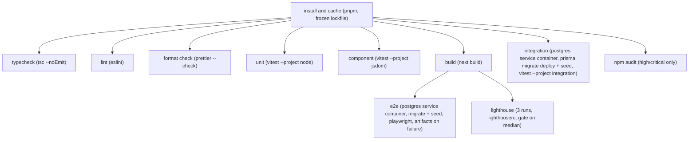

GitHub Actions service containers are job-scoped, not shareable across jobs, so "Prisma migrate
against a service container" is not its own job in the graph above — it is the first step of both
`integration` and `e2e`, each spinning its own throwaway Postgres 16 container and running
`prisma migrate deploy` + `prisma db seed` before its tests. `e2e` additionally depends on `build`
because `playwright.config.ts`'s `webServer` boots the production build, not `next dev`.

`playwright.config.ts`'s `globalSetup` also calls `POST /api/test/reset` once before any spec runs
(C24 A6(b)), and E3/E6 call it again in their own `beforeAll` (11.6) — see 11.2's determinism entry
for why a rate-limit/lockout reset is needed at all. The route this depends on is registered only
when `NODE_ENV !== "production"` AND `E2E_TEST_HOOKS === "true"` (A6(b)/A7); its absence from a
production build is itself asserted by 11.5's fifth integration case, and the registration guard's
own logic by the unit test in 11.3.2.

| Setting | Value |
|---|---|
| Concurrency | `group: ci-${{ github.ref }}`, `cancel-in-progress: true` — a force-push cancels the superseded run |
| Timeout (`typecheck`/`lint`/`format`/`unit`/`component`/`audit`) | 10 min |
| Timeout (`build`) | 15 min |
| Timeout (`integration`) | 15 min |
| Timeout (`e2e`) | 20 min, Playwright `retries: 1` in CI only |
| Timeout (`lighthouse`) | 10 min |
| Lighthouse sampling (C24 A10) | `numberOfRuns: 3`; gate asserts the **median** of the three per category, never a single run |
| Artifacts on `e2e` failure | Playwright HTML report + trace + screenshots, `actions/upload-artifact`, 7-day retention |

**Required to merge** (branch protection status checks): `typecheck`, `lint`, `format`, `unit`,
`component`, `build`, `integration`, `e2e`, `lighthouse`. `audit` is required but configured to fail
only on `high`/`critical` advisories — a low-severity transitive advisory with no fix available is
otherwise a permanently red, un-mergeable required check, which defeats the point of requiring it.

### 11.9 Test data and fixtures

`tests/fixtures/{services.ts, appointments.ts, admin-user.ts, clinic-settings.ts}` (Section 3) are
factory functions, not static JSON — each returns a fully valid object with sensible defaults,
overridable per field, so a test states only what it deviates from:

```ts
// tests/fixtures/appointments.ts
export function buildAppointment(overrides?: Partial<AppointmentFixture>): AppointmentFixture { /* defaults + overrides */ }
export function buildPendingHold(overrides?: Partial<AppointmentFixture>): AppointmentFixture {
  return buildAppointment({ status: "PENDING_VERIFICATION", holdExpiresAt: /* +holdTtlMin */ , ...overrides });
}
```

A composing helper, `seedScenario(db, { services?, workingHours?, closedDates?, appointments?,
adminUser?, clinicSettings? })`, writes exactly the rows a given integration/E2E spec declares and
nothing else — a double-booking test calls `seedScenario(db, { appointments: [buildAppointment({
startsAtUtc: T })] })` rather than inheriting the full ~60-row `prisma/seed.ts` dataset, so the
scenario's precondition is legible from the test file alone. E2E specs that need the full
dashboard-accuracy dataset (E4) instead run the real `prisma/seed.ts` directly, since that is the one
scenario where the standard seed's exact numbers (Section 9.11) *are* the fixture.

#### Contract Challenges

- **C23 pins production SLAs but is silent on a CI gate.** C23's four latency figures are stated as
  production p95 budgets with no mention of whether, or how, CI should enforce anything before
  merge. 11.7 introduces a separate, looser CI "smoke ceiling" to fill that gap; C23 should name this
  split explicitly so a future reader doesn't mistake the CI number for the SLA itself, or mistake
  the SLA's absence from CI for "untested."

---

## 12. Implementation Phases

This section sequences the build as ordered phases — Setup, Design System, Landing, Data and
API Foundations, Booking Flow, OTP, then (in the companion fragment) Admin Auth, Dashboard,
Calendar/Tables, Settings, Testing, Deploy. Phases run in order; within a phase, tasks run in
dependency order, not necessarily numeric order. This fragment covers Phases 1-6 — everything
needed to take an empty repository to a patient completing an OTP-verified booking on a styled,
statically-generated marketing site. Phases 7-12 (the admin surface, test suites beyond unit
coverage, and deploy) are a separate fragment.

### 12.0 How to read this section

**Task IDs.** `T<phase>.<index>`, e.g. `T1.1` is the first task of Phase 1, `T4.7` the seventh
task of Phase 4. IDs are stable identifiers, not a execution order within the phase — consult a
task's own `Dependencies` field for that.

**Complexity scale.** Every task is rated S, M, or L:
- **S** — up to about half a focused implementation session.
- **M** — about one full focused session.
- **L** — a long session. An L task should be split into smaller tasks wherever a natural seam
  exists (pure logic vs. DB-touching code, server vs. client, schema vs. migration-polish); it is
  kept whole only when no such seam exists. No task in Phases 1-6 is rated L — every candidate
  that would have been L is split below (see Phase 4's slot-engine split and Phase 5's
  action/component split, in particular).

**The repo-green rule.** Every task — not every phase, every task — ends with: `pnpm lint` clean,
`pnpm typecheck` clean (**assumption**: Section 3's `package.json` script list omits a
`typecheck` script despite `.github/workflows/ci.yml`'s own comment pinning a
`lint -> typecheck -> unit -> ...` pipeline; this plan adds `"typecheck": "tsc --noEmit"`, see
Contract Challenges), and `pnpm test` clean (`vitest run`, which already covers both the `node`
and `jsdom` Vitest projects — unit and component tests — in one command, per Section 3's
`vitest.config.ts` comment). `pnpm build` is additionally required at every **phase** exit and on
any task whose acceptance criteria say so (SSG pages, the Lighthouse gate); it is not re-run after
every single task because most tasks in Phases 1-2 touch no route the build would exercise
differently. A task is not done while any of these are red.

**Dependencies.** Listed as task IDs (`T2.4, T4.1`) or `none`. A dependency means "the file(s)
this task extends or imports from must already exist with the shape this task assumes" — it is
not a claim that the dependency's whole phase must be closed first, though in practice phases run
in order anyway. Dependencies are intra-fragment only; nothing in Phases 1-6 depends on Phases
7-12.

**Task block shape.** Every task below gives, in order: a one-line title, Description (1-3
sentences), Files touched (real paths from Section 3's canonical tree, or an explicitly flagged
addition), Dependencies, Acceptance criteria (2-5 objectively checkable bullets — a command that
passes, a specific rendered output, a test assertion — never "works correctly"), and Complexity.

Two placement decisions apply across every phase below and are stated once here rather than
repeated on each affected task:

- **`src/lib/money.ts`, `src/lib/dates.ts`, `src/lib/enums.ts` are built in Phase 2 (T2.5), not
  Phase 4.** All three are pure, Prisma-free TypeScript/Zod modules (Section 2.2 already groups
  them under `lib/` alongside `env.ts`/`clock.ts`, which Phase 1 builds). Phase 2's shared
  composites (`StatusBadge`, `MoneyDisplay`, and 08b's `DateTimeInClinicTz`) need the vocabulary
  these modules export before they can be more than markup, and nothing about them requires the
  Prisma schema to exist first. **Assumption**, stated here once rather than re-argued per task.
- **Phase 3 (Landing) needs a working database before Phase 4 ("Data and API Foundations")
  formally starts**, because the brief's phase order puts Landing's build-time Service read (C15)
  before the full-schema phase. Resolution: T3.2 pulls forward only the catalog/config slice of
  C5's schema (`Service`, `ClinicSettings`, `WorkingHour`, `ClosedDate`) into its own migration,
  enough for the landing build; T4.1-T4.3 add the remaining models (`Patient`, `Appointment`,
  `AppointmentSlot`, `OtpChallenge`, `AdminUser`, `AuditLog`) in later migrations. All nine models
  and every field/index/constraint still conform to C5 exactly — this only changes which
  migration a given `CREATE TABLE` lands in. **Assumption**, stated here once; see also Contract
  Challenges.

### 12.1 Phase 1 — Setup

**Goal.** An empty repository becomes a booting Next.js app with every tool the rest of the plan
depends on — strict TypeScript, linting with the three contract-mandated custom rules, a local
Postgres, Prisma pointed at it, the env/logger/clock seams, and a green CI pipeline — before any
feature code exists. Per the brief: the repository must boot and CI must be green before anything
else.

#### T1.1 Scaffold the Next.js application

**Description.** Create the Next.js 15 App Router project under `src/` with React 19 and
TypeScript 5.x `strict: true` + `noUncheckedIndexedAccess: true` (C2), pnpm as the package
manager, the `@/*` -> `src/*` path alias, and the baseline root config files Section 3 lists
outside any later task's remit.

**Files touched:** `package.json`, `tsconfig.json`, `next.config.mjs`, `.gitignore`,
`src/app/layout.tsx` (minimal shell), `src/app/page.tsx` (placeholder), `src/app/globals.css`
(Tailwind directives only — T2.1 fills in tokens), `README.md` (stub — T1.8 completes it).

**Dependencies:** none.

**Acceptance criteria:**
- `pnpm install && pnpm dev` boots on `localhost:3000` and renders the placeholder page with no
  console errors.
- `tsconfig.json`'s `compilerOptions` includes `"strict": true` and
  `"noUncheckedIndexedAccess": true`; `pnpm typecheck`-equivalent `tsc --noEmit` (wired properly
  in T1.6) passes against the placeholder files once that script exists.
- `.gitignore` excludes `node_modules`, `.next`, `.env*`, and `prisma/schema.sqlite.prisma`
  (the last one pre-emptively, per Section 3.1's generated-file note, even though that file
  doesn't exist until T4.3).
- `next.config.mjs` sets no `images.remotePatterns` (no external images are used, per Section 3)
  and leaves Server Actions on their default config.
- **Complexity:** M

#### T1.2 ESLint flat config + Prettier, with the three contract-mandated custom rules

**Description.** Add `eslint.config.mjs` (flat config) and Prettier with the Tailwind
class-sorting plugin, wiring the layering rule from Section 2.2 and the three custom
`no-restricted-*` rules the brief calls out: the Date/clock-seam ban (C22), the raw-`process.env`
ban (C16), and the local-time-construction ban (C6) — plus the argon2/Prisma-in-middleware import
ban (C11) and `@typescript-eslint/no-explicit-any: "error"`, enforcing the brief's own
Non-Functional Requirement that code quality means "no `any`" (Section 14.2's Definition of Done
restates this same rule; this task is where it is actually pinned).

**Files touched:** `eslint.config.mjs`, `.prettierrc.json`, `.prettierignore`, `package.json`
(`lint` script).

**Dependencies:** T1.1.

**Acceptance criteria:**
- `import/no-restricted-paths` zones match Section 2.2's block exactly (four zones: `lib/**` and
  `components/**` unreachable from `app/features/server`; `server/**` unreachable from
  `app/features`; `features/**` unreachable from `app`) — `pnpm lint` fails on a scratch file
  that imports `@/server/db` from `@/app/page.tsx`, and passes once that import is removed.
- A `no-restricted-syntax` rule flags `new Date()` / `Date.now()` anywhere under
  `src/server/**` or `src/features/**/actions.ts` outside `src/lib/clock.ts` itself (C22's exact
  scope — not a repo-wide ban); a scratch violation in `src/server/db.ts` fails `pnpm lint`.
- A separate `no-restricted-syntax` rule flags multi-argument `new Date(y, m, d, ...)`
  construction in server code (C6); a scratch violation fails `pnpm lint`.
- A `no-restricted-syntax` rule flags any `process.env` member access outside `src/lib/env.ts`
  (C16); a scratch violation fails `pnpm lint`.
- A `no-restricted-imports` rule flags `@node-rs/argon2` or `@prisma/client` imported from
  `src/middleware.ts` or `src/auth.config.ts` (C11); `pnpm lint` fails on the exact WRONG example
  from Section 2.5 (`import { auth } from "./auth"` inside `middleware.ts`).
- `@typescript-eslint/no-explicit-any` is set to `"error"` repo-wide; a scratch file under `src/`
  containing a bare `: any` type annotation fails `pnpm lint`, and passes once that annotation is
  replaced with a real type or `unknown` (brief NFR "no `any`", closing the gap Section 14.2 flags
  as an unpinned assumption).
- `pnpm lint` and `pnpm format:check` (or equivalent Prettier script) both pass clean on the
  current tree.
- **Complexity:** M

#### T1.3 Tailwind CSS + shadcn/ui initialization

**Description.** Install and initialize Tailwind CSS 3.4.x (`tailwind.config.ts`, NOT v4
CSS-first, per C2) and run the shadcn CLI's `init`, which generates `components.json` and
`src/lib/utils.ts` (the `cn()` class-merge helper). Design tokens themselves are T2.1/T2.2's job
— this task only gets the toolchain running.

**Files touched:** `tailwind.config.ts` (bare, pre-token), `postcss.config.mjs`,
`components.json`, `src/lib/utils.ts`.

**Dependencies:** T1.1.

**Acceptance criteria:**
- `components.json` sets aliases `@/components`, `@/lib`, `@/ui` and `css: "src/app/globals.css"`
  (Section 3).
- `src/lib/utils.ts` exports `cn(...)` built on `clsx` + `tailwind-merge`; a unit test asserts
  `cn("p-2", false && "p-4", "text-sm")` returns `"p-2 text-sm"`.
- `pnpm dlx shadcn@latest add button` (run once as a smoke test, then reverted or left as the
  first of T2.4's 22 files) succeeds with no CLI errors against this `components.json`.
- `pnpm build` succeeds with Tailwind processing `globals.css`'s directives.
- **Complexity:** S

#### T1.4 Vitest and Playwright configuration

**Description.** Add `vitest.config.ts` with two projects (`node` for `tests/unit/**`, `jsdom`
for `tests/component/**`) and `playwright.config.ts` (baseURL, `webServer` boot, chromium +
webkit projects, `tests/e2e/**`), both resolving the `@/*` alias. No specs exist yet in either
suite — Phase 11 (out of scope here) is the first to populate `tests/e2e/**` in depth, though
Phases 2-6 populate `tests/unit/**` and `tests/component/**` as they go.

**Files touched:** `vitest.config.ts`, `playwright.config.ts`, `package.json` (`test`, `test:e2e`
scripts).

**Dependencies:** T1.1.

**Acceptance criteria:**
- `pnpm test` runs successfully against zero spec files (exits 0, "no tests found" is not treated
  as a failure for either project).
- `pnpm test:e2e --list` resolves `playwright.config.ts` without error (no `webServer` boot
  needed for `--list`).
- Both configs resolve `@/lib/utils` to `src/lib/utils.ts` (one trivial import-smoke spec in each
  project, deleted once Phase 2 adds real specs, or left as a `*.smoke.test.ts` placeholder).
- **Complexity:** S

#### T1.5 Docker Compose Postgres + Prisma init

**Description.** Add `docker-compose.yml` with one `db` service (Postgres 16, per C3), and run
`prisma init` to create `prisma/schema.prisma` with the `postgresql` datasource (`DATABASE_URL`,
`directUrl = env("DIRECT_DATABASE_URL")`) and no models yet — the first model-bearing migration is
T3.2's job.

**Files touched:** `docker-compose.yml`, `prisma/schema.prisma` (datasource + generator block
only), `package.json` (`db:migrate`, `db:seed` script stubs).

**Dependencies:** T1.1.

**Acceptance criteria:**
- `docker compose up -d db` starts a Postgres 16 container reachable on the port
  `DATABASE_URL` (once T1.6 defines it) points at.
- `prisma/schema.prisma`'s `datasource db` block uses `provider = "postgresql"`,
  `url = env("DATABASE_URL")`, `directUrl = env("DIRECT_DATABASE_URL")` — no `@db.` native type
  attributes anywhere (C3).
- `pnpm prisma validate` passes against the empty (model-free) schema.
- `docker-compose.yml` declares no `redis`/cache service (C3's note: dev uses
  `MemoryRateLimiter`, no external dependency yet).
- **Complexity:** S

#### T1.6 Zod env module and `.env.example`

**Description.** Build `src/lib/env.ts`: Zod-parses `process.env` exactly once at module load
against the full C16 variable list, exporting a typed, frozen object; throws a readable startup
error (not a silent `undefined`) if any required var is missing or malformed. Add `.env.example`
documenting every C16 name with no values.

**Files touched:** `src/lib/env.ts`, `.env.example`, `tests/unit/lib/env.test.ts`.

**Dependencies:** T1.2 (the ESLint rule this file is the sanctioned exception to must already
exist so this task can prove compliance against it).

**Acceptance criteria:**
- `.env.example` lists exactly the C16 names (as amended by A7) — `DATABASE_URL`,
  `DIRECT_DATABASE_URL`, `AUTH_SECRET`, `AUTH_URL`, `NEXT_PUBLIC_SITE_URL`, `OTP_PEPPER`,
  `CRON_SECRET`, `SMS_PROVIDER`, `TWILIO_ACCOUNT_SID`, `TWILIO_AUTH_TOKEN`,
  `TWILIO_MESSAGING_SERVICE_SID`, `TWILIO_FROM_NUMBER`, `SMS_DAILY_CAP_MINOR`,
  `SMS_KILL_SWITCH`, `RATE_LIMIT_PROVIDER`, `UPSTASH_REDIS_REST_URL`,
  `UPSTASH_REDIS_REST_TOKEN`, `CLINIC_TIMEZONE`, `CLINIC_CURRENCY`, `CLINIC_DEFAULT_COUNTRY`,
  `SEED_ADMIN_EMAIL`, `SEED_ADMIN_PASSWORD`, `LOG_LEVEL`, `E2E_TEST_HOOKS` — no more, no fewer,
  no values (a test diffs the file's keys against a hardcoded literal array of these 24 names).
- `env.ts`'s schema rejects `SMS_PROVIDER` values other than `"console" | "twilio"` and
  `RATE_LIMIT_PROVIDER` values other than `"memory" | "upstash"` (unit test, both enums, both
  branches).
- Deleting a required var from a test `.env` and importing `env.ts` throws synchronously with a
  message naming the missing key, not a generic Zod dump (unit test).
- `pnpm lint` passes with zero `no-restricted-syntax` violations for the `process.env` rule,
  proving `env.ts` is correctly exempted while nothing else is.
- **Complexity:** S

#### T1.7 Logger and Clock seams

**Description.** Build `src/lib/logger.ts` (pino, redaction serializer per C19 — never logs
phone numbers, full names, OTP codes, passwords, session tokens, or booking references) and
`src/lib/clock.ts` (`interface Clock { now(): Date }`, `systemClock` for production, a
`FixedClock` test double, per C22).

**Files touched:** `src/lib/logger.ts`, `src/lib/clock.ts`, `tests/unit/lib/clock.test.ts` (added
here even though Section 3 doesn't name it individually; `tests/unit/lib/` already exists per
Section 3's tree for the five files T2.5/T5.1/T5.9 add — this task's clock test lands beside
them).

**Dependencies:** T1.6 (`LOG_LEVEL` from env.ts).

**Acceptance criteria:**
- `logger.ts`'s pino instance is configured with `level: env.LOG_LEVEL` and a `redact` serializer
  array covering `phoneE164`, `holdPhoneE164`, `fullName`, `holdFullName`, `code`, `passwordHash`,
  `sessionToken`, `reference` paths; a unit test logs an object containing a `phoneE164` field and
  asserts the captured output string never contains the raw value.
- `FixedClock` constructed with a fixed `Date` returns that exact instant from every `now()` call
  regardless of real wall-clock time elapsed between calls (unit test with two calls separated by
  a real `setTimeout`).
- `systemClock.now()` returns a `Date` within 50ms of `Date.now()` at call time (unit test, loose
  tolerance since this one file is the sanctioned exception to C22's ban).
- `pnpm test` passes including both new spec files.
- **Complexity:** S

#### T1.8 CI skeleton, PR template, and README quickstart

**Description.** Add `.github/workflows/ci.yml` running the pipeline stages that exist so far
(`lint`, `typecheck`, `unit`, `build`) in order, failing fast; add
`.github/pull_request_template.md` with the C19 PII-review checklist item; complete `README.md`'s
quickstart (`docker compose up -d db`, `pnpm install`, `pnpm db:migrate`, `pnpm db:seed`,
`pnpm dev`, per Section 3's own README comment — the migrate/seed steps become real once T3.2
exists, but the README documents the eventual full sequence now).

**Files touched:** `.github/workflows/ci.yml`, `.github/pull_request_template.md`, `README.md`.

**Dependencies:** T1.2, T1.4, T1.6.

**Acceptance criteria:**
- `ci.yml` runs `pnpm lint`, `pnpm typecheck`, `pnpm test`, `pnpm build` as separate steps, in
  that order, each gating the next (`continue-on-error` is never set).
- A pushed branch with one deliberately failing lint rule shows a red `lint` check and the
  pipeline does not proceed to `typecheck` (observed once on a scratch PR, then reverted).
- `pull_request_template.md` contains a checklist line matching "any new log line touching
  patient data reviewed for PII" (C19).
- `README.md`'s quickstart section lists the five commands above in that exact order and nothing
  else, runnable top-to-bottom on a clean checkout once T3.2's migration exists.
- **Complexity:** M

#### T1.9 Initiate Twilio account and A2P messaging registration (long-lead, non-blocking)

**Description.** Open the Twilio account and start carrier A2P registration now, since review
takes days to weeks that no engineering effort can compress (A11): 10DLC registration in the US
and Canada, or toll-free verification, or — only where the destination carrier permits it, which
excludes the US and Canada — an alphanumeric sender ID. Record which path was filed and the
carrier's expected approval date in a tracked location (e.g. an issue or a dated note in the repo
alongside this plan). This task has no code dependencies and blocks nothing else in development:
`SMS_PROVIDER=console` (T6.1) covers every dev and test send until the registration clears, and
only Phase 12's provider switch-over to `TwilioProvider` in production depends on this task's
completion.

**Files touched:** none (a tracking issue/note, not application code).

**Dependencies:** none.

**Acceptance criteria:**
- The Twilio account exists and one of the three A2P paths (10DLC, toll-free verification, or —
  outside the US/Canada only — an alphanumeric sender ID) has been filed for review.
- The expected carrier approval date is recorded somewhere durable and linkable (issue tracker,
  dated repo note).
- A code comment or doc note states explicitly that this task blocks no other task in Phases 1-11
  and is calendar-time, not engineer-time, work.
- **Complexity:** S

#### Phase 1 exit criteria
- `pnpm install && docker compose up -d db && pnpm dev` boots the app from a clean checkout.
- `pnpm lint`, `pnpm typecheck`, `pnpm test`, `pnpm build` all pass locally and in CI.
- `eslint.config.mjs` enforces all four custom rules (layering, clock-seam, env-seam,
  local-time-construction) plus the middleware-import ban and `@typescript-eslint/no-explicit-any`;
  each has a reverted scratch-violation commit as proof during review, not just an assertion in
  this plan.
- `src/lib/env.ts`, `src/lib/clock.ts`, `src/lib/logger.ts` exist, are unit-tested, and are the
  only files exempted from their respective lint bans.

### 12.2 Phase 2 — Design System

**Goal.** Every visual primitive the rest of the app will compose — color tokens, type, the
vendored shadcn kit, and the shared composites from Section 8.2 that don't require booking/admin
domain logic — exists, is type-checked, and is proven accessible (contrast audit) before any
feature screen is built.

#### T2.1 `globals.css` design tokens (light + dark)

**Description.** Define the canonical token vocabulary (C18, A8) as an HSL-channel CSS variable
under `:root` and under `.dark`, computed precisely from Section 8.3.2's pinned values — both the
light hexes (C18: "token values are EXACTLY the brief's hexes") and the dark-mode values, which
Section 8.3.2 pins explicitly rather than leaving to this plan's own derivation. The canonical set
is exactly 30 names, no more and no fewer (A8); three brief colors expand into named pairs no
single brief hex covers alone — `--card`/`--popover` (both the brief's one "Surface" hex),
`--primary`/`--primary-button` (brand teal versus the distinct, slightly darker button-fill shade
C18 already requires), and five `--chart-*` series tokens (two reuse `--primary`/`--secondary`,
three are net-new or reused status hues) — plus a `*-foreground` pairing for every surface/brand/
status token ever used as a text or icon color on top of it.

| Token | Light HSL | Dark HSL |
|---|---|---|
| `--background` | `210 40% 98%` (#F8FAFC) | `222 47% 11%` (#0F172A) |
| `--foreground` | `222 47% 11%` (#0F172A) | `210 40% 96%` (#F1F5F9) |
| `--card` | `0 0% 100%` (#FFFFFF) | `217 33% 17%` (#1E293B) |
| `--card-foreground` | `222 47% 11%` (#0F172A) | `210 40% 96%` (#F1F5F9) |
| `--popover` | `0 0% 100%` (#FFFFFF) | `217 33% 17%` (#1E293B) |
| `--popover-foreground` | `222 47% 11%` (#0F172A) | `210 40% 96%` (#F1F5F9) |
| `--primary` | `175 84% 32%` (#0D9488) | `172 66% 50%` (#2DD4BF) |
| `--primary-foreground` | `0 0% 100%` (#FFFFFF) | `222 47% 11%` (#0F172A) |
| `--primary-button` | `175 77% 26%` (#0F766E) | `172 66% 50%` (#2DD4BF) |
| `--primary-button-hover` | `176 69% 22%` (#115E59) | `173 60% 44%` (#26B8A5) |
| `--secondary` | `243 75% 59%` (#4F46E5) | `234 89% 74%` (#818CF8) |
| `--secondary-foreground` | `0 0% 100%` (#FFFFFF) | `222 47% 11%` (#0F172A) |
| `--accent` | `4 92% 69%` (#F97066) | `4 92% 69%` (unchanged) |
| `--accent-foreground` | `222 47% 11%` (#0F172A) | `222 47% 11%` (unchanged) |
| `--muted` | `214 32% 91%` (#E2E8F0) | `215 25% 27%` (#334155) |
| `--muted-foreground` | `215 19% 35%` (#475569) | `215 20% 65%` (#94A3B8) |
| `--border` | `214 32% 91%` (#E2E8F0) | `215 25% 27%` (#334155) |
| `--input` | `214 32% 91%` (#E2E8F0) | `215 25% 27%` (#334155) |
| `--ring` | `175 84% 32%` (= `--primary`) | `172 66% 50%` (= `--primary`) |
| `--destructive` | `0 72% 51%` (#DC2626) | `0 91% 71%` (#F87171) |
| `--destructive-foreground` | `0 0% 100%` (#FFFFFF) | `222 47% 11%` (#0F172A) |
| `--success` | `142 76% 36%` (#16A34A) | `142 69% 58%` (#4ADE80) |
| `--warning` | `38 92% 50%` (#F59E0B) | `43 96% 56%` (#FBBF24) |
| `--info` | `199 89% 48%` (#0EA5E9) | `198 93% 60%` (#38BDF8) |
| `--chart-1` | `175 84% 32%` (= `--primary`) | `172 66% 50%` (= `--primary`) |
| `--chart-2` | `243 75% 59%` (= `--secondary`) | `234 89% 74%` (= `--secondary`) |
| `--chart-3` | `26 90% 37%` (#B45309) | `43 96% 56%` (= `--warning`) |
| `--chart-4` | `201 96% 32%` (#0369A1) | `198 93% 60%` (= `--info`) |
| `--chart-5` | `295 72% 40%` (#A21CAF) | `292 91% 73%` (#E879F9) |

None of the banned aliases `--primary-hover`, `--primary-hover-dark`, `--surface`, `--danger`
(C18, A8) may appear anywhere in `globals.css`.

Also sets `--radius: 1rem` (C18) once, under `:root` only — not redeclared under `.dark`, since
`.dark` is a class applied to the same `<html>` element `:root` matches, and a custom property one
matching rule doesn't set is simply not overridden by that rule; the value set under `:root` keeps
resolving in dark mode too, exactly as Section 8.3.2's own `globals.css` does it.

**Files touched:** `src/app/globals.css`.

**Dependencies:** T1.3.

**Acceptance criteria:**
- Every one of the 30 canonical tokens above exists as a CSS variable under `:root`, and every
  one of the 29 color tokens (all but `--radius`) is redeclared under `.dark` with its dark-mode
  value from the table — a test (or a documented manual check, since this is pure CSS) greps
  `globals.css` for all 30 `--`-prefixed names and confirms zero occurrences of
  `--primary-hover`, `--primary-hover-dark`, `--surface`, or `--danger` anywhere in the file (A8).
- A browser devtools check (`getComputedStyle(document.documentElement).getPropertyValue(...)`)
  for every one of the 30 tokens resolves to a non-empty value both with and without a
  `class="dark"` attribute on `<html>` (manual check, documented in a code comment) — this is the
  exact precondition Phase 8's `hsl(var(--chart-1))` chart tasks depend on (A8's rationale).
- `pnpm build` succeeds with Tailwind processing the full token block.
- Toggling a `class="dark"` attribute on `<html>` in a browser devtools inspector (manual check,
  documented in a code comment) visibly swaps background/foreground without a page reload.
- **Complexity:** S

#### T2.2 `tailwind.config.ts` token mapping

**Description.** Map every T2.1 token into `theme.extend.colors` following Section 8.3.3's exact
structure — nested `{ DEFAULT, foreground }` objects for `card`, `popover`, `secondary`, `accent`,
`muted`, `destructive`; a nested `primary` object additionally carrying `button`/`button-hover`
keys; a nested `chart` object with keys `1`-`5`; and flat entries for `background`, `foreground`,
`border`, `input`, `ring`, `success`, `warning`, `info` — every leaf using
`"hsl(var(--token) / <alpha-value>)"` (shadcn convention). Set `darkMode: "class"` (C18), and set
`borderRadius` to derive from `--radius` (`rounded-2xl` for cards, `rounded-xl` for
inputs/buttons, per C18 — expressed as the default radius scale, not new tokens).

**Files touched:** `tailwind.config.ts`.

**Dependencies:** T2.1.

**Acceptance criteria:**
- `tailwind.config.ts` sets `darkMode: "class"`.
- `theme.extend.colors` resolves every one of T2.1's 30 canonical tokens — the six nested
  `{ DEFAULT, foreground }` groups (`card`, `popover`, `secondary`, `accent`, `muted`,
  `destructive`), `primary`'s nested `DEFAULT`/`button`/`button-hover`/`foreground` keys, the
  nested `chart.{1,2,3,4,5}` group, and the eight flat entries — each leaf using the
  `hsl(var(--x) / <alpha-value>)` pattern (Section 8.3.3) — grep confirms exactly 30
  `var(--...)` references, one per canonical token, and zero occurrences of any banned alias
  (A8).
- A scratch component using `bg-primary text-foreground border-border` builds and resolves to the
  expected computed colors in a browser devtools inspection (manual check).
- A code comment documents the C18 "8px spacing grid, restricted to multiples of 2" convention
  (Tailwind's default spacing scale is 4px-based, so "multiples of 2" means only even-numbered
  utilities — `p-2`, `p-4`, `p-6`... — are used in app code; this is a documented review
  convention, not an automatically-lint-enforced one, since no Tailwind-classname linter is
  otherwise introduced in this plan).
- `pnpm build` succeeds.
- **Complexity:** S

#### T2.3 `next/font` self-hosted type

**Description.** Wire `next/font/google` in `src/app/layout.tsx`: Inter as `--font-sans`, Plus
Jakarta Sans as `--font-display`, both `display: "swap"` (C18), applied as CSS variables on
`<html>` or `<body>`.

**Files touched:** `src/app/layout.tsx`.

**Dependencies:** T2.2.

**Acceptance criteria:**
- `layout.tsx` imports both fonts from `next/font/google` with `display: "swap"` and exposes
  `--font-sans` / `--font-display` CSS variables on the root element.
- `pnpm build` output contains zero requests to `fonts.googleapis.com` at runtime (self-hosted —
  `grep -r "fonts.googleapis" .next/static` after a build returns nothing).
- `tailwind.config.ts`'s `fontFamily.sans`/`fontFamily.display` reference the two CSS variables.
- **Complexity:** S

#### T2.4 shadcn primitive vendoring (closed list of 22)

**Description.** Vendor exactly the 22 shadcn primitives Section 3 names via the shadcn CLI:
`button`, `input`, `label`, `select`, `calendar`, `dialog`, `sheet`, `dropdown-menu`, `table`,
`tabs`, `badge`, `card`, `form`, `sonner`, `skeleton`, `separator`, `popover`, `alert`,
`checkbox`, `pagination`, `tooltip`, `command`. No `toast.tsx` (superseded by `sonner`), no
`accordion.tsx` (FAQ uses native `<details>`/`<summary>`), no `radio-group.tsx` (Section 3: "no
genuine use").

**Files touched:** `src/components/ui/button.tsx`, `input.tsx`, `label.tsx`, `select.tsx`,
`calendar.tsx`, `dialog.tsx`, `sheet.tsx`, `dropdown-menu.tsx`, `table.tsx`, `tabs.tsx`,
`badge.tsx`, `card.tsx`, `form.tsx`, `sonner.tsx`, `skeleton.tsx`, `separator.tsx`, `popover.tsx`,
`alert.tsx`, `checkbox.tsx`, `pagination.tsx`, `tooltip.tsx`, `command.tsx`.

**Dependencies:** T1.3, T2.2.

**Acceptance criteria:**
- All 22 files exist at `src/components/ui/` and no others do — `ls src/components/ui | wc -l`
  returns `22`.
- `pnpm typecheck` passes.
- `button.tsx`, `badge.tsx`, and `alert.tsx` each define a `cva(...)` variants object (component
  convention, Section 8.2.13) — grep returns exactly 3 hits across the directory for `cva(`.
- A scratch page importing all 22 named exports builds with no missing-export errors, then is
  deleted.
- **Complexity:** S

#### T2.5 `lib/money.ts`, `lib/dates.ts`, `lib/enums.ts`

**Description.** Build the three pure vocabulary/formatting modules Section 2.2 groups under
`lib/`, pulled forward from their "natural" Phase 4 home per this section's stated assumption
(12.0): `money.ts` (`formatMoney(minor, currency, locale)`, exponent from
`Intl.NumberFormat().resolvedOptions().maximumFractionDigits`, never a hardcoded `/100`, C7);
`dates.ts` (boundary wrappers around `fromZonedTime`/`toZonedTime`/`formatInTimeZone` from
`date-fns-tz`, C6); `enums.ts` (`AppointmentStatus`/`BookingSource`/`AdminRole`/`AuditAction` as
const objects plus matching Zod unions, C4).

**Files touched:** `src/lib/money.ts`, `src/lib/dates.ts`, `src/lib/enums.ts`,
`tests/unit/lib/money.test.ts`, `tests/unit/lib/dates.test.ts`, `tests/unit/lib/enums.test.ts`.

**Dependencies:** none (pure, Prisma-free).

**Acceptance criteria:**
- `formatMoney(5000, "EUR", "en-GB")` returns `"€50.00"`; `formatMoney(500, "JPY", "ja-JP")`
  returns a 0-decimal yen string (two unit test cases, asserting the exponent is read from
  `Intl`, not hardcoded, by also testing a 3-decimal currency like `JOD`).
- `enums.ts` exports all four C4 const objects and their Zod unions; `z.infer` of each union
  equals the literal string-union type (a `tests/unit/lib/enums.test.ts` case using
  `expectTypeOf` or a runtime array-equality check against C4's literal lists).
- `dates.ts` exports `fromZonedTime`, `toZonedTime`, `formatInTimeZone` as its only re-exports —
  grep confirms no other file in the repo imports `date-fns-tz` directly (the rule this module
  exists to enforce, verified once more files exist in later phases).
- `pnpm test` passes including all three new spec files.
- **Complexity:** S

#### T2.6 Shared composites, part 1 — PageHeader, EmptyState, StatusBadge, MoneyDisplay

**Description.** Build four of Section 8.2.2's shared composites: `PageHeader` (title + optional
actions slot), `EmptyState` (icon + message + optional action), `StatusBadge`
(`AppointmentStatus` -> color + icon + text, never color alone — C4, WCAG 1.4.1), `MoneyDisplay`
(thin wrapper around `formatMoney`). All four are Server Components by default (Section 8.2.13).

**Files touched:** `src/components/page-header.tsx`, `src/components/empty-state.tsx`,
`src/components/status-badge.tsx`, `src/components/money-display.tsx`.

**Dependencies:** T2.4 (`ui/badge`, `ui/card`), T2.5 (`enums.ts` for `StatusBadge`, `money.ts` for
`MoneyDisplay`).

**Acceptance criteria:**
- `StatusBadge` renders a distinct icon + text label for each of the 5 `AppointmentStatus`
  values; a component test asserts the rendered text content differs for all 5 (never relying on
  color alone, per C4/WCAG 1.4.1).
- `MoneyDisplay` given `{ minor: 5000, currency: "EUR" }` renders text containing `"€50.00"`
  (component test).
- None of the four files contain a `"use client"` directive (grep confirms).
- `pnpm typecheck` and `pnpm test` pass.
- **Complexity:** S

#### T2.7a Shared composites, part 2a — ConfirmDialog, DataTablePagination, DateRangePicker

**Description.** Build the three straightforward primitive-wrapper composites from Section 3's
11-file budget: `ConfirmDialog` (generic "are you sure?" over `ui/dialog`, one focus-trap +
pending-state + destructive-styling pattern reused by every "are you sure" dialog, 8.2.12),
`DataTablePagination` (wraps `ui/pagination`), `DateRangePicker` (`ui/popover` + `ui/calendar`
range picker, presentation-only — the caller owns the URL-sync wrapper, 8.2.12). Each is a
controlled component with no component-owned test-harness complexity beyond a standard
render/interact/assert cycle, unlike T2.7b's three.

**Files touched:** `src/components/confirm-dialog.tsx`, `src/components/data-table-pagination.tsx`,
`src/components/date-range-picker.tsx`.

**Dependencies:** T2.4 (`ui/dialog`, `ui/pagination`, `ui/popover`, `ui/calendar`).

**Acceptance criteria:**
- `ConfirmDialog` returns focus to its trigger element after closing, whether confirmed or
  cancelled (component test asserting `document.activeElement` post-close).
- `DataTablePagination` renders page/next/prev controls driven entirely by props (`page`,
  `pageCount`, `onPageChange`) with no internal state of its own (component test; grep confirms no
  `useState` call in the file).
- `DateRangePicker` calls `onChange({ from, to })` once a full range is selected and never mutates
  its `value` prop in place (component test).
- `pnpm typecheck` and `pnpm test` pass.
- **Complexity:** S

#### T2.7b Shared composites, part 2b — DateTimeInClinicTz, CopyButton, CountdownTimer (08b-sourced additions)

**Description.** Build the three components named only in Section 8.2's own stated additions
(**assumption, inherited from that fragment**: `DateTimeInClinicTz`, `CopyButton`,
`CountdownTimer` — extending the 11-file shared-composite budget to 14, per 8.2.12's own note).
Split out from T2.7a because each needs a meaningfully distinct, non-trivial test harness —
`CountdownTimer` needs `vi.useFakeTimers()`, `CopyButton` needs a mocked-absent
`navigator.clipboard` plus an `aria-live` assertion, `DateTimeInClinicTz` needs a `dates.ts`
boundary-call assertion — making this closer to its own session than a tail end of T2.7a's.

**Files touched:** `src/components/date-time.tsx`, `src/components/copy-button.tsx`,
`src/components/countdown-timer.tsx`.

**Dependencies:** T2.5 (`dates.ts` for `DateTimeInClinicTz`).

**Acceptance criteria:**
- `CopyButton` degrades without throwing when `navigator.clipboard` is undefined, and announces
  its state change via `aria-live` (component test mocking the API's absence).
- `CountdownTimer` renders `mm:ss` and decrements on a fake-timer tick (component test using
  `vi.useFakeTimers()`).
- `DateTimeInClinicTz` calls `formatInTimeZone` (from T2.5's `dates.ts`) exactly once per render —
  no inline `date-fns-tz` import of its own (grep).
- `pnpm typecheck` and `pnpm test` pass.
- **Complexity:** M

#### T2.8 SiteHeader, SiteFooter, ThemeToggle, AppLogo

**Description.** Build the four remaining Section 3 shared composites that are specifically
chrome, not data display: `SiteHeader` (public nav: `/`, `/privacy`, `/terms`, `/book`),
`SiteFooter` (contact info + hours summary — the brief's Footer landing section, built shared
because `/privacy` and `/terms` reuse it too), `ThemeToggle` (dark-mode switch, C18
nice-to-have), `AppLogo`.

**Files touched:** `src/components/site-header.tsx`, `src/components/site-footer.tsx`,
`src/components/theme-toggle.tsx`, `src/components/app-logo.tsx`.

**Dependencies:** T2.4, T2.2 (dark-mode class strategy).

**Acceptance criteria:**
- `SiteHeader` renders exactly 4 nav anchors with `href` values `/`, `/privacy`, `/terms`, `/book`
  (component test).
- `ThemeToggle` toggles `class="dark"` on `document.documentElement` on click and persists the
  choice to `localStorage` wrapped in `try`/`catch` (component test for the toggle; a second test
  forces `localStorage.setItem` to throw and asserts no uncaught error).
- `ThemeToggle`'s icon-swap transition is wrapped in a `@media (prefers-reduced-motion: reduce)`
  guard and never removes the element's focus ring (grep `globals.css`/the component's class
  list for the media query; manual keyboard-tab check that a visible outline remains).
- `pnpm typecheck` and `pnpm test` pass.
- **Complexity:** S

#### T2.9 Contrast audit artifact + `/dev/tokens` style guide page

**Description.** Record a committed contrast audit covering every pair C18 calls out, and build
a `/dev/tokens` page rendering every token swatch (both themes) and all 22 shadcn primitives'
default states, excluded from production builds. **Assumption**: neither the audit file's path
nor the style-guide route exists in Section 3's tree; this plan adds
`docs/accessibility/contrast-audit.md` and `src/app/dev/tokens/page.tsx` as new, explicitly
flagged files — noted as an assumption, not a Contract Challenge, since nothing in Section 3
forbids additive files, it simply doesn't name these two.

**Files touched:** `docs/accessibility/contrast-audit.md`, `src/app/dev/tokens/page.tsx`,
`src/lib/env.ts` (extend: export a `isProduction` boolean computed from `process.env.NODE_ENV` —
`NODE_ENV` is a framework builtin, not a C16-pinned var needing `.env.example` documentation, but
reading it still goes through the one file C16 allows to touch `process.env`, so it is added here
rather than read raw in the page).

**Dependencies:** T2.1 through T2.8 (audits/renders everything they produced).

**Acceptance criteria:**
- `docs/accessibility/contrast-audit.md` records a measured ratio for every pair C18 names
  (white-on-`#0D9488`, white-on-`#0F766E`, `#0F172A`-on-coral, muted-text-on-background, each
  status color's icon+text pairing) with every normal-text pair >= 4.5:1 and every
  large-text/non-text pair >= 3:1 — including the explicit note that white-on-`#0D9488` measures
  ~3.4:1 and FAILS, which is why `#0F766E` is the button fill, not `#0D9488` (C18).
- `/dev/tokens` renders all 14 color swatches in both themes and all 22 `ui/` primitives'
  default states on one page.
- `pnpm build && pnpm start`, then `curl -s -o /dev/null -w "%{http_code}" localhost:3000/dev/tokens`
  with `NODE_ENV=production` returns `404`.
- `/dev/tokens` is absent from `sitemap.ts`'s output and listed under `Disallow` in `robots.ts`
  once those exist (T3.7 — forward reference, re-verified there).
- **Complexity:** M

#### Phase 2 exit criteria
- `pnpm build` succeeds with the full token set, both fonts self-hosted, and all 22 shadcn
  primitives plus all 14 shared composites type-checking and smoke-tested.
- `/dev/tokens` renders every token and primitive in dev and 404s in a production build.
- `docs/accessibility/contrast-audit.md` is committed with every C18-named pair passing its WCAG
  threshold.
- `pnpm lint`, `pnpm typecheck`, `pnpm test`, `pnpm build` all green.

### 12.3 Phase 3 — Landing

**Goal.** The public marketing site at `/` (plus `/privacy`, `/terms`) is fully built as a
statically-generated page with build-time data, every section server-rendered in brief order,
and passes a hard Lighthouse gate of a >=95 median (3 runs, A10) in all four categories before
this phase can close.

#### T3.1 `src/content/site.ts`

**Description.** Build the single static-content config: hero copy, "How It Works" steps,
testimonials, doctor bios, FAQ entries, footer contact strings. Services and prices are
explicitly NOT here — they come from the database (T3.2's seed), per Section 3's own comment on
this file.

**Files touched:** `src/content/site.ts`.

**Dependencies:** T1.1.

**Acceptance criteria:**
- Exports one typed `siteContent` object covering: hero headline/subhead/CTA label, exactly 3
  "How It Works" steps, >= 3 testimonials, >= 3 doctor bios, >= 5 FAQ entries, footer contact
  strings — a unit test (`tests/unit/lib` is the closest existing home; this plan adds
  `tests/unit/content/site.test.ts`) asserts each array's minimum length.
- `pnpm typecheck` passes with zero `any` in the file.
- A code comment states explicitly that Services/prices are read from the database, not this
  file.
- **Complexity:** S

#### T3.2 Catalog/config schema slice, first migration, `server/db.ts`, partial seed

**Description.** Add the four catalog/config models from C5 — `Service`, `ClinicSettings`,
`WorkingHour`, `ClosedDate` — to `prisma/schema.prisma` with their exact C5 fields and indexes,
generate and apply the first migration, add the Prisma Client singleton, and seed only these four
tables (per the 12.0 assumption: this is a deliberate early slice, not the full schema — T4.1-T4.3
add the rest in later migrations).

**Files touched:** `prisma/schema.prisma` (four models), `prisma/migrations/<ts>_catalog_init/migration.sql`,
`src/server/db.ts`, `prisma/seed.ts` (partial: `ClinicSettings` singleton + `WorkingHour` rows +
`ClosedDate` rows + `Service` rows only — no `AdminUser`/`Appointment`/etc. yet).

**Dependencies:** T1.5.

**Acceptance criteria:**
- `Service` has exactly C5's fields (`id`, `slug` unique, `name`, `description`, `durationMin`,
  `priceMinor`, `isActive` default `true`, `sortOrder`, `colorHex`, `createdAt`, `updatedAt`,
  `appointments` relation); `ClinicSettings` has `id` defaulting to `"singleton"` plus all 13
  remaining C5 fields with their exact defaults (`slotIntervalMin` 15, `bufferMin` 0,
  `minLeadTimeMin` 120, `maxAdvanceDays` 60, `holdTtlMin` 10); `WorkingHour` has
  `@@unique([weekday, openMinute])`; `ClosedDate` has `date` as `String @unique`, not `DateTime`
  (C5's deliberate off-by-one-day-avoidance choice) — `pnpm prisma validate` plus a schema-diff
  review against C5 confirms all four.
- `pnpm prisma migrate dev --name catalog_init` applies cleanly against a freshly started
  `docker compose up -d db`.
- `pnpm prisma db seed` inserts: 1 `ClinicSettings` row (`id = "singleton"`), the Mon-Fri +
  Saturday-split-shift + Sunday-closed `WorkingHour` rows, 3 `ClosedDate` rows, and the 7 seeded
  `Service` rows (Section 4.6) — zero rows in any as-yet-undefined table.
- Re-running `pnpm prisma db seed` is idempotent (identical row counts on a second run).
- `src/server/db.ts` exports a `PrismaClient` singleton cached on `globalThis` across HMR reloads
  (Section 3) — a dev-mode double-import does not open a second connection (manual check: log
  Prisma's connection count across two hot reloads).
- **Complexity:** M

#### T3.3 Hero + Services sections, landing queries

**Description.** Build `HeroSection` and `ServicesSection` as ordered Server Components, plus
`features/landing/queries.ts`'s `getActiveServicesForLanding()` — the one build-time Prisma read
(C15) — and `types.ts`. Wire both sections into `src/app/page.tsx` in brief order (Hero first).

**Files touched:** `src/features/landing/queries.ts`, `src/features/landing/types.ts`,
`src/features/landing/components/hero-section.tsx`,
`src/features/landing/components/services-section.tsx`, `src/app/page.tsx`.

**Dependencies:** T3.1, T3.2, T2.6 (`MoneyDisplay`).

**Acceptance criteria:**
- `getActiveServicesForLanding()` queries `Service` `WHERE isActive = true ORDER BY sortOrder`,
  called from exactly one call site (`services-section.tsx`) — grep confirms no second caller.
- `ServicesSection` renders all 7 seeded services, each with its price via `MoneyDisplay`.
- `HeroSection` renders a `<a href="/book">` CTA.
- Neither component carries a `"use client"` directive (grep).
- `pnpm build` embeds the services list as static HTML with no client-side fetch for this section
  (view-source on the built output).
- **Complexity:** S

#### T3.4 About, How It Works, Testimonials sections

**Description.** Build `AboutSection` (doctors from `site.ts`), `HowItWorksSection` (3 numbered
steps), `TestimonialsSection` (all testimonials from `site.ts`) as ordered Server Components,
wired into `page.tsx` immediately after Services.

**Files touched:** `src/features/landing/components/about-section.tsx`,
`src/features/landing/components/how-it-works-section.tsx`,
`src/features/landing/components/testimonials-section.tsx`, `src/app/page.tsx`.

**Dependencies:** T3.1.

**Acceptance criteria:**
- `AboutSection` renders every doctor bio from `siteContent`; `HowItWorksSection` renders exactly
  3 steps; `TestimonialsSection` renders every testimonial — three component tests, one per
  section, each asserting the exact count.
- Every ``/`next/image` usage across the three sections sets explicit `width`/`height`
  (CLS 0, C23) — grep confirms no image tag lacks both attributes.
- None of the three carry `"use client"`.
- **Complexity:** S

#### T3.5 Hours/Location + FAQ sections

**Description.** Build `HoursLocationSection` (reads `ClinicSettings` + `WorkingHour` via a new
landing query, renders per-weekday open/close in clinic-local wall time) and `FaqSection`
(renders every FAQ entry from `site.ts` as native `<details>`/`<summary>`, zero client JS), wired
into `page.tsx` in brief order.

**Files touched:** `src/features/landing/queries.ts` (extend: `getClinicHoursForLanding()`),
`src/features/landing/components/hours-location-section.tsx`,
`src/features/landing/components/faq-section.tsx`, `src/app/page.tsx`.

**Dependencies:** T3.1, T3.2.

**Acceptance criteria:**
- `HoursLocationSection` renders all 7 weekdays' hours (or "Closed") derived from the seeded
  `WorkingHour` rows, formatted in `ClinicSettings.timeZone` wall time (component/integration
  test against the seeded test DB).
- `FaqSection` renders every FAQ entry as a native `<details>`/`<summary>` pair — grep confirms
  zero `"use client"` directive and no `ui/accordion` import anywhere in the file.
- Each `<summary>` is natively keyboard-focusable and togglable with the Enter/Space keys with no
  custom JS attached (manual accessibility check, documented in a code comment).
- **Complexity:** S

#### T3.6 Privacy and Terms pages

**Description.** Build the two static legal pages Section 3's tree names: `/privacy` (states the
C20 retention policy in prose) and `/terms` (service terms). **Assumption**: the brief gives no
specific Terms content; this plan uses generic boilerplate (service terms, no medical-advice
disclaimer, a cancellation-policy line referencing the booking hold) since nothing more specific
is pinned anywhere in scope.

**Files touched:** `src/app/privacy/page.tsx`, `src/app/terms/page.tsx`.

**Dependencies:** T2.8 (`SiteHeader`/`SiteFooter` reused on both).

**Acceptance criteria:**
- `/privacy`'s rendered text states, in plain language and matching C20's actual numbers:
  appointments older than 24 months are anonymized (not deleted) with revenue history retained;
  patients with no appointment in 24 months are hard-deleted; OTP codes are deleted within 24
  hours of use or expiry — a component test asserts the rendered page text contains the strings
  `"24 months"` and `"24 hours"`.
- Both pages are plain Server Components (no `"use client"`), reuse `SiteHeader`/`SiteFooter`.
- `pnpm build` renders both as static HTML (SSG, no `dynamic` export).
- **Complexity:** S

#### T3.7 Metadata, OG image, sitemap, robots

**Description.** Add page-level `metadata` exports (title/description) across `/`, `/privacy`,
`/terms`, `/book`; `src/app/opengraph-image.tsx` (generated OG image for `/`); `sitemap.ts`
(`/`, `/privacy`, `/terms`, `/book` only); `robots.ts` (disallow `/admin`, `/book/success`,
`/api`, `/dev`).

**Files touched:** `src/app/opengraph-image.tsx`, `src/app/sitemap.ts`, `src/app/robots.ts`,
`src/app/page.tsx`, `src/app/privacy/page.tsx`, `src/app/terms/page.tsx`, `src/app/book/page.tsx`
(metadata exports on each — `book/page.tsx` itself is a thin shell at this point, fully built in
Phase 5).

**Dependencies:** T3.3, T3.4, T3.5, T3.6.

**Acceptance criteria:**
- `sitemap.ts`'s output contains exactly `/`, `/privacy`, `/terms`, `/book` — a unit test calling
  the exported function asserts the 4-entry array.
- `robots.ts`'s output disallows `/admin`, `/book/success`, `/api`, and `/dev` — unit test.
- `/book/success/[reference]` and `/dev/tokens` set `robots: { index: false }` in their own
  metadata (forward-checked here against T2.9's and T5.9's pages once those exist).
- `opengraph-image.tsx` renders a 1200x630 image for `/`; `curl` against the built route returns
  `Content-Type: image/png` (or `svg`, depending on implementation).
- **Complexity:** S

#### T3.8 Image optimization pass

**Description.** Audit every image across the landing sections (hero, doctor headshots) for
`next/image` usage with explicit dimensions and the correct `priority`/`sizes` configuration —
the hero image (LCP element, C23) gets `priority`; doctor images do not.

**Files touched:** `src/features/landing/components/hero-section.tsx`,
`src/features/landing/components/about-section.tsx`, `public/images/hero.jpg`,
`public/images/doctors/*.jpg`.

**Dependencies:** T3.3, T3.4.

**Acceptance criteria:**
- The hero `next/image` sets `priority` and explicit `width`/`height`; doctor images set explicit
  `width`/`height` but not `priority` — grep confirms exactly one `priority` prop in the whole
  `landing/components` directory.
- A Lighthouse run (ad hoc, ahead of T3.9's formal gate) shows `0` layout-shift-causing image
  elements and the hero image as the LCP candidate.
- No image exceeds 200KB after Next's optimization pipeline (checked via `next build`'s output
  size report or a manual `curl -I` content-length check against the built `/_next/image` route).
- **Complexity:** S

#### T3.9 Lighthouse CI gate (>= 95, all four categories)

**Description.** Add `lighthouserc.json` asserting Performance, Accessibility, Best Practices,
and SEO each >= 95 against the built `/` route (C23), configured with `numberOfRuns: 3` and
asserting the MEDIAN score per category rather than a single run (A10, since a single-run gate
fails unrelated PRs on Lighthouse's documented run-to-run jitter and trains engineers to re-run CI
until green), and wire it as a `ci.yml` stage. This is a hard acceptance criterion in its own
right, not a nice-to-have: the phase does not close if any category's median is below 95.

**Files touched:** `lighthouserc.json`, `.github/workflows/ci.yml` (add `lighthouse` stage after
`build`).

**Dependencies:** T3.3, T3.4, T3.5, T3.6, T3.7, T3.8.

**Acceptance criteria:**
- `lighthouserc.json` sets `numberOfRuns: 3` and asserts against the median, not the first or
  best run — a grep/config review confirms `numberOfRuns: 3` is set (A10).
- `pnpm build && pnpm start &` then `lhci autorun` (or equivalent) runs 3 passes against `/` and
  reports a MEDIAN of Performance >= 95, Accessibility >= 95, Best Practices >= 95, SEO >= 95 —
  all four medians, not an average of the four categories.
- `ci.yml`'s `lighthouse` stage runs after `build` and fails the pipeline if any category's
  median drops below 95 (a deliberately regressed scratch commit — e.g. removing `priority` from
  the hero image — is observed to fail this stage, then reverted).
- Landing JS payload is <= 90KB gzipped and the page makes 0 third-party script requests (C23) —
  both asserted by the Lighthouse report's own resource-summary audit.
- **Complexity:** M

#### Phase 3 exit criteria
- `pnpm build` produces a fully static `/`, `/privacy`, `/terms` with zero runtime data fetching
  beyond the build-time Service/ClinicSettings/WorkingHour reads.
- The Lighthouse CI gate passes at >= 95 in all four categories and is wired into `ci.yml`.
- `sitemap.ts`/`robots.ts` correctly exclude every non-public route that exists so far.
- `pnpm lint`, `pnpm typecheck`, `pnpm test`, `pnpm build` all green.

### 12.4 Phase 4 — Data and API Foundations

**Goal.** The complete C5 data model exists in Postgres with every index and CHECK constraint,
seeded with realistic cross-status data; the cross-cutting server primitives
(`defineAction`/errors/rate limiting/audit) exist and are unit-tested; and the slot-availability
engine — the single most safety-critical module in the system — is built as a pure, fully
tested, DB-free core plus a thin DB-integrated layer, with every Section 6.6 edge case passing
before this phase closes.

#### T4.1 `Patient`, `Appointment`, `AppointmentSlot` models + migration

**Description.** Add the three core booking models from C5 to `prisma/schema.prisma` and
generate/apply the second migration, extending T3.2's catalog slice.

**Files touched:** `prisma/schema.prisma` (three models), `prisma/migrations/<ts>_booking_core_init/migration.sql`.

**Dependencies:** T3.2.

**Acceptance criteria:**
- `Patient` has `phoneE164 @unique`; `Appointment` has every C5 field including all four
  `...AtBooking` snapshot fields (`durationMinAtBooking`, `priceMinorAtBooking`,
  `currencyAtBooking`, `serviceNameAtBooking`) and `status`/`source` as plain `String` (no native
  Prisma enum, C3); `AppointmentSlot` has `slotStartUtc DateTime @unique` with
  `onDelete: Cascade` on its `appointmentId` relation — schema-diff review against C5 confirms
  all three.
- The exact 7 `Appointment` index/constraint entries from C5 as amended by A2 exist:
  `@@index([startsAtUtc])`, `@@index([status, startsAtUtc])`,
  `@@index([serviceId, startsAtUtc])`, `@@index([status, holdExpiresAt])`,
  `@@index([patientId])`, `@@index([startsAtUtc, status, serviceId])` (A2's covering index for
  the dashboard's "appointments by service" aggregate (9.8) — the single-status revenue
  queries keep `[status, startsAtUtc]`, see Section 4.5),
  `@@unique([reference])`; `AppointmentSlot` has `@@unique([slotStartUtc])` and
  `@@index([appointmentId])`; `Patient` has `@@unique([phoneE164])` — a generated-SQL review
  (`migration.sql`) confirms every one by name.
- `pnpm prisma migrate dev --name booking_core_init` applies cleanly on top of `catalog_init`.
- `pnpm typecheck` passes with the three new Prisma Client model types available.
- **Complexity:** M

#### T4.2 Hand-written CHECK-constraint migration

**Description.** Per Section 4.6's workflow: `pnpm prisma migrate dev --name
add_check_constraints --create-only`, then hand-edit the generated (empty) `migration.sql` to
append the six CHECK constraints from Section 4.5, as its own migration — distinct from
`booking_core_init`, per Section 4.6's own documented workflow (Section 3's folder tree depicts
only the schema's final shape, not the full migration history Section 12 actually produces).

**Files touched:** `prisma/migrations/<ts>_add_check_constraints/migration.sql`.

**Dependencies:** T4.1 (the `Appointment.status` CHECK needs that table to exist; `Service`/
`ClinicSettings`/`WorkingHour` already exist from T3.2).

**Acceptance criteria:**
- The migration file contains exactly these six statements, verbatim (Section 4.5):
  `appointment_status_legal` (status IN the 5 literals), `clinic_settings_singleton`
  (`id = 'singleton'`), `working_hour_weekday_range` (`weekday BETWEEN 0 AND 6`),
  `working_hour_close_after_open` (`"closeMinute" > "openMinute"`),
  `service_price_non_negative` (`"priceMinor" >= 0`), `service_duration_positive`
  (`"durationMin" > 0`).
- `pnpm prisma migrate dev` applies it; a raw-SQL `INSERT INTO "Service" (..., "priceMinor", ...)
  VALUES (..., -1, ...)` fails with a Postgres constraint violation (integration test).
- A raw-SQL `INSERT INTO "ClinicSettings" (id, ...) VALUES ('not-singleton', ...)` fails the
  CHECK (integration test).
- A code comment on `scripts/gen-sqlite-schema.ts` (added in T4.3) states that the SQLite
  fallback path never runs this file (`db push` has no migration history, C3) and that these six
  constraints therefore do not exist there — an accepted, documented gap.
- **Complexity:** S

#### T4.3 `OtpChallenge`, `AdminUser`, `AuditLog` models + migration; SQLite fallback tooling

**Description.** Add the three remaining C5 models and generate/apply the third migration,
completing the full nine-model schema; add `scripts/gen-sqlite-schema.ts` and its `pnpm db:sqlite`
wiring (C3's optional dev fallback) now that the schema is complete.

**Files touched:** `prisma/schema.prisma` (three models), `prisma/migrations/<ts>_admin_audit_init/migration.sql`,
`scripts/gen-sqlite-schema.ts`, `package.json` (`db:sqlite` script).

**Dependencies:** T4.1.

**Acceptance criteria:**
- `OtpChallenge` has every C5 field (`codeHash`, `expiresAt`, `attempts` default `0`,
  `maxAttempts` default `5`, `resendCount` default `0`, `lastSentAt`, `consumedAt?`) with
  `@@index([appointmentId, createdAt])` and `@@index([phoneE164, createdAt])`; `AdminUser` has
  `email @unique`, `role String`, `isActive` default `true`, `failedLoginCount` default `0`,
  `lockedUntil DateTime?`; `AuditLog` has `metaJson String?` (a JSON-serialized string, never a
  native `Json` column, C3) with `@@index([createdAt])` and `@@index([entity, entityId])` — plus
  the additive `@@index([actorAdminUserId])` Section 4.5 justifies beyond C5's literal list.
- `pnpm prisma migrate dev --name admin_audit_init` applies cleanly; `pnpm prisma validate`
  confirms the full 9-model schema matches C5 field-for-field.
- `pnpm db:sqlite` generates `prisma/schema.sqlite.prisma` with `provider = "sqlite"`, no
  `directUrl`, same models/fields; `pnpm prisma db push --schema=prisma/schema.sqlite.prisma`
  succeeds against a fresh `file:./dev.sqlite`.
- `git status` shows `prisma/schema.sqlite.prisma` ignored (not tracked) after generation.
- **Complexity:** M

#### T4.4 Full seed script completion

**Description.** Extend T3.2's partial `prisma/seed.ts` to the full Section 4.6 spec: 1
`AdminUser` (email from `SEED_ADMIN_EMAIL`, lowercased, argon2id-hashed `SEED_ADMIN_PASSWORD`)
and ~60 `Appointment`/`AppointmentSlot`/`OtpChallenge` rows across every status, generated with a
fixed PRNG seed (`"medibook-seed-v1"`) and a fixed `Clock` anchor (`SEED_NOW =
2026-01-15T09:00:00Z`) so re-seeding is deterministic. Section 4.6 pins the status-count totals
only; this task's placement of individual rows must additionally land the exact day-level fixtures
(`F1`-`F6`, `N1`, `N2`) Section 9.11 names, since 9.11 states those fixtures are "this section's own
elaboration" beyond what Section 4.6 pins, and 12b's `T8.1`/`T8.7` and Section 11's E4 scenario take
Section 9.11's worked numbers as given against this seed, not just the status breakdown.

**Files touched:** `prisma/seed.ts` (extend).

**Dependencies:** T4.3, T1.7 (`FixedClock`).

**Acceptance criteria:**
- `pnpm prisma db seed` against a freshly migrated DB inserts exactly 1 `AdminUser` and 60
  `Appointment` rows matching Section 4.6's status breakdown: 28 `COMPLETED`, 10 `CANCELLED`, 6
  `NO_SHOW`, 12 `CONFIRMED`, 4 `PENDING_VERIFICATION` (sums to 60; a seed-verification test
  queries `GROUP BY status` and asserts each count).
- Every seeded `Appointment` has exactly `ceil((durationMinAtBooking + bufferMin) /
  slotIntervalMin)` `AppointmentSlot` rows (the buffer-inclusive formula Section 6.1 generalizes
  C5's row-count note to — see that section's own Contract Challenge) — a test checks this for
  every one of the 60 rows.
- Two of the four `PENDING_VERIFICATION` rows have `holdExpiresAt` already in the past relative
  to `SEED_NOW` (exercising the lazy-sweep path T4.9/T6.4 build) — a test asserts this.
- Re-running `pnpm prisma db seed` twice (delete-all-then-recreate) produces the same 60-row
  status breakdown both times (idempotency test).
- The seed's day-level placement matches Section 9.11's fixture table exactly, verified by a
  seed-verification integration test run against `FixedClock(SEED_NOW)` that asserts each number
  individually rather than re-deriving status totals: `totalPatients === 45`; `todaysAppointments
  === 3` (fixtures `F1`/`F2` `CONFIRMED` and `F3` `COMPLETED` on 2026-01-15, with `F4` `CANCELLED`
  on the same day correctly excluded, 9.5); `upcomingThisWeek === 4` (`F1`, `F2`, `F5`, `F6`, ISO
  week Jan 12-18, 9.6); `totalRevenueMinor === 55_000` over the default 30-day range (the 10
  `COMPLETED` rows 9.3/9.9 pin inside `[2025-12-16T23:00Z, 2026-01-15T23:00Z)`); `expectedRevenueMinor
  === 87_500` over all 12 `CONFIRMED` rows (9.4); and `getAppointmentsByService` for that same
  default range sums to 14 across the 7 named services exactly as 9.8's table (General Consultation
  5, Follow-up Visit 4, Vaccination 2, Dental Cleaning 1, Physical Therapy Session 1, Diagnostic
  Ultrasound 1, Minor Outpatient Procedure 0) — the 10 `COMPLETED` rows plus `F1`/`F2` (`CONFIRMED`)
  plus `N1`/`N2` (two of the status breakdown's six `NO_SHOW` rows, placed in-range for this check).
- **Complexity:** M

#### T4.5 RateLimiter abstraction (interface + both implementations) + test-reset bypass

**Description.** Build `interface RateLimiter { limit(key, rule): Promise<Decision>;
resetAll(): Promise<void> }` (C14, A6b), `MemoryRateLimiter` (sliding-window `Map`,
dev/single-instance), `UpstashRateLimiter` (`@upstash/ratelimit`, prod/serverless), the pinned
rule table — including the two clinic-wide global ceilings `otp.send.global` and
`sms.spend.global` (A6a) — and the provider-selection module. Also build
`POST /api/test/reset` (A6b): registered ONLY when `NODE_ENV !== "production"` AND
`env.E2E_TEST_HOOKS === "true"`; calls `RateLimiter.resetAll()` and clears every
`AdminUser.failedLoginCount`/`lockedUntil`, so the required E2E scenarios (E3/E6) can pass on a
second same-day CI run without weakening any production limit.

**Files touched:** `src/server/ratelimit/limiter.ts`, `src/server/ratelimit/memory-limiter.ts`,
`src/server/ratelimit/upstash-limiter.ts`, `src/server/ratelimit/rules.ts`,
`src/server/ratelimit/index.ts`, `src/app/api/test/reset/route.ts`.

**Dependencies:** T1.6 (`RATE_LIMIT_PROVIDER`/`UPSTASH_*`/`E2E_TEST_HOOKS` from `env.ts`), T1.7
(`Clock`), T4.3 (`AdminUser`).

**Acceptance criteria:**
- `rules.ts` encodes exactly the C14 pinned table plus A6a's two global ceilings:
  `availability.read` 60/1min/IP; `booking.create` 5/1h/phone AND 20/1h/IP; `otp.send`
  3/15min/phone AND 10/1h/IP; `otp.verify` 10/15min/appointment; `reference.lookup` 30/1h/IP;
  `otp.send.global` 200/rolling-24h across all phones; `sms.spend.global` a rolling-24h cap at
  `env.SMS_DAILY_CAP_MINOR` minor units — a test asserts the exported object's shape matches
  these seven values exactly (six rules in scope here plus the one global-spend rule;
  `admin.login` is Phase 7's concern but may be stubbed in the table now since the file is
  otherwise complete).
- `MemoryRateLimiter.limit()` returns a decision whose `success` is `false` on the call
  immediately after a rule's threshold is reached, for every rule above including both global
  ceilings (one test per rule, using `FixedClock` to control the window).
- Both implementations HMAC-hash their keys before use — a test asserts the raw phone/IP string
  never appears as a `Map` key (`MemoryRateLimiter`) or as the key string passed to the mocked
  Upstash client.
- `src/server/ratelimit/index.ts` selects `MemoryRateLimiter` when
  `env.RATE_LIMIT_PROVIDER === "memory"` and `UpstashRateLimiter` when `"upstash"` (test, both
  branches) — this file is a provider-selection module, not a re-export barrel (Section 3.1).
- `RateLimiter.resetAll()` clears every in-memory sliding-window bucket (test: breach a rule,
  call `resetAll()`, confirm the next call succeeds again).
- `POST /api/test/reset` returns `200 { ok: true }` and calls `resetAll()` plus resets
  `AdminUser.failedLoginCount`/`lockedUntil` to `0`/`null` when both guard conditions hold
  (integration test); a test with `NODE_ENV === "production"` (with `E2E_TEST_HOOKS="true"`)
  asserts the route is entirely absent — no handler to 404 or 401 from — proving the guard is a
  registration-time check, not a runtime early-return (A6b, security suite).
- **Complexity:** M

#### T4.6 `lib/errors.ts` + `server/action.ts` (`defineAction`)

**Description.** Build `src/lib/errors.ts` (the `ErrorCode` union + `ActionError` shape, C12) and
`src/server/action.ts` (`defineAction({ input, handler, auth, rateLimit })`: Zod parse -> rate
limit -> auth -> handler -> error mapping, C12). Per Section 3.1's "where types live" convention,
`ActionResult<T>` and the cross-feature `Paginated<T>`/`DateRange` generics live in `action.ts`
beside `defineAction`, not in `errors.ts`.

**Files touched:** `src/lib/errors.ts`, `src/server/action.ts`.

**Dependencies:** T1.7 (`Logger`, `Clock`), T4.5 (`RateLimiter`).

**Acceptance criteria:**
- `errors.ts`'s `ErrorCode` union has exactly these 18 literal members (C12 as amended by A4,
  verbatim): — `VALIDATION_ERROR`, `RATE_LIMITED`, `SLOT_TAKEN`, `SLOT_UNAVAILABLE`,
  `HOLD_EXPIRED`, `OTP_INVALID`, `OTP_EXPIRED`, `OTP_MAX_ATTEMPTS`, `OTP_RESEND_COOLDOWN`,
  `OTP_SEND_FAILED`, `NOT_FOUND`, `UNAUTHORIZED`, `FORBIDDEN`, `ACCOUNT_LOCKED`,
  `INVALID_TRANSITION`, `CLOSED_DAY`, `OUTSIDE_BOOKING_WINDOW`, `INTERNAL` — `ACCOUNT_LOCKED` is
  distinct from `FORBIDDEN`: `FORBIDDEN` now means only a permanent condition (`isActive = false`,
  or insufficient role), while `ACCOUNT_LOCKED` means the temporary, self-clearing `lockedUntil`
  window (A4) — a test asserts a hardcoded array of these 18 strings matches the union's
  runtime-available member list exactly.
- `defineAction` runs Zod parse -> rate limit -> auth -> handler -> error mapping in that order —
  a unit test with a spy handler asserts the handler is never invoked when Zod parsing fails or
  when the rate limit is exceeded.
- A thrown Prisma `P2002` with `meta.target: ["slotStartUtc"]` maps to
  `{ ok: false, error: { code: "SLOT_TAKEN" } }` inside `defineAction`'s error-mapping step (unit
  test); a `P2002` on `["reference"]` is NOT mapped here (C8's own retry loop inside the handler
  is expected to have already retried before this layer ever sees it — unit test for both
  branches).
- `ActionResult<T>`, `Paginated<T>`, and `DateRange` are exported from `action.ts` (not
  `errors.ts`) — grep confirms, per Section 3.1.
- Every `defineAction`-wrapped call logs `{ action, durationMs, outcome }` via T1.7's logger with
  zero PII fields (unit test spies on the logger mock and asserts no `phoneE164`/`fullName` key
  is present in the logged object).
- **Complexity:** M

#### T4.7 `server/audit.ts`

**Description.** Build `writeAuditLog(action, entity, entityId, meta?)`, typed against the
`AuditAction` union (C4), inserting one `AuditLog` row per call with `metaJson` as a
`JSON.stringify`'d string (never a native `Json` column, C3) and never containing PII (C19).

**Files touched:** `src/server/audit.ts`.

**Dependencies:** T4.3 (`AuditLog` model), T1.7 (`Clock`).

**Acceptance criteria:**
- `writeAuditLog("APPOINTMENT_RESCHEDULED", "Appointment", id, { fromUtc, toUtc })` inserts one
  row with `metaJson = JSON.stringify({ fromUtc, toUtc })`; calling with no `meta` argument
  inserts `metaJson: null` (integration test, both branches).
- The `action` parameter's type is the `AuditAction` union only — a scratch call passing an
  arbitrary string literal not in C4's list fails `pnpm typecheck`.
- A unit test serializes a sample reschedule call's `metaJson` and asserts it contains no raw
  phone number or full name substring (C19).
- **Complexity:** S

#### T4.8 Slot engine, pure core — `computeFreeStarts`, `resolveWallTime`, day classification

**Description.** Build the DB-free half of Section 6's slot engine: `computeFreeStarts`
(candidate generation from shifts/service/occupied-set/settings/now), `resolveWallTime` (the one
place DST is resolved — 0/1/2 UTC instants per wall-clock minute), and the pure per-day
classification helper `getAvailableDays` uses (`"PAST" | "BEYOND_WINDOW" | "CLOSED_DATE" |
"NO_WORKING_HOURS" | "LEAD_TIME" | "FULLY_BOOKED" | null`). These functions live in
`src/server/slots/availability.ts`, per Section 3's canonical tree and A9's correction of C17 —
`src/server/slots/` is two modules, `availability.ts` and `hold-expiry.ts`, never a single
`engine.ts`.

**Files touched:** `src/server/slots/availability.ts` (pure exports only — T4.9 adds the
DB-touching exports to the same file), `tests/unit/server/slots/availability.test.ts`.

**Dependencies:** T1.7 (`Clock`, `FixedClock`).

**Acceptance criteria:**
- Every Section 6.6 edge case that is pure-logic-testable has a passing test: DST spring-forward
  (wall time doesn't exist -> candidate dropped), DST fall-back (wall time occurs twice -> earlier
  UTC instant wins), service+buffer exceeding the remaining shift (candidate excluded),
  split-shift gap (never iterated), duration not a multiple of `slotIntervalMin` (rounds up via
  the buffer-inclusive formula), today with lead time cutting into the morning (day stays enabled
  if a later slot clears the horizon) — at least 6 distinct cases, each citing its row from
  Section 6.6.
- `resolveWallTime` returns 0 instants for a wall-clock minute inside a spring-forward gap and
  exactly 2 for a fall-back-ambiguous minute, using a `FixedClock` anchored at a real
  `Europe/Berlin` DST transition (the seeded time zone, C6).
- `computeFreeStarts` never issues a DB call (grep: no Prisma import in this test's exercised code
  path) and never reads `Date.now()` directly (grep: zero `new Date()` outside the one place
  `now` is threaded in as a parameter).
- `pnpm vitest run tests/unit/server/slots/availability.test.ts` passes with the coverage report
  showing both branches of the candidate lead-time filter exercised.
- **Complexity:** M

#### T4.9 Slot engine, DB-integrated layer + hold-expiry sweep

**Description.** Add the DB-touching exports to `availability.ts` (`getFreeSlotsInTx`,
`getAvailableSlots`, the full `getAvailableDays` assembly around T4.8's pure classifier) and
build `src/server/slots/hold-expiry.ts` (`sweepExpiredHolds`: expired `PENDING_VERIFICATION` rows
-> `CANCELLED` with `cancellationReason = "HOLD_EXPIRED"`, their `AppointmentSlot` rows deleted,
C9 step 5), imported by `availability.ts`.

**Files touched:** `src/server/slots/availability.ts` (extend), `src/server/slots/hold-expiry.ts`,
`tests/unit/server/slots/hold-expiry.test.ts`.

**Dependencies:** T4.8, T3.2 (`ClinicSettings`/`WorkingHour`/`ClosedDate`), T4.1
(`Appointment`/`AppointmentSlot`).

**Acceptance criteria:**
- `getAvailableSlots` opens one `$transaction`, calls `sweepExpiredHolds` first, then
  `getFreeSlotsInTx` — against the seeded test DB, a `PENDING_VERIFICATION` row with
  `holdExpiresAt` in the past (two exist in T4.4's seed) is `CANCELLED` and its slot freed by the
  time the same call returns available slots for that day (integration test).
- `getAvailableDays` issues exactly one range `SELECT` over `AppointmentSlot` for the whole
  queried month (no per-day query — the N+1 avoidance Section 6.2 calls out) — a test asserts
  query count via a Prisma middleware/log spy.
- The remaining Section 6.6 edge cases needing the DB are covered: `ClosedDate` added over an
  existing `CONFIRMED` booking leaves it untouched; a fully booked day agrees between
  `getAvailableDays` (`FULLY_BOOKED`) and `getAvailableSlots` (`[]`); two concurrent
  `getFreeSlotsInTx` reads against the same day both see the same occupied set pre-insert
  (integration tests).
- `pnpm vitest run tests/unit/server/slots` passes (both files).
- **Complexity:** M

#### T4.10 Availability Server Actions

**Description.** Add `getAvailableDays`/`getAvailableSlots` read functions to
`src/features/booking/queries.ts` (delegating to `availability.ts` — Section 3's comment on this
file lists `getAvailableDays` alongside `getAvailableSlots`, Section 6's equally real sibling
read) and the two corresponding Server
Actions (`action availability.getAvailableDays`, `action availability.getAvailableSlots`) in
`src/features/booking/actions.ts`, both wired through `defineAction` under the `availability.read`
rate limit.

**Files touched:** `src/features/booking/queries.ts`, `src/features/booking/actions.ts`.

**Dependencies:** T4.9, T4.6, T4.5.

**Acceptance criteria:**
- Both actions are rate-limited under `availability.read` (60/1min/IP, C14) — a test asserts the
  61st call within one window from one simulated IP returns `{ ok: false, error: { code:
  "RATE_LIMITED" } }`.
- A bad `serviceId` (nonexistent or inactive) returns `{ ok: false, error: { code:
  "VALIDATION_ERROR", fieldErrors: {...} } }` rather than throwing (test).
- `getAvailableSlots` called for a date in `closedDateSet` or with no `WorkingHour` rows for that
  weekday returns `{ ok: true, data: [] }` — empty is success, not an error (test, mirroring
  Section 6.6's "day fully booked" semantics).
- `pnpm vitest run tests/unit/features/booking` passes.
- **Complexity:** S

#### Phase 4 exit criteria
- The full 9-model schema matches C5 field-for-field, index-for-index; `pnpm prisma migrate
  deploy` replays all three migrations cleanly on an empty database.
- `pnpm prisma db seed` produces exactly the Section 4.6 row counts and is idempotent.
- Every Section 6.6 edge case has a passing automated test.
- `RateLimiter`, `defineAction`, and `writeAuditLog` are each independently unit-tested.
- `pnpm lint`, `pnpm typecheck`, `pnpm test`, `pnpm build` all green.

### 12.5 Phase 5 — Booking Flow

**Goal.** A patient can walk the full 5-step wizard — service, date, time, details, review — and
commit a `PENDING_VERIFICATION` hold via a transactionally safe `createBooking` action, with
state surviving a reload and a clean recovery path when a slot is lost to a race. OTP
verification (the step between review and success) is Phase 6's addition; this phase's own exit
bar stops at the hold plus the success-page scaffolding, not full confirmation.

#### T5.1 Shared Zod schemas + `lib/phone.ts`

**Description.** Build `src/features/booking/schemas.ts` (per-step Zod schemas plus
`createBookingInputSchema`, shared by both the client step forms and `actions.ts`, C17) and
`src/lib/phone.ts` (libphonenumber-js wrapper: E.164 parse/validate, country list for the phone
selector).

**Files touched:** `src/features/booking/schemas.ts`, `src/lib/phone.ts`,
`tests/unit/lib/phone.test.ts`, `tests/unit/features/booking/schemas.test.ts`.

**Dependencies:** none.

**Acceptance criteria:**
- `fullNameSchema` rejects digits and underscores, accepts `"Mary O'Connor"` and `"Jean-Luc"`,
  enforces 2-80 characters (a table-driven unit test with >= 6 valid/invalid cases).
- `phoneE164Schema` (built on `lib/phone.ts`'s `isValidE164`) rejects a national-format string
  like `"0171234567"` with no country code (unit test).
- `createBookingInputSchema`'s inferred type has exactly the shape `{ serviceId, dateLocal,
  startUtc, fullName, phoneE164, confirm: true }` (a `satisfies`-based compile-time check).
- `pnpm vitest run tests/unit/lib/phone.test.ts tests/unit/features/booking/schemas.test.ts`
  passes.
- **Complexity:** S

#### T5.2 Wizard types, reducer/hook, `BookingWizard` shell

**Description.** Build `src/features/booking/types.ts` (`BookingWizardState`, `StepId` union,
`BookingDraft`), `src/features/booking/hooks/use-booking-wizard.ts` (a pure, unit-testable
reducer: actions `SELECT_SERVICE | SELECT_DATE | SELECT_SLOT | SET_DETAILS | CONFIRM_REVIEW |
BACK | RESTORE`), and `src/features/booking/components/booking-wizard.tsx` (the sole
`"use client"` boundary mounted by `app/book/page.tsx`, rendering exactly one step at a time).

**Files touched:** `src/features/booking/types.ts`,
`src/features/booking/hooks/use-booking-wizard.ts`,
`src/features/booking/components/booking-wizard.tsx`, `src/app/book/page.tsx`.

**Dependencies:** T5.1.

**Acceptance criteria:**
- Dispatching `SELECT_SERVICE` then `BACK` returns to step 1 with the previously selected service
  still present in the draft (unit test against the reducer directly, no rendering).
- `BookingWizard` renders exactly one step component matching `state.step` at a time (component
  test asserting only one step's test-id is present per render).
- `BookingWizard` is the only file under `src/features/booking/**` or `src/app/book/**` carrying
  `"use client"` at this point in the plan (grep) — `app/book/page.tsx` itself stays a Server
  Component shell that renders `<BookingWizard />`.
- `pnpm typecheck` and `pnpm test` pass.
- **Complexity:** M

#### T5.3 Step 1 (Service) + Step 2 (Date)

**Description.** Build `ServiceStep` (selectable service cards, price via `MoneyDisplay`) and
`DateStep` (`ui/calendar` wrapper whose `disabled` matcher is fed by `getAvailableDays`), plus
extend `queries.ts` with `getBookableServices()`.

**Files touched:** `src/features/booking/components/service-step.tsx`,
`src/features/booking/components/date-step.tsx`, `src/features/booking/queries.ts` (extend),
`tests/component/booking/service-step.test.tsx`, `tests/component/booking/date-step.test.tsx`.

**Dependencies:** T5.2, T4.10, T2.4 (`ui/calendar`).

**Acceptance criteria:**
- `ServiceStep` renders every active service as a selectable card and calls `onSelect(serviceId)`
  on click (component test).
- `DateStep`'s `disabled` matcher, given a mocked `getAvailableDays` response, disables every day
  tagged `PAST`/`CLOSED_DATE`/`NO_WORKING_HOURS`/`BEYOND_WINDOW`/`LEAD_TIME`/`FULLY_BOOKED` and
  leaves every other day enabled (component test).
- Selecting an enabled day calls `onSelect(dateLocal)` (component test).
- `pnpm vitest run tests/component/booking/service-step.test.tsx tests/component/booking/date-step.test.tsx`
  passes.
- **Complexity:** M

#### T5.4 Step 3 (Time) + `slot-picker.tsx`

**Description.** Build `TimeStep` and the shared `slot-picker.tsx` (reused by `DateStep`'s
day-fullness check and `TimeStep`'s slot grid), rendering `getAvailableSlots`'s results as
buttons showing clinic-local `displayLocal` times.

**Files touched:** `src/features/booking/components/time-step.tsx`,
`src/features/booking/components/slot-picker.tsx`,
`tests/component/booking/time-step.test.tsx`.

**Dependencies:** T5.3, T4.10.

**Acceptance criteria:**
- `TimeStep` renders one button per returned slot, labeled with `displayLocal`.
- An empty slot list renders T2.6's `EmptyState` instead of an empty grid (component test).
- Selecting a slot that the server then reports as `SLOT_TAKEN`/`SLOT_UNAVAILABLE` on a
  subsequent action call (mocked) triggers a re-fetch of the slot list and surfaces `ui/alert`
  with the error's `message` (component test simulating the error result).
- `pnpm vitest run tests/component/booking/time-step.test.tsx` passes.
- **Complexity:** M

#### T5.5 Step 4 (Details) + `PhoneInput`

**Description.** Build `DetailsStep` (React Hook Form, full name + phone, blocked submit until
both T5.1 schemas pass) and `PhoneInput` (`ui/command` + `ui/popover` country selector defaulting
to `CLINIC_DEFAULT_COUNTRY`, feeding `lib/phone.ts`).

**Files touched:** `src/features/booking/components/details-step.tsx`,
`src/features/booking/components/phone-input.tsx`,
`tests/component/booking/details-step.test.tsx`.

**Dependencies:** T5.1, T2.4 (`ui/command`, `ui/popover`, `ui/form`).

**Acceptance criteria:**
- `PhoneInput` emits a normalized E.164 string via `onChange` once a national number is entered
  under a selected country (component test).
- `DetailsStep`'s submit button stays disabled while `fullNameSchema`/`phoneE164Schema` have any
  violation, and the exact rejection reason renders via `FormMessage` (component test with an
  invalid name case).
- `pnpm vitest run tests/component/booking/details-step.test.tsx` passes.
- **Complexity:** M

#### T5.6 `createBooking` Server Action

**Description.** Build `src/features/booking/actions.ts`'s `createBooking` (extends T4.10's
file) implementing Section 6.4's transaction exactly: sweep -> re-check the chosen slot via
`getFreeSlotsInTx` -> generate the `MB-XXXXXX` reference (C8, retry up to 5x on collision) ->
insert `Appointment(status = "PENDING_VERIFICATION")` -> insert its `AppointmentSlot` rows, all
in one `$transaction`. Also builds `src/lib/reference.ts` (the generator C8 pins: Crockford
base32 minus vowels/look-alikes, `crypto.randomBytes` + rejection sampling). OTP-challenge
creation and SMS sending are Phase 6's extension to this same function (C9 step 3 runs "after
commit," per Section 2.4) — this task stops at a committed hold.

**Files touched:** `src/features/booking/actions.ts` (extend), `src/lib/reference.ts`,
`tests/unit/features/booking/actions.test.ts`.

**Dependencies:** T4.6, T4.9, T5.1.

**Acceptance criteria:**
- A submitted `dateLocal` outside `[today, today + maxAdvanceDays]` returns `{ ok: false, error:
  { code: "OUTSIDE_BOOKING_WINDOW" } }`; a submitted `dateLocal` present in `ClosedDate` returns
  `{ code: "CLOSED_DAY" }` — both checked before the transaction opens, distinct from the generic
  `SLOT_UNAVAILABLE` used when the specific slot (not the whole day) is already gone (two unit
  tests).
- A `P2002` on `AppointmentSlot.slotStartUtc` during insert maps to `{ code: "SLOT_TAKEN" }`;
  `getFreeSlotsInTx`'s re-check finding no matching candidate maps to `{ code:
  "SLOT_UNAVAILABLE" }` before any insert is attempted (two unit tests, mirroring Section 6.4
  exactly).
- A `P2002` on `Appointment.reference` is retried up to 5 times with a freshly generated
  reference before giving up (unit test forcing one collision, asserting a second, different
  reference is used).
- The action is rate-limited under `booking.create` (5/1h/phone AND 20/1h/IP, C14) — a test
  asserts the 6th call for one phone within the window returns `RATE_LIMITED`.
- A happy-path integration test against the seeded test DB returns `{ ok: true, data: {
  appointmentId, reference } }` with `reference` matching `/^MB-[2-9A-HJ-NP-TV-Z]{6}$/`.
- **Complexity:** M

#### T5.7 `ReviewStep` + `SLOT_TAKEN`/`SLOT_UNAVAILABLE` recovery UX

**Description.** Build `ReviewStep`: summary of the draft, the brief-required explicit
confirmation checkbox, and the recovery flow when `createBooking` reports the chosen slot is
gone.

**Files touched:** `src/features/booking/components/review-step.tsx`,
`tests/component/booking/review-step.test.tsx`.

**Dependencies:** T5.6, T5.2.

**Acceptance criteria:**
- The confirm checkbox is wired as a required `z.literal(true)` field; the submit button is
  disabled until it is checked (component test).
- Renders service/date/time/name/phone/price summary read from wizard state, price via
  `MoneyDisplay`.
- On a mocked `SLOT_TAKEN`/`SLOT_UNAVAILABLE` result, dispatches the wizard back to `TimeStep`
  with a `ui/alert` explaining the slot was just taken, and does not resubmit the same slot
  automatically (component test).
- `pnpm vitest run tests/component/booking/review-step.test.tsx` passes.
- **Complexity:** M

#### T5.8 `sessionStorage` draft persistence

**Description.** Extend T5.2's `use-booking-wizard.ts` to persist the draft (service, date, slot,
name, phone — never a server-issued `appointmentId`, `reference`, or OTP code) to
`sessionStorage` on every reducer transition, wrapped in `try`/`catch` for private-browsing
safety.

**Files touched:** `src/features/booking/hooks/use-booking-wizard.ts` (extend).

**Dependencies:** T5.2.

**Acceptance criteria:**
- Dispatching a sequence of actions then simulating a remount restores the exact prior step and
  all prior field values from `sessionStorage` (component test).
- The persisted draft's TS type has no `appointmentId`/`reference`/OTP-code field — grep/type
  review confirms (nothing server-trust-sensitive survives a reload).
- Forcing `sessionStorage.setItem` to throw (private mode / blocked) degrades to a fresh wizard
  with no uncaught error (component test).
- **Complexity:** S

#### T5.9 Success screen + `.ics` route + `lib/ics.ts`

**Description.** Build `/book/success/[reference]` (dynamic SSR, `no-store`, `noindex` — a
capability-token page, C8/C15) with its `not-found.tsx` for an unknown reference; the
`GET /api/appointments/[reference]/ics` Route Handler; and `src/lib/ics.ts` (the hand-rolled
RFC 5545 writer, no dependency, C2). Wires T2.7b's `CopyButton` to copy the reference.

**Files touched:** `src/app/book/success/[reference]/page.tsx`,
`src/app/book/success/[reference]/not-found.tsx`,
`src/app/api/appointments/[reference]/ics/route.ts`, `src/lib/ics.ts`,
`tests/unit/lib/ics.test.ts`.

**Dependencies:** T5.6, T2.7b (`CopyButton`).

**Acceptance criteria:**
- The success page looks up `Appointment` by case-insensitive `reference`; an unknown reference
  renders `not-found.tsx` rather than throwing (C12's `NOT_FOUND` semantics, surfaced as a 404
  page since this is SSR, not an action).
- The page sets `export const dynamic = "force-dynamic"`, a `no-store` response, and
  `robots: { index: false }` metadata (C15) — and its lookup is rate-limited under
  `reference.lookup` (30/1h/IP, C14) by calling `RateLimiter` directly, since this is a Server
  Component, not a Server Action or Route Handler, so `defineAction`'s pipeline does not apply
  here — the page is instead C13's third guarded-surface category, a "token-resolving page"
  (A5). An unknown reference and an expired or already-cancelled one render the identical
  `not-found.tsx` view with no timing or wording difference between the two (A5; integration test
  comparing both response bodies and latencies).
- `GET /api/appointments/[reference]/ics` returns `Content-Type: text/calendar` and a
  `Content-Disposition: attachment` header for a known reference, and `404` for an unknown one
  (integration test, both cases) — sharing the same `reference.lookup` rate limit as the success
  page (Section 3's own comment on this file).
- `lib/ics.ts`'s writer produces a `VEVENT` with `DTSTART`/`DTEND` ending in `Z` (UTC) regardless
  of `ClinicSettings.timeZone` (unit test fixture).
- `CopyButton` on the success page copies the reference string and announces "Copied" via
  `aria-live` (component test mocking `navigator.clipboard`).
- **Complexity:** M

#### Phase 5 exit criteria
- Steps 1-5 of the wizard are clickable end-to-end in dev, ending at a committed
  `PENDING_VERIFICATION` hold and a working success-page/`.ics` pair (full OTP-gated confirmation
  is Phase 6's addition, not yet wired at this point).
- `createBooking`'s concurrency test (two simultaneous calls for one slot, exactly one commits)
  passes.
- The wizard's in-progress draft survives a page reload at any step before submission.
- `pnpm lint`, `pnpm typecheck`, `pnpm test`, `pnpm build` all green.

### 12.6 Phase 6 — OTP

**Goal.** `createBooking`'s hold is extended with an OTP challenge the patient must clear before
the appointment becomes `CONFIRMED`; the hold still expires and is swept correctly if they never
do.

#### T6.1 `SmsProvider` interface + console + Twilio implementations

**Description.** Build `interface SmsProvider { sendOtp, sendConfirmation }`,
`ConsoleProvider` (dev/mock: logs to stdout at `debug` level only, never a real send),
`TwilioProvider`, and the provider-selection module. The clinic-wide kill switch and spend/volume
ceilings (A6a) are enforced one layer up, in T6.2's call site, before `SmsProvider.sendOtp` is
ever invoked — not inside either provider implementation here.

**Files touched:** `src/server/sms/provider.ts`, `src/server/sms/console-provider.ts`,
`src/server/sms/twilio-provider.ts`, `src/server/sms/index.ts`.

**Dependencies:** T1.6 (`SMS_PROVIDER`/`TWILIO_*` from `env.ts`).

**Acceptance criteria:**
- `ConsoleProvider.sendOtp` logs at `debug` level only (never `info`/`warn`/`error`, so it can
  never surface in a production log level) and never persists the code anywhere (unit test spies
  on the logger mock).
- `TwilioProvider` calls the Twilio client with `TWILIO_MESSAGING_SERVICE_SID`/
  `TWILIO_FROM_NUMBER`; a mocked network failure returns `{ success: false }` rather than
  throwing (unit test).
- Neither provider logs a raw phone number — only `phoneHash` (first 8 hex chars of
  `HMAC-SHA256(phone, OTP_PEPPER)`, C19's exact correlation field) ever reaches the logger (unit
  test asserts the logged object's shape).
- `index.ts` selects by `env.SMS_PROVIDER` (unit test, both branches); it is a provider-selection
  module, not a re-export barrel (Section 3.1).
- **Complexity:** M

#### T6.2 OTP challenge creation + resend, extending `createBooking`

**Description.** Add the OTP-challenge creation step to T5.6's `createBooking` (C9 step 3, "same
action, after commit"): first check `env.SMS_KILL_SWITCH` — if `"true"`, short-circuit
immediately with `OTP_SEND_FAILED`, generating no code and touching no `OtpChallenge` row (A6a);
otherwise check the two clinic-wide ceilings, `otp.send.global` and `sms.spend.global` (A6a) —
breaching either stops the send, returns `OTP_SEND_FAILED`, emits a `CRITICAL`-level log event
(C19, no PII — just the breached rule and current count), and raises a persistent banner on the
admin dashboard, while the Appointment stays `PENDING_VERIFICATION` and its `AppointmentSlot` rows
stay held, so clinic staff can confirm the booking by hand once sending resumes (a clinic-wide
ceiling never cancels a hold). Past that gate: generate a 6-digit code
(`crypto.randomInt(0, 1_000_000)`, zero-padded), hash it (`HMAC-SHA256(code, OTP_PEPPER)` hex,
C10), insert `OtpChallenge`, call `SmsProvider.sendOtp` — a provider-level send failure also
returns `OTP_SEND_FAILED` without rolling back the already-committed booking. Build
`otp.resendOtp` (60s cooldown, max 3 resends, each resend replaces the code and resets `attempts`
to 0; a resend is just another `otp.send` call and passes through the same kill-switch and
global-ceiling gate — it shares the budget, not a separate one, A6a). **Assumption**: the
code-generation/hashing helpers have no named home in Section 3's tree; this plan adds
`src/server/otp/codes.ts` (`generateOtpCode`/`hashOtpCode`) as a small cross-feature server
helper (consistent with Section 2.2's description of `server/` as feature-agnostic domain logic
shared by `booking` and `otp`).

**Files touched:** `src/features/booking/actions.ts` (extend `createBooking`),
`src/features/otp/actions.ts` (`resendOtp`), `src/features/otp/schemas.ts`,
`src/server/otp/codes.ts`.

**Dependencies:** T5.6, T6.1, T4.5 (`RateLimiter`, `otp.send.global`/`sms.spend.global` rules,
`env.SMS_KILL_SWITCH`/`SMS_DAILY_CAP_MINOR`).

**Acceptance criteria:**
- After a successful `createBooking` insert, exactly one `OtpChallenge` row is created with
  `expiresAt = now + 5min`, `lastSentAt = now` (C10) — the raw code is never persisted or logged
  anywhere (integration test).
- With `env.SMS_KILL_SWITCH = "true"`, `createBooking` returns `{ code: "OTP_SEND_FAILED" }`,
  creates no `OtpChallenge` row, and never calls `SmsProvider.sendOtp` (unit test), while the
  booking still commits as `PENDING_VERIFICATION`.
- Breaching `otp.send.global` (200/rolling-24h) or `sms.spend.global`
  (`env.SMS_DAILY_CAP_MINOR`/rolling-24h) returns `{ code: "OTP_SEND_FAILED" }`, emits one
  `CRITICAL` log event naming the breached rule and its current count with no PII, and leaves the
  Appointment/AppointmentSlot rows committed and held (two integration tests, one per ceiling,
  using `FixedClock` to control the rolling window).
- `SmsProvider.sendOtp` failure does NOT roll back the Appointment/AppointmentSlot rows; the
  action returns `{ code: "OTP_SEND_FAILED" }` while the hold remains `PENDING_VERIFICATION`
  (integration test mocking provider failure).
- `resendOtp` within 60s of `lastSentAt` returns `{ code: "OTP_RESEND_COOLDOWN" }` (unit test with
  `FixedClock`); the 4th resend request (after 3 successful resends) is rejected before touching
  the row (C10's resend cap, unit test); a resend also short-circuits under `SMS_KILL_SWITCH` or
  either global ceiling exactly like the initial send (unit test asserting the shared gate).
- A successful resend replaces `codeHash` on the SAME `OtpChallenge.id`, resets `attempts` to 0,
  and extends `expiresAt` (integration test).
- Both actions are rate-limited under `otp.send` (3/15min/phone AND 10/1h/IP, C14).
- **Complexity:** M

#### T6.3 `verifyOtp` + full transition matrix + confirmation SMS

**Description.** Build `otp.verifyOtp` (constant-time compare against `codeHash`; on success, in
one transaction: upsert `Patient` by `phoneE164` updating `fullName` to the latest, C9.4, set
`status = "CONFIRMED"`, `verifiedAt`, `confirmedAt`, `patientId`, `holdExpiresAt = null`,
`OtpChallenge.consumedAt`; fire-and-forget `SmsProvider.sendConfirmation`) and
`src/server/appointments/transitions.ts` (the full C4 legal-transition matrix and its
`assertTransition()` guard — built in full here even though only
`PENDING_VERIFICATION -> CONFIRMED` is exercised by product code until Phase 7+).

**Files touched:** `src/features/otp/actions.ts` (extend: `verifyOtp`),
`src/server/appointments/transitions.ts`,
`tests/unit/server/appointments/transitions.test.ts`.

**Dependencies:** T6.2, T4.1 (`Patient`).

**Acceptance criteria:**
- `assertTransition`'s matrix encodes every legal C4 edge
  (`PENDING_VERIFICATION -> CONFIRMED`, `PENDING_VERIFICATION -> CANCELLED`,
  `CONFIRMED -> COMPLETED | CANCELLED | NO_SHOW`, `CONFIRMED -> CONFIRMED` for reschedule) and
  rejects every other pair with `INVALID_TRANSITION` — `transitions.test.ts` enumerates every
  pair in the full matrix (legal and illegal) and asserts the correct outcome for each.
- A correct code within attempts/expiry transitions the Appointment to `CONFIRMED`, sets
  `verifiedAt`/`confirmedAt`/`holdExpiresAt = null`, and upserts `Patient` (create-on-first-phone,
  update-`fullName`-on-repeat-phone) inside one transaction (two integration tests, both
  branches).
- An incorrect code increments `attempts` and returns `OTP_INVALID` without the error shape
  differing between two different wrong codes (unit test asserting identical error shape); a
  verify attempt against an expired or already-consumed challenge returns `OTP_EXPIRED`; the 6th
  attempt after 5 failures returns `OTP_MAX_ATTEMPTS` even with the correct code (C10's dead-
  challenge rule) — three unit tests.
- The comparison uses a constant-time compare (`crypto.timingSafeEqual` or equivalent) on the
  HMAC digest, not `===` on the raw code — a test with a deliberately length-mismatched input
  still returns `OTP_INVALID` rather than throwing.
- `SmsProvider.sendConfirmation`'s failure (mocked rejection) does not change the action's
  returned `ok: true` result (fire-and-forget, unit test).
- Rate-limited under `otp.verify` (10/15min/appointment, C14).
- **Complexity:** M

#### T6.4 Hold-expiry cron Route Handler

**Description.** Build `POST /api/cron/expire-holds` (`Bearer CRON_SECRET`, every 5 minutes),
calling the exact same `sweepExpiredHolds` function T4.9 built — no duplicated sweep logic.

**Files touched:** `src/app/api/cron/expire-holds/route.ts`.

**Dependencies:** T4.9, T1.6 (`CRON_SECRET`).

**Acceptance criteria:**
- A request without a valid `Authorization: Bearer <CRON_SECRET>` header returns `401` and
  performs no sweep (integration test).
- A valid request sweeps every `PENDING_VERIFICATION` row past `holdExpiresAt` to `CANCELLED`
  (`cancellationReason = "HOLD_EXPIRED"`) and deletes its `AppointmentSlot` rows — reusing the two
  already-past-expiry seed rows from T4.4 as the integration test's fixture.
- Grep confirms this route imports `sweepExpiredHolds` from `src/server/slots/hold-expiry.ts`
  rather than reimplementing it.
- The response is `no-store` and its JSON body contains only a count, no row-level detail.
- **Complexity:** S

#### T6.5 OTP UI, wired into the wizard

**Description.** Build `OtpInput` (6 single-digit boxes, paste-to-fill) and `OtpResendButton`
(owns the 60s cooldown countdown via T2.7b's `CountdownTimer`), and extend `BookingWizard` to add
the OTP step between Review and Success.

**Files touched:** `src/features/otp/components/otp-input.tsx`,
`src/features/otp/components/otp-resend-button.tsx`,
`src/features/booking/components/booking-wizard.tsx` (extend),
`tests/component/booking/review-step.test.tsx` is unaffected; new:
`tests/component/otp/otp-input.test.tsx` (plan addition, mirrors the existing
`tests/component/booking/*` pattern for the `otp` feature).

**Dependencies:** T6.2, T6.3, T5.2.

**Acceptance criteria:**
- `OtpInput` supports paste-to-fill and calls `onComplete(code)` once all 6 digits are present
  (component test).
- `OtpResendButton` is disabled and shows a live "Resend in 0:NN" countdown until 60s elapse, then
  re-enables (component test with fake timers).
- A mocked `OTP_INVALID` result clears the input and shows a `ui/alert` without advancing; a
  mocked `OTP_MAX_ATTEMPTS` result routes the patient back to a fresh booking attempt rather than
  retrying `verifyOtp` again (C10's dead-challenge rule) — two component tests.
- On a mocked verify success, the wizard navigates to `/book/success/[reference]` (component test
  asserting the router call).
- **Complexity:** M

#### T6.6 Full OTP + rate-limit test matrix

**Description.** Add `tests/unit/server/otp.test.ts` (Section 3's named path) exercising
`verifyOtp`/`resendOtp` end to end — expiry, `maxAttempts`, resend cooldown/replacement — against
the real actions rather than isolated unit mocks, and extend `tests/unit/server/ratelimit.test.ts`
with the exact pinned thresholds for `otp.send`/`otp.verify`/`otp.send.global`/`sms.spend.global`
and a `SMS_KILL_SWITCH` case.

**Files touched:** `tests/unit/server/otp.test.ts`, `tests/unit/server/ratelimit.test.ts`
(extend).

**Dependencies:** T6.2, T6.3.

**Acceptance criteria:**
- `otp.test.ts` covers: a challenge past `expiresAt` returns `OTP_EXPIRED` on verify; the 6th
  attempt returns `OTP_MAX_ATTEMPTS`; a resend inside 60s is rejected and a resend after 60s
  replaces the code and resets `attempts` — against the seeded test DB and real actions, not
  mocks.
- `ratelimit.test.ts` asserts the exact pinned thresholds (3/15min/phone AND 10/1h/IP for
  `otp.send`; 10/15min/appointment for `otp.verify`; 200/rolling-24h for `otp.send.global`;
  `env.SMS_DAILY_CAP_MINOR`/rolling-24h for `sms.spend.global`) rather than an approximate "it
  eventually blocks" check, plus one case with `SMS_KILL_SWITCH="true"` asserting every send is
  short-circuited regardless of remaining budget (A6a).
- `pnpm vitest run tests/unit/server/otp.test.ts tests/unit/server/ratelimit.test.ts` passes.
- **Complexity:** S

#### Phase 6 exit criteria
- The full patient-facing flow — service through OTP-confirmed success — is clickable end to end
  in dev, using the console `SmsProvider` to read the code from server logs.
- A hold that is never verified expires via both the lazy sweep (next availability read) and the
  cron route, independently of each other (C9 step 5's "correctness independent of the cron
  actually running").
- Every C14 rate limit touched by Phases 4-6 (`availability.read`, `booking.create`, `otp.send`,
  `otp.verify`, `reference.lookup`) plus A6a's two clinic-wide ceilings
  (`otp.send.global`, `sms.spend.global`) and the `SMS_KILL_SWITCH` short-circuit has a passing
  test pinned to its exact threshold or behavior.
- `pnpm lint`, `pnpm typecheck`, `pnpm test`, `pnpm build` all green.

### 12.7 Dependency graph (Phases 1-6)

Phase-level dependencies only (task-level dependencies are listed per task above), scoped to this
fragment's six phases. The companion fragment's own dependency graph (12b's Section 12.13) already
draws every edge from these phases into Phases 7-12 (`P1 --> P7`, `P4 --> P7`, `P4 --> P8`,
`P4 --> P9`, `P6 --> P9`, `P5 --> P11`, `P6 --> P11`, `P6 --> P12`), so they are not repeated here.

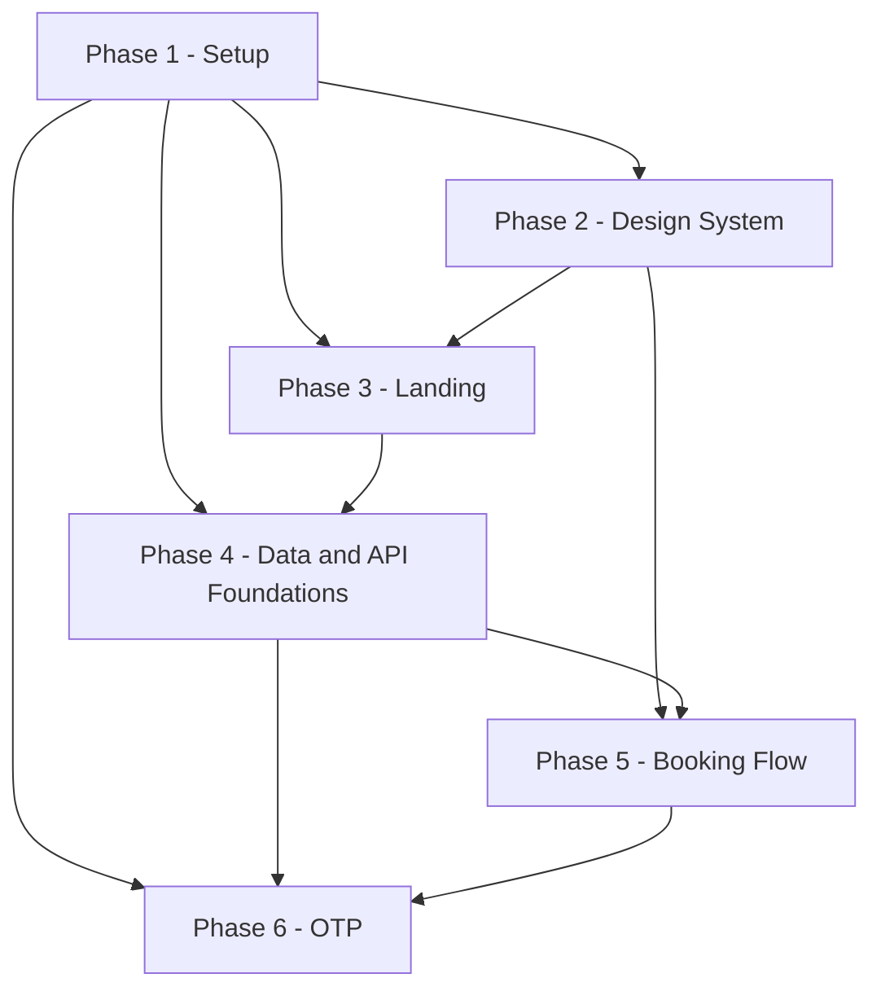

**Parallelism this exposes.** Phases 1-6 are mostly a linear critical path — each phase's early
tasks block the next phase's start — unlike Phases 7-12's more branching admin surface (12b's
12.13). The one real exception: `T3.1` (site content) depends only on `T1.1` and `T3.2`
(catalog schema/seed/`db.ts`) depends only on `T1.5`, so both can be built alongside Phase 2's
design-system work once Phase 1 closes; only `T3.3` and `T3.6` (which need `T2.6`/`T2.8`) actually
hold Phase 3's close on Phase 2's. This is the same relationship 12.0 already names as an
assumption ("Phase 3 needs a working database before Phase 4 formally starts") — the dependency is
on specific tasks, not on a phase's full task list finishing in numeric order.

### 12.8 Effort summary (Phases 1-6)

| Phase | Tasks | S/M/L | Rough sessions |
|---|---|---|---|
| 1 - Setup | 9 | 6/3/0 | 6 |
| 2 - Design System | 10 | 8/2/0 | 6 |
| 3 - Landing | 9 | 7/2/0 | 5.5 |
| 4 - Data and API Foundations | 10 | 3/7/0 | 8.5 |
| 5 - Booking Flow | 9 | 2/7/0 | 8 |
| 6 - OTP | 6 | 2/4/0 | 5 |
| **Total** | **53** | **28/25/0** | **39** |

"Rough sessions" applies this fragment's own stated weights (S=0.5, M=1, L=2 sessions, 12.0) to the
S/M/L counts; it is a planning estimate, not a commitment. The `L` column is 0 in every row because
no task in Phases 1-6 is rated L (12.0's complexity-scale note: every L candidate was split into
smaller S/M tasks) — unlike Phases 7-12, where two phases carry `L`-rated tasks (12b's 12.14).
Phase 1's task count includes T1.9, A11's long-lead Twilio/A2P registration task — calendar-time,
not engineer-time, but still counted here since it is a real task on the board. Added to 12b's own
Phase 7-12 total (44 tasks, 46 rough sessions, its Section 12.14), the whole project is **97 tasks
across roughly 85 rough sessions** — the total neither fragment's effort table states on its own.

#### Contract Challenges

1. **Section 3's `package.json` script list has no `typecheck` script, but `ci.yml`'s own comment
   pins a pipeline that needs one.** The listed scripts are `dev, build, start, lint, test,
   test:e2e, db:migrate, db:sqlite, db:seed`; `.github/workflows/ci.yml`'s comment says the
   pipeline runs `lint -> typecheck -> unit -> component -> build -> e2e -> Lighthouse CI`.
   Nothing in the listed scripts can run the `typecheck` stage. T1.8 adds `"typecheck": "tsc
   --noEmit"` as an explicit, additive assumption, used throughout this section's "repo-green"
   rule (12.0). Section 3 should list it so the two comments agree.

---

### 12.9 Phase 7 — Admin Auth

*Authoring note (applies to all of Phase 7-12 below).* Task IDs and the complexity scale continue
the scheme `12a-implementation-phases-1.md`'s "12.0 How to read this section" establishes for
Phases 1-6, restated here for a reader starting from this fragment:

- **Task ID scheme.** `T<phase>.<seq>`, e.g. `T7.3` = Phase 7's third task. Applied uniformly to
  Phases 7-12 here.
- **Complexity scale** (12a's 12.0, verbatim). `S` = fits a short focused session (~1-2h). `M` =
  one full focused session (~3-4h). `L` = reserved for work with no natural seam to split further
  (pure logic vs. DB-touching code, server vs. client, schema vs. migration-polish); wherever such
  a seam exists, the task is split instead of left `L`.

Tasks below depend on specific Phase 1-6 deliverables, cited directly by their real `12a` task IDs
(e.g. `T4.8` for `availability.ts`'s pure core, `T6.3` for `transitions.ts`) rather than by
placeholder.

#### Goal

Stand up the admin authentication boundary end to end: an Edge-safe split Auth.js v5 config, a
Credentials provider backed by argon2id, middleware route protection, a per-action `requireAdmin()`
guard, DB-backed login lockout, audit entries for every login attempt, and the authenticated admin
shell (sidebar/topbar/nav) every later admin page mounts into (C11).

#### T7.1 — Edge-safe Auth.js config split

| Attribute | Detail |
|---|---|
| Description | Create `src/auth.config.ts` (providers: `[]`, callbacks only — the `authorized()` callback consulted by middleware; no imports of `@node-rs/argon2` or `src/server/db`, so it transpiles for the Edge runtime, C11) and `src/auth.ts` (full NextAuth config: Credentials `authorize()` doing an `AdminUser` lookup by lowercased `email` + argon2id verify against `passwordHash`; `jwt`/`session` callbacks projecting `{ id, email, role }` onto the session; cookie `__Secure-authjs.session-token` in prod, `maxAge` 8h with rolling refresh). Export `auth()`, `signIn()`, `signOut()` from `auth.ts` only. |
| Files touched | `src/auth.config.ts`, `src/auth.ts` |
| Dependencies | `T1.1`, `T1.2`, `T1.3` |
| Acceptance criteria | `pnpm build` succeeds with `middleware.ts` importing only `auth.config.ts`; a static-import check (unit test walking the module graph, or an ESLint `no-restricted-imports` rule scoped to `middleware.ts`) fails if `auth.ts` becomes reachable from `middleware.ts`; a unit test calling `authorize()` directly with a seeded admin's correct credentials returns a session object containing `role`; the same call with a wrong password returns `null` without throwing. |
| Complexity | M |

#### T7.2 — Middleware route protection

| Attribute | Detail |
|---|---|
| Description | `src/middleware.ts`, matcher `/admin/:path*` excluding `/admin/login`, built on `auth.config.ts`'s `authorized()` callback. Unauthenticated requests redirect to `/admin/login?next=<pathname>`; `next` is validated same-origin-relative only (reject any value starting with `//`, containing `://`, or failing a leading-`/`-single-segment check) and falls back to `/admin` otherwise — open-redirect-safe (C11). |
| Files touched | `src/middleware.ts` |
| Dependencies | `T7.1` |
| Acceptance criteria | A request to `/admin` with no session cookie receives a redirect to `/admin/login?next=%2Fadmin`; a request to `/admin/login?next=https%3A%2F%2Fevil.example.com`, after a subsequent successful login, lands on `/admin`, never on the external URL; `/admin/login` itself is reachable with no session; a request to any `/admin/*` path with a valid session cookie passes through unredirected. |
| Complexity | S |

#### T7.3 — `requireAdmin()` guard, login rate limit, DB lockout

| Attribute | Detail |
|---|---|
| Description | `src/server/auth-guards.ts` exports `requireAdmin()`, called inside every admin Server Action independently of middleware (defense-in-depth, C11): re-checks the live session, re-reads the `AdminUser` row, and rejects with `FORBIDDEN` if `isActive: false`, or with `ACCOUNT_LOCKED` if `lockedUntil` is in the future — two distinct codes, not one overloaded `FORBIDDEN` (A4: `FORBIDDEN` is now reserved for the permanent, operator-cleared case; `ACCOUNT_LOCKED` is the temporary, self-clearing one). `auth.ts`'s `authorize()` increments `AdminUser.failedLoginCount` on a wrong password (locking at 5 consecutive failures: `lockedUntil = now + 15min`, C14) and resets it to 0 on success. The `admin.login` rate-limit rule (5/15min per email+IP, C14) is wired through `T4.5`'s `RateLimiter`. |
| Files touched | `src/server/auth-guards.ts`, `src/auth.ts`, `src/server/ratelimit/rules.ts` |
| Dependencies | `T7.1`, `T4.5` |
| Acceptance criteria | Integration test proves: (a) a Server Action call with no session cookie returns `UNAUTHORIZED`; (b) a valid session for an `AdminUser` flipped to `isActive: false` after the session was issued returns `FORBIDDEN`; (c) a valid session with `lockedUntil` in the future returns `ACCOUNT_LOCKED`, never `FORBIDDEN` (A4); each case additionally asserts the target row was not mutated (mirrors Section 11.5 case 4 exactly). A unit test proves 5 consecutive failed `authorize()` calls for the same email set `lockedUntil`, and a 6th call with the *correct* password while `lockedUntil` is still future still fails with `ACCOUNT_LOCKED`. |
| Complexity | M |

#### T7.4 — `adminAuth.login` action and login page

| Attribute | Detail |
|---|---|
| Description | `features/admin-auth/schemas.ts` (`loginSchema`: email, password); `features/admin-auth/actions.ts` (action `adminAuth.login`, a thin `defineAction`-wrapped call into `signIn("credentials", ...)`, per Section 5.4 — the real check is `authorize()` in `T7.1`, not here); `features/admin-auth/components/login-form.tsx` (React Hook Form + Zod, one `role="alert"` per failed attempt, `aria-describedby` on the form not per-field, distinct copy for `UNAUTHORIZED` (wrong credentials) / `ACCOUNT_LOCKED` (temporary, self-clearing) / `FORBIDDEN` (deactivated account) / `RATE_LIMITED` per Section 5.4's error table — `ACCOUNT_LOCKED` and `FORBIDDEN` are now distinct codes with distinct copy, never parsed out of one shared message, A4); `app/admin/login/page.tsx` + `loading.tsx`. |
| Files touched | `src/features/admin-auth/schemas.ts`, `src/features/admin-auth/actions.ts`, `src/features/admin-auth/types.ts`, `src/features/admin-auth/components/login-form.tsx`, `src/app/admin/login/page.tsx`, `src/app/admin/login/loading.tsx` |
| Dependencies | `T7.1`, `T7.3`, `T2.2` |
| Acceptance criteria | Submitting `SEED_ADMIN_EMAIL`/`SEED_ADMIN_PASSWORD` redirects to `/admin`; a wrong password shows the generic "Invalid email or password" message (no field-level distinction, per 5.4's stated non-enumeration trade-off); a locked account (`ACCOUNT_LOCKED`) shows the distinct lockout message *before* the password is checked, and a deactivated account (`FORBIDDEN`) shows a different, distinct message — a component test asserts the two render different copy and never collapse to the same string (A4); a component test asserts submit stays disabled until both fields are non-empty and exactly one `role="alert"` renders per failed attempt. |
| Complexity | M |

#### T7.5 — Audit entries for login success/failure

| Attribute | Detail |
|---|---|
| Description | Wire `writeAuditLog("ADMIN_LOGIN_SUCCEEDED" \| "ADMIN_LOGIN_FAILED", "AdminUser", adminUserId, meta)` into `auth.ts`'s `authorize()` callback. `meta` carries no PII (C19/LOG-2) — not even the attempted email — only non-identifying context (e.g. whether the failure was wrong-password vs. locked). |
| Files touched | `src/auth.ts`, `src/server/audit.ts` (reused, `T4.6`) |
| Dependencies | `T7.1`, `T4.6` |
| Acceptance criteria | A successful login writes exactly one `AuditLog` row (`action: "ADMIN_LOGIN_SUCCEEDED"`, `entity: "AdminUser"`, `entityId` = the user's id); a failed login writes exactly one `"ADMIN_LOGIN_FAILED"` row; a unit test scans every written `metaJson` string against the LOG-2 banned-substring list (phone/name/password/email) and asserts no match. |
| Complexity | S |

#### T7.6 — Logout

| Attribute | Detail |
|---|---|
| Description | Action `adminAuth.logout` (thin wrapper around `signOut()`) wired to a sign-out control in `admin-topbar.tsx` (`T7.7`). Clears the session cookie, writes `AuditLog("ADMIN_LOGGED_OUT", "AdminUser", adminUserId)` via `T4.6`'s `writeAuditLog` (A1 — C4's `AuditAction` union now carries a logout counter-operation alongside `ADMIN_LOGIN_SUCCEEDED`), and redirects to `/admin/login`. |
| Files touched | `src/features/admin-auth/actions.ts`, `src/app/admin/(dashboard)/_components/admin-topbar.tsx` |
| Dependencies | `T7.1`, `T7.7`, `T4.6` |
| Acceptance criteria | Clicking sign-out clears `__Secure-authjs.session-token` and a subsequent request to `/admin` redirects to `/admin/login`; the logout call writes exactly one `AuditLog("ADMIN_LOGGED_OUT")` row, asserted by an integration test. |
| Complexity | S |

#### T7.7 — Admin shell layout: sidebar, topbar, navigation

| Attribute | Detail |
|---|---|
| Description | `src/app/admin/layout.tsx` (outer shell: `force-dynamic` + `noindex` metadata for all `/admin/*`, C15 — kept separate so `/admin/login` renders without chrome); `src/app/admin/(dashboard)/layout.tsx` (sidebar + topbar, reads `auth()` for display name only — this layout is cosmetic, not a security boundary, C11); `_components/admin-sidebar.tsx`, `admin-topbar.tsx` (user menu, theme-toggle slot), `admin-nav-items.ts` (`{ href, label, icon }[]` for Dashboard/Calendar/Appointments/Patients/Settings, in that order); `src/hooks/use-media-query.ts` drives collapsing the sidebar into an off-canvas `Sheet` on `sm`/`md`. |
| Files touched | `src/app/admin/layout.tsx`, `src/app/admin/(dashboard)/layout.tsx`, `src/app/admin/(dashboard)/_components/admin-sidebar.tsx`, `src/app/admin/(dashboard)/_components/admin-topbar.tsx`, `src/app/admin/(dashboard)/_components/admin-nav-items.ts`, `src/hooks/use-media-query.ts` |
| Dependencies | `T7.1`, `T2.2`, `T2.4` |
| Acceptance criteria | Rendering the layout with a stubbed session shows exactly the 5 nav items in Dashboard/Calendar/Appointments/Patients/Settings order; the active route's item carries `aria-current="page"`; below the `md` breakpoint the sidebar is absent from the initial render and a visible menu control opens it as a `Sheet`; an axe pass on the rendered shell reports zero `serious`/`critical` violations. |
| Complexity | M |

#### Phase exit criteria

Every route under `/admin/:path*` except `/admin/login` is unreachable without a valid session;
correct credentials reach `/admin`; 5 consecutive failures lock the account at the DB level for 15
minutes, surviving across rate-limiter instances, and a locked session is rejected with
`ACCOUNT_LOCKED` while a deactivated one is rejected with `FORBIDDEN` (A4, two distinct codes);
every login attempt (success or failure) produces exactly one `AuditLog` row and every logout
produces exactly one `ADMIN_LOGGED_OUT` row (A1); the admin shell renders all 5 nav sections with
zero axe `serious`/`critical` violations.

---

### 12.10 Phase 8 — Dashboard

#### Goal

Build the read-only KPI dashboard: one `searchParams`-driven date-range control feeding five KPI
cards and two Recharts-based charts, loading/empty/error states per widget, and numeric accuracy
verified against Section 9's worked examples and Section 11's E4 scenario.

**Naming reconciliation.** Section 5.7's `dashboard.getKpis` already defines its output using the
canonical five-field `KpiSnapshot` shape — per Section 5.1's Naming Reconciliation table, citing
Section 9 rather than redefining it — and that shape matches Section 9's worked math (9.2-9.6) and
Section 11's E4 assertions exactly. There is no mismatch to reconcile here; Phase 8 implements
directly against that shape:

```ts
type KpiSnapshot = {
  totalPatients: number;
  totalRevenueMinor: number;      // COMPLETED only, 9.3
  expectedRevenueMinor: number;   // upcoming CONFIRMED, 9.4
  currency: string;
  todaysAppointments: number;     // 9.5
  upcomingThisWeek: number;       // 9.6
};
```

#### T8.1 — Dashboard queries (`getDashboardKpis`, `getRevenueSeries`, `getAppointmentsByService`)

| Attribute | Detail |
|---|---|
| Description | `features/dashboard/queries.ts` implementing the three Section 9 functions to the letter: date-anchor and status-filter semantics per metric (9.1-9.8), `bucketAndFill` reused from `lib/dates.ts` (never a DB-side `date_trunc`, per 9.9/C6); `features/dashboard/schemas.ts` (`dashboardRangeSchema` parsing `from`/`to`/`granularity` `searchParams`, default 30-day preset); `features/dashboard/types.ts` (`KpiSnapshot` above, `RevenuePoint`, `ServiceBreakdownPoint`). |
| Files touched | `src/features/dashboard/queries.ts`, `src/features/dashboard/schemas.ts`, `src/features/dashboard/types.ts` |
| Dependencies | `T4.2`, `T1.5` |
| Acceptance criteria | Against the standard seed with `FixedClock(SEED_NOW)` and the default 30-day range: `totalPatients === 45`, `totalRevenueMinor === 55000`, `expectedRevenueMinor === 87500`, `todaysAppointments === 3`, `upcomingThisWeek === 4` (Section 9.2-9.6); `getRevenueSeries(range, "day")` returns 10 non-empty buckets summing to 55000, `"week"` returns 5 summing to 55000, `"month"` returns 2 summing to 55000 (9.9/9.11); `getAppointmentsByService(range)` returns 7 rows summing to 14 matching Section 9.8's table exactly. |
| Complexity | L |

#### T8.2 — Date-range filter (shared, `searchParams`-driven)

| Attribute | Detail |
|---|---|
| Description | `features/dashboard/components/date-range-filter.tsx` (dashboard-specific wrapper around the new shared `src/components/date-range-picker.tsx`), pushing `from`/`to`/`granularity` into the URL; `app/admin/(dashboard)/page.tsx` parses `searchParams` server-side via `dashboardRangeSchema` and resolves one `DateRange` consumed by all three `T8.1` queries, so one navigation re-renders every widget (C15 — never per-widget filters). |
| Files touched | `src/features/dashboard/components/date-range-filter.tsx`, `src/components/date-range-picker.tsx`, `src/app/admin/(dashboard)/page.tsx` |
| Dependencies | `T8.1`, `T2.2` |
| Acceptance criteria | Changing the range control updates the URL without a full page reload; loading the URL directly with explicit `from`/`to`/`granularity` renders the identical resolved range server-side on first paint; exactly one live-region announcement fires per range change, not one per widget (Section 8.1.13). |
| Complexity | M |

#### T8.3 — Five KPI cards and `KpiGrid`

| Attribute | Detail |
|---|---|
| Description | `features/dashboard/components/kpi-card.tsx` (label + number + icon, money via `money-display.tsx`, never a raw minor-unit integer) and `kpi-grid.tsx` (1-col `sm`, 2-col `md`, 5-across `lg`/`xl`), wired to `T8.1`'s `KpiSnapshot`. |
| Files touched | `src/features/dashboard/components/kpi-card.tsx`, `src/features/dashboard/components/kpi-grid.tsx` |
| Dependencies | `T8.1`, `T2.2` |
| Acceptance criteria | A component test rendering `KpiGrid` with the `SEED_NOW` fixture snapshot shows "45", "€550.00", "€875.00", "3", "4" in that order, each with an accessible name including its label and unit; a zero-appointment range renders explicit "0" values, never a blank card. |
| Complexity | S |

#### T8.4 — Revenue-over-time chart (D/W/M toggle)

| Attribute | Detail |
|---|---|
| Description | `features/dashboard/components/revenue-chart.tsx`, a client island wrapping Recharts, series color from the `--chart-1` CSS variable (C18/8.3.7's token mapping, part of the full `--chart-1`..`--chart-5` set `T2.1` now creates per A8); D/W/M toggle via `ui/tabs` re-querying `T8.1`'s `getRevenueSeries` with the selected granularity; a visually-hidden `<table>` mirroring the chart's data plus a summarizing `aria-label`, per 8.1.13; loading skeleton; "No data in this range" empty state. |
| Files touched | `src/features/dashboard/components/revenue-chart.tsx` |
| Dependencies | `T8.1`, `T8.2`, `T2.4`, `T2.1` (A8 — the Phase 2 token task that must create `--chart-1` for this chart's `hsl(var(--chart-1))` acceptance criterion to resolve at all) |
| Acceptance criteria | Switching D/W/M tabs re-renders from the matching bucketed series without navigation; the series' resolved color is `hsl(var(--chart-1))`; a zero-appointment range renders the literal text "No data in this range" instead of an empty canvas; the chart's wrapper carries an `aria-label` summarizing total revenue plus the hidden equivalent `<table>`. |
| Complexity | M |

#### T8.5 — Appointments-by-service chart

| Attribute | Detail |
|---|---|
| Description | `features/dashboard/components/appointments-by-service-chart.tsx`, ranked horizontal bars, one per service, each bar filled with that `Service.colorHex` and paired with a visible numeric text label (never color alone, C18/WCAG 1.4.1); reads `getAppointmentsByService` from `T8.1`. |
| Files touched | `src/features/dashboard/components/appointments-by-service-chart.tsx` |
| Dependencies | `T8.1`, `T8.2` |
| Acceptance criteria | Given Section 9.8's fixture, bars render in descending count order (General Consultation 5 … Minor Outpatient Procedure 0) with each bar's visible label matching its count; a service with 0 in-range appointments still renders a labeled zero-length row rather than being omitted, so the visible rows always sum to the filtered total. |
| Complexity | S |

#### T8.6 — Loading skeletons and per-widget empty/error states

| Attribute | Detail |
|---|---|
| Description | `app/admin/(dashboard)/loading.tsx` (5 skeleton cards + 2 skeleton chart blocks matching the live grid, targeting <400ms p95 per C23); a new shared `src/components/widget-error-boundary.tsx` wrapping each of the 7 widgets' own data fetch so one widget's failure shows an inline `ui/alert` + retry without affecting the other six (8.1.13's stated rule — not achievable from the route-level `error.tsx` alone). |
| Files touched | `src/app/admin/(dashboard)/loading.tsx`, `src/components/widget-error-boundary.tsx` (new) |
| Dependencies | `T8.1`, `T8.3`, `T8.4`, `T8.5` |
| Acceptance criteria | A throttled-network run shows the 7-widget skeleton layout matching the live grid, with no visible reflow once data arrives; forcing one query to reject (test double) leaves the other six widgets rendering normally with only the failing one showing `Alert` + Retry. |
| Complexity | S |

#### T8.7 — KPI-accuracy verification (Section 9 / E4)

| Attribute | Detail |
|---|---|
| Description | No new production code: an integration test and the E4 Playwright scenario (already named in Section 3's tree as `tests/e2e/admin-dashboard-kpis.spec.ts`) exercising the full `/admin` page against the standard `prisma/seed.ts` dataset and `FixedClock(SEED_NOW)`, asserting every number in Section 9.11/11.6's E4 scenario in one place. |
| Files touched | `tests/unit/server/dashboard/kpi-accuracy.integration.test.ts` (new), `tests/e2e/admin-dashboard-kpis.spec.ts` |
| Dependencies | `T8.1`, `T8.3`, `T8.4`, `T8.5`, `T8.6` |
| Acceptance criteria | E4 passes verbatim: Total patients 45, Total revenue 55,000 minor, Expected revenue 87,500 minor, Today's appointments 3, Upcoming this week 4; daily/weekly/monthly series of 10/5/2 buckets each summing to 55,000; service breakdown summing to 14 across 7 rows. This task's own acceptance criterion is exactly "E4 is green in CI." |
| Complexity | M |

#### Phase exit criteria

`/admin` renders all five KPI cards and both charts from one shared date-range control; every
number matches Section 9's worked examples under the standard seed; a zero-data range renders
explicit zero/empty states, never a blank widget; E4 passes in CI.

---

### 12.11 Phase 9 — Calendar and Tables

#### Goal

Give admins full visibility and control over appointments: a color-coded calendar, a filterable and
paginated appointments table with status-transition row actions and reschedule, admin-created
appointments, and a read-only patients roster — all reusing the slot engine and transition guard
rather than re-implementing either.

#### T9.1 — Appointments list query and filters schema

| Attribute | Detail |
|---|---|
| Description | `features/appointments/queries.ts` `listAppointments(filters)` implementing `appointments.list` (Section 5.5): `page`/`pageSize`/`q` (plain scan over `holdFullName`/`Patient.fullName`/`reference`)/`status`/`serviceId`/`from`/`to`; `features/appointments/schemas.ts` (`appointmentsFiltersSchema`, `rescheduleSchema`); `features/appointments/types.ts` (`AppointmentRow`, `AppointmentsFilters`). |
| Files touched | `src/features/appointments/queries.ts`, `src/features/appointments/schemas.ts`, `src/features/appointments/types.ts` |
| Dependencies | `T1.2`, `T4.1` |
| Acceptance criteria | `listAppointments`'s `total` matches a direct `COUNT` query for at least 3 independent filter combinations (status-only, service-only, date-range-only); `q` matches both a name substring and an exact reference, case-insensitively; a `pageSize` over 100 is rejected by Zod before reaching the DB. |
| Complexity | M |

#### T9.2 — Status-transition actions and audit

| Attribute | Detail |
|---|---|
| Description | `features/appointments/actions.ts` action `appointments.updateStatus` (Section 5.5), funnelling confirm/complete/no-show/cancel through `T6.3`'s `transitions.ts` guard (C4). On `-> CANCELLED`, delete this appointment's `AppointmentSlot` rows (frees the slot); on `-> COMPLETED`/`-> NO_SHOW`, retain them (C5). One `AuditLog("APPOINTMENT_STATUS_CHANGED", { fromStatus, toStatus })` per call, no PII (C19). |
| Files touched | `src/features/appointments/actions.ts`, `src/server/appointments/transitions.ts` (reused) |
| Dependencies | `T9.1`, `T6.3`, `T4.6` |
| Acceptance criteria | A parametrized integration test over all 25 ordered `(from, to)` status pairs shows exactly the 6 C4-legal edges succeed and the other 19 return `INVALID_TRANSITION`; a `-> CANCELLED` call leaves zero `AppointmentSlot` rows for that appointment while a `-> NO_SHOW` call leaves them unchanged; each successful call writes exactly one `AuditLog` row. |
| Complexity | M |

#### T9.3 — Appointments DataTable and filters UI

| Attribute | Detail |
|---|---|
| Description | `features/appointments/components/appointments-table.tsx` (`ui/table` + the shared `data-table-pagination.tsx`); `appointments-filters.tsx` (debounced search via a new `use-debounced-value.ts`, status/service `Select`, date range reusing `T8.2`'s `date-range-picker.tsx`); `appointment-row-actions.tsx` (`ui/dropdown-menu` offering exactly the legal next transitions for the row's current status — none for `COMPLETED`/`CANCELLED`/`NO_SHOW`, C4); `app/admin/(dashboard)/appointments/page.tsx` + `loading.tsx` wiring `searchParams` (`page`, `q`, `status`, `service`, `range`) to `T9.1`. |
| Files touched | `src/features/appointments/components/appointments-table.tsx`, `src/features/appointments/components/appointments-filters.tsx`, `src/features/appointments/components/appointment-row-actions.tsx`, `src/app/admin/(dashboard)/appointments/page.tsx`, `src/app/admin/(dashboard)/appointments/loading.tsx`, `src/hooks/use-debounced-value.ts` |
| Dependencies | `T9.1`, `T9.2`, `T8.2`, `T2.2` |
| Acceptance criteria | Changing the status `Select` pushes `?status=CONFIRMED&page=1` (page resets on any filter change) while preserving `q`/`service`/`range`; clicking page 2 preserves all other params; a `COMPLETED` row's actions menu renders no enabled transition items; a row action that returns `INVALID_TRANSITION`/`SLOT_TAKEN` rolls its optimistic update back and shows a toast. |
| Complexity | L |

#### T9.4 — Reschedule dialog (reusing the slot engine)

| Attribute | Detail |
|---|---|
| Description | `features/appointments/components/reschedule-dialog.tsx` (`ui/dialog`) re-embedding the booking wizard's date/time pickers (`T5.*`), scoped to the appointment's existing service, to pick `dateLocal`/`startUtc`; action `appointments.reschedule` (Section 5.5) delegates verbatim to `rescheduleAppointment` (Section 6.5) via a new `src/server/appointments/reschedule.ts`: row-locks the appointment, requires `status === "CONFIRMED"`, sweeps expired holds, re-checks the new slot, deletes old `AppointmentSlot` rows and inserts new ones in one transaction, sets `rescheduledFromUtc`, writes `AuditLog("APPOINTMENT_RESCHEDULED", { fromUtc, toUtc })`. |
| Files touched | `src/features/appointments/components/reschedule-dialog.tsx`, `src/features/appointments/actions.ts`, `src/server/appointments/reschedule.ts` (new) |
| Dependencies | `T9.2`, `T9.3`, `T4.2`, `T4.9` |
| Acceptance criteria | Rescheduling a `CONFIRMED` appointment to a free slot leaves old `AppointmentSlot` rows gone, new ones present, `rescheduledFromUtc` set to the prior `startsAtUtc`, and exactly one `AuditLog` row; targeting a slot another appointment already holds rolls back the *whole* transaction, leaving the original appointment's slot rows still present (mirrors Section 11.5 case 3's two sub-cases exactly); rescheduling a non-`CONFIRMED` appointment returns `INVALID_TRANSITION` without opening the picker. |
| Complexity | L |

#### T9.5 — Admin-created appointments

| Attribute | Detail |
|---|---|
| Description | Action `appointments.createByAdmin` (Section 5.5): same slot-matching/insert path as `booking.create` but `status: "CONFIRMED"` directly, `patientId` resolved via the same upsert-by-`phoneE164` logic `otp.verify` uses (`T6.2`), `confirmedAt: now`, no `OtpChallenge` row, `AuditLog("APPOINTMENT_CREATED_BY_ADMIN")`. A "New appointment" entry point on `/admin/appointments` reuses `T9.4`'s date/time picker plus a minimal name/phone form — **assumption**: Section 8 has no dedicated wireframe for this screen, so this task also defines its minimal field set rather than a full new page. |
| Files touched | `src/features/appointments/actions.ts`, `src/features/appointments/components/appointments-table.tsx` |
| Dependencies | `T9.4`, `T6.2` |
| Acceptance criteria | Creating an admin appointment for a free slot produces an upserted `Patient` row and an `Appointment` with `status: "CONFIRMED"`, `source` in `{"ADMIN","PHONE"}`, and no `OtpChallenge` row; a slot collision returns `SLOT_TAKEN`/`SLOT_UNAVAILABLE` and reopens the picker, never a raw 500. |
| Complexity | M |

#### T9.6 — Admin calendar (day/week/month, color-coded, legend, detail sheet)

| Attribute | Detail |
|---|---|
| Description | `features/appointments/components/admin-calendar.tsx` (`"use client"` FullCalendar wrapper: daygrid+timegrid+interaction, C2); `calendar-view-toggle.tsx` (custom `role="tablist"`/`"tab"` control driving `calendarRef.current.changeView()`, kept custom per 8.1.14's styling rationale rather than FullCalendar's own toolbar); event blocks colored via the shared `status-badge.tsx` palette plus status/initials/service text (never hue alone); legend always visible beneath the grid; clicking an event opens a detail `ui/sheet` reusing `appointment-row-actions.tsx`'s menu; `app/admin/(dashboard)/calendar/page.tsx` + `loading.tsx`. |
| Files touched | `src/features/appointments/components/admin-calendar.tsx`, `src/features/appointments/components/calendar-view-toggle.tsx`, `src/app/admin/(dashboard)/calendar/page.tsx`, `src/app/admin/(dashboard)/calendar/loading.tsx` |
| Dependencies | `T9.1`, `T9.2`, `T9.3` |
| Acceptance criteria | Each of the 5 `AppointmentStatus` values renders in a visually distinct color plus a text label (axe flags no color-only encoding); a component test with two mocked viewport widths confirms Day view defaults below `md` and Week view at `lg`/`xl` (8.1.14); clicking an event opens the same row-action set as the table for that appointment's current status; a successful `T9.4` reschedule moves the event to its new time on the next render without a full page reload. |
| Complexity | L |

#### T9.7 — Patients list (visit count, total spent, last visit)

| Attribute | Detail |
|---|---|
| Description | `features/patients/queries.ts` `listPatients(filters)` (Section 5.6). **Assumption** (Section 8's wireframe names the three columns without pinning their status scope beyond one worked example, "4 visits / €220.00"): "visit count" and "total spent" both scope to `COMPLETED` appointments only — a visit is one that happened, not a future `CONFIRMED` booking or a `NO_SHOW` — and "last visit" is the max `startsAtUtc` among that same `COMPLETED` set, keeping all three columns' status filter identical to Section 9.3's revenue semantics rather than inventing a second definition. `features/patients/components/patients-table.tsx` masks the phone number (same staff-screen courtesy as the booking success page); `app/admin/(dashboard)/patients/page.tsx` + `loading.tsx`, `searchParams`-driven (`q`, `page`). |
| Files touched | `src/features/patients/queries.ts`, `src/features/patients/schemas.ts`, `src/features/patients/types.ts`, `src/features/patients/components/patients-table.tsx`, `src/app/admin/(dashboard)/patients/page.tsx`, `src/app/admin/(dashboard)/patients/loading.tsx` |
| Dependencies | `T1.2`, `T8.1` |
| Acceptance criteria | For a patient with `C` `COMPLETED` appointments, "visit count" equals `C`, "total spent" equals the sum of `priceMinorAtBooking` across exactly those `C` rows, and "last visit" equals the max `startsAtUtc` among them — each checked against a direct DB aggregate for every seeded patient; a search with no match renders the "no search match" `EmptyState`, zero patients at all renders the distinct "No patients yet" `EmptyState`; the phone renders masked with an accessible name repeating the same masked string, never the raw number. |
| Complexity | M |

#### Phase exit criteria

Every `CONFIRMED`/`COMPLETED`/`CANCELLED`/`NO_SHOW` transition is reachable from both the
appointments table and the calendar, guarded by the same `transitions.ts` matrix the unit tests
verify; a reschedule moves slots atomically with no orphaned `AppointmentSlot` rows on a collision;
admin-created appointments bypass OTP but never bypass the slot-concurrency guard; the patients
roster's three computed columns match a direct DB aggregate for every seeded patient.

---

### 12.12 Phase 10 — Settings

#### Goal

Let admins edit the clinic's live operating parameters — working hours (incl. split shifts), closed
dates, the slot/booking-window grid, the service catalogue, and clinic profile fields — with every
mutation audited and the public landing page kept in sync via `revalidatePath('/')`.

#### T10.1 — Settings aggregate query and page shell

| Attribute | Detail |
|---|---|
| Description | `features/settings/queries.ts` (`getClinicSettings()`, `listWorkingHours()`, `listClosedDates()`), composed by action `settings.get` (Section 5.9) into one `ClinicSettingsView`; `features/settings/types.ts`; `app/admin/(dashboard)/settings/page.tsx` + `loading.tsx` rendering the 4-tab shell (Hours / Closed Dates / Slot Interval & General / Services, per 8.1.17) with independent per-tab loading. |
| Files touched | `src/features/settings/queries.ts`, `src/features/settings/types.ts`, `src/app/admin/(dashboard)/settings/page.tsx`, `src/app/admin/(dashboard)/settings/loading.tsx` |
| Dependencies | `T1.2`, `T7.7` |
| Acceptance criteria | `settings.get`'s payload equals the composition of the three individual queries against the seed (the `ClinicSettings` singleton, 7 `WorkingHour` rows incl. Saturday's split shift, 3 `ClosedDate` rows, Section 4.6); the four tabs use `role="tablist"`/`"tab"`/`"tabpanel"` with roving tabindex. |
| Complexity | S |

#### T10.2 — Working hours form (per-weekday, split shifts)

| Attribute | Detail |
|---|---|
| Description | `features/settings/components/working-hours-form.tsx` (one row per weekday, "+ Add shift" appends a second open/close pair matching the seeded Saturday pattern, up to 4 shifts per Section 5.9's schema, zero shifts = closed); action `settings.updateWorkingHours` (Section 5.9): one transaction, `DELETE WorkingHour WHERE weekday = ...` then `INSERT` the submitted shifts (replace-all-for-that-weekday, matching `@@unique([weekday, openMinute])`, C5); `AuditLog("SETTINGS_UPDATED")` (reused — C4 has no dedicated working-hours action). |
| Files touched | `src/features/settings/components/working-hours-form.tsx`, `src/features/settings/actions.ts`, `src/features/settings/schemas.ts` |
| Dependencies | `T10.1` |
| Acceptance criteria | A shift with `closeMinute <= openMinute` returns `VALIDATION_ERROR` naming the offending shift before any DB write; submitting a valid 2-shift Saturday replaces only that weekday's rows (other weekdays untouched) and round-trips on reload; the save writes exactly one `AuditLog("SETTINGS_UPDATED")` row. |
| Complexity | M |

#### T10.3 — Closed dates management

| Attribute | Detail |
|---|---|
| Description | `features/settings/components/closed-dates-form.tsx` (date + reason, removable list); actions `settings.addClosedDate` (`P2002` on a duplicate date mapped to `fieldErrors.date`, `AuditLog("CLOSED_DATE_ADDED")`) and `settings.removeClosedDate` (**assumption**, per Section 5.9: removing an already-absent date is a silent success, not `NOT_FOUND`; `AuditLog("CLOSED_DATE_REMOVED")` written only when a row was actually deleted). |
| Files touched | `src/features/settings/components/closed-dates-form.tsx`, `src/features/settings/actions.ts`, `src/features/settings/schemas.ts` |
| Dependencies | `T10.1` |
| Acceptance criteria | Adding a date already present returns `VALIDATION_ERROR` on the date field with no new `AuditLog` row; removing an already-absent date succeeds with zero new `AuditLog` rows, removing a present one writes exactly one `CLOSED_DATE_REMOVED` row; a `CONFIRMED` appointment already booked on a newly-closed date is left untouched (Section 6.6). |
| Complexity | S |

#### T10.4 — Slot interval control with existing-bookings warning

| Attribute | Detail |
|---|---|
| Description | Within `general-settings-form.tsx` (`T10.5`'s file): changing `slotIntervalMin` surfaces a static inline warning — "Existing bookings keep their original times; new availability uses the new interval" — before save, since `interval_change_does_not_retroactively_free_old_rows` (Section 6.6/11.3.1) proves old bookings on the prior grid are neither moved nor freed. No confirmation modal blocks the save (effective-immediately config, Section 5.9); the warning is informational only. |
| Files touched | `src/features/settings/components/general-settings-form.tsx` (shared with `T10.5`) |
| Dependencies | `T10.5` |
| Acceptance criteria | The warning renders once the `slotIntervalMin` field's value differs from its server-rendered initial value, and not otherwise; an integration test confirms a booking made on the old grid still reads at its original `startsAtUtc` after the setting changes — no backfill of existing `Appointment` rows occurs. |
| Complexity | S |

#### T10.5 — Clinic profile and scheduling-window fields

| Attribute | Detail |
|---|---|
| Description | Remaining `general-settings-form.tsx` fields (`clinicName`, `timeZone` validated against `Intl.supportedValuesOf("timeZone")`, `currency`, `bufferMin`, `minLeadTimeMin`, `maxAdvanceDays`, `holdTtlMin`, `phoneE164`, `email`, `addressLine1`/`addressLine2`, `mapUrl`); action `settings.update` (Section 5.9): `UPDATE ClinicSettings` (singleton `id: "singleton"`, C5), `AuditLog("SETTINGS_UPDATED")`, `revalidatePath('/')` (`clinicName`/currency are landing-visible). |
| Files touched | `src/features/settings/components/general-settings-form.tsx`, `src/features/settings/actions.ts`, `src/features/settings/schemas.ts` |
| Dependencies | `T10.1` |
| Acceptance criteria | An unsupported IANA `timeZone` string returns `VALIDATION_ERROR` inline without reaching the DB; a successful save triggers exactly one `revalidatePath('/')` call and exactly one `AuditLog("SETTINGS_UPDATED")` row; client-side Zod (the shared schema import, C17) blocks an out-of-range submission before any network request fires, asserted in a component test. |
| Complexity | M |

#### T10.6 — Services CRUD (create/update/active flag/reorder)

| Attribute | Detail |
|---|---|
| Description | `features/services/components/services-table.tsx` + `service-form-dialog.tsx` (`ui/dialog`+`ui/form`); actions `services.create`/`.update`/`.setActive`/`.reorder` (Section 5.8): `create` inserts `isActive: true` + `AuditLog("SERVICE_CREATED")` + `revalidatePath('/')`; `update` never touches past `Appointment` `...AtBooking` snapshots (C5) + `AuditLog("SERVICE_UPDATED")` + `revalidatePath('/')`; `setActive` flips `isActive` (soft "deactivate," never a hard delete) + `revalidatePath('/')`, writing `AuditLog("SERVICE_DEACTIVATED")` when turning *off* and `AuditLog("SERVICE_REACTIVATED")` when turning back *on* (A1 — C4's `AuditAction` union now carries that counter-operation, so an `AuditLog` reader can reconstruct a service's full active/inactive history); `reorder` applies every `sortOrder` change in one transaction + `revalidatePath('/')`, no audit row — a separate, still-open gap, since A1 adds no `SERVICE_REORDERED` action. |
| Files touched | `src/features/services/components/services-table.tsx`, `src/features/services/components/service-form-dialog.tsx`, `src/features/services/actions.ts`, `src/features/services/schemas.ts`, `src/features/services/queries.ts`, `src/features/services/types.ts` |
| Dependencies | `T10.1` |
| Acceptance criteria | Creating a service with a `slug` colliding on the `@unique` constraint returns `VALIDATION_ERROR` with `fieldErrors.slug`, never `INTERNAL`; deactivating a service already referenced by a future `CONFIRMED` appointment leaves that appointment's `serviceId`/snapshot fields untouched; reordering 3 services in one call updates exactly those 3 `sortOrder` values atomically (no partial apply on a mid-batch failure); every create/update/deactivate call triggers exactly one `revalidatePath('/')` call. |
| Complexity | L |

#### T10.7 — Audit-coverage verification across every settings mutation

| Attribute | Detail |
|---|---|
| Description | No new production code: one consolidating integration test calling every `settings.*` and `services.*` mutating action once each — `setActive` called in both directions, so both `SERVICE_DEACTIVATED` and `SERVICE_REACTIVATED` are each asserted at least once (A1) — and asserting the resulting `AuditLog` rows exactly match the expected multiset, catching any future edit to these actions that forgets to call `writeAuditLog`. |
| Files touched | `tests/unit/server/settings/audit-coverage.integration.test.ts` (new) |
| Dependencies | `T10.2`, `T10.3`, `T10.5`, `T10.6` |
| Acceptance criteria | The test fails if any of the six settings/services mutating actions produces zero new `AuditLog` rows when called; it passes against the actions exactly as specified in `T10.2`-`T10.6`. |
| Complexity | S |

#### Phase exit criteria

Every one of the six audited settings/services mutations (`updateWorkingHours`, `addClosedDate`,
`removeClosedDate`, `update`, `services.create`/`update`/`setActive`) writes the trail C4 provides
for it; a working-hours or slot-interval change never mutates an existing `Appointment` row; a
service edit never rewrites `...AtBooking` history; every landing-visible mutation triggers exactly
one `revalidatePath('/')` call.

---

### 12.13 Phase 11 — Testing and Hardening

#### Goal

Fill out the unit/component/integration/E2E suites specified in Section 11 to their stated coverage
targets and scenario catalogue, then harden the shipped surface — accessibility, security headers
and CSP, data retention, SMS spend controls, PII-in-logs hygiene, and the Lighthouse gate — as
focused, independently landable tasks rather than one undifferentiated "write tests" task.

#### T11.1a — Unit suite: slot engine + hold-expiry (100%-branch tier)

| Attribute | Detail |
|---|---|
| Description | Fill out `tests/unit/server/slots/availability.test.ts` (all 16 named cases, Section 11.3.1) and `tests/unit/server/slots/hold-expiry.test.ts` — Section 11.1's 100%-branch tier for `src/server/slots/**`. |
| Files touched | `tests/unit/server/slots/availability.test.ts`, `tests/unit/server/slots/hold-expiry.test.ts` |
| Dependencies | `T4.8`, `T4.9` |
| Acceptance criteria | `vitest run --project node --coverage` reports 100% branch coverage for `src/server/slots/**`; all 16 named cases from Section 11.3.1's table exist as individually-named tests. |
| Complexity | M |

#### T11.1b — Unit suite: transitions + OTP (100%-branch tier)

| Attribute | Detail |
|---|---|
| Description | Fill out `tests/unit/server/appointments/transitions.test.ts` (all 25 ordered pairs) and `tests/unit/server/otp.test.ts` (hash determinism, expiry-before-code-check ordering, `maxAttempts`, resend cooldown/cap) — Section 11.1's 100%-branch tier for `transitions.ts`. |
| Files touched | `tests/unit/server/appointments/transitions.test.ts`, `tests/unit/server/otp.test.ts` |
| Dependencies | `T6.3`, `T4.3`, `T6.2` |
| Acceptance criteria | `vitest run --project node --coverage` reports 100% branch coverage for `transitions.ts`; the transitions test is parametrized over all 25 ordered pairs with exactly 6 legal and 19 asserting `INVALID_TRANSITION`. |
| Complexity | M |

#### T11.2 — Unit suite: `lib/**` and feature schemas (>=95% line tier)

| Attribute | Detail |
|---|---|
| Description | Fill out `tests/unit/lib/{money,dates,phone,enums,ics}.test.ts`, a new `tests/unit/lib/reference.test.ts` (**assumption**: Section 3's tree omits a test file for `lib/reference.ts` despite Section 11.3.2 requiring its 1000-sample/collision-retry coverage; added here under the existing `tests/unit/lib/` convention), `tests/unit/server/ratelimit.test.ts`, and `tests/unit/features/booking/schemas.test.ts`, per Section 11.3.2's table. |
| Files touched | `tests/unit/lib/money.test.ts`, `tests/unit/lib/dates.test.ts`, `tests/unit/lib/phone.test.ts`, `tests/unit/lib/enums.test.ts`, `tests/unit/lib/ics.test.ts`, `tests/unit/lib/reference.test.ts` (new), `tests/unit/server/ratelimit.test.ts`, `tests/unit/features/booking/schemas.test.ts` |
| Dependencies | `T1.5`, `T4.4` |
| Acceptance criteria | `vitest run --project node --coverage` reports >=95% line coverage for every file under `src/lib/**`; `ics.test.ts` round-trips a `SUMMARY` containing all four RFC 5545-escaped characters; `phone.test.ts` rejects a validly-formatted E.164 number from a non-allowlisted country (RATE-8). |
| Complexity | M |

#### T11.3 — Component suite: booking wizard, OTP, admin widgets (>=70% statement tier, with axe)

| Attribute | Detail |
|---|---|
| Description | Fill out `tests/component/booking/{service,date,time,details,review}-step.test.tsx` and `tests/component/admin/{kpi-cards,appointments-table}.test.tsx` per Section 11.4's table, plus two new files, `otp-input.test.tsx` and `otp-resend-button.test.tsx` (**assumption**: Section 3's tree lists only the 5 booking-step component tests and no `component/otp/` subtree; these are added under `tests/component/booking/` alongside the step tests, since 11.4 requires covering both components and no other location is named). Every file additionally asserts zero `vitest-axe` violations of impact `serious`/`critical`, and the 7 components 11.4 names explicitly get a keyboard-only interaction test. |
| Files touched | `tests/component/booking/service-step.test.tsx`, `tests/component/booking/date-step.test.tsx`, `tests/component/booking/time-step.test.tsx`, `tests/component/booking/details-step.test.tsx`, `tests/component/booking/review-step.test.tsx`, `tests/component/booking/otp-input.test.tsx` (new), `tests/component/booking/otp-resend-button.test.tsx` (new), `tests/component/admin/kpi-cards.test.tsx`, `tests/component/admin/appointments-table.test.tsx` |
| Dependencies | `T8.3`, `T9.3`, `T5.*` |
| Acceptance criteria | `vitest run --project jsdom --coverage` reports >=70% statement coverage for `src/features/*/components/*` and `src/components/*`; every listed file's test includes a `vitest-axe` assertion of zero `serious`/`critical` violations; each of the 7 named keyboard-testable components has at least one test driving only keyboard events. |
| Complexity | L |

#### T11.4 — Integration suite: concurrency, hold-expiry, reschedule rollback, `requireAdmin`

| Attribute | Detail |
|---|---|
| Description | Stand up the third Vitest project (`integration`, matching `tests/unit/server/**/*.integration.test.ts`, Section 11.5's additive change to C17) and its per-worker-schema + `TRUNCATE` isolation mechanism; implement the four named cases: (1) `Promise.all` double-`createBooking` -> one `SLOT_TAKEN`; (2) a direct past-`holdExpiresAt` insert -> `getAvailableSlots` sees it free, re-read shows `CANCELLED`/`"HOLD_EXPIRED"`; (3) reschedule success plus the rollback-on-collision sub-case; (4) `requireAdmin()`'s three rejection cases, each confirming the target row is unmutated. |
| Files touched | `vitest.config.ts` (adds the `integration` project), `tests/unit/server/booking/concurrency.integration.test.ts` (new), `tests/unit/server/slots/hold-expiry.integration.test.ts` (new), `tests/unit/server/appointments/reschedule.integration.test.ts` (new), `tests/unit/server/auth/require-admin.integration.test.ts` (new), `tests/support/integration-setup.ts` (new) |
| Dependencies | `T9.4`, `T7.3`, `T1.2` |
| Acceptance criteria | `vitest run --project integration` against a Docker Postgres passes all four cases exactly as specified in Section 11.5, including the rollback sub-case where the *original* appointment's slot rows survive a failed reschedule; two workers run in parallel without unique-constraint cross-talk. |
| Complexity | L |

#### T11.5 — E2E suite: booking, race, admin login, lifecycle, settings (E1-E3, E7, E8)

| Attribute | Detail |
|---|---|
| Description | Implement `tests/e2e/booking-flow.spec.ts` (E1), `double-booking.spec.ts` (E2), `admin-login.spec.ts` (E3), `admin-appointments-actions.spec.ts` (E7), and a new `admin-settings-effects.spec.ts` (E8) per Section 11.6's step-by-step scripts and cleanup. **Note**: Section 3's tree names only 5 of Section 11.6's 9 scenarios; `admin-settings-effects.spec.ts` is added here, consistent with the `integration` project's own precedent (11.5) of extending the tree additively rather than contradicting it. |
| Files touched | `tests/e2e/booking-flow.spec.ts`, `tests/e2e/double-booking.spec.ts`, `tests/e2e/admin-login.spec.ts`, `tests/e2e/admin-appointments-actions.spec.ts`, `tests/e2e/admin-settings-effects.spec.ts` (new) |
| Dependencies | `T9.2`, `T9.4`, `T10.2`, `T10.3`, `T10.6`, `T7.4` |
| Acceptance criteria | All five specs pass against a freshly migrated and seeded Postgres service container; E3's 6th login attempt with *correct* credentials is still rejected while `lockedUntil` is future; E8's four admin-then-patient round trips are each observed from an independent unauthenticated `BrowserContext`. |
| Complexity | L |

#### T11.6 — E2E suite: OTP exhaustion/resend, KPI accuracy, accessibility sweep (E6, E4, E9)

| Attribute | Detail |
|---|---|
| Description | Implement two new specs, `otp-exhaustion.spec.ts` (E6) and `accessibility-sweep.spec.ts` (E9: axe against all 12 named routes at 375x667 and 1440x900, plus the full keyboard-only booking traversal with visible-focus-indicator assertions), and finalize `admin-dashboard-kpis.spec.ts` (E4, started in `T8.7`) as the version that actually lands in the suite. |
| Files touched | `tests/e2e/otp-exhaustion.spec.ts` (new), `tests/e2e/admin-dashboard-kpis.spec.ts`, `tests/e2e/accessibility-sweep.spec.ts` (new) |
| Dependencies | `T8.7`, `T6.2` |
| Acceptance criteria | E6 passes including "the 5th wrong attempt kills the challenge, no 6th prompt" and the resend's reset-to-0-attempts behavior; E9 reports zero axe violations of impact `serious`/`critical` across all 12 routes at both viewports, and the keyboard-only run never loses a visible focus indicator. |
| Complexity | M |

#### T11.7 — Security hardening: headers, CSP, Lighthouse CI gate

| Attribute | Detail |
|---|---|
| Description | `next.config.mjs` `headers()` emitting the full HDR-1..HDR-6 bundle (Section 10.7's exact HSTS/CSP/`X-Frame-Options`/`Referrer-Policy`/`X-Content-Type-Options`/`Permissions-Policy` block); `middleware.ts` minting a per-request nonce threaded via an `x-nonce` header into `app/layout.tsx`; `lighthouserc.json` configured with `numberOfRuns: 3`, asserting the MEDIAN score across those runs — never a single run's score — is >=95 in all four categories (A10: a single-run gate fails unrelated PRs on Lighthouse's own documented run-to-run jitter) plus the C23 budget assertions; a new E2E header-assertion spec; and, per A6(b), a test proving `POST /api/test/reset` is registered only when `NODE_ENV !== "production"` AND `E2E_TEST_HOOKS === "true"` — built against a production-mode build (`NODE_ENV=production`, `E2E_TEST_HOOKS` unset) to confirm the route is absent, since the test bypass A6 introduces for E3/E6 must never ship live. |
| Files touched | `next.config.mjs`, `src/middleware.ts`, `src/app/layout.tsx`, `lighthouserc.json`, `tests/e2e/security-headers.spec.ts` (new), `tests/unit/server/test-reset-route-absent.test.ts` (new) |
| Dependencies | `T7.2` |
| Acceptance criteria | Every route in Section 3's tree carries all six HDR headers, `frame-ancestors 'none'`, and a nonce that differs between two separate requests; the `lighthouse` CI job runs 3 times per build and fails only if the MEDIAN of those 3 runs is below 95 in any category (A10), never on one run's score alone; a production-mode build (`NODE_ENV=production`, `E2E_TEST_HOOKS` unset) registers no `POST /api/test/reset` route at all — checked against the build's route manifest, not by issuing a live request (A6(b)). |
| Complexity | M |

#### T11.8 — Operational hardening: retention script, SMS spend ceiling, PII-in-logs audit

| Attribute | Detail |
|---|---|
| Description | `scripts/retention.ts` (C20's three rules: anonymize `Appointment`s >24mo, hard-delete stale `Patient`s, hard-delete `OtpChallenge` rows 24h past `consumedAt`/`expiresAt`, hard-delete `AuditLog` >24mo) plus an optional `--patient-id` flag for DSAR (PRIV-3); `src/server/sms/index.ts` wrapping the selected `SmsProvider` with the clinic-wide ceilings A6(a) adds on top of the existing per-phone/per-IP limits (RATE-9) — `otp.send.global` (200 sends / rolling 24h across all phone numbers) and `sms.spend.global` (a daily ceiling in minor units read from `SMS_DAILY_CAP_MINOR`, C16/A7) — either breach short-circuits to `OTP_SEND_FAILED` without reaching Twilio, emits a CRITICAL log event, and raises the alert hook that drives the admin dashboard's persistent banner; plus `SMS_KILL_SWITCH=true` (C16/A7) short-circuiting every send unconditionally for use during an attack (A6(a)); a PII-in-logs audit: `tests/unit/lib/logger.test.ts` asserting the redaction serializer strips every LOG-2 field even under an unexpected key. |
| Files touched | `scripts/retention.ts`, `src/server/sms/index.ts` (new), `src/lib/logger.ts`, `tests/unit/lib/logger.test.ts` (new), `tests/unit/server/sms/provider.test.ts` (new) |
| Dependencies | `T6.2`, `T1.5`, `T1.6` (`SMS_DAILY_CAP_MINOR`/`SMS_KILL_SWITCH` now parsed by `env.ts`, C16/A7) |
| Acceptance criteria | Running `retention.ts` against a 25-month-old `Appointment` anonymizes `holdFullName`/`holdPhoneE164` while `...AtBooking` fields stay untouched; a `Patient` with no appointment in 24 months is hard-deleted, one with a 23-month-old appointment is not; the (per-phone/IP cap+1)th simulated send returns `OTP_SEND_FAILED` with a spy proving Twilio's send function was never invoked, and separately the 201st simulated send spread across 201 distinct phone numbers within one rolling 24h window is also rejected with `OTP_SEND_FAILED`, proving `otp.send.global`'s ceiling holds even when no single phone/IP is over its own limit (A6(a)); crossing `SMS_DAILY_CAP_MINOR` in simulated spend likewise returns `OTP_SEND_FAILED` and emits exactly one CRITICAL log event; setting `SMS_KILL_SWITCH=true` short-circuits every send attempt with zero calls to the underlying provider, independently of either ceiling; `logger.test.ts` covers every LOG-2 field. |
| Complexity | M |

#### Phase exit criteria

CI's `typecheck`/`lint`/`format`/`unit`/`component`/`build`/`integration`/`e2e`/`lighthouse` jobs are
all green and configured as required branch-protection checks (Section 11.8); the repo-wide 85%
statement-coverage floor and every per-layer target in Section 11.1's table are met; all nine E2E
scenarios (E1-E9) exist and pass; the full HDR-1..6 header bundle and the Lighthouse gate — a
3-run median, never a single run (A10) — are enforced on every PR; the retention script, the
per-phone/IP SMS/OTP limits, the `otp.send.global`/`sms.spend.global` clinic-wide ceilings, and the
`SMS_KILL_SWITCH` (A6) are all implemented and unit-tested; `/api/test/reset` is confirmed absent
from a production build (A6(b)).

---

### 12.14 Phase 12 — Deploy

#### Goal

Ship to production: provision Vercel and managed Postgres, wire environment variables and the
migration/cron pipeline, switch SMS to Twilio, add uptime and error monitoring, and leave behind a
smoke-test checklist, an admin runbook, and a rollback procedure.

#### T12.1 — Vercel project and environment variables

| Attribute | Detail |
|---|---|
| Description | Create the Vercel project tracking the default branch for Production, one Preview deployment per open PR (Section 2.6); configure every C16 env var as a Vercel Project Environment Variable scoped per environment (Production/Preview/Development), cross-checked against `.env.example`'s name list (CFG-2/CFG-4); `AUTH_URL`/`NEXT_PUBLIC_SITE_URL` set per-environment to each deployment's own URL. |
| Files touched | `README.md` (deploy section, new) |
| Dependencies | `T1.3` |
| Acceptance criteria | All 21 C16 variable names are present in the Production environment and in at least one Preview environment, with zero names present that are not in C16's list; a fresh Preview deployment for a throwaway branch builds successfully using only Vercel-side env vars, no local `.env` in the build container. |
| Complexity | M |

#### T12.2 — Managed Postgres: pooled and direct URLs, branch-per-PR previews

| Attribute | Detail |
|---|---|
| Description | Provision a managed Postgres instance; `DATABASE_URL` set to the pooled endpoint (`?pgbouncer=true&connection_limit=1`, C23) used by every Node-runtime request; `DIRECT_DATABASE_URL` set to the unpooled endpoint, used only by `prisma migrate deploy`; configure branch-per-PR database branching so each Preview's env vars point at a database branch created from `main`, discarded with the PR (Section 2.6). |
| Files touched | `README.md` (deploy section) |
| Dependencies | `T12.1` |
| Acceptance criteria | A burst of concurrent serverless invocations against the pooled endpoint completes without a "too many connections" error; `prisma migrate deploy` against the pooled `DATABASE_URL` is confirmed to fail or warn while the same command against `DIRECT_DATABASE_URL` succeeds, demonstrating the split is load-bearing; opening a throwaway PR provisions a distinct database branch, confirmed by a row inserted in the preview being absent from `main` after the PR closes. |
| Complexity | M |

#### T12.3 — Migration step in the deploy pipeline

| Attribute | Detail |
|---|---|
| Description | A deploy-time step running `prisma migrate deploy` against `DIRECT_DATABASE_URL` before the Production deployment is promoted to serve traffic, so a failed migration blocks the release rather than shipping app code against a stale schema. |
| Files touched | `.github/workflows/deploy.yml` (new) |
| Dependencies | `T12.2` |
| Acceptance criteria | A deliberately-broken migration fails this step and the Production deployment is never promoted; a clean migration completes before the first request is served to the new deployment, verified immediately afterward by `T12.7`'s smoke check seeing the new schema. |
| Complexity | M |

#### T12.4 — Cron registrations: hold expiry (Vercel Cron) and retention (GitHub Actions)

| Attribute | Detail |
|---|---|
| Description | `vercel.json` declaring the single in-app cron `*/5 * * * *` -> `POST /api/cron/expire-holds` with Bearer `CRON_SECRET` (C9/C13/Section 2.6) — **note**: `vercel.json` is required by Section 2.6/C13 but is absent from Section 3's top-level file list, added here as the real repo file both already assume exists; a separate GitHub Actions scheduled workflow (monthly) invoking `scripts/retention.ts` directly against `DIRECT_DATABASE_URL` — explicitly not a Vercel Cron Job, consistent with Section 2's own resolution of the C13-vs-C20 tension (a Vercel Cron can only target an HTTP route, and C13 closes Route Handlers at exactly four). |
| Files touched | `vercel.json` (new), `.github/workflows/retention.yml` (new) |
| Dependencies | `T12.1`, `T11.8` |
| Acceptance criteria | `POST /api/cron/expire-holds` without the correct Bearer token returns 401 in production; with the correct `CRON_SECRET` it returns `200 { sweptCount }` and a manually-inserted expired hold is swept; a manual `workflow_dispatch` run of the retention workflow completes and its log shows no Route-Handler invocation, confirming the script runs directly. |
| Complexity | S |

#### T12.5 — Twilio switch-over from the console SMS provider

| Attribute | Detail |
|---|---|
| Description | Set `SMS_PROVIDER=twilio` and the four `TWILIO_*` env vars in Production only (Preview/Development keep `SMS_PROVIDER=console`); `T11.8`'s spend-ceiling wrapper applies identically regardless of provider — this task is the environment switch-over and a one-time manual send/receive drill, not new provider code (the `SmsProvider` Twilio implementation is assumed built in Phase 6, `T6.2`). Gated on Phase 1's long-lead A2P/10DLC-or-toll-free carrier registration task having come back *approved*, not merely submitted (A11): carrier review is calendar time measured in days-to-weeks that no engineering effort on this task compresses, so the switch-over is scheduled off that task's recorded approval date, never off this phase's own start date. |
| Files touched | `README.md` (deploy section) |
| Dependencies | `T12.1`, `T6.2`, `T11.8`, `T1.9` (A11 — Phase 1's long-lead "initiate Twilio account and A2P registration" task; its carrier-approval status must be verified `approved`, not just `submitted`, before this task is scheduled) |
| Acceptance criteria | `T1.9`'s recorded carrier-approval date has passed and its registration status is confirmed `approved` before this task is scheduled, checked against that recorded status rather than assumed from elapsed calendar time alone (A11); a real OTP sent from Production to a test phone number arrives within Twilio's normal delivery window and verifies successfully end-to-end; temporarily lowering the spend ceiling and sending once more confirms it still forces `OTP_SEND_FAILED` against the real Twilio provider, not just the console one. |
| Complexity | S |

#### T12.6 — Uptime and error monitoring

| Attribute | Detail |
|---|---|
| Description | An external uptime monitor polling `GET /api/health` on a short interval with alerting on failure/timeout; production log aggregation sufficient to alert on a sustained rise in `{ outcome: "error" }` entries from `defineAction`'s logging (C19/C23) or on RATE-10's unverified-ratio flag. |
| Files touched | `README.md` (deploy/runbook section) |
| Dependencies | `T12.1`, `T11.7` |
| Acceptance criteria | A forced temporary outage trips the uptime monitor's alert within its configured check interval; a synthetic burst of failed admin logins or `SLOT_TAKEN` responses is visible in the log aggregation view within a documented latency (e.g. under 5 minutes). |
| Complexity | S |

#### T12.7 — Production smoke-test checklist

| Attribute | Detail |
|---|---|
| Description | A documented, repeatable checklist run immediately after every Production deploy: health check 200, a real test booking through OTP-verified confirmation, admin login, one dashboard KPI spot-check against a known value, one appointment status transition, one settings read, security headers present, a successful `.ics` download — each a discrete, independently-checkable pass/fail line. |
| Files touched | `README.md` ("Production smoke test" section, new) |
| Dependencies | `T12.3`, `T12.4`, `T12.5` |
| Acceptance criteria | The checklist exists with exactly these checks enumerated as separate items, none bundling two assertions into one line; a dry run against the current Production deployment passes every item and the completed checklist is attached to the deploy record. |
| Complexity | S |

#### T12.8 — Admin runbook, rollback procedure, handover documentation

| Attribute | Detail |
|---|---|
| Description | Documentation covering: unlocking a locked `AdminUser` (direct DB update of `failedLoginCount`/`lockedUntil` — no UI exists for it, C4's STAFF-cannot-manage-admins note); re-running `prisma/seed.ts` safely; rotating `AUTH_SECRET`/`OTP_PEPPER` (CFG-5's stated procedures); rolling back a bad deploy (Vercel's "Promote to Production" on the prior deployment; a schema rollback needs a hand-written down migration, stated as a gap, not a tool); a handover summary pointing at every doc fragment (01-13) for a new maintainer's first read-through order. |
| Files touched | `README.md`, `docs/runbook.md` (new) |
| Dependencies | `T12.7` |
| Acceptance criteria | The runbook names, for each of the five procedures, the exact file/command/table involved — no "contact the team" placeholders; a dry run of the `AdminUser`-unlock procedure against a deliberately-locked seed account succeeds using only the documented steps; the rollback procedure, exercised once against a throwaway bad Preview deploy, restores the prior working deployment within a stated time budget. |
| Complexity | M |

#### Phase exit criteria

Production and Preview deployments both build and serve traffic with every C16 variable present and
correctly scoped; a schema migration runs automatically and blockingly before a new deployment
serves traffic; hold-expiry sweeps run every 5 minutes via Vercel Cron and retention runs monthly
via GitHub Actions, neither through a fifth Route Handler; Phase 1's A2P/carrier registration is
confirmed `approved` before the Twilio switch-over is scheduled, never assumed from elapsed time
alone (A11); Production sends real SMS via Twilio under the same spend ceiling as every other
environment; the smoke-test checklist passes clean on the live Production deployment; a runbook
exists covering unlock, seed, secret rotation, and rollback.

---

### 12.15 Dependency graph

Phase-level dependencies only (task-level dependencies are listed per task above). Phases at the
same depth with no edge between them can proceed in parallel.

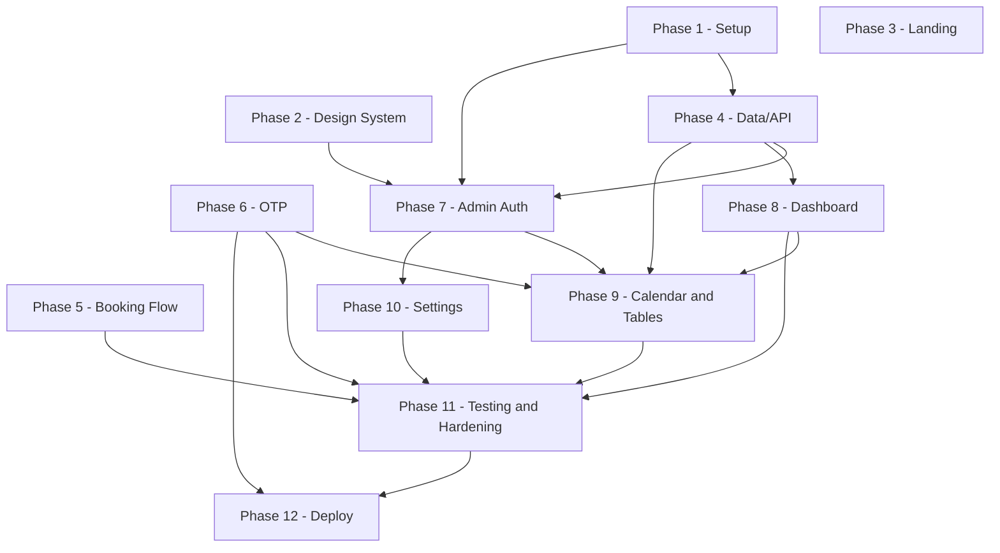

**Parallelism this exposes.** Once Phase 4 (Data/API) and Phase 2 (Design System) are both done,
**Phase 7 (Admin Auth) and Phase 8 (Dashboard) have no edge between them and can run concurrently**
— Phase 8's queries only need the slot/data layer, not the auth layer. Once Phase 7 is done,
**Phase 9 (Calendar and Tables) and Phase 10 (Settings) can also run concurrently** — Phase 9
additionally needs Phase 8 (it reuses the dashboard's date-range picker, `T8.2`), but Phase 10 needs
only Phase 7's admin shell. Phase 11 is a convergence point (it needs 8, 9, and 10 all landed, plus
5 and 6 upstream) and Phase 12 is the final serialization point.

### 12.16 Effort summary

| Phase | Tasks | S/M/L | Rough sessions |
|---|---|---|---|
| 7 - Admin Auth | 7 | 3/4/0 | 5.5 |
| 8 - Dashboard | 7 | 3/3/1 | 6.5 |
| 9 - Calendar and Tables | 7 | 0/4/3 | 10 |
| 10 - Settings | 7 | 4/2/1 | 6 |
| 11 - Testing and Hardening | 9 | 0/6/3 | 12 |
| 12 - Deploy | 8 | 4/4/0 | 6 |
| **Total** | **45** | **14/23/8** | **46** |

"Rough sessions" applies this fragment's own stated weights (S=0.5, M=1, L=2 sessions) to the S/M/L
counts; it is a planning estimate, not a commitment — Phase 9 and Phase 11's L-heavy totals are the
two likeliest places actual effort runs past this number, precisely because an `L` task is already a
signal (per this fragment's complexity-scale note) that it may need splitting once implementation
starts.

#### Contract Challenges

None remaining. The four challenges this fragment previously raised are each resolved by AMENDMENTS
v2: C17's missing `appointments/` enumeration is fixed by A9 (and this fragment already names
`availability.ts`/`hold-expiry.ts`/`transitions.ts`/`reschedule.ts` throughout, per `T9.4`'s files
touched); `C12`'s conflated lockout code is fixed by A4 (`T7.3`/`T7.4` now implement and test
`ACCOUNT_LOCKED` as distinct from `FORBIDDEN`); `C4`'s asymmetric `AuditAction` union is fixed by A1
(`T10.6` now logs `SERVICE_REACTIVATED`, `T7.6` now logs `ADMIN_LOGGED_OUT`); and RATE-9's homeless
spend-ceiling env var is fixed by A7 (`T11.8` now reads the contract-listed `SMS_DAILY_CAP_MINOR`
and `SMS_KILL_SWITCH`, C16).

---

## 13. Risks and Mitigations

This register is deliberately candid: several rows describe things the plan accepts rather than
solves, because solving them is out of scope (C1) or not worth the complexity at single-clinic
scale. "Mitigation" cites what Sections 2-11 already build; "Contingency" is the fallback when the
mitigation isn't enough.

### 13.1 Risk register

| ID | Risk | Category | Likelihood | Impact | Mitigation | Early warning signal | Contingency |
|---|---|---|---|---|---|---|---|
| R-SSG | `/` (SSG) drifts from live `Service` prices after an admin edit | Freshness | Medium | Medium | Build-time read + `revalidatePath('/')` on save (2.3) | "Site still shows old price" | Manual rebuild/redeploy; or short-window ISR (2.3) |
| R-TZ | Wrong-time booking from a local-time bug instead of `fromZonedTime` | Correctness | High | High | `new Date()` ESLint ban (C22); DST tie-break (C6, 6.3); FixedClock DST tests (6.6) | Time complaint on a DST changeover date | Hotfix call site; correct affected rows; phone the patient |
| R-RL | `RATE_LIMIT_PROVIDER=memory` in prod; counters are per-instance | Security | Medium | Medium | DB-backed `OtpChallenge.attempts`/`AdminUser.lockedUntil` back up any limiter choice (C14) | Twilio spend outpacing unique phones/IPs | Flip env var to `upstash`, no redeploy |
| R-SMS | OTP pumping/toll fraud; Twilio deliverability, sender-ID rules, carrier-registration lead times | Financial | Medium | High | Per-phone/IP limits (C14); clinic-wide `otp.send.global` 200/24h + `SMS_DAILY_CAP_MINOR` spend ceiling (A6); 3-resend cap (C10); carrier registration scheduled as a long-lead Phase 1 task (A11); pluggable `SmsProvider` | Spend spike with no matching `CONFIRMED` growth, or the global-ceiling breach logging a `CRITICAL` event | `SMS_KILL_SWITCH=true` halts all sending immediately (A6); held bookings still land as `PENDING_VERIFICATION` for manual confirmation; add destination allow-list |
| R-DBL | Double booking regresses once only the non-atomic UI race test survives in CI | Correctness | Low | High | `slotStartUtc` unique index (C5); 11.5's in-process `Promise.all` is the real proof, not E2 | `11.5` skipped/quarantined in CI | Treat any 11.5 skip as a release blocker |
| R-CONN | Connection exhaustion: unpooled endpoint used, or pooler undersized | Availability | Medium | High | Pooled `DATABASE_URL`; `DIRECT_DATABASE_URL` for migrations only (C23); cached singleton client | `P1017` errors at peak hours | Resize pooler max connections; add a pre-launch load test |
| R-COLD | Cold-start latency hurts perceived speed, though it's outside the measured budget | Performance | Medium | Low | Budget scoped to handler duration only, excludes SMS I/O and cold start, and says so (C23) | "Feels slow" despite logs showing compliance | Minimum-instance warm-up; document the gap |
| R-RESOURCE | Single bookable resource is wrong if the clinic runs two rooms in parallel | Scope | Low | High | `practitionerId`/`resourceId` exist as unimplemented, documented seams (C1) | Stakeholder mentions a second room in UAT | Scope as a new feature (13.2.6), not a flag |
| R-SELFCANCEL | No patient self-cancel (C1: no portal); drives phone load and no-shows | Operational | High | Medium | Staff cancels via `appointments.updateStatus` (cancel transition, Section 5.1); reference+phone finds a booking on a call | Rising cancel-by-phone volume | Add a reference-token self-cancel route (C8) in v1.1 |
| R-REMIND | No automated reminder SMS; brief doesn't request one | Revenue | High | Medium | Confirmation SMS only, at booking time (C9.4); `SmsProvider` is reminder-ready | `NO_SHOW` rate above `CANCELLED` in KPIs (9) | Add a scheduled reminder job post-v1 |
| R-ADMINRESET | No admin password reset; one seeded admin, no recovery path | Operational | Low | Medium | `AdminUser` supports more rows; a second admin can be seeded | Admin locked out; repeated `ADMIN_LOGIN_FAILED` | Direct DB password update by a trusted operator |
| R-JWT | JWT session valid for its full 8h; no server-side revocation list | Security | Low | Medium | `HttpOnly`/`Secure` cookie (C11); `requireAdmin()` re-checks live `isActive`/`lockedUntil` every call | Lost/stolen admin device reported | Set `AdminUser.isActive = false` — next call rejected even with a valid cookie |
| R-OTPLOCK | Poor reception causes repeated OTP failures; attempts/expiry locks the patient out | Accessibility | Medium | Medium | Resend with cooldown, 3 per challenge (C10); clinic phone on every public page | `OTP_MAX_ATTEMPTS`/`OTP_EXPIRED` spikes by region | Staff books by phone with `source: "ADMIN"` (C4) |
| R-GDPR | Phone + name, joined to a `Service.name` that can imply a health condition | Privacy | Medium | High | Minimal fields; 24mo retention (C20); PII-redacting logger (C19); operational DSAR (10) | A patient/regulator data request | Run `scripts/retention.ts --patient-id` for that patient |
| R-LIGHTHOUSE | A later PR adds a third-party script or heavy image, breaking the >=95 floor | Performance | Medium | Medium | Lighthouse CI gate on every PR, `numberOfRuns: 3` + median-score gate to resist run-to-run jitter (A10, C23); 0-script and image budgets stated up front | CI fails the Lighthouse median on an unrelated PR | Revert/defer, or re-budget the allowance explicitly |
| R-TOKENDRIFT | Two parts of the spec invent different names for the same design token, so a later-phase task can't resolve the CSS variable it depends on | Spec consistency | Low | Medium | Single canonical token section is the only place names are declared (C18, Section 8.3.2, A8); a Phase 2 acceptance criterion asserts every canonical variable resolves (e.g. `getComputedStyle` returns a non-empty value for `--chart-1`) before Phase 8 work starts | A Phase 8+ chart task fails because `hsl(var(--chart-1))` resolves to nothing | Add the missing token to Section 8.3.2 and re-run the Phase 2 acceptance check; block the dependent phase from starting until it's green |
| R-SCOPE | Pressure to add multi-doctor, payments, or a patient portal mid-build | Organizational | High | Medium | C1 states exclusions and two concrete seams up front | A "small addition" touching resource model/payments | Log as a scoped v2 proposal; don't fold into this build |
| R-KEYPERSON | Bespoke single-clinic app, one implementer, no handover runbook | Organizational | Medium | High | This plan, the `Clock` seam (C22), and the DST test table (6.6) are the handover artifact | Implementer unavailable when a bug needs a response | Keep PLAN.md, `.env.example`, README current as the handover minimum |
| R-SEEDPROD | `seed.ts` sample data runs against prod, polluting KPI numbers | Data integrity | Low | Medium | `db:seed` is a separate command, never part of `build`/`migrate deploy` | A suspiciously round, seed-like KPI number | Delete seeded rows by a known marker; guard the script on `NODE_ENV` |
| R-SMSSTATUS | Fire-and-forget SMS send (C9.3) hides a real Twilio delivery failure | Reliability | Medium | Low | OTP failure still surfaces at verify; confirmation failure never un-confirms the booking | Delivery mismatch with no in-app signal | Treat `.ics` + on-screen reference as the real confirmation |
| R-DR | No stated backup/restore runbook or RPO/RTO for production Postgres | Availability | Low | High | Managed-Postgres PITR by default; migrations tracked and reproducible (3) | A data-loss incident with no documented recovery step | Treat provider PITR docs as the runbook; add a restore drill before launch |

### 13.2 Top six, expanded

#### 13.2.1 Time zone and DST defects (R-TZ)

Most likely because it's silent: a `Date` built from local wall-clock parts instead of
`fromZonedTime` is wrong by exactly the clinic's UTC offset, with no error. Today: C6 bans local-time
construction, 6.3's `resolveWallTime` picks the earlier instant on an ambiguous fall-back wall time
and drops candidates on a nonexistent spring-forward one, and FixedClock tests pin both cases (6.6).
Accepted gap: the C22 ESLint ban scopes to `src/server/**` and action files, not client components —
a slot label in `time-step.tsx` or FullCalendar's own date handling in `admin-calendar.tsx` can still
trust the browser's local zone instead of `formatInTimeZone`, and nothing lints that. The storage-side
guarantee is solid; the display-side one depends on review discipline that isn't automated yet.

#### 13.2.2 Double-booking escaping to production via test erosion (R-DBL)

The real guarantee is the `slotStartUtc` unique index (C5); 11.5's forced in-process `Promise.all`
on `createBooking` is the only test that actually proves it. `E2`'s Playwright race, by its own
stated caveat, demonstrates graceful UI handling of a near-simultaneous click, not the DB guarantee —
two browser clicks dispatched together land close but not atomically. The risk is organizational:
real-database integration tests are slower and more fragile in CI, which is exactly the profile that
gets `.skip`'d under deadline pressure. If 11.5 goes dark, the suite stays green while a regression in
the unique-index path (a weakened migration, a refactor moving slot inserts out of the transaction)
goes undetected. Nothing in CI config currently makes skipping 11.5 harder than skipping any other
test; making it a non-skippable release gate is a cheap fix not yet written down anywhere.

#### 13.2.3 Per-instance rate limiting on serverless (R-RL)

`MemoryRateLimiter`'s sliding window lives in one instance's memory; Vercel runs many instances
concurrently, each with its own empty map, so a `memory`-configured deployment's real throughput is
closer to (limit) x (instance count) than to the limit — C14 says so outright. Today's backstop:
`OtpChallenge.attempts`/`AdminUser.lockedUntil` are read from Postgres, shared by every instance, so
OTP and login brute force stay bounded at a coarser, per-row granularity even if the limiter is
misconfigured. Accepted gap: that backstop only bites once a specific phone has already been
targeted — OTP pumping against a fresh phone number each time (R-SMS) isn't capped by any DB row,
because a new number means a new, uncounted `OtpChallenge`. There's also no startup check that fails
loudly if `RATE_LIMIT_PROVIDER=memory` reaches a production env; it ships quietly wrong today.

#### 13.2.4 SMS toll fraud, OTP pumping, and Twilio deliverability/regulatory risk (R-SMS)

Every `otp.send` costs money whether or not the booking completes, the one risk with direct financial
exposure if left uncapped. C14's per-phone/IP limits bound cost per key, but a distributed attacker
rotating through many phone numbers and IPs used to defeat that bound entirely — each new number
arrived with a clean counter. A6 closes this: `otp.send.global` (200 sends per rolling 24h,
clinic-wide, independent of key) and `sms.spend.global` (`SMS_DAILY_CAP_MINOR`, a daily spend ceiling
in minor units) cap exposure regardless of how many distinct phones or IPs an attacker burns, and
`SMS_KILL_SWITCH=true` short-circuits all sending immediately for use mid-attack. Honest residual
risk: both ceilings are clinic-wide and blunt — a breach stops sending for every patient, not just the
attacker, until the 24h window rolls over or an operator intervenes; bookings still succeed as
`PENDING_VERIFICATION` so a held slot isn't lost, but confirmation becomes a manual, staff-driven step
until sending resumes. There is still no destination allow-list, so a sustained attacker can hold the
global ceiling pinned at its cap rather than being singled out. Separately, plain deliverability is a
launch risk: alphanumeric sender IDs aren't supported in every country (notably US/Canada), so
`CLINIC_DEFAULT_COUNTRY` may require Messaging Service, toll-free, or 10DLC registration — carrier
review that takes days to weeks and that no engineering effort can compress. A11 schedules this as a
long-lead, non-blocking task in Phase 1 (initiate the Twilio account and A2P registration, record the
expected approval date), with Phase 12's provider switch-over declaring a dependency on it; the
console `SmsProvider` covers all development and testing while approval is pending. Today's mitigation:
the pluggable `SmsProvider` isolates Twilio behind one seam, so swapping configuration or provider
never touches application code.

#### 13.2.5 Prisma connection exhaustion on serverless (R-CONN)

Without a pooled endpoint, each invocation opening its own connection hits `max_connections` under
moderate concurrency — and invocations spike exactly when the clinic is busiest, so the failure lands
as a hard outage at the worst time. Today's mitigation (C23): `DATABASE_URL` is pooled with
`connection_limit=1`; `DIRECT_DATABASE_URL` is unpooled and used only by `prisma migrate deploy` from
CI; the `PrismaClient` singleton is cached on `globalThis` so one warm instance doesn't multiply its
own connections. Accepted gap: `connection_limit=1` per instance means the real ceiling is the
pooler's own configured max versus how many instances Vercel actually spins up under load — that
sizing conversation isn't resolved anywhere in the plan, and Section 11 has no load/soak test that
would surface it before real traffic does. This belongs on a go-live checklist as a number, not an
assumed default.

#### 13.2.6 Single bookable resource as a model risk (R-RESOURCE)

C1 pins one bookable resource, and every slot-engine query (Section 6) is built on that being true.
If the clinic actually runs two rooms or a second practitioner in parallel, the system understates
real capacity: `getAvailableDays` marks a day `FULLY_BOOKED` while a second room sits open, costing
real booking volume. Today: `practitionerId` and a hardcoded `resourceId` exist as documented, unused
seams (C1) — a known deferral, not a surprise. What it would cost to fix: `AppointmentSlot`'s unique
index is on `slotStartUtc` alone (C5), global across the clinic, not per resource. Supporting N
resources means changing that to `@@unique([resourceId, slotStartUtc])` — the core concurrency
guarantee (6.4) — cascading into every slot-engine query, the availability cache keys, the admin
calendar's color-coding, and a backfill migration assigning history to a resource. That is a scoped
feature, estimated like one, not a flag flip because a field name already exists. If the assumption
is wrong, it belongs on Section 1's stakeholder sign-off list before build, not discovered in UAT.

---

## 14. Definition of Done

Every item is a checkbox with a named, independently reproducible verification method — a second engineer, the clinic owner, or a CI job, never the implementer's own say-so. Items point at the test IDs and sections that already define pass/fail (4, 6, 9, 10, 11) rather than restating them.

### 14.1 Functional completeness

#### 14.1.1 Landing page (`/`)
- [ ] All eight brief sections present (Hero+CTA, Services+prices, About, How-It-Works, Testimonials, Hours/Location, FAQ, Footer): screenshot pass against Section 8.1's wireframes.
- [ ] `/` is SSG, zero runtime fetch: `next build` marks `/` static; a network-tab recording shows no XHR/fetch.
- [ ] Rendered service names/durations/prices match the seeded `Service` rows (4.6): diff against the seed table.
- [ ] No horizontal scroll/overlap at 375/768/1440px: Playwright viewport sweep.
- [ ] WCAG 2.1 AA and Lighthouse ≥95 — see 14.4/14.5.

#### 14.1.2 Booking flow (`/book`)
- [ ] Steps 1-5 behave per spec: service required before Next; date step disables past/closed/full days (E8); slots cover all 16 Section 6.6 edge cases (`availability.test.ts`); name/phone pass schema validation; review step gates submit on the confirm checkbox.
- [ ] OTP lifecycle correct: pluggable `SmsProvider`, 5-min expiry, 5-attempt cap, 60s cooldown, 3-resend cap: `otp.test.ts` + E6.
- [ ] Success screen shows the `MB-XXXXXX` reference, a valid `.ics`, and a captured confirmation SMS: E1.
- [ ] A losing concurrent booking gets a graceful `SLOT_TAKEN` recovery, never a crash: E2, plus 14.3 below.
- [ ] UTC storage / clinic-local display correct through both 2026 DST transitions: FixedClock cases, 11.3.1.

#### 14.1.3 Admin area (`/admin/*`)
- [ ] Hashed-password, session-cookie login, rate-limited; every `/admin/*` route redirects when logged out: E3.
- [ ] KPI cards match Section 9.11's exact seed numbers; both charts render the same datasets and respond to the shared date-range filter: E4.
- [ ] Calendar shows day/week/month views, color-coded by status: manual QA screenshots of all three views, plus E7's reschedule check.
- [ ] Appointments table search/filter/pagination and all five actions (confirm/complete/no-show/cancel/reschedule): E7 + component tests (11.4).
- [ ] Patients list (name, phone, visits, spend, last visit) reconciles against 9.11's distinct-phone count: integration test.
- [ ] Settings (hours incl. split shifts, closed dates, slot interval, services CRUD) take effect on the next patient-side read: E8.
- [ ] Currency as configurable integer minor units via `Intl`'s own exponent, never a hardcoded `/100`: `money.test.ts`.

### 14.2 Quality gates
- [ ] `tsc --noEmit` zero errors under `strict` + `noUncheckedIndexedAccess` (C2) — CI `typecheck` green.
- [ ] `eslint --max-warnings=0` clean, including the `no-restricted-syntax`/`no-restricted-paths` rules (2.2/3) — CI `lint` green.
- [ ] Zero `any` in `src/`, enforced by `@typescript-eslint/no-explicit-any: "error"` (assumption: not pinned elsewhere) — same job, plus a `grep ": any"` over `src/` returning nothing.
- [ ] `prettier --check` clean — CI `format` green.
- [ ] Every Section 11.1 per-layer coverage bar met, plus the repo-wide 85% statement floor — Vitest `v8` thresholds in `vitest.config.ts` fail the job otherwise.
- [ ] All nine required status checks (typecheck, lint, format, unit, component, build, integration, e2e, lighthouse — 11.8) green on `main`'s latest commit.

### 14.3 Test evidence
- [ ] All nine E2E scenarios (E1-E9, 11.6) pass on a freshly seeded build — zero failed/flaky specs in the Playwright report.
- [ ] **Double-booking (E2) is not accepted alone** — it proves graceful UX at the browser level, not the DB guarantee (11.6's own caveat). Required too: 11.5's concurrent-`createBooking` test logs a genuine `P2002` on `AppointmentSlot.slotStartUtc` mapped to `SLOT_TAKEN`, not just "one won"; and E2 survives ≥20 repeated runs with zero flakes.
- [ ] **KPI accuracy (E4) is not accepted on matching numbers alone** — a wrong query can cancel out on this one seed. Required too: each KPI query reviewed against its Section 9 definition, filter clause named in the review; and a boundary-mutation check — shift one seeded `startsAtUtc` by ±1 minute across a bucket edge, confirm the KPI moves by exactly that row's amount.
- [ ] **`ACCOUNT_LOCKED` and `FORBIDDEN` are not accepted as a shared code path** — a login attempt against a temporarily locked (`lockedUntil` in the future) but active account must assert `error.code === 'ACCOUNT_LOCKED'`, and a login attempt against an inactive (`isActive = false`) or insufficient-role account must assert `error.code === 'FORBIDDEN'`, both asserted by code in the same test file, not distinguished only by message text: `auth.test.ts` + E3.
- [ ] Every `ErrorCode` in C12 has a triggering test somewhere in the suite; no Server Action throws uncaught in any suite.

### 14.4 Performance
- [ ] Lighthouse ≥95 — the median of `numberOfRuns: 3`, never a single run (A10) — in Performance, Accessibility, Best Practices, and SEO on `/`, on `lighthouserc.json`'s default throttled-mobile run: CI `lighthouse` artifact (11.7).
- [ ] Zero third-party scripts, ≤90KB gzipped JS on `/`: Lighthouse CI's budget assertion plus `next build`'s printed First Load JS.
- [ ] Booking-path p95 observed under a scripted load test against a deployed Preview on production's pooled-Postgres topology (2.6): `getSlots` <120ms, `booking.create` <250ms, `otp.verify` <150ms, dashboard aggregate <400ms (C23): the load tool's own percentile report.

### 14.5 Accessibility
- [ ] WCAG 2.1 AA; axe zero `serious`/`critical` violations on every route in Section 3, mobile and desktop: E9.
- [ ] Full booking flow completable keyboard-only, no mouse: E9.
- [ ] Contrast audit (Section 8.3.4) committed, every pair in use PASS at 4.5:1 normal / 3:1 large-or-non-text (C18): diff against 8.3's token list.
- [ ] Every canonical CSS variable required by Section 8.3.2's token set (`background` through `radius`, including `primary-button`, `primary-button-hover`, and `chart-1`-`chart-5`) resolves to a non-empty computed value in BOTH the light and the `.dark` theme — closing the missing `--chart-1` defect found in review: a Playwright check that reads `getComputedStyle` for every token name in both themes and fails on any empty string.
- [ ] Visible focus indicator on every interactive element, never suppressed: E9 plus code review confirming no rule removes `:focus-visible`.
- [ ] `prefers-reduced-motion: reduce` zeroes the booking wizard's transition durations: Playwright `emulateMedia` test.

### 14.6 Security and privacy
- [ ] Every control row across Section 10.1-10.10 shows `Status: Done`, each confirmed by that row's own named method: a pass through the 10.x tables, no "Planned" left.
- [ ] `.env.example` matches C16's variable list exactly, no values; no secret ever committed: diff against C16 plus `git log --all -p -- .env*` (CFG-1/2).
- [ ] All six security headers present in production: `curl -I` against the live domain (HDR-1..6).
- [ ] A log sample reviewed line-by-line against C19/LOG-2's banned-field list: reviewer sign-off naming sample window and row count.
- [ ] `scripts/retention.ts` run against a seeded non-prod branch, output matches Section 4.7/10.9 exactly: before/after row diff.
- [ ] Rate limits demonstrated live, not just unit-asserted: the 61st read in a minute, the 6th login failure, the 4th resend, the 201st OTP send inside a rolling 24h window (`otp.send.global`'s 200 ceiling), and a breach of `SMS_DAILY_CAP_MINOR` (`sms.spend.global`) each trip their code against a running deployment, and setting `SMS_KILL_SWITCH=true` is proven to short-circuit all sending immediately: `ratelimit.test.ts` + E3/E6.
- [ ] `POST /api/test/reset` is absent from a production build: a security-suite test builds with `NODE_ENV=production` and without `E2E_TEST_HOOKS=true` set, then asserts the route 404s.

### 14.7 Data and operations
- [ ] `prisma migrate deploy` applies cleanly from an empty Postgres schema: proven by every CI `integration`/`e2e` run doing exactly this (11.8).
- [ ] `pnpm prisma db seed` run twice is byte-identical: checksum diff across two consecutive runs (4.6).
- [ ] Both crons registered and firing once post-deploy: Vercel Cron `*/5 * * * *` → `expire-holds`; GitHub Actions retention workflow: a real invocation in the function log, and a green scheduled (not manual) Actions run (2.6).
- [ ] Backups/restore tested, closing R-DR (13.1): PITR enabled (provider dashboard) and a restore drill performed on a non-prod branch: one known row's value compared before and after.
- [ ] Monitoring/alerting live: an uptime monitor on `GET /api/health` with ≥1 recorded success; the SMS spend kill switch (RATE-9) fire-tested in staging: monitor dashboard, alert transport receipt.

### 14.8 Documentation and handover
- [ ] README quickstart: clone to a running `pnpm dev` session rendering `/` in under 15 minutes: timed dry run by someone who didn't write the code.
- [ ] `docs/PLAN.md` amended to match what was actually built: PR review against the Contract Challenges collected across Sections 1-13.
- [ ] Admin runbook covers daily workflow plus named failure modes (locked-out login, AUTHN-7; OTP-stuck patient, R-OTPLOCK; undelivered SMS, R-SMSSTATUS): clinic-staff dry run, unassisted.
- [ ] Rollback procedure documented and rehearsed (`vercel rollback` plus a migration-compatibility check): a staging rehearsal.
- [ ] Every open question OQ1-OQ15 (Section 1.4) carries a stakeholder-confirmed answer or an explicit "shipping on default" note, zero blanks: line-by-line review.

### 14.9 Sign-off
- [ ] Clinic owner signs functional acceptance (14.1 complete) after a live walkthrough of one full booking and one full admin session: dated signature.
- [ ] Engineer signs quality gates (14.2-14.7 complete): dated signature or signed checklist attached to the release commit.
- [ ] Go-live checklist, each line initialed immediately before launch: domain live (closes OQ13); every C16 var set in Production; seed never run against prod (R-SEEDPROD); A2P carrier registration (10DLC/toll-free verification, initiated in Phase 1 per A11) confirmed APPROVED before switch-over; `SMS_PROVIDER=twilio` with live credentials; seeded admin password changed from its default; Lighthouse and E2E green on the exact deployed commit; PITR enabled; uptime monitor live.

